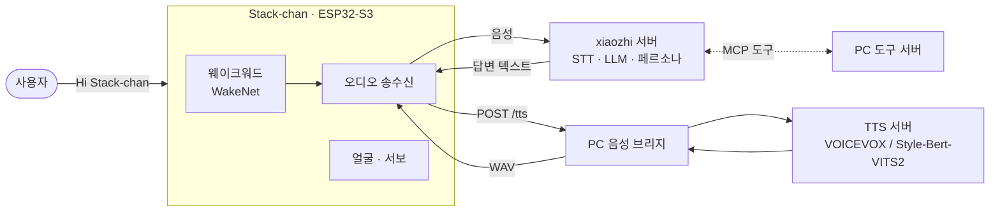

책상 위에 [Stack-chan](https://github.com/stack-chan/stack-chan)(M5Stack CoreS3 기반 소형 로봇)을 두고, 블루 아카이브의 케이 목소리와 성격으로 말하게 만들고 있습니다.
이 글은 그 과정에서 펌웨어를 고치며 부딪힌 문제 세 가지를 정리한 기록입니다.

## 전체 구조

로봇에는 M5Stack 공식 StackChan 펌웨어(오픈소스 음성 비서 [xiaozhi-esp32](https://github.com/78/xiaozhi-esp32) v2.2.4 기반)가 올라가 있습니다.
음성 인식과 LLM 대화는 xiaozhi 서버가 맡고, **음성 합성만 PC로 돌렸습니다.** 원하는 목소리를 쓰려면 직접 학습한 TTS 모델을 PC에서 돌려야 하기 때문입니다.



- **펌웨어 수정**(ESP-IDF 5.5): 서버가 보낸 음성 대신, 답변 텍스트를 PC 브리지에 `POST /tts`로 보내 받은 WAV를 재생합니다. 얼굴도 케이 스킨으로 바꿨습니다.
- **PC 음성 브리지**(Python): TTS 엔진 전환, 캐릭터 말투 후처리를 맡습니다. 예를 들어 서버가 일정 시간 뒤 스스로 보내는 "잘 자요" 인사를 사용자가 잠든다고 말하지 않았다면 캐릭터 대사로 바꿉니다. 이를 위해 펌웨어가 요청마다 `X-Turn`(턴 번호)과 `X-User-Text`(그 턴의 STT 결과) 헤더를 붙이게 했습니다.
- 펌웨어를 다시 굽지 않고 말투를 바꿀 수 있도록, 펌웨어에 박힌 대사도 브리지에서 덮어씁니다.

## 문제 1. 대답이 사라진다: 내부 RAM 18KB

### 증상

가끔 로봇이 70초 동안 "말하는 중" 상태로 멈추거나, 대답을 소리 없이 넘겼습니다.
PC 브리지 로그로는 요청을 0.5초 만에 정상 응답했는데, 펌웨어 쪽에는 이런 로그가 남았습니다.

```text
HttpClient: Wait for HTTP headers receive timeout
EspTcp: Failed to wait for receive task exit
```

### 원인

펌웨어는 10초마다 `SystemInfo: free sram: N minimal sram: M`을 찍습니다. 이 값을 먼저 봤어야 했습니다.

| 상태 | 내부 SRAM 여유 |
|---|---|
| 런처 화면 | 약 135 KB |
| AI 에이전트 모드 | **18~23 KB** |
| 최저 기록 | 3.7 KB (한 번은 55 B) |

ESP32-S3는 PSRAM이 8MB나 있지만, 태스크 스택이나 DMA 버퍼는 기본적으로 **내부 SRAM**(수백 KB)에 잡힙니다.
그런데 LAN HTTP 요청마다 HTTP 클라이언트가 수신용 FreeRTOS 태스크(`tcp_receive`, 스택 4KB)를 `xTaskCreate`로 새로 만들고, **반환값을 확인하지 않았습니다.**
메모리가 모자라 태스크 생성이 실패하면 요청은 나가고 PC도 응답하지만, 응답을 읽을 태스크가 없어 타임아웃이 납니다.

### 시도와 해결

1. ❌ Wi-Fi/LWIP 버퍼를 PSRAM으로 옮기기(`CONFIG_SPIRAM_TRY_ALLOCATE_WIFI_LWIP`): 여유 RAM이 오히려 16KB로 줄고, 오디오 링버퍼가 1,300번 넘쳤습니다. 되돌렸습니다.
2. ✅ 큰 태스크 하나를 PSRAM으로 옮기기: Opus 코덱 태스크의 스택 24KB를 `xTaskCreatePinnedToCoreWithCaps(..., MALLOC_CAP_SPIRAM)`로 PSRAM에 잡았습니다. 이 태스크는 DMA를 쓰지 않아서 가능했습니다.
3. ✅ LAN HTTP 요청을 뮤텍스로 한 번에 하나만 보내게 했습니다. 얼굴 추적 기능의 요청도 같은 뮤텍스를 씁니다.
4. ✅ 요청이 실패하면 내부 RAM 여유와 최대 연속 블록 크기를 로그로 남기고, 그 턴의 나머지 문장은 건너뛰어 70초 정지를 막았습니다.

> 임베디드에서 "가끔 응답이 없다"는 증상이 보이면 네트워크보다 **힙 여유와 태스크 생성 실패**를 먼저 봅니다.
{: .prompt-tip }

## 문제 2. "케이짱"이라고 부르고 싶었다

기본 웨이크워드는 ESP-SR의 WakeNet 모델 "Hi Stack-chan"입니다.
이를 「ケイちゃん」(케이짱)으로 바꾸려고 명령어 인식 모델인 MultiNet을 써 봤습니다.

| 시도 | 결과 |
|---|---|
| `mn7_cn` (중국어 병음) | "kei"가 병음 음절표에 없어 등록 거부. "gei chan"으로 등록은 됐지만 반응하지 않음 |
| `mn7_en` (영어, `KAY CHAN`) | 모델이 4MB assets 파티션에 안 들어가 파티션 테이블을 바꿈. 그런데 대기 중 재생이 3~5배 느려지고 로봇이 스스로 꺼짐 |

결국 원래 WakeNet으로 되돌렸습니다.
다음에 다시 한다면 TTS로 "케이짱" 합성 샘플을 대량으로 만들고 제 녹음 수십 개를 섞어 [microWakeWord](https://github.com/kahrendt/microWakeWord) 같은 수십 KB짜리 전용 모델을 학습하는 쪽이 현실적입니다.

부수적으로 얻은 것: xiaozhi의 assets 빌드 스크립트(`build_default_assets.py`)가 sdkconfig를 Windows 기본 인코딩으로 읽어 일본어 명령어가 깨지길래 UTF-8로 읽게 고쳤습니다.

## 문제 3. 로봇이 혼자 꺼진다

### 단서: PMIC가 남긴 꺼짐 원인

말하면서 고개를 움직이는 순간, USB를 연결해 놓았는데도 전원이 꺼졌습니다.
CoreS3의 전원 관리 칩 AXP2101은 마지막으로 꺼진 원인을 레지스터 `0x21`에 남깁니다.
ESP32만 리셋되는 재부팅(펌웨어 플래시 등)에서는 이 값이 유지되므로, 부팅 직후 읽어 로그로 찍게 했습니다.

| `off_src` (0x21) | 의미 | 상황 |
|---|---|---|
| `0x20` | DCDC 저전압 | 인사·혼잣말 재생 + 머리 움직임 중 |
| `0x08` | VSYS 저전압 (< 2.6 V) | AI 모드 시작, USB 분리, 소리 없이 움직일 때 |

### 소프트웨어로 버티기 (그리고 되돌리기)

- DCDC 저전압 차단 끄기(REG `0x23`): `0x20`으로 꺼지는 건 줄었지만 `0x08`(VSYS)로 꺼지는 게 남았습니다.
- 서보 S-커브 가속: 기본 서보 제어는 임계감쇠 스프링 모델이라 **움직임 시작 순간 가속도가 최대**입니다. 시작 전류 피크를 줄이려고 최대 속도와 가속도를 제한한 S-커브 궤적으로 바꿨습니다.

그래도 USB를 뽑는 순간 화면이 깜빡이며 꺼지는 문제가 계속돼서, 원인을 확실히 찾을 때까지 이 수정들은 모두 되돌렸습니다.
보호 기능을 끄는 건 원인을 가리는 일이기도 합니다.

### 회로도 읽기

공식 회로도(Power 보드, Adapter 보드)를 보니 전류 경로는 이렇습니다.

```text
550mAh 셀 ─ CON3(1.25mm 2핀) ─ 보호 IC(FH9261)+FET ─ 7선 하네스(1.25mm) ─ Power 보드
   └ 10mΩ 션트(INA226) ─ BAT+ ─┬─ M5-Bus → AXP2101 (본체 전원)
                               └─ TPS61088 부스트 → 서보 5V
```

**서보 전류 전부가 가는 1.25mm 하네스의 BAT+ 선 하나와 GND 선 하나를 지납니다.**
50ms 간격으로 전압을 찍어 보니, 전류가 0.3 A 정도일 때 BAT+가 3.16~3.30 V까지 떨어졌습니다.
배터리 전압이 4.1 V인 상태에서 이 정도면 경로 저항이 약 3 Ω이라는 뜻이고, 정상(수십 mΩ)보다 훨씬 큽니다.
그래서 원인은 Power 보드 앞단, 즉 셀 자체, CON3 커넥터, 보호 FET, 하네스 중 하나로 좁혀졌습니다.

현재는 커넥터를 다시 꽂고 배터리 부풀음을 확인하는 단계이고, 안 되면 배터리를 교체할 예정입니다. 그동안은 5 V 2 A 어댑터를 씁니다(PC USB 포트는 4.40 V까지 처졌습니다).

> 전원 문제는 펌웨어에서 증상을 숨길 수는 있어도 고칠 수는 없습니다. PMIC의 꺼짐 원인 레지스터와 회로도부터 봅니다.
{: .prompt-warning }

## 그 밖의 메모

- Windows 11의 **스마트 앱 컨트롤**이 서명 없는 실행 파일을 막습니다(오류 4551). ESP-IDF 툴체인의 `xtensa-esp-elf-ranlib.exe`가 한 번 막혔다가 다시 빌드하니 통과했습니다. Python 가상환경도 서명된 python.org 인터프리터로 만들어야 안전합니다.
- 공식 펌웨어 소스를 고칠 때는 수정 전 파일을 `.bak_before_*`로 남겨 두니, 이번처럼 기능 하나만 되돌릴 때 편했습니다.

TTS 모델 쪽 이야기는 [한국어 TTS 학습기](/posts/korean-tts-attention-sink/)에 따로 정리했습니다.
