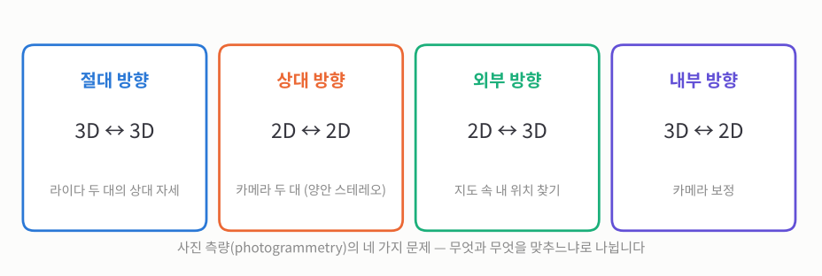
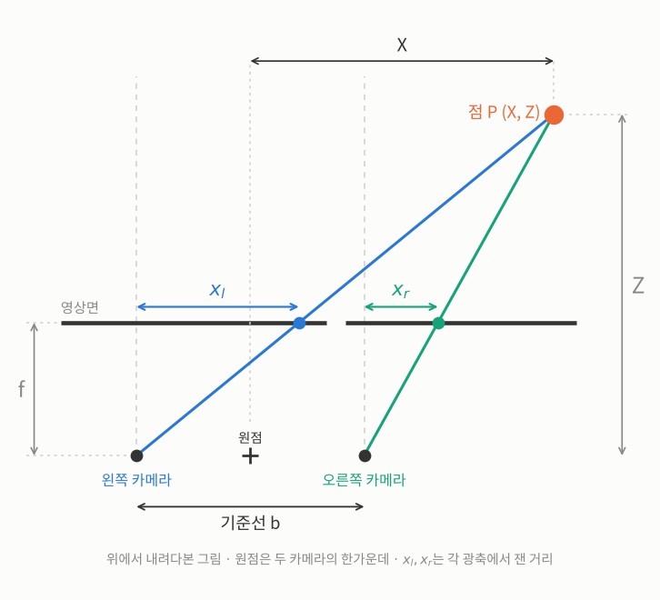
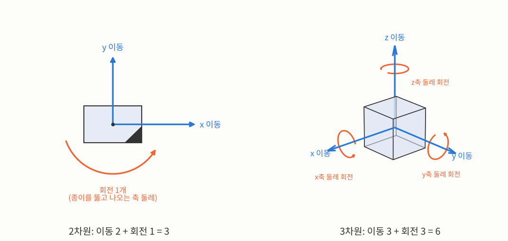
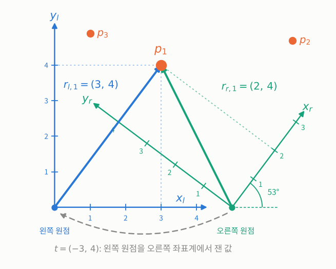
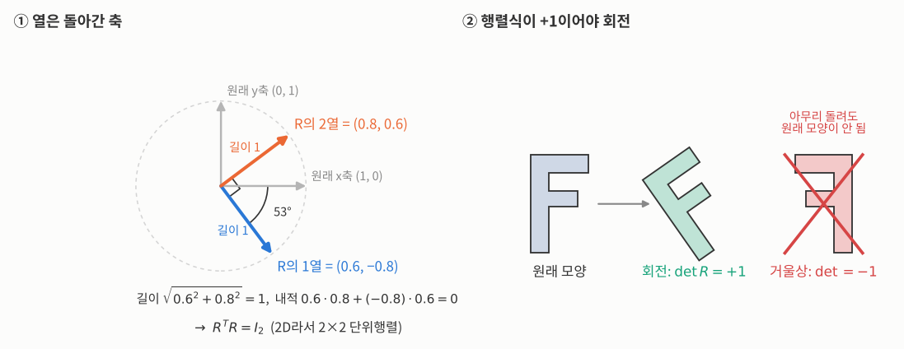
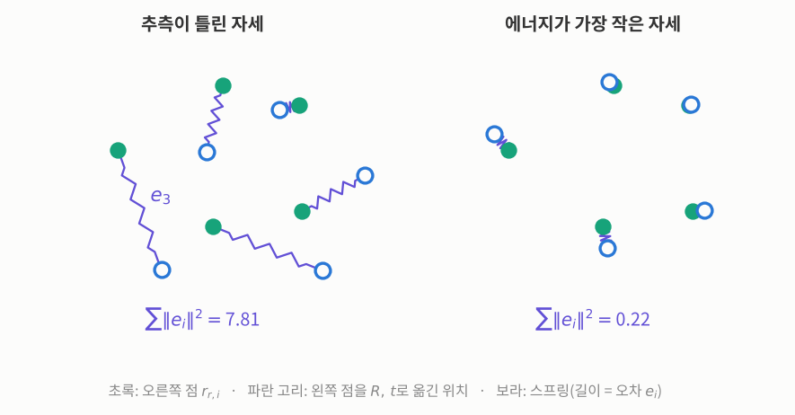
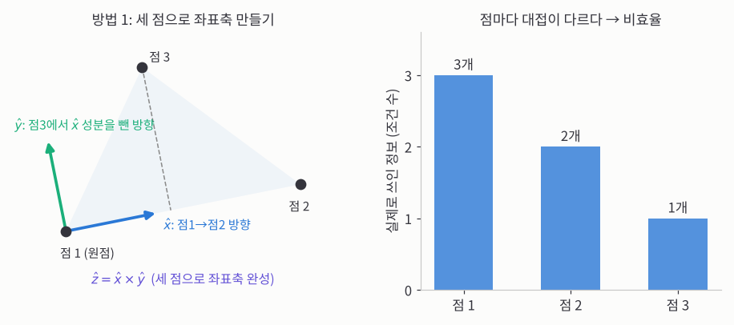
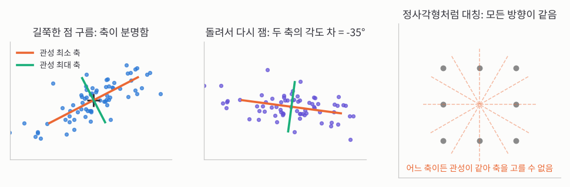
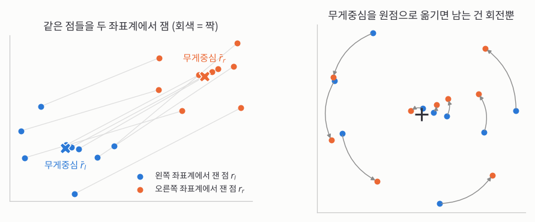


_MIT OpenCourseWare 6.801 17강 원본 영상 (영어). 아래 소제목은 영상의 챕터와 같은 순서이고, ▶ 링크를 누르면 그 장면부터 재생됩니다._

> **한 줄 요약:** 같은 점들을 서로 다른 두 기준(좌표계)에서 따로 쟀다면, 그 숫자들만 보고 두 기준 사이의 **회전과 이동**을 거꾸로 찾을 수 있습니다. 무게중심끼리 먼저 맞추면 이동이 따로 떨어져 나가니까, 남는 회전 3개만 찾으면 됩니다.
{: .prompt-info }

## 1. 사진 측량 소개

_▶ [0:00부터 보기](https://www.youtube.com/watch?v=R8O0vlHBeNc&t=0s) · Introduction to photogrammetry_

**지금까지 찾은 경계와 점을 이제 "재는 데" 쓰니까, 주제가 사진 처리에서 사진 측량으로 넘어갑니다.**

16강까지는 밝기 값을 다루고, 특정한 특징(특히 경계)을 정밀하게 찾는 **저수준** 처리였습니다. 교수님은 눈에 띄는 점을 찾는 이야기도 더 할 수 있지만, 이제 그렇게 찾은 정보로 **무언가를 해내는** 단계로 넘어가자고 합니다. 그 첫 주제가 **사진 측량**(photogrammetry)이고, 이름은 "측정"과 "그림"을 뜻하는 두 말이 합쳐진 것입니다.

## 2. 사진으로 재기

_▶ [0:56부터 보기](https://www.youtube.com/watch?v=R8O0vlHBeNc&t=56s) · Measuring from images_

**사진 측량은 무엇과 무엇을 맞추느냐로 나뉘니까, 고전 문제 네 가지만 알면 전체 지도가 그려집니다.**

말 그대로 **사진으로 재는** 일입니다. 사진이 발명된 직후, 사람들은 사진으로 지도를 만들 수 있다는 걸 알아챘습니다. 당시 유행하던 열기구에 사람을 태워 올려 보내 사진을 찍었고, 땅이 평평하고 카메라가 똑바로 아래를 보면 그 사진이 거의 그대로 지도가 됐습니다. 땅이 울퉁불퉁하면 여러 장을 찍어 3D 지형을 되살릴 수 있었습니다.

사진 측량에는 고전 문제가 네 가지 있고, 머신비전은 나중에 이것들을 다른 이름으로 다시 발명했습니다. 아래에서 3D는 센서로 잰 공간 좌표, 2D는 사진 속 위치입니다.

_네 가지 고전 문제입니다. 이번 강의와 다음 두 강의는 첫 번째, 절대 방향을 다룹니다._

이 챕터에서는 앞의 두 문제를 소개합니다.

- **절대 방향**(3D↔3D): 자율주행차에 레이저 센서가 두 대 달려 있으면, 두 센서의 측정을 합쳐 3D 정보를 얻기 **전에**, 한 센서 좌표계에서 다른 센서 좌표계로 가는 변환부터 알아야 합니다. 거꾸로 좌표계는 하나인데 물체가 둘이거나 물체가 움직인 경우, 움직이기 전과 후의 관계를 찾는 것도 사실상 같은 문제입니다. 3D↔3D부터 다루는 이유는 **반복 없이 식 한 번으로 답이 나오기**(닫힌 해) 때문입니다.
- **상대 방향**(2D↔2D): 머신비전이 더 자주 만나는 건 사실 이쪽입니다. 카메라 두 대로 사진 두 장을 찍어 세 번째 차원(깊이)을 되살리는 양안 스테레오가 대표적입니다. 여기에도 일이 두 가지 있습니다. 사진 두 장에서 3D를 되살리는 일, 그리고 그 전에 두 카메라가 공간에서 어디에 어떻게 돌아가 있는지 맞추는 일입니다.

## 3. 방향 찾기 문제들

_▶ [5:26부터 보기](https://www.youtube.com/watch?v=R8O0vlHBeNc&t=326s) · Orientation problems_

**네 문제 모두 결국 "어떻게 돌아가 있나"를 묻기 때문에, 이 강의 내내 회전 이야기가 계속 나옵니다.**

나머지 두 문제입니다.

- **외부 방향**(2D↔3D): 사진 한 장과, 보고 있는 대상의 3D 모델이 있을 때 **내가 어디에서 어느 방향을 보고 있는지** 찾습니다. 지도가 있는 지역 위를 나는 드론이 사진만 보고 자기 위치를 찾는 경우, 우주선이 별을 보고 자기가 공간에서 얼마나 돌아가 있는지 찾는 경우가 예입니다.
- **내부 방향**(3D↔2D): 외부·내부는 카메라를 기준으로 한 말이라, 내부 방향은 곧 **카메라 보정**입니다. 렌즈는 정해진 초점거리로 만들고, 금속 몸체가 렌즈에 대해 영상의 위치를 잡아 주지만, 몸체가 설계 그대로 만들어지는 일은 없습니다. 그래서 정밀하게 재려면 카메라의 실제 성질부터 알아내야 합니다. 앞에서 본 **주점**(principal point) 찾기가 내부 방향의 한 가지입니다.

## 4. 항공 사진 측량의 역사

_▶ [7:34부터 보기](https://www.youtube.com/watch?v=R8O0vlHBeNc&t=454s) · Aerial photogrammetry history_

**사람의 눈과 뇌가 사진 두 장을 겹쳐 높이를 느끼니까, 옛날에는 사람이 직접 등고선을 따라 그렸습니다.**

사진 측량의 원래 쓰임새는 **지형도 만들기**였습니다.

1. 비행기가 미리 정한 경로를 날며 일정한 간격으로 사진을 찍습니다.
2. 작업자가 쌍안경처럼 생긴 기구를 들여다보는데, 양쪽 눈에 이웃한 사진 두 장이 하나씩 보입니다. 그러면 눈과 뇌가 알아서 두 장을 겹쳐 각 지점의 높이를 느낍니다.
3. 두 사진에 인공 점을 하나씩 넣어 두면, 두 점의 위치에 따라 그 점이 떠 보이는 높이가 정해집니다. 작업자는 이 점을 눈에 보이는 땅 표면에 맞춰 놓고, 그 높이를 유지한 채 움직여 **등고선**을 그립니다.

지금은 이 일을 영상끼리의 상관(correlation)으로 자동으로 합니다. 다만 그 전에 두 카메라가 서로 어떻게 놓여 있는지를 먼저 알아야 합니다.

사진 측량에서 일어나는 일을 아주 간단한 예로 보기 위해, 교수님은 사람이 깊이를 느끼는 단서부터 꺼냅니다. 사람은 깊이 단서를 적어도 열두 가지쯤 쓰고, 앞에서 본 명암과 명암으로 모양 알기도 그중 하나입니다.

## 5. 양안 스테레오의 기하

_▶ [9:40부터 보기](https://www.youtube.com/watch?v=R8O0vlHBeNc&t=580s) · Binocular stereo geometry_

**두 눈에 보이는 위치 차이는 가까울수록 크니까, 그 차이만 재면 거리가 나옵니다.**

길 가는 사람에게 어떻게 입체를 보냐고 물으면 대개 "눈이 두 개라서"라고 답합니다. 사람들이 그렇게 생각한다는 점에서 중요한 단서이지만, 꼭 **가장** 중요한 단서는 아니라고 교수님은 덧붙입니다.

손가락 하나를 눈앞 20 cm쯤에 세우고 왼쪽 눈과 오른쪽 눈을 번갈아 감아 보면, 손가락이 뒤 배경에 대해 좌우로 툭툭 튑니다. 팔 길이만큼 멀리 두면 훨씬 덜 튑니다. 눈이 하나뿐이면 점이 보이는 **방향**은 알아도 **거리**는 모릅니다. 가까운 작은 물체와 먼 큰 물체가 똑같이 보이기 때문입니다. 두 번째 눈(렌즈)이 이 모호함을 풀어 줍니다.

### 아주 단순한 경우

두 카메라의 광축(렌즈 중심에서 카메라 정면으로 뻗은 선)이 서로 **나란하고**, 두 카메라를 잇는 선(기준선)에 **수직**이며, 초점거리도 같은 경우만 봅니다. 실제로는 이렇게 완벽히 맞추기가 거의 불가능합니다. Draper 연구소의 Sutro라는 연구자는 화성 탐사 로봇이 실제로 생기기 한참 전부터 탐사 로봇용 스테레오를 오래 연구했는데, 교수님 말로는 "끝내 성공하지 못했다"고 할 만큼 정렬을 맞추기가 어렵습니다. 그래서 나중에는 두 카메라가 실제로 어떻게 놓여 있는지를 **알아내는** 방법을 배웁니다.

기호를 정하겠습니다.

- $$b$$: 두 카메라 사이의 거리, **기준선**(baseline)입니다.
- $$f$$: 렌즈 중심에서 영상면까지의 거리입니다. 교수님 말처럼 엄밀히는 초점거리(focal length)보다 조금 깁니다.
- $$(X, Z)$$: 점 P의 실제 위치입니다. $$X$$는 **가로(좌우)** 위치, $$Z$$는 카메라가 바라보는 **앞쪽 거리(깊이)**입니다. 칠판에 수직인 세로 방향 $$Y$$는 덜 중요해서 뺍니다.
- $$x_l, x_r$$: 점 P가 왼쪽(left)·오른쪽(right) 사진에 찍힌 가로 위치입니다. 사진 속 위치라서 소문자로 쓰고, 각 카메라의 광축에서 잽니다.

원점은 **두 렌즈의 한가운데**에 둡니다. 그러면 각 렌즈는 원점에서 $$b/2$$씩 떨어집니다.

_카메라 두 대를 위에서 내려다본 그림입니다. 가로가 $$X$$, 위쪽이 $$Z$$(카메라가 바라보는 앞쪽)이고, 세로 방향 $$Y$$는 종이를 뚫고 나오는 방향이라 보이지 않습니다. 회색 점선이 각 카메라의 광축이고, 점 P가 두 영상면에 찍힌 위치를 각자의 광축에서 잰 값이 $$x_l$$(파랑), $$x_r$$(초록)입니다._

각 카메라에서 닮은 삼각형을 쓰면 됩니다. 다만 $$X$$는 가운데 원점에서 잰 값이라, 왼쪽 렌즈에서 잰 거리로 바꾸려면 기준선의 절반을 더하고, 오른쪽 렌즈에서 잰 거리로 바꾸려면 뺍니다.

$$
\frac{x_l}{f} = \frac{X + b/2}{Z}, \qquad \frac{x_r}{f} = \frac{X - b/2}{Z}
$$

식 둘에 미지수 둘($$X, Z$$)이니 풀립니다. 두 사진을 겹쳐 놓았을 때 점 위치가 어긋난 정도를 **시차**(disparity)라 하고 $$d = x_l - x_r$$로 쓰면,

$$
d = x_l - x_r = \frac{bf}{Z} \quad\Longrightarrow\quad Z = \frac{bf}{d}, \qquad X = \frac{b}{2}\,\frac{x_l + x_r}{d}
$$

깊이는 시차에 **반비례**합니다. 가로 위치 $$X$$는 두 사진 위치의 평균($$x_l + x_r$$) 쪽에서 나옵니다. 세로 $$Y$$도 같은 방식으로 쉽게 나옵니다.

### 멀수록 부정확하다

**멀리 있을수록 시차가 작아지니까, 시차를 조금만 잘못 재도 거리는 크게 틀립니다.**

**손으로 계산해 보면:** 기준선 $$b = 12$$ cm, $$f = 800$$픽셀인 카메라 쌍이 시차 $$d = 64$$픽셀을 쟀다면 $$Z = 12 \times 800 / 64 = 150$$ cm입니다. 시차를 1픽셀 틀렸을 때를 거리별로 비교해 봅시다.

| 실제 거리 | 시차 $$d$$ | 시차를 1픽셀 틀리면 | 거리 오차 |
|---|---|---|---|
| 150 cm | 64픽셀 | 63 또는 65 → 152.4 cm 또는 147.7 cm | 약 ±2.4 cm |
| 300 cm | 32픽셀 | 31 또는 33 → 309.7 cm 또는 290.9 cm | 약 ±9.5 cm |

거리가 2배가 되자 오차는 약 4배가 됐습니다.

**기준선이나 초점거리를 키우면 시차가 커지니까 더 정확해집니다.** 하지만 제약이 있습니다. 자율주행차라면 두 카메라를 앞유리 양 끝에 다는 대신 **백미러 뒤에 숨을 만큼** 가까이 붙이고 싶습니다. 둘을 멀리 떨어뜨리면 차를 타는 동안 정렬이 계속 유지될 리 없어서, 두 좌표계의 관계를 자동으로 다시 찾는 방법이 필요해집니다.

아래 데모에서 점을 멀리 보내 보면 시차가 줄고, 1픽셀 오차일 때의 거리 범위(주황 띠)가 길어지는 게 보입니다.

처음 상태(기준선 12 cm, 거리 150 cm)의 범위는 148~152 cm이고, 점을 300 cm로 보내면 291~310 cm로 늘어납니다. 기준선을 36 cm로 늘리면 같은 300 cm에서도 297~303 cm로 다시 줄어듭니다.

교수님은 이것이 실제로 믿고 쓸 수 없는 **아주 특수한 경우**라고 강조합니다.

## 6. 절대 방향 문제

_▶ [16:58부터 보기](https://www.youtube.com/watch?v=R8O0vlHBeNc&t=1018s) · Absolute orientation problem_

**센서를 대충 맞춰 달아도 그 관계는 믿을 수 없으니까, 측정한 점들로 관계를 직접 찾아야 합니다.**

두 카메라가 똑같지 않고, 서로 돌아가 있고, 기준선이 광축에 수직이 아니면 어떻게 보정할까요? 이건 나중 강의의 주제입니다. 지금은 바로 첫 번째 문제, **절대 방향**으로 들어갑니다.

대표적인 예는 **라이다 두 대**입니다. 라이다는 레이저로 거리를 재서 3D 좌표를 바로 주는 영상 장치이고, 두 대의 정보를 합쳐 자율주행차 주변의 모습을 만듭니다. 그러려면 두 라이다 좌표계의 관계가 필요한데, 적당히 맞춰 달았더라도 그걸 믿을 수는 없습니다. 항공 사진은 더 심합니다. 두 사진을 찍는 위치가 단단한 몸체로 이어져 있지 않고, 조종사가 높이를 일정하게 지키려 해도 공기가 고르지 않아 비행기의 자세가 계속 바뀌기 때문입니다.

여기서는 **같은 점을 이미 찾았다**고 가정합니다. 앞에서 배운 정밀한 경계도 입력이 될 수 있고, 눈에 띄는 점을 찾는 방법도 있습니다. SIFT가 그 예인데, 교수님은 David Lowe의 논문이 "조금 난해하다"고 하고, 특허가 나온 뒤로 계산은 훨씬 빠르지만 덜 정확할 수 있는 변형이 많이 나왔다고 합니다. 어쨌든 점을 찾고 **다른 사진에서 다시 찾는 짝짓기 문제는 제쳐 두고**, 두 좌표계에서 잰 좌표 묶음이 주어졌을 때 무엇을 할지만 봅니다.

## 7. 3D 좌표 변환

_▶ [20:20부터 보기](https://www.youtube.com/watch?v=R8O0vlHBeNc&t=1220s) · 3D coordinate transformation_

**두 3D 좌표계의 관계는 회전과 이동뿐이니까, 숫자 6개만 찾으면 됩니다.**

교수님은 두 좌표계를 **왼쪽·오른쪽**이라고 부릅니다. 양안 스테레오가 큰 응용이라 붙인 이름일 뿐이고, 차가 사진을 찍고 움직인 뒤 또 찍었다면 "움직이기 전·후"여도 됩니다.

기호를 정합니다.

- $$i$$: 점의 번호입니다. 점은 하나로는 부족하니 번호를 붙이고, 모두 $$N$$개라 하겠습니다.
- $$p_i$$: 주변에 있는 $$i$$번째 점(point) 자체입니다.
- $$r_{l,i}$$, $$r_{r,i}$$: 점 $$p_i$$를 왼쪽·오른쪽 좌표계에서 잰 3D 좌표(원점에서 점까지 가는 화살표, 위치 벡터)입니다. 위치 벡터는 물리에서 흔히 $$r$$로 씁니다.

여기에도 쌍대성이 있습니다. 물체 하나를 두 좌표계에서 재든, 물체 둘을 한 좌표계에서 재든 같은 문제입니다. 카메라가 움직였는지 물체가 움직였는지는 상관없고, 방향의 **부호만 뒤집힐** 수 있어 조심하면 됩니다.

두 좌표계가 어디 있는지 **안다면** 아주 행복합니다. 각 카메라에서 점 쪽으로 광선을 쏘아 두 광선이 만나는 곳이 점 $$p_i$$입니다. 실제로는 두 광선이 딱 만나지 않으니, 둘 사이가 가장 가까운 곳(두 광선에 모두 수직인 선분)을 찾습니다. 하지만 그러려면 먼저 **두 좌표계의 관계**를 알아야 하고, 지금 푸는 게 바로 그것입니다.

3D 좌표계끼리의 관계는 **회전**과 **이동**입니다. 이동은 3개, 회전도 3개라 모두 6개입니다. 교수님은 회전이 3개인 게 조금 놀랍다고 합니다. "3D니까 3개지"라고 생각하기 쉽지만, 2D 회전은 2개가 아니라 1개이고, 4D는 6개입니다. 공간의 차원 수를 $$n$$이라 하면 회전의 자유도(독립적으로 바꿀 수 있는 숫자의 개수)는 $$n$$이 아니라 $$n(n-1)/2$$입니다. 3D에서 마침 $$3 \cdot 2 / 2 = 3$$이 되는 건 **"운 좋은 우연"**이고, 그 때문에 회전이 실제보다 단순해 보이는 착각이 생깁니다.

_왼쪽: 2D에서는 $$x, y$$ 방향 이동 2개와, 종이를 뚫고 나오는 축 둘레 회전 1개입니다. 오른쪽: 3D에서는 $$x, y, z$$ 방향 이동 3개(파랑)와 $$x, y, z$$축 둘레 회전 3개(주황)입니다._

## 8. 식으로 쓰기

_▶ [23:49부터 보기](https://www.youtube.com/watch?v=R8O0vlHBeNc&t=1429s) · Mathematical representation_

**모든 점에 같은 회전과 같은 이동이 적용되니까, 식 하나로 모든 점을 묶을 수 있습니다.**

회전을 $$R$$(Rotation), 이동을 $$t$$(translation)로 쓰면(교수님은 이동을 $$r_0$$로 쓰지만, 이 글에서는 $$t$$로 씁니다), 점 번호 $$i$$를 생략하고

$$
r_r = R(r_l) + t
$$

이동 $$t$$는 모든 점에 똑같이 적용되는 고정된 값입니다. $$R(r_l)$$은 "$$r_l$$을 $$R$$만큼 돌린 벡터"라는 뜻인데, 교수님은 일부러 괄호를 씁니다. 괄호 없이 $$R\,r_l$$로 쓰면 3×3 행렬에 벡터를 곱한다고 생각하게 되는데, 회전을 꼭 직교 행렬로 나타내지는 않겠다는 뜻입니다. 다른 표현을 쓸 것이고, 그 이유는 곧 나옵니다.

이런 식은 두 방향으로 쓰입니다. $$R$$과 $$t$$를 **알면** $$r_l$$을 넣어 $$r_r$$을 계산하면 되니 쉽습니다. 우리 문제는 반대입니다. 두 좌표계에서 잰 $$(r_l, r_r)$$ 쌍들을 알고, $$R$$과 $$t$$를 **찾아야** 합니다.

_위에서 내려다본 2D 예입니다(3D도 원리는 같습니다). 파란 축 $$x_l, y_l$$이 왼쪽 좌표계, 초록 축 $$x_r, y_r$$이 오른쪽 좌표계입니다. 같은 점 $$p_1$$이 파란 눈금으로는 $$(3, 4)$$, 초록 눈금으로는 $$(2, 4)$$로 읽힙니다. 회색 점선 화살표가 $$t$$입니다._

**숫자로 확인해 보면:** 그림의 초록 축 $$x_r, y_r$$은 파란 축 $$x_l, y_l$$을 반시계로 약 53° 돌려 놓은 것입니다($$\cos 53^\circ \approx 0.6$$, $$\sin 53^\circ \approx 0.8$$). 3D로 보면 종이를 뚫고 나오는 $$z$$축 둘레로 돈 것입니다. 오른쪽 원점은 왼쪽 좌표로 $$(5, 0)$$에 있습니다. 이때

$$
R = \begin{pmatrix} 0.6 & 0.8 \\ -0.8 & 0.6 \end{pmatrix}, \qquad t = \begin{pmatrix} -3 \\ 4 \end{pmatrix}
$$

이고, $$r_{l,1} = (3, 4)$$를 넣으면

$$
R\,r_{l,1} = (0.6 \cdot 3 + 0.8 \cdot 4,\; -0.8 \cdot 3 + 0.6 \cdot 4) = (5,\, 0), \qquad R\,r_{l,1} + t = (2,\, 4) = r_{r,1}
$$

으로 초록 눈금으로 읽은 값과 같습니다.

- 초록 축은 **반시계**로 53° 돌았는데 $$R$$은 **시계 방향** 53° 회전입니다. 고개를 왼쪽으로 돌리면 앞의 물건이 오른쪽으로 가 보이는 것과 같습니다.
- 왼쪽 원점 $$r_l = (0, 0)$$을 넣으면 $$r_r = t$$입니다. 즉 $$t$$는 **왼쪽 원점을 오른쪽 좌표계에서 잰 위치**이고, 오른쪽 원점의 위치 $$(5, 0)$$과는 다릅니다.

## 9. 회전 행렬의 조건

_▶ [25:32부터 보기](https://www.youtube.com/watch?v=R8O0vlHBeNc&t=1532s) · Rotation matrix constraints_

**3×3 행렬은 숫자가 9개인데 조건 6개가 묶여 있으니까, 회전은 3개만 자유롭습니다. 여기에 거울상을 막는 조건이 하나 더 붙습니다.**

회전을 3×3 행렬로 나타내면 **직교 정규**(orthonormal)여야 합니다. 행끼리의 내적은 0, 행과 자기 자신의 내적은 1이라는 뜻입니다. 이걸 짧게 쓰면, $$R$$의 행과 열을 바꾼 행렬(전치)을 $$R^T$$, 대각선만 1인 3×3 단위행렬을 $$I_3$$이라 할 때

$$
R^T R = I_3
$$

입니다. 열을 벡터로 보면, 열끼리 서로 수직이고 길이가 1이라는 뜻입니다. 열이 이 성질을 가지면 행도 가진다는 것도 증명할 수 있어서, $$R R^T = I_3$$으로 써도 같습니다.

그런데 이상합니다. 3×3 행렬 = 3×3 행렬이면 식이 9개입니다. 숫자 9개에서 조건 9개를 빼면 자유도가 하나도 안 남습니다. 비밀은 $$R^T R$$이 **대칭** 행렬이라는 데 있습니다. $$(j, k)$$ 칸과 $$(k, j)$$ 칸이 같은 내적이라, 독립인 조건은 대각선 3개와 위쪽 삼각형 3개, 모두 **6개**입니다. $$9 - 6 = 3$$, 자유도 3입니다.

이 조건이 왜 "회전답다"는 뜻인지 숫자로 보면 쉽습니다. 앞의 숫자 예 $$R$$에 원래 $$x$$축 방향 $$(1, 0)$$을 곱하면 첫 열 $$(0.6, -0.8)$$이, $$y$$축 방향 $$(0, 1)$$을 곱하면 둘째 열 $$(0.8, 0.6)$$이 나옵니다. **각 열은 원래 축이 돌아간 뒤 가리키는 방향**입니다. 그러니 길이 1은 "축이 늘거나 줄지 않는다", 서로 수직은 "축 사이 직각이 그대로다"라는 뜻입니다.

| 행렬 | 열 | 정사각형이 어떻게 되나 |
|---|---|---|
| $$\begin{pmatrix}2&0\\0&1\end{pmatrix}$$ | $$(2, 0)$$의 길이가 2 | 가로로 2배 늘어남 |
| $$\begin{pmatrix}1&1\\0&1\end{pmatrix}$$ | $$(1, 0)$$과 $$(1, 1)$$이 수직이 아님 | 평행사변형으로 찌그러짐 |
| $$\begin{pmatrix}0.6&0.8\\-0.8&0.6\end{pmatrix}$$ | 길이 1, 서로 수직 | 모양 그대로 돌아감 |

보통은 여기서 멈추지만, 교수님은 **조건이 하나 더** 필요하다고 합니다. 이 조건은 어떤 값을 맞추는 식이 아니라 정보 **1비트**짜리입니다. 예를 들어 $$z$$ 방향만 뒤집는 대각 행렬 $$\mathrm{diag}(1, 1, -1)$$은 전치해도 자기 자신이고, 자기와 곱하면 단위행렬이라 첫 조건을 지킵니다. 하지만 회전이 아니라 **거울상**입니다. 교수님의 비유로는, 바닥에 비친 사람(발이 위로 간 모습)의 왼손은 내 오른손에 해당하는데, 나를 어떻게 돌려도 그 사람이 될 수는 없습니다. 왼손을 오른손으로 바꾸는 건 회전으로는 안 되고 반사로는 쉽습니다. 이 반사를 막는 조건이 **행렬식**(determinant)이 $$+1$$이라는 조건, $$\det R = +1$$입니다.

_① 숫자 예의 $$R$$: 1열 $$(0.6, -0.8)$$과 2열 $$(0.8, 0.6)$$은 원래 $$x$$축 $$(1, 0)$$과 $$y$$축 $$(0, 1)$$을 시계 방향으로 53° 돌린 것이라 길이가 1이고 서로 수직입니다. 2D 예라서 단위행렬도 2×2인 $$I_2$$입니다. ② 행렬식이 $$-1$$인 행렬은 거울상을 만들어, 아무리 돌려도 원래 모양과 겹치지 않습니다._

숫자로 확인하면 두 열의 길이는 $$\sqrt{0.6^2 + 0.8^2} = 1$$, 내적은 $$0.6 \cdot 0.8 + (-0.8) \cdot 0.6 = 0$$, 행렬식은 $$0.6 \cdot 0.6 - 0.8 \cdot (-0.8) = 1$$입니다. 두 조건을 모두 지키는 3×3 행렬의 모임을 $$SO(3)$$(Special Orthogonal, 3차원)라고 부릅니다.

문제는 최소제곱처럼 오차를 줄여 답을 찾을 때, 직교 정규 조건에 더해 이 행렬식 조건까지 **억지로 지켜야** 한다는 점입니다. 교수님은 "귀찮게도" 그렇고 어렵다며, 그래서 직교 행렬은 앞으로 별로 쓰지 않겠다고 합니다.

## 10. 최소제곱 오차 모형

_▶ [29:13부터 보기](https://www.youtube.com/watch?v=R8O0vlHBeNc&t=1753s) · Least squares error model_

**짝지은 점끼리 스프링으로 묶으면 물체가 에너지가 가장 작은 자세로 가니까, 그 자세가 곧 오차 제곱합이 가장 작은 답입니다.**

덤으로 하나: $$R^T R = I_3$$이라는 건 **회전 행렬의 역행렬이 그냥 전치**라는 뜻이라, 역행렬을 구하기가 아주 쉽습니다.

이제 물리적인 그림으로 생각해 봅시다. 왼쪽 좌표계에서 얻은 점 구름(point cloud, 점들의 모음)과 오른쪽 좌표계에서 얻은 점 구름을 **최대한 잘 겹치고** 싶습니다. 왼쪽 점 하나를 변환해 옮긴 위치와, 그 짝인 오른쪽 점 사이의 거리를 가능한 한 짧게 만들고 싶은 것입니다. 이 둘을 **스프링**으로 연결했다고 생각하면 됩니다.

교수님은 이 거리를 **오차**(error)라서 $$e$$라고 부릅니다. 훅의 법칙에 따라 스프링이 당기는 힘은 원래 길이에서 늘어난 만큼에 비례하고, 스프링의 **자연 길이를 0**이라 하면 늘어난 길이가 곧 $$e$$입니다. 에너지는 그 힘을 적분한 것이라, 스프링의 단단한 정도(용수철 상수)를 $$k$$라 하면

$$
E = \tfrac{1}{2} k e^2
$$

이렇게 묶인 물리계는 스스로 움직여 **에너지가 가장 작아지는** 자세로 갑니다. 모든 스프링의 $$k$$가 같으면, 에너지 합이 가장 작은 자세는 곧 오차 제곱합이 가장 작은 자세입니다. 그래서 이 문제를 최소제곱으로 풀 수 있습니다.

_초록 점이 오른쪽에서 잰 점, 파란 고리가 왼쪽에서 잰 점을 옮긴 위치, 보라 지그재그가 스프링입니다. 왼쪽: 자세를 잘못 추측하면 스프링이 길게 늘어나 오차 제곱합이 7.81입니다. 오른쪽: 에너지가 가장 작은 자세에서는 0.22로 줄어듭니다. 0이 안 되는 것은 잡음 때문입니다._

## 11. 오차를 줄이는 식

_▶ [31:23부터 보기](https://www.youtube.com/watch?v=R8O0vlHBeNc&t=1883s) · Error minimization formula_

**왼쪽을 오른쪽으로 옮겨 비교하는 식은 한쪽 편을 드니까, 반대로 풀어도 정확히 역변환이 나오는지 꼭 확인해야 합니다.**

$$i$$번째 점의 오차는, 왼쪽 점을 돌리고 옮겨 오른쪽 좌표계로 가져온 다음 오른쪽에서 잰 값과 비교한 차이입니다. 맞는 답이라면 둘이 같아야 합니다.

$$
e_i = r_{r,i} - \left( R(r_{l,i}) + t \right), \qquad \min_{R,\, t} \sum_{i=1}^{N} \|e_i\|^2
$$

$$\|e_i\|$$는 벡터의 길이, $$\sum_{i=1}^{N}$$은 1번부터 $$N$$번 점까지 더하라는 뜻이고, $$\min_{R,\,t}$$는 손댈 수 있는 두 가지, $$R$$과 $$t$$를 바꿔 가며 합을 가장 작게 하라는 뜻입니다.

그런데 이 식에는 **겉보기 편향**이 있습니다. 두 좌표계 중 하나를 다르게 대합니다. 왜 한 좌표계가 우선이어야 할까요? 그래서 다 풀고 나면, 오른쪽에서 왼쪽으로 가는 변환을 구했을 때 그것이 처음 구한 변환의 **정확한 역**인지 확인해야 합니다. 아니라면 뭔가 잘못된 겁니다.

교수님은 직선 맞추기를 예로 듭니다. 기울기 $$m$$, $$y$$절편 $$c$$인 $$y = mx + c$$를 최소제곱으로 맞추면 "$$x$$에는 오차가 없고 오차는 모두 $$y$$에 있다"고 가정하는 셈입니다. 하지만 사진 속 위치의 오차는 $$x$$, $$y$$ 모두에 있습니다. 마찬가지로 여기서도 대칭성을 지키는 방법을 쓸 것이고, 위 식에서는 그 대칭성이 바로 보이지 않으니 확인이 필요합니다.

정리하면, 보통은 $$R$$과 $$t$$를 알고 $$r_l$$을 넣어 $$r_r$$을 얻는 앞 방향으로 이 식을 씁니다. 여기서는 짝지은 측정값들로 변환을 거꾸로 찾습니다.

## 12. 대응 문제

_▶ [34:03부터 보기](https://www.youtube.com/watch?v=R8O0vlHBeNc&t=2043s) · Correspondence problem_

**이동과 회전을 떼어 놓으면 한 번에 3개씩만 다루면 되니까 문제가 훨씬 단순해집니다.**

보통의 문제에서는 변환을 알고, 점끼리 어느 것이 짝인지(대응)를 모릅니다. 여기서는 **정반대**로, 짝지은 점의 좌표를 알고 변환을 모릅니다.

이걸 푸는 방법은 여럿 있고, 교수님이 다루는 방법은 모두 **이동 찾기와 회전 찾기를 떼어 놓는** 접근을 씁니다. 그러면 매번 자유도 3개만 다루면 됩니다. 한 가지 방법은 각 점 구름에서 **기준점**을 하나씩 골라 출발하는 것입니다.

## 13. 점 구름(point cloud)에서 세 점으로 좌표축 세우기

_▶ [35:01부터 보기](https://www.youtube.com/watch?v=R8O0vlHBeNc&t=2101s) · Building coordinate bases_

**점 세 개로 원점·축 하나·평면 하나를 정하면, 서로 수직인 새 좌표축이 저절로 생깁니다.**

왼쪽 점들로 좌표계를 하나 세워 봅시다. 글자 위의 모자(^)는 길이가 1인 **단위 벡터**라는 표시입니다.

_왼쪽: 세 점으로 새 축 $$\hat{x}, \hat{y}, \hat{z}$$를 세우는 과정입니다. 오른쪽: 점 1은 위치 전체(숫자 3개)가, 점 2는 방향(2개)만, 점 3은 평면의 기울기(1개)만 쓰입니다(16번 챕터에서 다룹니다)._

1. 3D 정보를 가지고 있는 점 1을 골라 **원점**으로 선언합니다.
2. 두 번째 점과 선으로 이으면 그게 축 하나가 됩니다. 1과 2 사이 거리는 1이 아니니, 차이 벡터를 그대로 쓰지 않고 길이 1로 줄입니다.

   $$
   x_l = r_{l,2} - r_{l,1}, \qquad \hat{x}_l = \frac{x_l}{\|x_l\|}
   $$

3. 세 번째 점도 **원점인 점 1에서** 잇습니다. 하지만 점 1→점 3 화살표 $$r_{l,3} - r_{l,1}$$을 그대로 새 좌표계의 $$y$$축으로 쓰면 $$x$$축과 수직이 아닙니다. 이 화살표는 세 점이 놓인 평면 안에 있어서 $$x$$ 방향 부분과 $$y$$ 방향 부분으로만 이루어져 있습니다. 그러니 $$\hat{x}_l$$ 방향으로 뻗은 부분을 빼면 **$$y$$ 방향만 남습니다**. 남은 화살표를 $$y_l$$로 씁니다(아직 길이가 1이 아닌 $$y$$축 방향 벡터라서 모자가 없습니다). 즉 **세 점이 놓인 평면이 새 좌표계의 $$xy$$평면**이 됩니다. 빼 줄 부분은 화살표와 $$\hat{x}_l$$의 내적(화살표가 $$\hat{x}_l$$ 방향으로 뻗은 길이, 숫자 하나)에 $$\hat{x}_l$$을 곱해서 구합니다.

   $$
   y_l = (r_{l,3} - r_{l,1}) - \big((r_{l,3} - r_{l,1}) \cdot \hat{x}_l\big)\,\hat{x}_l, \qquad \hat{y}_l = \frac{y_l}{\|y_l\|}
   $$

$$y_l$$과 $$x_l$$의 내적을 계산해 보면 0이 나와서 수직임을 쉽게 확인할 수 있습니다. 이제 원점, $$x$$축, $$xy$$평면이 생겼습니다.

## 14. 두 점 구름(point cloud) 사이의 변환

_▶ [38:51부터 보기](https://www.youtube.com/watch?v=R8O0vlHBeNc&t=2331s) · Point cloud transformation_

**한 점을 원점으로 잡으면 이동이 사라지니까, 양쪽 축 묶음을 맞추는 회전만 남습니다.**

여기서 "점"은 물체에서 찾아 잰 눈에 띄는 점들입니다. 경계는 3D 위치를 완전히 정해 주지 못하니 **모서리** 같은 점이어야 합니다. 보정용 물체가 정육면체라면 꼭짓점들, 사람 머리라면 눈동자 위치 같은 것입니다. 중요한 건 이 점들을 **양쪽 좌표계 모두에서** 쟀다는 것입니다.

4. 마지막 축은 외적으로 만듭니다. 외적은 두 벡터 모두에 수직이니 $$\hat{z}_l = \hat{x}_l \times \hat{y}_l$$은 $$\hat{x}_l$$, $$\hat{y}_l$$ 모두에 수직입니다.

이제 서로 수직인 단위 벡터 셋(triad)으로 왼쪽 좌표계를 세웠고, 점은 **세 개만** 필요했습니다. 오른쪽 좌표계에서도 같은 세 점으로 똑같이 해서 $$\hat{x}_r, \hat{y}_r, \hat{z}_r$$을 얻습니다.

이제 "할 일"은 이 단위 벡터들끼리 맞추는 것뿐입니다. 한 점을 원점으로 골라 이동을 인위적으로 없앴으니, 지금은 회전만 생각하면 됩니다.

$$
\hat{x}_r = R(\hat{x}_l), \qquad \hat{y}_r = R(\hat{y}_l), \qquad \hat{z}_r = R(\hat{z}_l)
$$

첫 줄만으로는 $$R$$이 정해지지 않습니다. 한 벡터를 다른 벡터로 돌리는 방법은 그 벡터 둘레로 얼마나 더 도느냐에 따라 무수히 많기 때문입니다.

## 15. 회전 행렬 구하기

_▶ [42:25부터 보기](https://www.youtube.com/watch?v=R8O0vlHBeNc&t=2545s) · Solving for rotation matrix_

**세 축을 열로 나란히 세우면 식 세 개가 행렬 식 하나로 합쳐지니까, 역행렬 한 번으로 $$R$$이 나옵니다.**

세 벡터를 열로 나란히 세우면 3×3 행렬이 되고, 세 식은 이 한 식과 같습니다. 행렬에 첫 열을 곱하면 첫 식이 나오는 식이기 때문입니다.

$$
\begin{pmatrix} \hat{x}_r & \hat{y}_r & \hat{z}_r \end{pmatrix} = R \begin{pmatrix} \hat{x}_l & \hat{y}_l & \hat{z}_l \end{pmatrix}
\;\Longrightarrow\;
R = \begin{pmatrix} \hat{x}_r & \hat{y}_r & \hat{z}_r \end{pmatrix}\begin{pmatrix} \hat{x}_l & \hat{y}_l & \hat{z}_l \end{pmatrix}^{-1}
$$

양변의 오른쪽에 왼쪽 행렬의 역행렬을 곱하면, 그 행렬이 자기 역행렬과 만나 단위행렬이 되어 사라집니다. 역행렬은 언제나 있을까요? 세 열이 일부러 서로 수직이 되게 만들었으니 있습니다. 열들이 서로 기대는(선형 종속) 최악의 경우와 정반대인, 가장 이상적인 경우입니다. 이렇게 문제가 풀렸습니다.

## 16. 즉석 방법의 한계

_▶ [44:50부터 보기](https://www.youtube.com/watch?v=R8O0vlHBeNc&t=2690s) · Limitations of ad hoc methods_

**세 점의 정보를 3·2·1개씩만 쓰고 나머지는 버리니까, 어느 점을 먼저 고르느냐에 따라 답이 달라집니다.**

이동을 빼면 찾을 것은 3개이고, 짝은 3개입니다. 딱 맞아 보이지만, 짝 하나는 "숫자 = 숫자"가 아니라 "벡터 = 벡터"라 조건 3개짜리입니다. 3D에서 점 하나를 못 박으려면 숫자 3개가 필요하니까요($$x, y, z$$든, 와이파이 공유기 세 대까지의 거리든). 그러면 조건은 9개인데 회전은 3개뿐입니다. 그럼 두 점으로 충분할까요? 두 점으로는 $$x$$축만 정해지고 그 둘레로 여전히 돌 수 있으니, 세 점이 다 필요합니다.

비밀은 **받은 정보를 다 쓰지 않는다**는 데 있습니다.

| 점 | 쓰인 정보 | 조건 수 |
|---|---|---|
| 점 1 | 원점이라 세 성분 모두 | 3 |
| 점 2 | 1→2의 **방향**만 (거리는 버림) | 2 |
| 점 3 | 평면이 $$\hat{x}$$축 둘레로 얼마나 기울었나 | 1 |

합 $$3 + 2 + 1 = 6$$은 이동 3까지 포함한 숫자입니다. 점마다 대접이 다르니 이상합니다. 어느 점이 더 중요하다고 누가 정했나요? (측정이 특히 확실한 점에 가중치를 줄 수는 있지만 그건 다른 이야기입니다.) 게다가 점 순서를 바꿔 다른 점을 점 1로 고르면, 버리는 정보가 달라지니 **다른 답**이 나옵니다.

실제로는 짝을 셋보다 훨씬 많이 잽니다. 라이다 두 대는 점을 수백 개씩 주고, 모두 오차가 있습니다. 점이 많으면 최소제곱처럼 모든 짝을 쓰는 방법이 정확도를 크게 높이는데, 이 방법은 세 점만 씁니다. 세 점씩 여러 번 골라 평균을 내면 낫긴 하지만, 교수님 표현으로 "땜질"입니다.

## 17. 첫 추측용 방법

_▶ [49:11부터 보기](https://www.youtube.com/watch?v=R8O0vlHBeNc&t=2951s) · Initial guess methods_

**빠르지만 거친 방법이라도 첫 추측으로 쓰면, 정밀한 방법이 그 근처에서 출발할 수 있습니다.**

방법 1은 대략적인 답이나 **첫 추측**이 필요할 때 쓸 만합니다. PatQuick으로 빠른 근사 답을 얻고 그걸 PatMax의 출발점으로 쓰던 것과 같은 구조입니다.

이제 방법 2입니다. 2D에서 잠깐 다뤘던 것을 떠올려 봅시다. 이진 영상의 덩어리를 알아보거나 맞추려고, **관성 축**을 구했습니다. 이진 영상 대신 점 구름이어도 똑같이 할 수 있습니다. 관성은 각 점에서 축까지 **거리의 제곱**에 질량을 곱해 적분(더)한 값입니다. 덩어리가 길쭉하게 뻗은 방향의 축은 점들이 축 가까이 있어 거리가 짧으니 관성이 작고, 그와 직각인 축은 먼 점이 많아 관성이 큽니다. 두 축은 서로 직각이고, 2×2 행렬의 고유값·고유벡터로 구할 수 있었습니다.

## 18. 관성 축 방법

_▶ [51:30부터 보기](https://www.youtube.com/watch?v=R8O0vlHBeNc&t=3090s) · Axes of inertia method_

**점 구름의 관성 축은 점 구름에 붙어 다니니까, 양쪽에서 관성 축을 찾아 맞추면 회전이 나옵니다.**

같은 생각을 3D로 넓힙니다. 왼쪽 데이터와 오른쪽 데이터에 각각 좌표계를 세우면, 두 좌표계를 맞추기만 하면 된다는 걸 방법 1에서 봤습니다. 이번에는 좌표계를 관성 축으로 세웁니다.

3D에서도 관성이 가장 작은 축과, 그에 수직인 가장 큰 축이 있습니다. 다른 점은 **세 번째 축**이 있다는 것입니다. 이 축은 **안장점**입니다. 축을 한 방향으로 기울이면 관성이 2차식으로 커지고, 그와 직각인 방향으로 기울이면 2차식으로 작아집니다. 교수님은 "그리기 어렵다"면서 그 모양을 손으로 보여 줍니다. 계산은 어렵지 않으니 해 봅시다.

## 19. 축까지 거리 식

_▶ [53:50부터 보기](https://www.youtube.com/watch?v=R8O0vlHBeNc&t=3230s) · Distance from axis formula_

**원점을 무게중심에 두면 이동을 따로 떼어 낼 수 있으니까, 축의 방향만 찾으면 됩니다.**

관성에는 각 점에서 축까지의 거리가 들어가니, 그 식부터 필요합니다. 교수님은 "조금 반칙"을 합니다. **무게중심을 원점**으로 잡는 것입니다. 이것도 이동 찾기와 회전 찾기를 떼어 놓는 같은 요령이고, 2D에서도 관성 축은 무게중심을 지났습니다.

기호를 정합니다.

- $$r$$: 무게중심에서 잰 한 점의 위치 벡터입니다.
- $$\hat{\omega}$$: 축의 방향(단위 벡터)입니다. $$\omega$$(오메가)는 회전축에 흔히 쓰는 글자입니다.
- $$r'$$: 점 $$r$$에서 축에 수선을 내린 발입니다. $$r$$을 축 방향으로 사영한 것이라 $$r' = (r \cdot \hat{\omega})\,\hat{\omega}$$입니다.

구하려는 거리는 $$r$$과 $$r'$$ 사이, 즉 $$\|r - r'\|$$입니다. 교수님은 "이 대수는 다시 쓰지 않으니 너무 걱정하지 말되, 따라는 와 보라"고 합니다.

## 20. 관성 행렬 유도

_▶ [56:32부터 보기](https://www.youtube.com/watch?v=R8O0vlHBeNc&t=3392s) · Inertia matrix derivation_

**거리 제곱을 정리하면 축 방향 $$\hat{\omega}$$를 행렬로 감싼 꼴이 되니까, 점들만으로 행렬 하나를 미리 계산해 두면 됩니다.**

거리의 제곱을 펼치면 $$r \cdot r - 2(r \cdot \hat{\omega})^2 + (r \cdot \hat{\omega})^2(\hat{\omega} \cdot \hat{\omega})$$이고, $$\hat{\omega}$$는 단위 벡터라 $$\hat{\omega} \cdot \hat{\omega} = 1$$입니다. 정리하면

$$
\|r - r'\|^2 = r \cdot r - (r \cdot \hat{\omega})^2
$$

"전체 길이² − 축 방향 성분²"이라는 피타고라스 정리 그대로입니다. 이제 $$\hat{\omega}$$를 바꿀 때 이 값이 어떻게 변하는지가 궁금합니다. 다루기 좋게 고쳐 씁니다.

- 내적은 순서를 바꿔도 같으니 $$(r \cdot \hat{\omega})^2 = \hat{\omega}^T (r\,r^T)\,\hat{\omega}$$로 쓸 수 있습니다. $$r\,r^T$$는 열벡터와 행벡터를 곱한 3×3 행렬(dyadic product)입니다.
- 앞에서 버렸던 $$\hat{\omega} \cdot \hat{\omega} = 1$$을 다시 끼워 넣으면 $$r \cdot r = \hat{\omega}^T (r \cdot r)\, I_3\, \hat{\omega}$$입니다.

관성은 이 거리 제곱을 모든 점에 대해 더한(연속 물체라면 적분한) 값입니다. 교수님은 관성을 칠판용 굵은 글씨 $$\mathbb{I}$$로 써서 단위행렬 $$I_3$$과 헷갈리지 않게 합니다.

$$
\mathbb{I}(\hat{\omega}) = \sum_i \left( r_i \cdot r_i - (r_i \cdot \hat{\omega})^2 \right) = \hat{\omega}^T \underbrace{\left( \sum_i (r_i \cdot r_i) I_3 - r_i r_i^T \right)}_{A} \hat{\omega}
$$

가운데 행렬의 첫 부분은 단위행렬에 숫자를 곱한 것이고, 둘째 부분은 dyadic product의 합입니다. 교수님은 "I를 쓸 수 있는 글씨체가 다 떨어져서" 이 행렬을 $$A$$라고 부릅니다.

## 21. 축을 찾는 고유값 문제

_▶ [1:01:02부터 보기](https://www.youtube.com/watch?v=R8O0vlHBeNc&t=3662s) · Eigenvalue problem for axes_

**관성이 가장 작은 축은 $$A$$의 가장 작은 고유값의 고유벡터이니까, 3×3 고유값 문제 하나로 세 축이 한꺼번에 나옵니다.**

$$A$$는 이름은 A지만 **관성 행렬**이라 부르고, 3D 모양이나 점 구름만 있으면 계산할 수 있습니다. $$\hat{\omega}^T A\, \hat{\omega}$$를 가장 작게 하는 $$\hat{\omega}$$를 찾는 건 고전적인 **고유값·고유벡터 문제**입니다.

- 가장 작은 고유값의 고유벡터 → 관성이 가장 작은 축
- 가장 큰 고유값의 고유벡터 → 관성이 가장 큰 축
- 가운데 고유값의 고유벡터 → 그 사이의 안장점 축

세 축은 서로 직각입니다(고약한 경우에는 아닐 수 있지만, 그때는 직각이 되게 고르면 됩니다). 3×3 고유값 문제는 손으로 풀던 2×2보다 품이 들지만 도구가 많고, **3차 방정식에도 근의 공식**이 있어서 닫힌 꼴로 풀립니다. 사람들이 2차 공식만 기억할 뿐입니다.

이렇게 왼쪽 점 구름에 분포만으로 서로 직각인 축 세 개를 세우고, 오른쪽 점 구름에도 똑같이 합니다. 길쭉한 점 구름이라면 $$x$$축이 그 길이 방향으로 놓이는 식입니다. 그다음은 방법 1과 같은 방식으로 두 좌표계를 맞춥니다. 두 좌표계를 맞추는 문제와 물체의 두 위치를 맞추는 문제는 쌍대라 둘 다 이렇게 풉니다.

이 방법이 더 그럴듯한 이유는 **모든 점을 똑같이 대접하고**(모두 합에 들어감), **모든 점을 쓰고**, 일종의 최소제곱을 풀기 때문입니다. 그럼 왜 널리 쓰지 않을까요? 극저온 전자현미경(cryo-EM) 영상을 맞추는 것처럼 잘 통하는 문제도 있지만, 늘 이상적이지는 않습니다.

## 22. 대칭과 실패하는 경우

_▶ [1:05:05부터 보기](https://www.youtube.com/watch?v=R8O0vlHBeNc&t=3905s) · Symmetry and failure cases_

**관성 축 방법은 짝 정보를 쓰지 않으니까, 대칭인 물체 앞에서는 축을 고르지 못합니다.**

구를 생각해 봅시다. 어느 축으로 돌려도 관성이 같아서 최소·최대·안장점 축이 없습니다. 구는 완전히 대칭이니 마지못해 받아들일 수 있습니다. 그런데 **정사면체**도 안 된다면 어떨까요? 관성 행렬을 계산해 보면 모든 방향의 관성이 같고, **정팔면체**도 마찬가지입니다. 이런 도형은 무수히 많습니다.

더 놀라운 건 **정육면체**입니다. 뚜렷한 축이 셋이나 있는데, 그 세 축의 관성이 모두 같아서 결국 어느 축을 골라도 관성이 같습니다. 가로·세로·높이가 다른 **벽돌**이라면 세 축의 관성이 달라 잘 맞출 수 있습니다.

_점 구름을 돌리면 관성 축도 똑같이 돌아가므로, 양쪽 점 구름의 관성 축을 맞추면 회전이 나옵니다. 하지만 정사각형처럼 대칭인 모양에서는 관성 축이 정해지지 않습니다._

아래 데모에서 "정사각형 (대칭)"을 누르면 두 관성이 같아져 축이 정해지지 않습니다. 그 상태에서 점 하나만 살짝 끌면 축이 갑자기 나타나고, 조금 더 끌면 방향이 휙 바뀝니다. 대칭에 가까울수록 작은 잡음에도 답이 크게 흔들립니다.

무엇을 잊었을까요? **짝(대응)**입니다. 이 방법은 한 점 구름의 길쭉함만 보고 다른 점 구름은 생각하지 않은 채 축을 세웠습니다. 하지만 우리는 어느 점이 어느 점의 짝인지 알고 있고, 짝을 알면 구라도 정확히 맞출 수 있습니다. 교수님은 이게 **양날의 검**이라고 합니다. 짝이 필요 없는 방법은 짝을 잘못 지어도 영향을 안 받아 매력적이지만, 이렇게 대칭 때문에 답을 못 내는 일이 많고 대체로 덜 정확합니다.

그런데도 이런 즉석 방법을 소개한 이유는 두 가지입니다. 많은 사람이 문제를 모른 채 실제로 쓰고 있고, 반복이나 탐색 없이 고유값만 구하면 되니 빠르고 체계적인 답을 주기 때문입니다.

## 23. 회전의 성질

_▶ [1:08:42부터 보기](https://www.youtube.com/watch?v=R8O0vlHBeNc&t=4122s) · Properties of rotations_

**회전은 내적과 부피를 바꾸지 않으니까, 길이·각도·손잡이 방향(오른손/왼손)이 모두 그대로입니다.**

이동은 쉽게 처리되니 회전에 집중합니다. 회전을 나타내는 방법은 여럿이지만, 먼저 성질부터 봅니다. 아무 벡터 $$u, v, w$$에 대해 회전은

- **내적을 보존합니다:** $$R(u) \cdot R(v) = u \cdot v$$
- 그래서 **길이**도 보존합니다($$u = v$$로 놓으면 됩니다).
- **각도**도 보존합니다.
- **삼중곱**도 보존합니다: $$[R(u)\,R(v)\,R(w)] = [u\,v\,w]$$

삼중곱 $$[u\,v\,w] = u \cdot (v \times w)$$는 세 벡터로 만든 평행육면체(기울어진 벽돌)의 부피입니다. 세 벡터를 똑같이 돌리면 그 도형이 돌아갈 뿐이라 부피는 그대로입니다. 중요한 건 **부호가 뒤집히지 않는다**는 점입니다. 회전 대신 반사를 쓰면 삼중곱의 부호가 바뀝니다. 음수 부피란, 세 벡터의 순서가 오른손 법칙이 아니라 왼손 법칙이라는 뜻입니다. 앞에서 본 바닥에 비친 $$z$$ 뒤집기를 생각하면, 셋 중 하나의 부호가 바뀌니 삼중곱이 음수가 됩니다.

앞의 조건과 연결하면, 내적 보존은 직교 정규 조건($$R^T R = I_3$$)에, 삼중곱의 부호 보존은 행렬식 조건($$\det R = +1$$)에 해당합니다. 이것으로 필요한 성질은 다 모였습니다.

## 24. 이동과 회전 나누기

_▶ [1:13:22부터 보기](https://www.youtube.com/watch?v=R8O0vlHBeNc&t=4402s) · Separating translation and rotation_

**양쪽 점 구름의 무게중심을 각각 원점으로 옮기면, 새 좌표의 합이 0이 되니까 이동이 식에서 떨어져 나갑니다.**

이제 제대로 된 최소제곱입니다. 11번 챕터의 오차 $$e_i$$를 최소화하는데, 고를 것은 이동과 회전입니다. 여전히 왼쪽을 오른쪽으로 옮겨 비교하는 식이고, 실제로는 작은 오차가 남으니 그걸 가장 작게 만드는 변환을 찾습니다.

교수님은 "답을 알고 있으니" 문제를 쉽게 바꾸는 변형을 합니다. 왼쪽 좌표를 모두 더해 $$N$$으로 나눠 **무게중심**을 구하고, 오른쪽도 똑같이 한 다음, 그 무게중심을 새 원점으로 삼습니다. 무게중심(평균 위치)은 글자 위에 줄(bar)을 그어 $$\bar{r}_l, \bar{r}_r$$로, 무게중심을 뺀 좌표는 프라임(′)을 붙여 $$r'_{l,i}, r'_{r,i}$$로 씁니다.

$$
\bar{r}_l = \frac{1}{N}\sum_i r_{l,i}, \quad \bar{r}_r = \frac{1}{N}\sum_i r_{r,i}, \qquad r'_{l,i} = r_{l,i} - \bar{r}_l, \quad r'_{r,i} = r_{r,i} - \bar{r}_r
$$

새 좌표를 모두 더하면 어떻게 될까요? $$\sum_i r'_{l,i} = \sum_i r_{l,i} - N\bar{r}_l$$이고, 무게중심의 정의를 넣으면 0입니다. 무게중심이 새 좌표의 원점에 왔으니 당연합니다. 이 성질을 다음 챕터에서 씁니다.

_무게중심을 원점으로 옮기면 두 점 구름은 원점 둘레로 돌리기만 하면 겹칩니다._

**손으로 해 보면:** 2D 점 두 개를 왼쪽에서 $$r_{l,1} = (0, 0)$$, $$r_{l,2} = (2, 0)$$, 오른쪽에서 $$r_{r,1} = (3, 1)$$, $$r_{r,2} = (3, 3)$$으로 쟀다고 합시다. 무게중심은 $$\bar{r}_l = (1, 0)$$, $$\bar{r}_r = (3, 2)$$이고, 무게중심을 뺀 좌표는 왼쪽 $$(-1, 0), (1, 0)$$, 오른쪽 $$(0, -1), (0, 1)$$입니다. 양쪽 모두 더하면 $$(0, 0)$$이고, 가로로 누운 두 점이 세로로 섰으니 남은 일은 반시계 90° 돌리기뿐입니다.

## 25. 무게중심으로 이동 구하기

_▶ [1:17:12부터 보기](https://www.youtube.com/watch?v=R8O0vlHBeNc&t=4632s) · Centroid translation derivation_

**새 좌표를 오차에 넣으면 섞인 항이 모두 0이 되니까, 오차가 "회전만의 항"과 "이동만의 항" 둘로 깔끔하게 나뉩니다.**

$$r_{l,i} = r'_{l,i} + \bar{r}_l$$, $$r_{r,i} = r'_{r,i} + \bar{r}_r$$을 오차에 넣으면, 이동 자리에 새로운 값이 생깁니다.

$$
t' = R(\bar{r}_l) + t - \bar{r}_r
$$

$$t'$$은 "왼쪽 무게중심을 $$R, t$$로 옮긴 위치가 오른쪽 무게중심에서 얼마나 벗어났나"입니다. 그러면 $$e_i = \big(r'_{r,i} - R(r'_{l,i})\big) - t'$$이고, 두 덩어리의 차로 보고 제곱을 펼치면

$$
\sum_i \|e_i\|^2 = \sum_i \|r'_{r,i} - R(r'_{l,i})\|^2 \;-\; 2\,t' \cdot \sum_i \big(r'_{r,i} - R(r'_{l,i})\big) \;+\; N\|t'\|^2
$$

가운데 항에는 $$\sum_i r'_{r,i}$$와 $$\sum_i R(r'_{l,i})$$가 들어 있는데, 둘 다 0입니다(돌린 것의 합은 합을 돌린 것이고, 0을 돌리면 0). 그래서 **가운데 항이 통째로 사라집니다.** 이동 $$t$$를 미분해서 구할 수도 있지만, 교수님은 이게 가장 눈에 잘 보이는 길이라고 합니다.

이제 이동을 어떻게 고를까요? 첫 항은 이동과 상관없고, 마지막 항만 이동에 달려 있으며 그 제곱입니다. 제곱을 가장 작게 하려면?

## 26. 회전 항 최대화

_▶ [1:20:16부터 보기](https://www.youtube.com/watch?v=R8O0vlHBeNc&t=4816s) · Maximizing rotation contribution_

**이동은 "무게중심이 무게중심으로" 가게 고르면 되니까, 남는 일은 짝지은 가시들이 최대한 같은 방향을 보게 돌리는 것뿐입니다.**

답은 0입니다. $$t' = 0$$이니

$$
t = \bar{r}_r - R(\bar{r}_l)
$$

**이동은 오른쪽 무게중심과, 돌린 왼쪽 무게중심의 차이**입니다. 즉 무게중심이 무게중심으로 갑니다. 아직 $$R$$을 모르니 당장 쓸 수는 없지만, 회전을 찾기만 하면 이 식에 넣어 이동이 바로 나옵니다. 이동과 회전을 떼어 놓는다는 목표를 이뤘습니다.

손계산 예에 넣으면, $$R$$이 반시계 90°일 때 $$R\,\bar{r}_l = R(1, 0) = (0, 1)$$이니 $$t = (3, 2) - (0, 1) = (3, 1)$$입니다. 확인: $$R\,r_{l,2} + t = (0, 2) + (3, 1) = (3, 3) = r_{r,2}$$.

남은 것은 첫 항, 회전입니다. 한 항을 펼치면

$$
\|r'_{r,i} - R(r'_{l,i})\|^2 = \|r'_{r,i}\|^2 - 2\, r'_{r,i} \cdot R(r'_{l,i}) + \|R(r'_{l,i})\|^2
$$

회전은 길이를 보존하니 마지막 항은 돌리기 전 길이 $$\|r'_{l,i}\|^2$$로 계산해도 됩니다. 그러면 첫 항과 마지막 항은 회전과 상관없는 고정값이고, 가운데 항만 남는데 앞에 빼기가 붙어 있습니다. 그래서 오차를 **최소화**하는 대신 이 합을 **최대화**합니다.

$$
\max_R \sum_{i=1}^{N} r'_{r,i} \cdot R(r'_{l,i})
$$

교수님의 비유가 직관적입니다. 점 구름의 무게중심에서 각 점까지 선을 그으면, 가시가 돋친 공, 초밥집의 **우니**(성게)처럼 됩니다. 성게 하나를 다른 성게에 맞추는데, **짝지은 가시끼리 사이각이 작도록** 돌리는 것입니다. 두 벡터의 내적은 사이각의 코사인에 비례하고, 코사인은 각이 0일 때 가장 큰 1이 되니까요. 손계산 예에서 반시계 90°로 돌리면 가시 $$(-1, 0)$$은 $$(0, -1)$$로, $$(1, 0)$$은 $$(0, 1)$$로 가서 오른쪽 가시와 정확히 겹치고, 내적 합이 $$1 + 1 = 2$$로 가장 커집니다.

아래 데모에서 회전 각도 $$\theta$$(세타, 각도에 흔히 쓰는 글자)와 이동의 가로·세로 성분 $$t_x, t_y$$를 직접 바꿔 보세요.

처음 상태($$\theta = 0^\circ$$, $$t = (0, 0)$$)의 오차 제곱합은 23.62입니다. 회전만 맞추면($$\theta = -40^\circ$$) 11.06, 이동만 맞추면($$t = (1.30, -0.40)$$) 10.45로 한쪽만으로는 절반쯤밖에 줄지 않고, 둘을 함께 맞춰야 0.03까지 내려갑니다.

## 27. 회전 표현의 어려움

_▶ [1:25:55부터 보기](https://www.youtube.com/watch?v=R8O0vlHBeNc&t=5155s) · Rotation representation challenges_

**행렬의 숫자 9개는 서로 묶여 있어서 그냥 미분하면 조건을 지킬 수 없으니까, 다른 회전 표현이 필요합니다.**

회전 문제가 위 식으로 줄었습니다. 미적분을 아는 사람이라면 $$R$$로 미분해서 0으로 놓고 싶을 겁니다. 그런데 $$R$$은 숫자도 벡터도 아니고 행렬입니다. 행렬의 숫자 9개를 한 줄로 늘어놓아 9차원 벡터로 미분할 수는 있습니다. 문제는 그 9개가 **독립이 아니라는** 것입니다. $$R^T R = I_3$$, $$\det R = +1$$이라는 귀찮은 조건을 모두 지켜야 하고, 그 길로 가면 "믿을 수 없을 만큼 지저분해집니다."

그래서 교수님은 이 문제가 아주 쉽게 풀리는 **다른 회전 표현**을 쓰겠다고 합니다. 많은 일이 그렇듯 그 표현을 만드는 데는 품이 들지만, 일단 만들고 나면 문제는 사소해집니다. 다음 시간은 그 표현을 쌓아 올리는 데 씁니다.

## 정리

- 사진 측량은 맞추는 대상에 따라 **절대(3D↔3D), 상대(2D↔2D), 외부(2D↔3D), 내부(3D↔2D)** 방향 문제로 나뉩니다.
- 양안 스테레오는 시차로 거리를 잽니다: $$Z = bf/d$$. 멀수록 시차가 작아져 오차가 빠르게 커지고, 기준선을 넓히면 정밀해지지만 정렬 유지가 어려워집니다.
- 절대 방향은 두 좌표계 사이의 회전 3 + 이동 3 = **6개**를 찾는 문제입니다. 회전 행렬은 숫자 9개에 독립 조건 6개($$R^T R = I_3$$)가 묶이고, 거울상을 막는 $$\det R = +1$$이 더 붙습니다.
- 세 점 방법은 정보를 3·2·1개씩만 써서 점을 차별하고, 관성 축 방법은 짝 정보를 버려서 대칭에 약합니다.
- 무게중심끼리 맞추면 이동이 떨어져 나가 $$t = \bar{r}_r - R(\bar{r}_l)$$이고, 남는 일은 성게 가시를 맞추듯 $$\sum r'_{r,i} \cdot R(r'_{l,i})$$를 최대화하는 회전 찾기입니다.

> 다음 글: [[MIT 머신비전 18강] 회전을 숫자 네 개로: 단위 사원수](/posts/mit-mv-18-quaternions/)

_참고: MIT 6.801/6.866 Machine Vision (Fall 2020), Berthold Horn 강의 영상·녹취록 · Ryan Sander · Tadayuki Yoshitake 강의 노트 (MIT OpenCourseWare, CC BY-NC-SA 4.0)_
