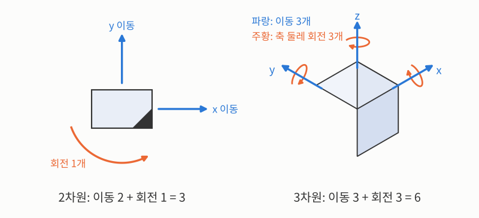
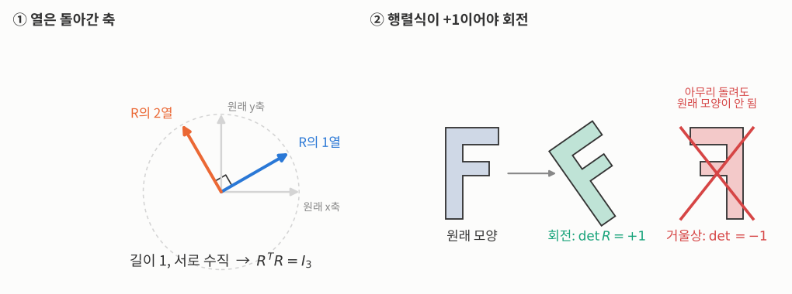


_MIT OpenCourseWare 6.801 17강 원본 영상 (영어)_

> **한 줄 요약:** 같은 점들을 서로 다른 두 좌표계에서 쟀다면, 두 좌표계 사이의 **회전과 이동**을 찾을 수 있습니다. 이동은 **두 점 구름의 무게중심 차이**로 바로 나오고, 남는 회전이 진짜 문제입니다. 이 강의는 그 문제를 세우고, 쉬운 방법 두 가지가 왜 부족한지 보여 줍니다.
{: .prompt-info }

## 이제 "사진으로 재는" 문제로

지금까지는 경계를 찾고, 패턴을 맞추고, 흐리게 만드는 **저수준** 영상 처리였습니다. 이번 강의부터는 한 단계 올라가 **사진으로 위치와 방향을 재는** 문제, 즉 **사진 측량**(photogrammetry, 원래 뜻은 "사진으로부터의 측정", 대표적인 예가 지도 만들기)을 다룹니다.

사진 측량에는 크게 네 가지 문제가 있습니다. 무엇과 무엇을 맞추느냐로 나뉩니다.

_이번 강의와 다음 두 강의는 첫 번째, 절대 방향을 다룹니다._

- **절대 방향**(3D↔3D): 라이다 두 대가 같은 장면을 쟀을 때 두 라이다의 상대 자세를 찾습니다. 한 센서로 물체를 두 번 쟀을 때 물체가 얼마나 움직였는지도 같은 문제입니다.
- **상대 방향**(2D↔2D): 카메라 두 대의 사진만으로 두 카메라 사이의 자세를 찾습니다. 양안 스테레오가 대표적입니다.
- **외부 방향**(2D↔3D): 사진 한 장과 3D 지도로 내가 어디에 어느 방향으로 있는지 찾습니다. 로봇의 위치 추정이 여기 속합니다.
- **내부 방향**(3D↔2D): 카메라 자체의 성질(초점거리, 중심점 등)을 찾습니다. 즉 카메라 보정입니다.

## 두 눈으로 거리 재기: 양안 스테레오

사람은 거리를 느끼는 단서를 열 가지 넘게 쓰는데, 그중 하나가 두 눈의 차이입니다. 카메라 두 대를 나란히 놓고 같은 점을 보면, 두 사진에서 그 점의 위치가 살짝 다릅니다.

_두 카메라는 일정 거리만큼 떨어져 있고, 같은 점 P가 두 사진에 서로 다른 위치로 찍힙니다._

기호를 먼저 정하겠습니다. 대부분 영어 단어의 첫 글자를 땄습니다.

- $$b$$: 두 카메라 사이의 거리, **기준선**(baseline)입니다.
- $$f$$: 렌즈 중심에서 영상면까지의 거리, **초점거리**(focal length)입니다.
- $$(X, Z)$$: 점 P의 실제 위치입니다. $$X$$는 가로 위치, $$Z$$는 카메라가 바라보는 방향의 거리, 즉 **깊이**입니다. 3D 좌표에서는 관례상 깊이 축을 $$Z$$로 씁니다. 위에서 내려다본 그림이라 세로 위치 $$Y$$는 생략했습니다.
- $$x_l, x_r$$: 점 P가 왼쪽(left)·오른쪽(right) 사진에 찍힌 가로 위치입니다. 각 카메라의 광축(카메라 정면으로 뻗은 선)에서 잽니다. 실제 공간의 $$X$$와 구분하려고 소문자로 씁니다.

원점은 두 카메라의 한가운데에 둡니다. 그러면 왼쪽 카메라는 $$X = -b/2$$, 오른쪽 카메라는 $$X = +b/2$$에 있으므로, 각 카메라에서 본 점 P의 가로 거리는 $$X + b/2$$와 $$X - b/2$$입니다. 원점을 가운데에 둔 것은 두 식을 대칭으로 만들기 위해서입니다. 각 카메라에서 닮은 삼각형을 쓰면

$$
\frac{x_l}{f} = \frac{X + b/2}{Z}, \qquad \frac{x_r}{f} = \frac{X - b/2}{Z}
$$

두 식을 빼면 두 사진 속 점 위치의 차이가 나옵니다. 이 차이를 **시차**(disparity)라 하고, 첫 글자를 따서 $$d = x_l - x_r$$로 씁니다. 그러면 거리가 바로 풀립니다.

$$
d = x_l - x_r = \frac{bf}{Z} \quad\Longrightarrow\quad Z = \frac{bf}{x_l - x_r}, \qquad X = \frac{b}{2}\,\frac{x_l + x_r}{x_l - x_r}
$$

**손으로 계산해 보면:** 기준선 $$b = 12$$cm, 초점거리 $$f = 800$$픽셀인 카메라 쌍이 시차 $$d = 64$$픽셀을 쟀다면

$$
Z = \frac{12 \times 800}{64} = 150\text{cm}
$$

시차를 1픽셀 틀려 63이나 65로 재면 거리는 152.4cm나 147.7cm가 됩니다. 같은 카메라로 3m 떨어진 점을 보면 시차가 32픽셀뿐이라, 1픽셀 오차가 약 ±9.5cm로 커집니다. **멀수록 시차가 작아져 오차가 거리의 제곱에 비례해 커집니다.**

- 기준선 $$b$$를 늘리면 시차가 커져 더 정밀해집니다.
- 하지만 자동차에 카메라를 100m 떨어뜨려 달 수는 없듯, 실제로는 장치 크기의 제약이 있습니다.
- 그리고 실제로는 두 카메라를 완벽히 나란히 맞추기가 거의 불가능합니다. 그래서 두 카메라 사이의 **정확한 회전과 이동**을 알아내야 합니다. 사진에서는 깊이를 모른 채 방향만 알기 때문에 이건 **상대 방향** 문제이고, 19~20강에서 다룹니다. 그 전에 더 쉬운 경우, 양쪽 모두 3D 좌표를 아는 **절대 방향**부터 풉니다.

## 절대 방향: 문제 세우기

같은 점들을 두 좌표계(예: 두 센서 각자의 좌표계)에서 잰 **3D 좌표**가 있다고 합시다. 기호는 이렇게 정합니다.

- $$i$$: 점의 번호(index)입니다. 점은 모두 $$N$$개(Number)이고 $$i = 1, \dots, N$$입니다.
- $$p_i$$: $$i$$번째 점(point) 자체입니다. 어느 좌표계로 재기 전의 실제 점을 가리킵니다.
- $$r_{l,i}$$, $$r_{r,i}$$: $$p_i$$를 왼쪽(left)·오른쪽(right) 좌표계에서 잰 3D 좌표입니다. 원점에서 점까지의 **위치 벡터**는 물리에서 관례상 $$r$$로 쓰고, Horn의 강의도 이 표기를 씁니다. 아래첨자 $$l, r$$은 스테레오에서 빌려 온 이름일 뿐이라, 실제로 왼쪽·오른쪽에 있는 카메라일 필요는 없습니다.

양쪽 모두 길이까지 다 아는 경우가 절대 방향입니다. 두 좌표계 사이의 관계는 **회전 + 이동**입니다. 회전을 $$R$$(Rotation), 이동 벡터를 $$t$$(translation)로 두면, 점 번호 $$i$$를 생략하고 이렇게 씁니다.

$$
r_r = R(r_l) + t
$$

$$R(r_l)$$은 "$$r_l$$을 $$R$$만큼 돌린 벡터"라는 뜻이고, 회전을 행렬로 쓰면 $$R\,r_l$$과 같습니다. $$R$$과 $$t$$가 우리가 찾을 미지수입니다.

_같은 점 $$p_1$$이라도 어느 좌표계에서 재느냐에 따라 좌표값이 다릅니다. 보기 쉽게 2D로 그렸고, 3D도 원리는 같습니다._

**숫자로 확인해 보면:** 그림에서 오른쪽 축은 왼쪽 축을 반시계로 약 53° 돌려 놓았고($$\cos 53^\circ \approx 0.6$$, $$\sin 53^\circ \approx 0.8$$), 오른쪽 원점은 왼쪽 좌표로 $$(5, 0)$$에 있습니다. 이때 회전과 이동은

$$
R = \begin{pmatrix} 0.6 & 0.8 \\ -0.8 & 0.6 \end{pmatrix}, \qquad t = \begin{pmatrix} -3 \\ 4 \end{pmatrix}
$$

입니다. 점 $$p_1$$을 왼쪽에서 잰 $$r_{l,1} = (3, 4)$$를 넣으면

$$
R\,r_{l,1} = (0.6 \cdot 3 + 0.8 \cdot 4,\; -0.8 \cdot 3 + 0.6 \cdot 4) = (5,\, 0), \qquad R\,r_{l,1} + t = (2,\, 4) = r_{r,1}
$$

이 되어, 그림에서 오른쪽 눈금으로 읽은 값과 같습니다. 여기서 두 가지를 눈여겨볼 만합니다.

- 축은 **반시계**로 53° 돌아가 있는데, $$R$$은 **시계 방향** 53° 회전입니다. 축이 돌아간 반대 방향으로 좌표값이 돌기 때문입니다.
- $$r_l = 0$$(왼쪽 원점)을 넣으면 $$r_r = t$$입니다. 즉 $$t$$는 **왼쪽 원점을 오른쪽 좌표계에서 잰 위치**이고, 오른쪽 원점의 위치 $$(5, 0)$$과는 다른 값입니다.

**자유도**(DOF, degrees of freedom: 독립적으로 바꿀 수 있는 숫자의 개수)는 몇 개일까요? 공간의 차원 수를 $$n$$이라 하면 이동은 $$n$$개, 회전은 $$n(n-1)/2$$개입니다. 시차 $$d$$와 겹치지 않도록 차원은 $$n$$으로 씁니다. 3D에서는 이동 3 + 회전 3 = **6자유도**입니다.

$$
\text{DOF}(n) = n + \frac{n(n-1)}{2} \quad\Longrightarrow\quad \text{DOF}(3) = 6
$$

_2D에서는 $$\text{DOF}(2) = 2 + 1 = 3$$, 3D에서는 $$\text{DOF}(3) = 3 + 3 = 6$$입니다. 이 숫자들을 모두 정하면 자세가 하나로 정해집니다._

회전을 3×3 행렬로 쓰면 숫자는 9개지만 조건이 붙습니다.

- $$R^T R = I_3$$: $$R^T$$는 $$R$$의 전치(Transpose, 행과 열을 바꾼 행렬), $$I_3$$은 3×3 단위행렬(Identity, 대각선만 1)입니다. 이 식은 각 열의 길이가 1이고 서로 수직이라는 뜻입니다(직교 행렬, 행도 마찬가지).
- $$\det R = +1$$: $$\det$$는 행렬식(determinant)입니다. 이 조건은 거울에 비친 것처럼 뒤집는 변환(반사)을 막습니다.

_① $$R$$의 각 열은 원래 축을 돌린 결과라서 길이가 1이고 서로 수직입니다. ② 행렬식이 $$-1$$이면 거울상이 되어, 아무리 돌려도 원래 모양과 겹치지 않습니다._

앞의 숫자 예로 확인하면, $$R$$의 두 열 $$(0.6, -0.8)$$과 $$(0.8, 0.6)$$은 길이가 $$\sqrt{0.36 + 0.64} = 1$$이고 내적이 $$0.6 \cdot 0.8 - 0.8 \cdot 0.6 = 0$$이라 서로 수직입니다. 행렬식은 $$0.6 \cdot 0.6 - 0.8 \cdot (-0.8) = 1$$입니다.

이런 조건을 다 만족하는 행렬들의 모임을 $$SO(3)$$라고 부릅니다. Special Orthogonal(특수 직교)의 머리글자이고, 3은 3차원이라는 뜻입니다. 회전 행렬 9개 숫자를 자유롭게 움직이면 이 제약을 벗어나 회전이 아닌 행렬이 되어 버립니다. 그래서 제약을 지키면서 움직이는 방법이 따로 필요하고, 이 때문에 최적화가 까다롭습니다.

## 스프링으로 생각하기 = 최소제곱

측정에는 잡음이 있으니 모든 점이 완벽히 맞지는 않습니다. 짝지은 점끼리 **스프링으로 연결**했다고 생각해 봅시다. 스프링으로 묶인 물체는 놓아두면 **모든 스프링에 저장된 에너지의 합이 가장 작은 자세**에서 멈춥니다. 그 자세가 우리가 찾는 답입니다.

스프링 하나에 저장된 에너지를 $$E$$(Energy), 스프링이 늘어난 길이를 $$e$$, 스프링의 단단한 정도(용수철 상수)를 $$k$$라 합시다. 늘어난 길이를 $$e$$로 쓴 이유는, 이 길이가 곧 아래에서 볼 두 점 사이의 **오차**(error)이기 때문입니다. $$k$$는 물리에서 용수철 상수에 쓰는 관례적 기호입니다. 에너지는 늘어난 길이의 제곱에 비례합니다.

$$
E = \tfrac{1}{2} k e^2
$$

모든 스프링의 $$k$$가 같으면 $$\tfrac{1}{2}k$$는 상수이므로, 에너지의 합을 최소화하는 것은 곧 **오차 제곱합을 최소화**하는 것입니다. $$i$$번째 점 쌍의 오차 $$e_i$$는 왼쪽 점을 $$R, t$$로 옮긴 위치와 오른쪽 점의 차이(벡터)입니다.

$$
e_i = R(r_{l,i}) + t - r_{r,i}, \qquad \min_{R,\, t} \sum_{i=1}^{N} \|e_i\|^2
$$

$$\|e_i\|$$는 벡터의 길이, $$\sum_{i=1}^{N}$$은 1번부터 $$N$$번 점까지 더하라는 뜻입니다. $$\min_{R,\,t}$$는 $$R$$과 $$t$$를 바꿔 가며 그 합이 가장 작아지는 값을 찾으라는 뜻입니다.

_자세를 잘못 추측하면 스프링이 길게 늘어나 에너지 합이 큽니다. 에너지가 가장 작은 자세에서는 스프링이 거의 늘어나지 않습니다. 아래 [직접 해 보기](#직접-해-보기) ③에서 손으로 맞춰 볼 수 있습니다._

이것은 "역문제"입니다. 자세를 알고 점의 위치를 예측하는 것(순문제)은 쉽지만, 점들로부터 자세를 찾는 것은 어렵습니다.

## 쉬운 방법 1: 세 점으로 좌표축 만들기

가장 먼저 떠오르는 방법은 점 세 개로 각 좌표계 안에 **새 좌표축을 직접 만드는** 것입니다.

_점 1은 위치 전체가, 점 2는 방향만, 점 3은 평면을 정하는 데만 쓰입니다._

1. 점 1을 원점으로 삼습니다.
2. 점 1에서 점 2로 가는 방향을 $$\hat{x}$$축으로 삼습니다. 글자 위의 모자(^)는 길이가 1인 **단위 벡터**라는 표시입니다.
3. 점 1에서 점 3으로 가는 벡터에서 $$\hat{x}$$ 성분을 빼면 $$\hat{x}$$에 수직인 $$\hat{y}$$축이 됩니다.
4. $$\hat{z} = \hat{x} \times \hat{y}$$로 마지막 축을 얻습니다.

양쪽 좌표계에서 똑같이 하면, 두 축 묶음을 맞추는 회전이 바로 나옵니다. 아래첨자 $$l, r$$은 각각 왼쪽·오른쪽 좌표계에서 만든 축이라는 뜻입니다.

$$
\begin{pmatrix} \hat{x}_r & \hat{y}_r & \hat{z}_r \end{pmatrix} = R \begin{pmatrix} \hat{x}_l & \hat{y}_l & \hat{z}_l \end{pmatrix}
\;\Longrightarrow\;
R = \begin{pmatrix} \hat{x}_r & \hat{y}_r & \hat{z}_r \end{pmatrix}\begin{pmatrix} \hat{x}_l & \hat{y}_l & \hat{z}_l \end{pmatrix}^{-1}
$$

축들이 서로 수직이라 역행렬은 언제나 있습니다. 하지만 **점마다 대접이 다릅니다.** 점 1은 조건 3개가 다 쓰이고, 점 2는 2개, 점 3은 1개만 쓰입니다. 점 4부터는 아예 쓰이지 않고요. 첫 추측으로는 괜찮지만 최선은 아닙니다.

## 쉬운 방법 2: 관성 축 맞추기

[13강의 덩어리 분석](/posts/mit-mv-13-pattern-recognition/)에서는 픽셀을 세어 면적과 무게중심을 구했습니다. 한 걸음 더 나가면 모양이 어느 쪽으로 길쭉한지를 **관성 축**으로 잴 수 있습니다. 점 구름을 어떤 축 둘레로 돌릴 때의 관성은 각 점에서 축까지 거리의 제곱합입니다.

기호를 정합니다.

- $$\hat{\omega}$$: 축의 방향입니다. 모자(^)는 단위 벡터라는 표시이고, $$\omega$$(오메가)는 회전축이나 각속도에 관례적으로 쓰는 글자입니다.
- $$r_i$$: $$i$$번째 점의 위치 벡터입니다. 앞과 같은 이유로 $$r$$을 쓰되, 여기서는 **무게중심을 원점으로 잡은** 좌표입니다. 원점을 다른 곳에 두면 축 자체가 달라집니다.
- $$I(\hat{\omega})$$: 축 $$\hat{\omega}$$ 둘레의 관성(Inertia)입니다. 단위행렬 $$I_3$$과는 다른 기호입니다.

점 $$r_i$$에서 축까지 거리의 제곱은 피타고라스 정리로 $$r_i \cdot r_i - (r_i \cdot \hat{\omega})^2$$입니다(전체 길이² − 축 방향 성분²). 이걸 모든 점에 대해 더해 정리하면 행렬 하나가 나옵니다. 식의 $$r_i r_i^T$$는 열벡터와 행벡터를 곱한 3×3 행렬(바깥곱, outer product)입니다.

$$
I(\hat{\omega}) = \sum_i \left( r_i \cdot r_i - (r_i \cdot \hat{\omega})^2 \right) = \hat{\omega}^T \underbrace{\left( \sum_i (r_i \cdot r_i) I_3 - r_i r_i^T \right)}_{A:\ \text{관성 행렬}} \hat{\omega}
$$

가운데 묶인 3×3 행렬을 **관성 행렬**이라 하고 $$A$$로 씁니다. $$A$$는 특별한 뜻 없이 붙인 이름입니다. 관성 $$I(\hat{\omega})$$가 가장 작은 축, 가장 큰 축, 그 중간(안장점)은 각각 **관성 행렬 $$A$$의 고유벡터**입니다. 세 고유벡터가 서로 수직이니 그대로 좌표축이 되고, 원점은 무게중심입니다.

_구름을 돌리면 축도 똑같이 돌아가므로, 두 좌표계의 축을 맞추면 회전이 나옵니다. 하지만 대칭인 모양에서는 축이 정해지지 않습니다._

방법 1보다 낫습니다.

- **모든 점을 씁니다.**
- **모든 점을 똑같이 대접합니다.**

그런데 실제로는 잘 쓰이지 않습니다. 구, 정육면체, 정팔면체처럼 **대칭인 물체**는 모든 방향의 관성이 같아 축을 고를 수 없기 때문입니다. 게다가 이 방법은 "어느 점이 어느 점과 짝인지"(대응) 정보를 전혀 쓰지 않습니다. 대응을 쓰면 정보가 늘지만, 안 쓰는 대신 대칭에 취약해지는 양날의 검입니다.

## 이동부터 떼어 내기: 무게중심의 힘

이제 제대로 된 최소제곱으로 갑니다. 먼저 회전의 성질 몇 가지를 기억해 둡니다. 아무 벡터 세 개를 $$u, v, w$$라 하겠습니다(기준선 $$b$$와 겹치지 않도록 $$a, b, c$$ 대신 이 글자를 씁니다). 회전은

- 내적을 보존하고: $$R(u) \cdot R(v) = u \cdot v$$
- 길이를 보존하고: $$\|R(u)\| = \|u\|$$
- 삼중곱(부피)을 보존합니다: $$[R(u)\,R(v)\,R(w)] = [u\,v\,w]$$. 여기서 $$[u\,v\,w] = u \cdot (v \times w)$$는 세 벡터가 만드는 평행육면체의 부피입니다.

핵심 요령은 **각 점 구름의 무게중심을 빼는 것**입니다. 왼쪽 점들의 무게중심(평균 위치)을 $$\bar{r}_l$$로 씁니다. 글자 위의 줄(bar)은 평균이라는 표시입니다. 각 점에서 무게중심을 뺀 좌표에는 프라임(′)을 붙여 $$r'_{l,i}$$로 씁니다. 오른쪽도 똑같습니다.

$$
\bar{r}_l = \frac{1}{N}\sum_i r_{l,i}, \quad \bar{r}_r = \frac{1}{N}\sum_i r_{r,i}, \qquad r'_{l,i} = r_{l,i} - \bar{r}_l, \quad r'_{r,i} = r_{r,i} - \bar{r}_r
$$

_무게중심을 원점으로 옮기면 두 점 구름은 원점 둘레로 돌리기만 하면 겹칩니다._

이동도 무게중심 기준으로 바꾸고, 같은 뜻으로 프라임을 붙여 $$t' = t - \bar{r}_r + R(\bar{r}_l)$$이라 두면, 오차는 $$e_i = R(r'_{l,i}) - r'_{r,i} + t'$$이 됩니다. 이걸 제곱해 더하면, 이동에 관한 항이 $$N\|t'\|^2$$ 하나로 떨어져 나옵니다(무게중심을 뺀 좌표의 합이 0이라 섞인 항이 사라집니다). 이 항은 $$t' = 0$$일 때 가장 작으니, 원래 이동 벡터는

$$
t = \bar{r}_r - R(\bar{r}_l)
$$

**왼쪽 무게중심을 돌린 다음, 오른쪽 무게중심과의 차이가 곧 이동**입니다. 회전만 알면 이동은 공짜로 따라옵니다.

남은 것은 회전입니다. 오차 제곱합을 펼치면 $$\sum \|r'_{r,i}\|^2$$과 $$\sum \|r'_{l,i}\|^2$$은 회전과 무관한 상수(회전은 길이를 보존하니까)이고, 남는 항을 정리하면

$$
\max_R \sum_{i=1}^{N} r'_{r,i} \cdot R(r'_{l,i})
$$

**돌린 왼쪽 점과 오른쪽 점이 최대한 같은 방향을 가리키게 하라**는 뜻입니다. 그런데 $$R$$이 직교 행렬이라는 조건 때문에 그냥 미분해서 0으로 놓을 수가 없습니다. 이 문제를 깔끔하게 푸는 열쇠가 다음 강의의 **사원수**입니다.

## 직접 해 보기

**① 두 눈으로 거리 재기.** 주황 점을 끌어 멀리 보내 보세요. 위쪽의 두 작은 사진에서 점의 위치 차이(시차)가 줄어들고, 주황 띠(1픽셀 오차일 때의 거리 범위)가 길어집니다.

처음 상태(기준선 12cm, 거리 150cm)에서 시차는 64픽셀, 1픽셀 오차의 범위는 148~152cm입니다. 점을 300cm로 보내면 범위가 291~310cm로 늘어납니다. 기준선을 36cm로 늘리면 같은 300cm에서도 범위가 다시 297~303cm로 줄어듭니다.

**② 관성 축.** 점을 끌어 보면서 두 축이 어떻게 따라 도는지 보세요. "정사각형 (대칭)"을 누르면 두 관성이 같아져 축이 사라집니다.

정사각형 상태에서 점 하나만 살짝 끌어도 축이 갑자기 나타나는데, 조금 더 끌면 축 방향이 크게 휙 바뀝니다. 대칭에 가까울수록 작은 잡음에도 답이 크게 흔들린다는 뜻입니다.

**③ 스프링으로 맞추기.** 회전 각도를 $$\theta$$(세타, 각도에 관례적으로 쓰는 글자), 이동 벡터 $$t$$의 가로·세로 성분을 $$t_x, t_y$$라 하겠습니다. 슬라이더로 이 세 값을 바꿔 파란 고리를 초록 점에 맞춰 보세요. 보라 스프링이 짧아질수록 에너지 합 $$\sum\|e_i\|^2$$이 줄어듭니다.

처음 상태($$\theta = 0^\circ$$, $$t = (0, 0)$$)의 에너지 합은 23.62입니다. 회전만 맞추면($$\theta = -40^\circ$$) 11.06, 이동만 맞추면($$t = (1.30, -0.40)$$) 10.45로, 어느 한쪽만으로는 절반쯤밖에 줄지 않습니다. 둘을 함께 맞춰야 0.03까지 내려갑니다. 2D라서 손으로 맞출 수 있지만, 3D에서는 회전만 3자유도라 이렇게 찾기 어렵습니다. 그래서 다음 강의부터 사원수로 한 번에 푸는 닫힌 해를 다룹니다.

## 정리

- 사진 측량은 맞추는 대상에 따라 **절대(3D↔3D), 상대(2D↔2D), 외부(2D↔3D), 내부(3D↔2D)** 방향 문제로 나뉩니다.
- 양안 스테레오는 시차로 거리를 잽니다: $$Z = bf/d$$. 멀수록 오차가 빠르게 커집니다.
- 절대 방향은 회전 3 + 이동 3 = **6자유도**를 찾는 최소제곱 문제입니다.
- 세 점 방법은 점을 차별하고, 관성 축 방법은 대칭에 약합니다.
- **무게중심을 빼면 이동이 분리**되고 $$t = \bar{r}_r - R(\bar{r}_l)$$, 남는 문제는 $$\max_R \sum r'_r \cdot R(r'_l)$$입니다.

_참고: MIT 6.801/6.866 Machine Vision (Fall 2020), Berthold Horn · Ryan Sander · Tadayuki Yoshitake 강의 노트 (MIT OpenCourseWare, CC BY-NC-SA 4.0)_
