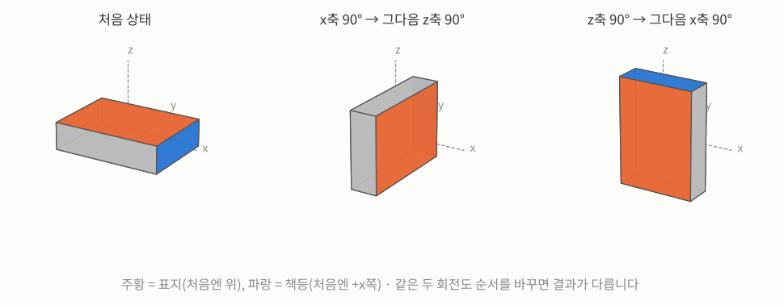
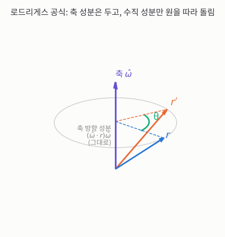
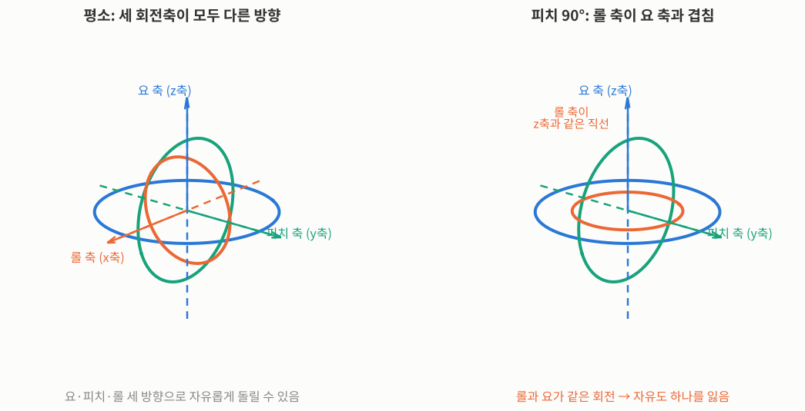
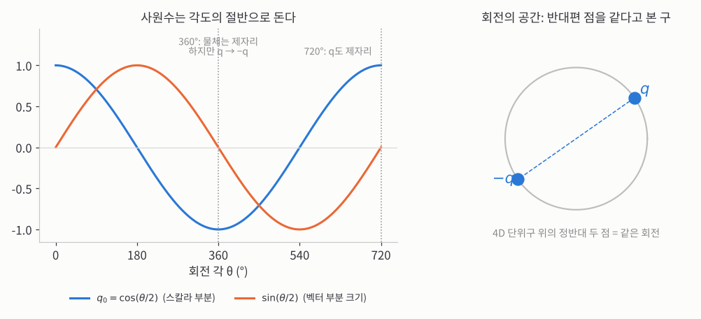
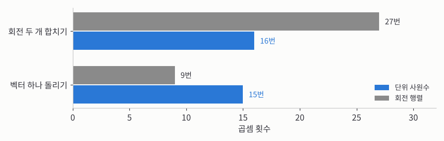


_MIT OpenCourseWare 6.801 18강 원본 영상 (영어). 아래 소제목은 영상의 챕터 순서 그대로이고, ▶ 링크를 누르면 그 장면부터 볼 수 있습니다._

> **한 줄 요약:** 회전은 순서를 바꾸면 결과가 달라지고, 적는 방법마다 약점이 있습니다. **단위 사원수**(숫자 네 개, 길이 1)로 적으면 회전을 합치기도, 벡터를 돌리기도, 미분하기도 쉬워집니다. 덕분에 지난 강의에서 막힌 절대 방향의 회전이 **4×4 행렬의 고유벡터 하나**로 풀립니다.
{: .prompt-info }

## 1. 회전은 왜 까다로운가

_▶ [0:00부터 보기](https://www.youtube.com/watch?v=uiG6KY0Cqd8&t=0s) · Challenges of rotation_

**회전은 순서를 바꾸면 결과가 달라지니까, 데이터에 회전을 맞추는 문제가 이동보다 훨씬 어려워집니다.**

교수님은 이번 강의를 "다른 주제에서 잠시 벗어나는 재미있는 곁길"이라고 소개합니다. 사진 측량과 로봇 공학에 쓸 도구, 특히 회전을 다루는 법을 만듭니다.

먼저 이동입니다. $$x$$ 방향으로 5 m 간 다음 $$y$$ 방향으로 10 m 가든, $$y$$ 방향으로 10 m 먼저 가고 $$x$$ 방향으로 5 m 가든 같은 곳에 도착합니다. 이동은 **순서를 바꿔도 결과가 같습니다.**

회전은 다릅니다. 교수님은 칠판 앞에 $$x$$축과 $$y$$축을 정해 두고 지우개 두 개로 보여 줍니다. 하나는 $$x$$축 둘레로 90° 돌린 다음 $$y$$축 둘레로 90°, 다른 하나는 $$y$$축 먼저 90° 돌린 다음 $$x$$축 둘레로 90° 돌립니다. 두 지우개의 최종 자세가 다릅니다.

_책상 위의 책으로 같은 실험을 그린 그림입니다(축은 책상에 고정된 $$x, y, z$$축). 왼쪽이 처음 자세(주황 = 표지, 파랑 = 책등), 가운데는 $$x$$축 둘레 90° 다음 $$z$$축 둘레 90°, 오른쪽은 같은 두 회전을 순서만 바꾼 것입니다. 표지와 책등이 향하는 방향이 서로 다릅니다._

이 순서 민감성 때문에, 측정값에 회전을 최소제곱으로 맞추는 일이 까다로워집니다.

## 2. 사원수 소개와 "회전들의 공간"

_▶ [1:53부터 보기](https://www.youtube.com/watch?v=uiG6KY0Cqd8&t=113s) · Introduction to quaternions_

**회전들이 모인 "공간"이 있으면 그 공간을 나누고, 뒤지고, 평균 낼 수 있으니까, 회전도 이동처럼 다룰 수 있게 됩니다.**

강의 순서는 이렇습니다. 회전의 성질을 보고, 여러 표현을 비교하고, 그중 **해밀턴의 사원수**를 고릅니다. 사원수는 원래 더 넓은 개념이지만, **길이가 1인 사원수(단위 사원수)**만 보면 3D 회전과 딱 짝이 맞습니다.

이동은 공간 자체가 3D라서, 최적화할 때 뒤질 곳도, 칸으로 나눌 곳도, 답이 놓이는 곳도 그 3D 공간입니다. 회전은 그런 공간이 무엇인지부터 분명하지 않습니다.

교수님의 예입니다. 차가 구를 때 **안전벨트에 걸리는 힘을 모든 자세에 대해 평균** 내고 싶다고 합시다. 이동이라면 부피에 대해 적분하고 부피로 나누면 끝입니다. 회전으로 같은 일을 하려면 "모든 회전"이 모인 공간이 필요하고, 사원수가 그걸 줍니다.

쓰임새는 사진 측량이 주이지만 로봇 공학, 그래픽스, 우주선 자세 제어에서도 아주 중요합니다. 그리고 지난 강의에서 시작한 문제, 즉 같은 물체를 두 좌표계에서 잰 경우(또는 한 좌표계에서 물체가 움직인 경우)의 **닫힌 해**(반복 없이 식으로 한 번에 나오는 답)를 이 사원수로 만듭니다.

## 3. 유클리드 운동이 지키는 것

_▶ [3:26부터 보기](https://www.youtube.com/watch?v=uiG6KY0Cqd8&t=206s) · Euclidean motion properties_

**회전은 거리·각도·손잡이 방향을 그대로 두니까, "내적과 삼중곱을 보존한다"는 한 문장으로 정의할 수 있습니다.**

회전 표현이 필요한 곳은 많습니다. 머신비전의 물체 인식과 자세 찾기, 로봇 팔, 단백질 접힘, 극저온 전자현미경(cryo-EM)까지 모두 좋은 회전 표현이 필요합니다. (교수님은 끝에 재미로 나눗셈이 되는 대수와 시공간 이야기도 하겠다고 했지만, 시간이 모자라 다루지 못했습니다.)

물체를 찌그러뜨리지 않고 옮기는 움직임을 **유클리드 운동**이라 하고, 이동과 회전으로 나뉩니다. 이 움직임은 세 가지를 지킵니다.

- 점 사이의 **거리**
- 선 사이의 **각도**
- **손잡이 방향**(오른손이 오른손으로 남는 것). 이걸 빼먹으면 거울에 비친 반사가 섞입니다. 생물에게 중요한 화학 물질 대부분은 두 거울상 중 한쪽 모양만 제대로 작동하니, 손잡이 방향은 실제로 중요합니다.

세 가지를 합치면 **내적과 삼중곱을 보존한다**는 말이 됩니다. 반사, 기울임(전단), 크기 바꾸기는 다른 경우엔 멀쩡한 변환이지만 여기서는 뺍니다(크기는 다음 강의에서 조금 다룹니다).

## 4. 오일러 정리와 자세

_▶ [5:32부터 보기](https://www.youtube.com/watch?v=uiG6KY0Cqd8&t=332s) · Euler's theorem and attitude_

**어떤 회전이든 원점을 지나는 축 둘레의 회전 + 이동으로 바꿀 수 있으니까, 이동을 떼어 내면 "공 하나가 어떻게 도는가"만 알면 됩니다.**

- **오일러 정리:** 강체가 어떻게 돌든, 움직이지 않는 직선이 하나 있습니다. 그게 **회전축**입니다.
- **평행축 정리:** 아무 축 둘레의 회전은 **원점을 지나는 축** 둘레의 회전에 이동 하나를 더한 것과 같습니다.

그래서 이동은 따로 다루고, 회전은 원점을 지나는 축 둘레의 것만 보면 됩니다. 원점에 놓인 공 하나가 도는 모든 방식을 알면, 공간 전체가 도는 방식을 아는 셈입니다.

**자세**(attitude)는 어떤 기준 자세에 대해 얼마나 돌아가 있는지를 뜻합니다. 예를 들어 앞에서 본 특허들(13~15강)처럼 물체 모델이 정해진 좌표계에 있으면, 물체를 찾는다는 건 그 모델에 대한 위치와 회전을 찾는 것입니다. (교수님은 이 슬라이드와 사원수를 정리한 네 쪽짜리 요약을 강의 사이트에 올린다고 덧붙입니다.)

## 5. 회전의 자유도와 각속도

_▶ [7:28부터 보기](https://www.youtube.com/watch?v=uiG6KY0Cqd8&t=448s) · Degrees of freedom in rotation_

**아주 짧은 순간의 회전 빠르기(각속도)는 화살표처럼 그냥 더해지지만, 유한한 회전은 더해지지 않으니까, 회전 자체는 각속도보다 훨씬 다루기 어렵습니다.**

**각속도**는 쉽습니다. 회전축 방향에 1초에 도는 각도(라디안)를 곱한 화살표 하나입니다. 이 화살표를 $$\omega$$(오메가)로 씁니다. $$\omega$$는 회전과 각속도에 흔히 쓰는 글자입니다.

각속도 화살표는 이동처럼 **그냥 더해집니다.** $$x$$축 둘레로 초당 1라디안, $$y$$축 둘레로 초당 1라디안으로 동시에 돌면, $$(1, 0, 0) + (0, 1, 0) = (1, 1, 0)$$ 방향 축 둘레로 도는 것과 같습니다. 다만 조금 돌고 나면 다음 순간의 축은 달라집니다. (아는 사람을 위한 말로, 각속도들은 성질 좋은 리 대수를, 그걸 쌓아 올린 유한한 회전들은 리 군을 이룹니다.)

돌고 있는 물체 위의 점 $$r$$이 움직이는 속도를 $$v$$(velocity)라 하면, **푸아송 공식**이 그 값을 줍니다.

$$
v = \omega \times r
$$

속도는 $$r$$에도 $$\omega$$에도 수직이고, 방향은 오른손 법칙을 따릅니다.

자유도는 17강에서 본 대로 공간의 차원 수를 $$n$$이라 할 때 $$n(n-1)/2$$이고, 3D에서 마침 3입니다. 그래서 "$$x$$축 둘레 회전, $$y$$축 둘레 회전"처럼 축으로 생각하는 버릇이 생기는데, 그러면 $$n$$차원에서 회전 자유도가 $$n$$개라고 착각하기 쉽습니다. 교수님은 **평면을 기준으로 생각하라**고 합니다. "$$xy$$평면을 제자리에 두고 그 안에서 돌린다"처럼요. 3D에는 $$xy, yz, zx$$평면 3개, 2D에는 $$xy$$평면 하나뿐이라 1개, 4D에는 축 두 개를 고르는 조합이 6개라 자유도가 6입니다.

## 6. 외적을 행렬로

_▶ [10:41부터 보기](https://www.youtube.com/watch?v=uiG6KY0Cqd8&t=641s) · Cross products and matrices_

**외적을 행렬 곱으로 바꾸면 이상한 연산 하나가 사라지고 행렬·벡터 계산만 남으니까, 식을 다루기 쉬워집니다.** 같은 요령을 뒤에서 사원수에도 씁니다.

외적은 좀 이상한 곱입니다. 벡터 둘을 곱했는데 벡터가 나옵니다. 결과가 두 벡터에 수직인 방향인데, 3D에서는 그 방향이 마침 하나로 정해져서 벡터로 쓸 수 있을 뿐입니다. 이것도 3D의 우연입니다. 더 높은 차원에서 두 벡터에 수직인 것은 벡터 하나가 아니라 공간 덩어리입니다. 굳이 넓히면 "$$n - 1$$개 벡터에 모두 수직인 벡터"가 되는데, 3D에서 $$n - 1 = 2$$라서 우리가 아는 외적이 됩니다.

벡터 $$a = (a_x, a_y, a_z)$$로 **반대칭 행렬**(대각선이 0이고, 대각선을 사이에 둔 두 칸이 부호만 반대인 행렬)을 만들어 $$[a]_\times$$라 쓰면, 외적을 행렬 곱으로 쓸 수 있습니다.

$$
a \times b = [a]_\times\, b, \qquad [a]_\times = \begin{pmatrix} 0 & -a_z & a_y \\ a_z & 0 & -a_x \\ -a_y & a_x & 0 \end{pmatrix}
$$

반대칭 행렬은 대각선이 0이고 위아래가 부호만 반대라, 마음대로 정할 수 있는 숫자가 3개입니다. 벡터의 자유도 3과 딱 맞습니다.

**손으로 확인해 보면:** $$a = \hat{z} = (0, 0, 1)$$, $$b = \hat{x} = (1, 0, 0)$$이면 $$[a]_\times\,b$$는 $$[a]_\times$$의 첫 열 $$(0, 1, 0)$$이라 $$\hat{z} \times \hat{x} = \hat{y}$$입니다. 오른손 법칙과 같습니다.

$$a$$ 대신 $$b$$를 행렬로 바꿔 $$a \times b = -[b]_\times\, a$$로 써도 됩니다. 행렬이 전치(부호 반전)된 모양이 되는데, 외적이 순서에 따라 부호가 바뀌는 것과 같은 이야기입니다.

## 7. 회전을 적는 여러 방법

_▶ [13:20부터 보기](https://www.youtube.com/watch?v=uiG6KY0Cqd8&t=800s) · Rotation representations_

**회전을 적는 방법이 이렇게 많다는 것 자체가, 완벽한 방법이 하나도 없다는 뜻입니다.** 이동은 $$x, y, z$$면 끝인데 말이죠.

**축과 각도.** 회전축 방향을 길이 1인 벡터 $$\hat{\omega}$$로, 도는 각도를 $$\theta$$(세타, 각도에 흔히 쓰는 글자)로 적습니다. 단위 벡터는 자유도가 2라 각도까지 3입니다.

**깁스 벡터.** 축과 각도를 벡터 하나로 합친 것입니다. 축에 $$\theta$$를 그냥 곱하면 계산 성질이 나쁘고(게다가 각도는 360°마다 되풀이됩니다), 깁스는 $$\tan(\theta/2)$$를 곱하면 좋다는 걸 알아냈습니다.

$$
\hat{\omega}\,\tan\frac{\theta}{2}
$$

숫자 3개로 자유도와 딱 맞습니다. 문제는 $$\theta = 180^\circ$$에서 $$\tan 90^\circ$$가 무한대가 된다는 것입니다. 180° 회전은 전혀 이상하지 않은 회전인데 적을 수가 없습니다. 직선을 $$y = mx + c$$(기울기 $$m$$, $$y$$절편 $$c$$)로 적으면 $$y$$축과 나란한 세로선을 적을 수 없는 것과 같은 문제입니다.

**오일러 각.** $$x$$축, $$y$$축, $$z$$축 둘레로 차례로 돌립니다. 비행기로 말하면 기체의 앞뒤 축 둘레로 기우는 **롤**, 기수를 위아래로 드는 **피치**, 좌우로 트는 **요**입니다. 각이 작은 편안한 비행이라면 순서가 별 상관없지만, 90°처럼 크면 순서에 따라 결과가 크게 다릅니다. 그래서 어느 축부터인지, 돌린 뒤의 새 축 둘레로 도는지 원래 축 둘레로 도는지까지 정해야 하고, 그 결과 **정의가 24가지**나 됩니다. 하나로 정하자는 국제 회의도 없었습니다.

**직교 행렬.** 다들 아는 회전 행렬입니다.

## 8. 그 밖의 표현들

_▶ [16:42부터 보기](https://www.youtube.com/watch?v=uiG6KY0Cqd8&t=1002s) · Alternative methods_

**표현마다 쉬운 문제가 다르니까, 결국 진짜 일은 "표현 사이를 바꾸는 것"이 되는 경우가 많습니다.**

- **직교 행렬:** 17강에서 본 두 조건($$R^T R = I_3$$, $$\det R = +1$$)이 붙습니다.
- **지수 표현:** 외적에서 본 3×3 반대칭 행렬을 $$\Omega$$(대문자 오메가)라 하면 $$R = e^{\Omega}$$로 쓸 수 있습니다. 행렬의 지수는 $$e^x = 1 + x + \tfrac12 x^2 + \cdots$$에 $$x$$ 대신 행렬을 넣은 것입니다. 되긴 하지만 더 들어가지 않습니다.
- **입체 사영:** 둥근 지구를 평면 지도로 팔기 위해 수백 년 동안 온갖 투영법이 나왔는데, 그중 각도를 지키는 것이 입체 사영입니다. 구를 평면에 펼치고, 평면 위에서 점들을 딱 맞게 옮긴 다음 다시 구로 되돌리면 구가 돌아갑니다. 10번 챕터에서 그림으로 봅니다.
- **파울리 행렬:** 물리학자들은 2×2 복소 행렬을 씁니다. 숫자가 8개처럼 보이지만 조건이 붙어 자유도는 3입니다. (파울리는 동료 논문을 두고 "틀리지조차 않았다"고 말한 것으로 유명합니다.)
- **오일러 매개변수(로드리게스 매개변수)**, 그리고 **단위 사원수**.

이들 사이를 바꾸는 방법이 중요합니다. 교수님은 극좌표와 직교좌표에 비유합니다. 어떤 문제는 극좌표로는 답이 뻔한데 직교좌표로는 어렵고, 그러면 남는 일은 좌표 변환입니다. 극좌표는 변환이 쉽지만, 회전 표현들은 변환이 어려운 경우도 있습니다.

## 9. 로드리게스 공식

_▶ [20:24부터 보기](https://www.youtube.com/watch?v=uiG6KY0Cqd8&t=1224s) · Rodriguez's formula_

**벡터를 축 방향과 축에 수직인 방향으로 나누면, 수직인 쪽만 평면에서 돌리면 되니까, 3D 회전이 익숙한 2D 회전으로 바뀝니다.**

로드리게스는 파리의 은행가였는데, 은행 일이 지루했는지 밤마다 수학을 했다고 합니다. 회전으로 하고 싶은 일은 두 가지입니다. **벡터 돌리기**(또는 돌아간 좌표계에서 그 벡터를 다시 적기)와, 한 축 둘레로 돌린 뒤 다른 축 둘레로 다시 돌린 **두 회전 합치기**입니다. 로드리게스 공식은 앞의 것을 축과 각도로 합니다.

벡터 $$r$$을 축 $$\hat{\omega}$$ 둘레로 $$\theta$$만큼 돌린 결과를 $$r'$$이라 합니다.

_보라 화살표가 회전축 $$\hat{\omega}$$, 파란 화살표가 처음 벡터 $$r$$, 주황 화살표가 돌린 뒤의 $$r'$$입니다. 축 방향 성분은 그대로이고, 회색 원(축에 수직인 평면) 위에서 수직 성분만 $$\theta$$만큼 돕니다._

1. **축 방향 성분:** $$r$$을 축에 내린 그림자 $$(\hat{\omega} \cdot r)\,\hat{\omega}$$입니다. 축 위에 있으니 돌려도 그대로입니다.
2. **수직 성분:** $$r$$에서 축 방향 성분을 뺀 것입니다. 축에 수직인 평면 안에서 원을 따라 돕니다.
3. **그 평면에서 수직 성분을 90° 돌린 방향:** 축과 $$r$$ 모두에 수직이어야 하니 $$\hat{\omega} \times r$$입니다.

평면 안에서는 2D 회전처럼 "처음 방향 × $$\cos\theta$$ + 90° 돌린 방향 × $$\sin\theta$$"로 섞으면 됩니다. $$\theta = 0$$이면 처음 방향, $$\theta = 90^\circ$$면 90° 돌린 방향이 되고, 그 사이에서도 길이는 그대로입니다. 셋을 합치면

$$
r' = (\cos\theta)\, r + (\sin\theta)(\hat{\omega} \times r) + (1 - \cos\theta)(\hat{\omega} \cdot r)\,\hat{\omega}
$$

**손으로 확인해 보면:** $$\hat{x}$$를 $$z$$축 둘레로 90° 돌려 봅시다. $$\cos 90^\circ = 0$$, $$\sin 90^\circ = 1$$, $$\hat{z} \times \hat{x} = \hat{y}$$, $$\hat{z} \cdot \hat{x} = 0$$이므로

$$
r' = 0 \cdot \hat{x} + 1 \cdot \hat{y} + (1 - 0) \cdot 0 \cdot \hat{z} = \hat{y}
$$

$$x$$축이 $$y$$축으로 갔습니다. $$z$$축 위에서 내려다보면 반시계 방향 90°입니다. 회전이 그렇게 간단하지만은 않다는 것도 식에서 보입니다.

## 10. 입체 사영

_▶ [23:48부터 보기](https://www.youtube.com/watch?v=uiG6KY0Cqd8&t=1428s) · Stereographic projections_

**축과 각도는 머릿속에 그리기 쉽지만 두 회전을 합칠 수가 없어서, 결국 다른 표현을 빌려야 합니다.**

"$$x$$축 둘레로 90°"처럼 축과 각도는 이해하기 쉽습니다. 약점은 **합치기**입니다. 오일러 정리 덕분에 두 회전을 합친 결과도 회전 하나라는 건 알지만, 축·각도끼리 바로 합치는 방법이 없습니다. 교수님이라면 둘 다 직교 행렬로 바꿔 곱한 다음 다시 축·각도로 되돌린다고 합니다.

여기서 교수님은 지수 표현은 건너뛰고, 앞에서 말한 입체 사영을 그림으로 보여 줍니다.

1. 돌릴 공의 북극에 평면을 대고, **남극**에서 공 위의 점을 지나는 선을 그어 평면에 닿는 곳에 그 점을 옮깁니다.
2. 이렇게 하면 남극 한 점만 빼고 공 전체가 평면에 펼쳐집니다.
3. 넓이는 크게 왜곡됩니다. 북극 근처의 알래스카는 별로 안 커지지만, 남반구의 오스트레일리아는 멀리 밀려나 엄청 커집니다.
4. 그래도 **각도(모양)는 지킵니다.** 그래서 다른 투영이 잘 안 맞는 극지방 지도에 실제로 쓰입니다. 넓이를 지키는 투영과 각도를 지키는 투영은 고를 수 있지만, 둘 다 지키는 투영은 없습니다.

이 평면을 복소평면으로 보고, 평면 위의 점 $$z$$(복소수)를 $$a, b, c, d$$(복소수 상수)로 만든 분수로 옮깁니다.

$$
z' = \frac{az + b}{cz + d}
$$

옮긴 점들을 다시 공으로 되돌리면, 공 위의 무늬가 **그대로 돌아간 모양**이 됩니다. 3D 회전을 복소평면의 연산으로 생각할 수 있다는 놀라운 사실입니다.

## 11. 최적화와 고르게 뽑기: 좋은 표현의 조건

_▶ [27:14부터 보기](https://www.youtube.com/watch?v=uiG6KY0Cqd8&t=1634s) · Optimization and sampling_

**좋은 회전 표현이 해 줘야 할 일을 목록으로 만들면, 각 표현의 약점이 분명해집니다.**

1. 벡터를 **돌리기**(또는 좌표계를 돌리기)
2. 두 회전을 **합치기**
3. **직관적**일 것
4. **군더더기**가 없을 것, 그리고 특이점(값이 무한대가 되는 곳)이 없을 것
5. **계산이 빠를** 것
6. 두 자세 사이를 **보간**하고, 여러 회전을 **평균** 낼 수 있을 것
7. 회전에 대해 **미분**할 수 있을 것(최적화용)
8. 회전을 **고르게 뽑을** 수 있을 것

**직관.** 교수님은 처음에 회전 행렬의 숫자는 뜻이 안 보인다고 말합니다. 대각선 숫자의 합(대각합, trace)이 각도와 관계있다는 정도입니다. 정확한 관계는 $$\text{tr}(R) = 1 + 2\cos\theta$$입니다(교수님은 즉석에서 대충 말했는데 이 식이 맞습니다). 예를 들어 $$z$$축 둘레 90° 회전 $$\begin{pmatrix} 0 & -1 & 0 \\ 1 & 0 & 0 \\ 0 & 0 & 1 \end{pmatrix}$$은 대각합이 $$0 + 0 + 1 = 1$$이고, $$1 + 2\cos 90^\circ = 1$$과 같습니다.

그런데 한 학생이 반론합니다. 원래 $$x$$축 $$(1, 0, 0)$$을 곱하면 첫 열이 나오니, **각 열은 원래 $$x, y, z$$축이 돌아간 방향**이라는 것입니다. 교수님은 "좋은 지적이다, 직관적이지 않다는 내 말은 취소"라며 받아들입니다. 행도 반대 방향으로 같은 뜻이 있습니다. 다만 회전축과 각도는 바로 보이지 않습니다.

**군더더기.** 회전 행렬은 숫자 9개로 3개를 나타내니 군더더기가 많습니다. 축과 각도는 숫자 4개입니다. 깁스 벡터는 군더더기가 없지만 특이점이 있습니다.

**보간.** 그래픽스에서는 작가가 춤추는 사람의 자세 몇 개만 정하면, 그 사이 프레임은 컴퓨터가 채웁니다. 돌고 있는 사람의 "반쯤 돌린 자세"는 어떻게 구할까요? 회전 행렬을 두 번 곱하면 원래 회전이 되는 행렬, 즉 행렬의 제곱근이 반 회전이지만, 행렬의 제곱근은 구하기 번거롭습니다. 두 행렬을 그냥 평균 내면 안 될까요? 2D로 해 보면, 제자리 $$\begin{pmatrix}1&0\\0&1\end{pmatrix}$$과 90° 회전 $$\begin{pmatrix}0&-1\\1&0\end{pmatrix}$$의 평균은 $$\begin{pmatrix}0.5&-0.5\\0.5&0.5\end{pmatrix}$$입니다. 열의 길이가 $$\sqrt{0.5^2 + 0.5^2} \approx 0.71$$이라, 45° 돌리면서 **줄어드는** 행렬이 됩니다. 회전이 아닙니다.

**미분.** 측정값에 모델을 맞추려면 미분해서 0으로 놓아야 하는데, 회전 행렬로 미분한다는 건 숫자 9개로 미분하는 것이고, 조건을 어떻게 지킬지가 문제입니다.

**고르게 뽑기.** 닫힌 해가 없으면 회전들을 골고루 뽑아 시험해 봐야 합니다. 이동이라면 공간을 같은 크기의 정육면체 칸으로 나누거나, $$x, y, z$$를 각각 아무렇게나 뽑으면 됩니다. 오일러 각을 같은 간격으로 나누면 고르지 않습니다. 더 쉬운 예로, 공 위의 점을 위도·경도로 같은 간격으로 뽑으면 **극 근처가 훨씬 촘촘해집니다.** 회전은 여기에 차원이 하나 더 붙은 문제입니다. 그래서 "회전들의 공간"이 있으면 칸을 나누고, 고르게 또는 무작위로 뽑고, 평균을 낼 수 있어 아주 반갑습니다.

## 12. 짐벌 락

_▶ [32:38부터 보기](https://www.youtube.com/watch?v=uiG6KY0Cqd8&t=1958s) · Gimbal lock explained_

**오일러 각은 축 하나를 90° 돌리면 두 축이 같은 직선에 놓이니까, 자유도 하나가 사라집니다.**

지금까지의 문제를 모으면, 직교 행렬은 군더더기와 복잡한 조건, 오일러 각과 축·각도는 합치기가 어렵고(행렬로 바꿔 곱하는 게 최선), 그리고 오일러 각에는 **짐벌 락**이 있습니다.

교수님은 "여러분은 너무 어려서 모르겠지만" 하며 아폴로 이야기를 꺼냅니다. TV 중계에서 해설자 말을 무시하고 우주선 교신을 들으면 "짐벌 락에 접근 중"이라는 말이 나왔다고 합니다. 항법 장치는 Draper 연구소가 만들었고, 자이로스코프가 들어 있었습니다. 자이로스코프는 빠르게 도는 부분이 한 방향을 유지하려 하고, 그 주위의 고리(짐벌) 세 개가 우주선이 그 방향에 대해 돌 수 있게 해 줍니다. 그런데 오일러 각처럼 **두 고리의 축이 같은 직선에 놓이면 자유도 하나를 잃고**, 그 자세를 지나가면 우주에서의 방향을 잃어버립니다. 그래서 우주비행사들은 그 자세를 절대 지나가지 않도록 교육받았습니다.

_왼쪽: 평소에는 바깥 고리(파랑)가 $$z$$축 둘레의 요, 가운데 고리(초록)가 $$y$$축 둘레의 피치, 안쪽 고리(주황)가 $$x$$축 둘레의 롤을 맡아 세 방향으로 돌 수 있습니다. 오른쪽: 피치를 90° 들면 안쪽 고리의 롤 축이 $$z$$축과 같은 직선에 놓여, 롤과 요가 같은 회전이 됩니다. 세 고리로 두 방향밖에 못 돌립니다._

해결법은 **고리를 네 개** 쓰는 것입니다. 대신 더 이상 가만히 두는 장치가 아니라, 두 축이 겹치지 않도록 모터로 계속 돌려 주는 능동 장치가 되어야 합니다.

정리하면 깁스 벡터는 특이점, 축·각도는 합치기 문제가 있고, 어느 것도 "회전들의 공간"을 깔끔하게 보여 주지 못합니다.

## 13. 사원수의 대수

_▶ [34:58부터 보기](https://www.youtube.com/watch?v=uiG6KY0Cqd8&t=2098s) · Quaternion algebra_

**성분 세 개로는 나눗셈이 되는 곱을 만들 수 없지만, 네 개로 늘리면 되니까, 해밀턴은 허수 단위 세 개짜리 수를 만들었습니다.**

더블린의 해밀턴은 복소수를 넓히고 싶었습니다. 복소수는 실수 두 개짜리 수인데 더하기·빼기·곱하기·**나누기**가 다 됩니다. 나누기가 돼야 방정식을 빼고, 곱하고, 넘기며 풀 수 있습니다. 당시 물리학에서는 공간의 점(나중에 벡터라 부르는 것)을 다루는 데 관심이 많아서, 실수 → 복소수 → 세 쌍으로 넓히는 게 자연스러운 다음 단계였습니다.

세 쌍의 곱으로 내적은 결과가 스칼라라 안 맞고, 외적이 있습니다. 그런데 외적으로는 나눌 수 없습니다. $$c = a \times b$$일 때 $$a = c / b$$라고 할 수 없습니다. $$b$$와 나란한 성분은 외적에서 사라져 버리니까요.

해밀턴은 오래 고민했습니다. 아이들에게 매일 아침 식사하러 내려오는 자기에게 "아빠, 이제 세 쌍 곱할 수 있어요?"라고 묻게 시켰을 정도입니다. 그러다 1843년 어느 일요일, 아내와 더블린을 산책하다 답을 얻었고, 다리에 설명 없이 핵심 식만 낙서로 새겼습니다. 교수님은 "범죄를 저질렀다"고 농담합니다. 해밀턴은 그 순간을 "계산을 위해 공간의 네 번째 차원을 받아들여야 한다는 생각이 떠올랐다. 전기 회로가 닫히며 불꽃이 튀는 듯했다"고 적었습니다. 에디슨과 테슬라보다 한참 전, 전기가 막 신기하던 시절의 표현입니다.

핵심은 **셋으로는 안 되고 넷으로는 된다**는 것입니다. 복소수에서 제곱하면 $$-1$$이 되는 허수 $$i$$를 들인 것처럼, 그런 수를 $$i, j, k$$ 세 개 들이고, 아주 중요한 규칙 하나를 더했습니다.

$$
i^2 = j^2 = k^2 = ijk = -1
$$

다리에 새긴 것이 이 식이고, 지금도 남아 있습니다(수학자들이 영감을 얻으려고 만져서 많이 닳았다고 합니다). 나머지 규칙은 여기서 다 나옵니다. 예를 들어 $$ijk = -1$$의 양변 오른쪽에 $$k$$를 곱하면 $$ij\,k^2 = -k$$, 즉 $$-ij = -k$$라서 $$ij = k$$입니다.

$$
ij = k,\quad jk = i,\quad ki = j, \qquad ji = -k,\quad kj = -i,\quad ik = -j
$$

**곱하는 순서를 바꾸면 부호가 바뀝니다.** 외적과 닮았고, 회전의 순서 민감성과도 맞습니다. 해밀턴은 이걸로 800쪽짜리 책을 썼는데 거의 읽을 수 없는 책이라, 강의에서는 훨씬 단순하게 다룹니다.

### 사원수를 적는 여러 방법

- 실수 하나 + 서로 다른 허수 셋
- **실수 하나 + 3D 벡터 하나**의 묶음 (가장 많이 씀)
- 숫자 네 개짜리 벡터
- 4×4 행렬 (외적을 반대칭 행렬로 바꾼 것처럼)
- 복소수 두 개의 묶음. 이 방식을 한 번 더 쓰면 성분이 8개, 16개인 수 체계가 나오는데, 갈수록 이상해져서 4개에서 멈춥니다.

교수님은 사원수를 스칼라·벡터와 구별하려고 글자 위에 작은 동그라미를 얹어 $$\mathring{q}$$로 씁니다(흔한 표기는 아닙니다). 실수 부분을 $$q_0$$, 벡터 부분을 굵은 글씨 $$\mathbf{q} = (q_x, q_y, q_z)$$로 쓰면

$$
\mathring{q} = q_0 + i\,q_x + j\,q_y + k\,q_z = (q_0, \mathbf{q})
$$

### 곱셈

두 사원수 $$\mathring{p} = (p_0, \mathbf{p})$$, $$\mathring{q} = (q_0, \mathbf{q})$$를 곱하면 항이 16개 나오는데, 실수 부분과 벡터 부분으로 모으면 이렇게 간단해집니다.

$$
\mathring{p}\,\mathring{q} = \big(p_0 q_0 - \mathbf{p}\cdot\mathbf{q},\;\; p_0\mathbf{q} + q_0\mathbf{p} + \mathbf{p}\times\mathbf{q}\big)
$$

순서를 바꾸면 마지막 외적만 $$\mathbf{q}\times\mathbf{p} = -\mathbf{p}\times\mathbf{q}$$로 부호가 바뀝니다. 순서 민감성이 이 외적 하나에서 나옵니다.

**손으로 확인해 보면:** $$i = (0, \hat{x})$$, $$j = (0, \hat{y})$$입니다. 실수 부분은 $$0 \cdot 0 - \hat{x}\cdot\hat{y} = 0$$, 벡터 부분은 $$0 + 0 + \hat{x}\times\hat{y} = \hat{z}$$라서 $$ij = (0, \hat{z}) = k$$입니다. 순서를 바꾸면 $$\hat{y}\times\hat{x} = -\hat{z}$$라 $$ji = -k$$입니다.

외적을 행렬 곱으로 바꿨던 것처럼, 사원수 곱도 "$$\mathring{p}$$로 만든 4×4 행렬 × $$\mathring{q}$$"로 쓸 수 있습니다. 이 행렬은 첫 열이 $$\mathring{p}$$ 자체이고, 대각선만 빼면 반대칭이며, 단위 사원수라면 직교 행렬입니다. "$$\mathring{q}$$로 만든 4×4 행렬 × $$\mathring{p}$$"로도 쓸 수 있는데, 두 행렬은 첫 행·첫 열은 같고 안쪽 3×3 부분만 서로 전치입니다. 이 3×3 부분이 같았다면 곱셈의 순서가 상관없었을 것입니다.

## 14. 사원수의 성질

_▶ [44:37부터 보기](https://www.youtube.com/watch?v=uiG6KY0Cqd8&t=2677s) · Quaternion properties_

**사원수에 자기 켤레를 곱하면 실수만 남으니까, 0이 아니면 언제나 나눌 수 있습니다.** 세 쌍에서 안 되던 나눗셈이 여기서 됩니다.

- **순서 민감:** 교환법칙이 안 됩니다. 됐다면 회전을 나타낼 수 없었을 테니, 바로 이 점 때문에 이야기하는 것입니다.
- **결합법칙:** $$(\mathring{p}\mathring{q})\mathring{r} = \mathring{p}(\mathring{q}\mathring{r})$$. 곱셈 공식에 넣으면 지저분한 대수로 확인됩니다.
- **켤레:** 복소수처럼 허수(벡터) 부분의 부호만 바꾼 $$\mathring{q}^* = (q_0, -\mathbf{q})$$입니다. 곱의 켤레는 순서가 뒤집혀 $$(\mathring{p}\mathring{q})^* = \mathring{q}^*\mathring{p}^*$$입니다. 행렬의 $$(AB)^T = B^T A^T$$와 닮았습니다. (교수님은 양자역학의 거장들이 어떤 이는 복소수로, 어떤 이는 행렬로 접근했는데 결국 같았다는 이야기를 곁들입니다.)

교수님이 사원수를 고르는 가장 큰 이유는 **사원수로는 미분할 수 있어서 닫힌 해가 나온다**는 것입니다. 직교 행렬로는 그게 안 됩니다. 닫힌 해가 없는 문제라도, 회전들의 공간이 생기니 그 공간을 고르게 또는 무작위로 뽑아 뒤질 수 있습니다.

- **내적:** 숫자 네 개짜리 벡터의 보통 내적입니다. $$\mathring{p}\cdot\mathring{q} = p_0 q_0 + \mathbf{p}\cdot\mathbf{q}$$
- **길이:** 자기 켤레와 곱하면 벡터 부분이 사라지고 실수만 남습니다.

  $$
  \mathring{q}\,\mathring{q}^* = (\mathring{q}\cdot\mathring{q},\ \mathbf{0})
  $$

  ($$\mathring{q}\cdot\mathring{q}$$는 네 숫자의 제곱합.) 이 값이 1이면 **단위 사원수**입니다.
- **역수:** 그래서 $$\mathring{q}^{-1} = \mathring{q}^* / (\mathring{q}\cdot\mathring{q})$$입니다. $$\mathring{q} = 0$$만 빼면 언제나 됩니다. 단위 사원수는 역수가 그냥 켤레라서, 회전을 되돌리기가 아주 쉽습니다. 직교 행렬의 역행렬이 그냥 전치인 것과 같습니다.
- **곱의 내적:** $$(\mathring{p}\mathring{q})\cdot(\mathring{p}\mathring{r}) = (\mathring{p}\cdot\mathring{p})(\mathring{q}\cdot\mathring{r})$$. 단위 사원수를 앞에 곱해도 내적이 그대로라는 뜻입니다.
- **내적의 반대쪽으로 넘기기:** 내적 한쪽에 곱해진 사원수를 **켤레로 바꾸면** 반대쪽으로 넘길 수 있습니다.

  $$
  (\mathring{p}\,\mathring{q})\cdot\mathring{r} = \mathring{p}\cdot(\mathring{r}\,\mathring{q}^*)
  $$

  18번 챕터에서 이 요령이 결정적으로 쓰입니다.

## 15. 벡터와 회전

_▶ [49:15부터 보기](https://www.youtube.com/watch?v=uiG6KY0Cqd8&t=2955s) · Vectors and rotation_

**사원수를 앞뒤로 한 번씩 곱하면, 앞에서 4D로 나간 것을 뒤에서 3D로 되돌려 놓으니까, 결과가 돌아간 3D 벡터가 됩니다.**

3D 벡터 $$\mathbf{r}$$은 실수 부분을 0으로 둔 사원수 $$\mathring{r} = (0, \mathbf{r})$$로 씁니다(스칼라는 반대로 벡터 부분을 0으로). 이런 "순수 허수" 사원수로 계산하고 다시 3D로 돌아옵니다. 이런 사원수에는 편한 성질이 많습니다.

- 켤레는 그냥 부호를 바꾼 것: $$\mathring{r}^* = -\mathring{r}$$
- 내적은 벡터의 내적과 같습니다.
- 두 개를 곱하면 내적과 외적이 **한꺼번에** 나옵니다.

  $$
  \mathring{r}\,\mathring{s} = (-\mathbf{r}\cdot\mathbf{s},\ \mathbf{r}\times\mathbf{s})
  $$

  당시 비판자들은 이걸 두 성이 다 들어 있는 "자웅동체 괴물"이라 불렀지만, 교수님은 어떤 목적에는 오히려 장점이라고 봅니다.
- $$(\mathring{r}\mathring{s})\cdot\mathring{t}$$는 삼중곱 $$[\mathbf{r}\,\mathbf{s}\,\mathbf{t}] = (\mathbf{r}\times\mathbf{s})\cdot\mathbf{t}$$입니다(실수 부분이 0이라 벡터 부분끼리의 내적만 남으니까요).

이제 회전입니다. 사원수 하나를 그냥 곱하면 실수 부분이 생겨 3D를 벗어나 4D로 갑니다. 그래서 그걸 되돌리는 연산이 하나 더 필요합니다. 교수님은 평면 안의 회전을 하려고 잠깐 3D로 나갔다가 다시 평면으로 돌아오는 것에 비유합니다. 벡터 $$\mathring{r}$$을 단위 사원수 $$\mathring{q}$$로 돌린 결과를 $$\mathring{r}'$$이라 하면

$$
\mathring{r}' = \mathring{q}\,\mathring{r}\,\mathring{q}^*
$$

앞에서 $$\mathring{q}$$를 곱하고 뒤에서 켤레 $$\mathring{q}^*$$를 곱하면, 결과의 실수 부분이 다시 0이 되어 3D로 돌아옵니다.

## 16. 회전 합치기와 변환

_▶ [52:42부터 보기](https://www.youtube.com/watch?v=uiG6KY0Cqd8&t=3162s) · Composition and conversion_

**$$\mathring{q}\,\mathring{r}\,\mathring{q}^*$$는 내적과 삼중곱을 지키니 진짜 회전이고, 두 번 돌리면 사원수 곱 하나로 합쳐지니까, 축·각도에서 그렇게 어렵던 합치기가 곱셈 한 번이 됩니다.**

앞뒤 곱셈을 각각 4×4 행렬로 바꿔 곱하면 4×4 행렬 하나가 됩니다. 이 행렬은 **첫 행과 첫 열이 구석 하나만 빼고 0**이라서, 실수 부분이 0인 벡터를 넣으면 결과의 실수 부분도 0입니다. 그리고 안쪽 3×3 부분이 바로 **회전 행렬**입니다.

사원수가 부담스러우면 벡터와 내적·외적만으로 쓸 수도 있습니다. $$\mathring{q} = (q_0, \mathbf{q})$$일 때

$$
\mathbf{r}' = (q_0^2 - \mathbf{q}\cdot\mathbf{q})\,\mathbf{r} + 2(\mathbf{q}\cdot\mathbf{r})\,\mathbf{q} + 2q_0\,(\mathbf{q}\times\mathbf{r})
$$

이 식을 $$\mathbf{r}$$과 $$\mathbf{s}$$에 각각 적용해 내적을 계산하면 $$\mathbf{r}\cdot\mathbf{s}$$가 그대로 나오고, 삼중곱도 그대로입니다. 길이·각도·손잡이 방향을 지키니 **회전**입니다. 아직 어떤 회전인지는 모르지만요.

**합치기.** $$\mathring{q}$$로 먼저 돌리고 $$\mathring{p}$$로 다시 돌리면, 결합법칙과 $$(\mathring{p}\mathring{q})^* = \mathring{q}^*\mathring{p}^*$$ 덕분에

$$
\mathring{p}\,(\mathring{q}\,\mathring{r}\,\mathring{q}^*)\,\mathring{p}^* = (\mathring{p}\mathring{q})\,\mathring{r}\,(\mathring{p}\mathring{q})^*
$$

두 회전이 **곱 $$\mathring{p}\mathring{q}$$ 하나**로 합쳐집니다. 계산도 빠릅니다(20번 챕터).

**어떤 회전인가.** 위 식을 로드리게스 공식과 항별로 맞춰 보면, 먼저 **벡터 부분 $$\mathbf{q}$$가 회전축과 나란하다**는 게 보입니다. 직접 확인하려면 $$\mathbf{r}$$ 자리에 $$\mathbf{q}$$를 넣어 보면 됩니다. 외적 $$\mathbf{q}\times\mathbf{q} = 0$$이 사라지고 나머지 항이 모두 $$\mathbf{q}$$ 방향이라, $$\mathbf{q}$$는 돌려도 $$\mathbf{q}$$ 그대로입니다. 움직이지 않는 직선, 즉 오일러 정리의 회전축입니다.

**② 순서 바꿔 합치기.** 회전 A와 B를 고르면, "A 먼저"는 $$\mathring{q}_B\mathring{q}_A$$, "B 먼저"는 $$\mathring{q}_A\mathring{q}_B$$로 합쳐집니다. 나중에 하는 회전이 왼쪽에 곱해집니다.

처음 설정($$x$$축 90°, $$z$$축 90°)에서는 두 곱이 (0.5, 0.5, 0.5, 0.5)와 (0.5, 0.5, −0.5, 0.5)로 다릅니다. 둘 다 축이 대각선 방향인 120° 회전이지만 축이 서로 다릅니다. 같은 축끼리 고르면 순서와 상관없이 같아지고, $$x$$축 180°와 $$y$$축 180°처럼 두 곱이 서로 $$-\mathring{q}$$ 관계가 되어 결국 같은 회전이 되는 경우도 있습니다.

## 17. 단위 사원수

_▶ [57:52부터 보기](https://www.youtube.com/watch?v=uiG6KY0Cqd8&t=3472s) · Unit quaternions_

**축 $$\hat{\omega}$$ 둘레로 $$\theta$$만큼 도는 회전은 각도를 절반으로 넣은 단위 사원수가 되고, $$\mathring{q}$$와 $$-\mathring{q}$$가 같은 회전이니까, 회전들의 공간은 "정반대 점을 같게 본 4D 공"이 됩니다.**

로드리게스 공식과 마저 비교하면 축과 각도에서 사원수로 바꾸는 식이 나옵니다.

$$
\mathring{q} = \left(\cos\frac{\theta}{2},\ \sin\frac{\theta}{2}\,\hat{\omega}\right)
$$

표현이 8가지쯤 되니 서로 바꾸는 방법은 $$8 \times 7 = 56$$가지인데, 교수님은 다 하지는 않겠다고 합니다. 꼭 필요한 건 두 가지입니다. 축·각도 ↔ 사원수(이 식)와, 사원수 ↔ 직교 행렬(앞 챕터의 4×4 행렬 안쪽 3×3)입니다.

이 사원수는 길이가 $$\cos^2(\theta/2) + \sin^2(\theta/2) = 1$$이라 언제나 단위 사원수입니다. 각도가 절반인 것은 $$\mathring{q}$$가 앞뒤로 두 번 작용하기 때문입니다.

**손으로 계산해 보면:** 로드리게스 공식으로 했던 것처럼 $$\hat{x}$$를 $$z$$축 둘레로 90° 돌려 봅시다. 절반 각도는 45°이고, $$\cos 45^\circ = \sin 45^\circ \approx 0.707$$을 $$c$$, $$s$$로 줄여 쓰면 $$\mathring{q} = (c,\ s\hat{z})$$, $$\mathring{q}^* = (c,\ -s\hat{z})$$, $$\mathring{r} = (0,\ \hat{x})$$입니다.

1. 앞에서 곱하기: 실수 부분 $$c \cdot 0 - s\hat{z}\cdot\hat{x} = 0$$, 벡터 부분 $$c\hat{x} + 0 + s\,\hat{z}\times\hat{x} = c\hat{x} + s\hat{y}$$
2. 뒤에서 $$(c, -s\hat{z})$$ 곱하기: 실수 부분 $$0 - (c\hat{x} + s\hat{y})\cdot(-s\hat{z}) = 0$$, 벡터 부분 $$c(c\hat{x} + s\hat{y}) + (c\hat{x} + s\hat{y})\times(-s\hat{z})$$. $$\hat{x}\times\hat{z} = -\hat{y}$$, $$\hat{y}\times\hat{z} = \hat{x}$$이므로 외적 부분은 $$cs\,\hat{y} - s^2\hat{x}$$이고, 합치면 $$(c^2 - s^2)\hat{x} + 2cs\,\hat{y}$$
3. $$c^2 - s^2 = 0.5 - 0.5 = 0$$, $$2cs = 2 \times 0.5 = 1$$이므로 결과는 $$(0,\ \hat{y})$$

$$x$$축이 정확히 $$y$$축으로 갔고, 실수 부분도 0으로 남았습니다. 로드리게스 공식의 답과 같습니다.

**조금 귀찮은 점: $$-\mathring{q}$$도 같은 회전입니다.** $$-\mathring{q}$$를 넣으면 부호가 앞뒤로 두 번 곱해져 사라지니까요.

_왼쪽: 회전 각 $$\theta$$에 따른 실수 부분 $$\cos(\theta/2)$$(파랑)와 벡터 부분의 크기 $$\sin(\theta/2)$$(주황)입니다. 물체를 한 바퀴(360°) 돌리면 제자리지만 사원수는 $$-\mathring{q}$$가 되고, 두 바퀴(720°)를 돌아야 사원수도 제자리입니다. 오른쪽: 4D 단위구를 원으로 그린 개념도로, 정반대 두 점이 같은 회전입니다._

그래서 회전들의 공간은 **4D 단위구**(네 숫자의 제곱합이 1인 점들, 그 표면은 3차원이라 $$S^3$$으로 씁니다)에서 정반대 두 점을 같게 본 것입니다. 이 공 위에서 뽑고, 적분하고, 평균 내면 되는데, 반대편은 같은 회전이니 **반쪽만** 쓰면 된다는 점을 기억해야 합니다.

**① 축과 각도로 돌리기.** 축의 방향과 회전 각을 바꿔 보세요. 아래에 사원수 네 숫자가 바로 나옵니다.

회전 각을 360°로 놓으면 상자는 처음과 똑같은데 사원수는 $$(-1, 0, 0, 0)$$입니다. 720°까지 가야 $$(+1, 0, 0, 0)$$으로 돌아옵니다. 어떤 각도든 사원수의 길이는 늘 1.000입니다.

## 18. 절대 방향

_▶ [59:54부터 보기](https://www.youtube.com/watch?v=uiG6KY0Cqd8&t=3594s) · Absolute orientation_

**회전을 사원수로 바꾸면 오차가 "측정값으로 만든 4×4 행렬을 $$\mathring{q}$$로 양쪽에서 감싼 꼴"이 되니까, 회전에 대해 미분할 수 있고 답이 고유벡터 하나로 나옵니다.**

[지난 강의](/posts/mit-mv-17-photogrammetry/)의 복습부터 합니다. 같은 점들을 왼쪽·오른쪽 두 좌표계에서 잰 $$r_{l,i}$$, $$r_{r,i}$$가 있고, 왼쪽 좌표를 돌리고($$R$$) 옮겨서($$t$$) 오른쪽 좌표에 맞추려 합니다. 짝지은 점끼리 스프링을 달면 에너지가 오차 제곱에 비례하고, 그 합이 가장 작은 자세가 답입니다.

**이동.** 이번에는 교수님이 수업 때와 다른 길로, 오차 제곱합을 $$t$$로 직접 미분합니다. 미분해서 0으로 놓고 합을 세 덩어리로 나누면 지난번과 같은 답이 나옵니다.

$$
t = \bar{r}_r - R(\bar{r}_l)
$$

왼쪽 무게중심을 돌린 것이 오른쪽 무게중심으로 갑니다. 무게중심만 있으면 되니 **이 부분은 짝(대응)을 몰라도 됩니다.** 다만 아직 $$R$$을 모르니 이 식은 맨 끝에 씁니다.

**회전.** 무게중심을 뺀 좌표(프라임 $$'$$을 붙인 것)로 바꾸고 오차를 펼치면 항이 넷인데, 회전은 길이를 바꾸지 않으니 둘은 데이터로 정해진 상수입니다. 우리가 바꿀 수 있는 건 가운데 항뿐이고 앞에 마이너스가 붙어 있으니, 그 항을 **가장 크게** 하면 됩니다.

$$
\max_R \sum_{i} r'_{r,i} \cdot R(r'_{l,i})
$$

지난번의 성게 비유처럼, 짝지은 가시끼리 최대한 같은 방향을 가리키게 하는 문제입니다. 여기서는 짝이 필요합니다. 교수님은 **우주선 자세 제어**도 같은 문제라고 합니다. 카메라로 본 별들의 방향을 별 목록의 방향에 맞추는데, 별까지 거리는 모르고 알 필요도 없습니다. 우주선이 옆으로 움직여도 별까지의 거리에 비하면 아무것도 아니라 방향은 그대로입니다.

이걸 $$R$$로 미분해서 0으로 놓을 수도 있지만, $$R^T R = I_3$$과 $$\det R = +1$$을 함께 지켜야 해서 지저분합니다. 교수님은 특히 **행렬식 조건이 어렵다**고 합니다. 그래서 사원수로 바꿉니다.

1. 벡터 내적을 실수 부분이 0인 사원수끼리의 내적으로 바꾸고, 회전은 $$\mathring{q}\,\mathring{r}'_{l,i}\,\mathring{q}^*$$로 씁니다.
2. 14번 챕터의 "켤레로 바꿔 반대쪽으로 넘기기"로 $$\mathring{q}^*$$를 넘기면 $$(\mathring{q}\,\mathring{r}'_{l,i})\cdot(\mathring{r}'_{r,i}\,\mathring{q})$$ 꼴이 됩니다.
3. 각 사원수 곱을 "4×4 행렬 × $$\mathring{q}$$"로 바꾸고, 내적을 행렬 곱으로 쓰면 각 항이 $$\mathring{q}^T(\text{4×4 행렬})\,\mathring{q}$$ 꼴입니다.
4. $$\mathring{q}$$는 점마다 같으니 합 밖으로 빼낼 수 있습니다.

결과는 측정값으로만 만든 4×4 행렬 하나를 $$\mathring{q}$$가 양쪽에서 감싼 꼴입니다. 이 행렬을 Horn의 표기대로 $$N$$이라 쓰겠습니다(17강에서 점의 개수를 $$N$$으로 썼으니, 이 챕터에서는 합을 $$\sum_i$$로만 쓰고 $$N$$은 이 행렬만 가리킵니다).

$$
\sum_{i} r'_{r,i} \cdot R(r'_{l,i}) = \mathring{q}^T N\, \mathring{q}
$$

이제 이 값을 가장 크게 하면 되는데, 그냥 두면 $$\mathring{q}$$를 키워 값을 한없이 키울 수 있습니다. 그래서 **단위 사원수**라는 조건 $$\mathring{q}\cdot\mathring{q} = 1$$을 붙입니다. 사원수는 숫자 4개로 자유도 3을 나타내니 이 조건 하나가 필요합니다. 라그랑주 승수를 아는 사람은 그걸로 조건을 넣으면 되고, 교수님은 그걸 몰라도 되는 다른 방법도 씁니다. 어느 쪽이든 이제 **회전에 대해 미분할 수 있습니다.** 이동으로 미분하는 건 놀랍지 않지만 회전으로 미분하는 건 대단한 일입니다. 미분해서 정리하면, 고유값을 $$\lambda$$(람다)로 쓸 때

$$
N\mathring{q} = \lambda\,\mathring{q}
$$

즉 $$\mathring{q}$$는 $$N$$의 고유벡터이고, 그때 $$\mathring{q}^T N \mathring{q} = \lambda$$입니다. 값을 가장 크게 하려면 **가장 큰 고유값의 고유벡터**를 고르면 됩니다. 앞에서 관성이 가장 작은 축을 찾을 때처럼 늘 가장 작은 고유값을 찾았는데, 여기서는 마이너스 부호 때문에 반대입니다. $$N$$은 데이터로 만든 4×4 **실수 대칭 행렬**입니다.

## 19. 회전 구하기: 4차 방정식

_▶ [1:10:34부터 보기](https://www.youtube.com/watch?v=uiG6KY0Cqd8&t=4234s) · Solving for rotation_

**4×4 행렬의 고유값은 4차 방정식의 근이고, 4차까지는 근의 공식이 있으니까, 반복 없이 닫힌 해로 풀립니다.**

2×2 행렬의 고유값은 2차 방정식이라 공식으로 바로 풀었습니다. 3×3은 3차 방정식인데 이것도 근의 공식이 있습니다. 교수님은 16세기 이탈리아 수학자들의 이야기를 합니다. 3차 방정식을 푸는 건 큰 자랑이었지만 요즘 같은 논문 문화가 없어서, 풀이를 공개하지 않으면서도 나중에 "내가 먼저 풀었다"고 주장하려고 이야기나 우화, 시 속에 풀이를 숨겨 두었습니다. 페라리는 나중에 "카르다노보다 몇 년 먼저 풀었다, 내가 쓴 시를 봐라"라고 할 수 있었다는 식입니다.

4×4는 4차 방정식인데, 이것도 근의 공식이 있습니다. 요령은 늘 같습니다. 3차를 2차로 줄이듯, 4차를 먼저 3차로 줄이고 3차를 풀면 나머지는 쉽습니다. 5차는 어떨까요? 학생들이 안 된다고 답하자 교수님이 반가워합니다. 요즘은 컴퓨터로 몇 차든 수치로 풀 수 있지만, 사칙연산과 거듭제곱근만으로 된 닫힌 해는 4차까지가 끝입니다.

### $$N$$ 만드는 법

먼저 무게중심을 뺀 점들로 3×3 행렬 $$M$$을 만듭니다. 각 점 쌍의 왼쪽 벡터와 오른쪽 벡터로 만든 3×3 행렬(바깥곱)을 모든 점에 대해 더한 것이라 대칭이 아니고, 독립인 숫자가 9개입니다. 칸 하나를 예로 들면 $$S_{xy}$$는 "왼쪽 점의 $$x$$ 좌표 × 오른쪽 점의 $$y$$ 좌표"를 모든 점에 대해 더한 값입니다($$S$$는 합(Sum)의 머리글자).

$$
S_{xy} = \sum_i x'_{l,i}\, y'_{r,i}, \qquad S_{xx},\ S_{xz},\ S_{yx},\ \dots,\ S_{zz}\ \text{도 같은 방식}
$$

$$N$$은 이 아홉 숫자를 더하고 빼서 채웁니다(강의 노트의 식).

$$
N = \begin{pmatrix}
S_{xx}+S_{yy}+S_{zz} & S_{yz}-S_{zy} & S_{zx}-S_{xz} & S_{xy}-S_{yx} \\
S_{yz}-S_{zy} & S_{xx}-S_{yy}-S_{zz} & S_{xy}+S_{yx} & S_{zx}+S_{xz} \\
S_{zx}-S_{xz} & S_{xy}+S_{yx} & -S_{xx}+S_{yy}-S_{zz} & S_{yz}+S_{zy} \\
S_{xy}-S_{yx} & S_{zx}+S_{xz} & S_{yz}+S_{zy} & -S_{xx}-S_{yy}+S_{zz}
\end{pmatrix}
$$

**정보량이 맞아떨어집니다.** $$N$$은 4×4라 칸이 16개지만 대칭이라 독립인 칸은 10개입니다. 교수님은 $$N$$이 대칭이라는 걸 보이기가 생각보다 쉽지 않은데, 자기 논문의 유일한 실수가 "대칭인 건 자명하다"고 써 버린 것이라고 고백합니다. 그래도 $$M$$의 9개보다 많은데, $$N$$은 대각합이 0이라는 조건이 하나 더 있어서 $$10 - 1 = 9$$로 딱 맞습니다. 대각합이 0이면 고유값 방정식의 **3차 항이 0**이 되어, 4차를 3차로 줄이기도 쉬워집니다. 실제로 구현할 때는 방정식의 계수를 계산한 뒤 4차 방정식을 풀면 됩니다.

**손으로 계산해 보면:** 17강에서 손으로 풀었던 예를 3D로 넓혀 봅시다. 무게중심을 뺀 왼쪽 점이 $$(-1, 0, 0), (1, 0, 0), (0, 0, 1), (0, 0, -1)$$, 오른쪽 점이 $$(0, -1, 0), (0, 1, 0), (0, 0, 1), (0, 0, -1)$$입니다. 가로로 누운 두 점이 세로로 섰고, $$z$$축 위의 두 점은 그대로입니다.

1. 0이 아닌 합은 둘뿐입니다. $$S_{xy} = (-1)(-1) + (1)(1) = 2$$, $$S_{zz} = (1)(1) + (-1)(-1) = 2$$
2. $$N$$의 칸을 채우면

   $$
   N = \begin{pmatrix} 2 & 0 & 0 & 2 \\ 0 & -2 & 2 & 0 \\ 0 & 2 & -2 & 0 \\ 2 & 0 & 0 & 2 \end{pmatrix}
   $$

   대각합은 $$2 - 2 - 2 + 2 = 0$$입니다.
3. $$\mathring{q} = (1, 0, 0, 1)/\sqrt{2}$$를 넣으면 $$N\mathring{q} = (2 + 2,\ 0,\ 0,\ 2 + 2)/\sqrt{2} = 4\,\mathring{q}$$이고, 고유값 4가 가장 큽니다(나머지는 0, 0, −4).
4. $$\mathring{q} = (\cos 45^\circ,\ \sin 45^\circ\,\hat{z})$$이니, **$$z$$축 둘레 90° 회전**입니다. 17강에서 눈으로 찾은 답과 같습니다.

참고로 점들이 모두 한 직선 위에 있으면 가장 큰 고유값이 두 개 겹쳐 답이 하나로 정해지지 않습니다. 그 직선 둘레로 돌려도 점들이 그대로이니 당연합니다.

주된 쓰임은 절대 방향이지만 쓸 곳은 많고, 우주선 자세 제어를 하는 Draper 연구소에 가 보면 사원수를 아는 사람들이 있다고 교수님은 덧붙입니다.

## 20. 계산 효율과 성적표

_▶ [1:15:40부터 보기](https://www.youtube.com/watch?v=uiG6KY0Cqd8&t=4540s) · Computational efficiency_

**사원수는 회전을 합칠 때 빠르고 회전 행렬은 벡터를 돌릴 때 빠르니까, 일에 따라 둘을 골라 쓰면 됩니다.**

11번 챕터의 목록으로 사원수를 채점해 봅시다.

- **돌리기:** $$\mathring{q}\mathring{r}\mathring{q}^*$$
- **합치기:** $$\mathring{p}\mathring{q}$$
- **군더더기:** 숫자 4개로 자유도 3이라 거의 없고, 남는 것도 "길이 1"이라는 아주 단순한 조건 하나입니다.
- **직관:** 벡터 부분이 회전축 방향을 가리키니 일부는 직관적입니다.
- **보간:** 발레리나가 도는 장면의 처음과 끝 자세를 작가가 정했다면, 두 회전 행렬을 가중 평균하면 직교 행렬이 아니게 됩니다. 사원수로는 쉽습니다. 축 둘레로 90° 도는 회전이라면 그 각도를 필요한 프레임 수로 나눠 중간 사원수를 만들면 됩니다.
- **평균·미분:** 구르는 차의 안전벨트 평균 하중도 구할 수 있고, 미분해서 최소제곱도 풉니다. 닫힌 해가 없으면 회전 공간을 고르게 또는 무작위로 뽑을 수 있습니다.

교수님은 다음 주제도 미리 보여 줍니다. 절대 방향은 항공 사진으로 지형도를 만드는 사진 측량에 중요하지만, 사람의 시각을 이해하는 데는 **상대 방향**이 더 중요합니다. 두 눈은 깊이가 아니라 **방향만** 얻기 때문입니다. 각 눈의 좌표계에서 본 점들의 방향만으로 기준선과 두 좌표계 사이의 회전을 찾는 문제이고, 점이 **최소 5개** 필요합니다. 이동과 회전을 찾는다는 점은 같지만 데이터가 덜 좋아서, 절대 방향처럼 닫힌 해가 나오지는 않습니다.

로봇 팔의 운동학도 쓰임새입니다. 요즘은 로봇을 사면 소프트웨어가 다 해 주지만(교수님은 "옛날엔 버스도 없어서 눈길을 걸어 다녔다"며 농담합니다), 예전에는 마디마다 이동과 회전을 직접 이어 붙여 계산해야 했습니다. 특히 손목에서 두 축이 나란해지면 자유도를 잃는데(짐벌 락과 같은 문제), 사원수로 회전을 적으면 이 문제를 피하기 좋습니다.

### 계산 비용

요즘 컴퓨터는 빨라서 덜 신경 쓰지만, 그래픽스에서 물체의 모든 점에 이 계산을 해야 한다면 문제가 됩니다.

_파란 막대가 단위 사원수, 회색 막대가 회전 행렬의 곱셈 횟수입니다. 두 회전을 합칠 때는 사원수가 적고, 벡터 하나를 돌릴 때는 행렬이 적습니다._

| 작업 | 단위 사원수 | 회전 행렬 |
|---|---|---|
| 두 회전 합치기 | 곱셈 16번, 덧셈 12번 | 곱셈 27번, 덧셈 18번 |
| 벡터 하나 돌리기 | 곱셈 15번, 덧셈 12번 | 곱셈 9번, 덧셈 6번 |

벡터 돌리기는 16번 챕터의 식을 곧이곧대로 계산하면 곱셈 22번, 덧셈 16번입니다. 식을 고쳐 써서 $$\mathbf{q}\times\mathbf{r}$$을 한 번만 계산해 두 곳에 쓰면 곱셈 15번, 덧셈 12번으로 줄어듭니다. 이건 순진한 비교일 뿐이고, 진지하게 하는 사람들은 더 줄입니다. 예를 들어 회전 행렬은 셋째 행이 앞의 두 행의 외적이니 두 행만 저장합니다. 이렇게 서로 계속 줄여 가면 결국 비슷해지는데, 합치기는 사원수가, 벡터 돌리기는 행렬이 유리합니다.

## 21. 회전 공간 고르게 뽑기

_▶ [1:21:48부터 보기](https://www.youtube.com/watch?v=uiG6KY0Cqd8&t=4908s) · Sampling rotation space_

**정다면체를 자기 자신과 겹치게 하는 회전들은 회전 공간에 완전히 고르게 퍼져 있으니까, 이걸 출발점으로 회전을 고르게 뽑을 수 있습니다.**

그 전에 작은 차이 하나. **다시 정규화하기**입니다. 그래픽스에서 작은 회전을 계속 합치다 보면, 부동소수점 반올림 오차가 쌓여 회전 행렬이 조금씩 직교 행렬에서 벗어납니다. 이걸 바로잡으려면 행렬 $$M$$에 대해 $$M\,(M^T M)^{-1/2}$$, 즉 행렬의 역제곱근을 계산해야 해서 비쌉니다. 사원수도 오차가 쌓여 길이가 1에서 벗어나지만, **길이로 나누기만** 하면 됩니다.

**손으로 해 보면:** 오차가 쌓여 $$\mathring{q} = (0.606,\ 0.808,\ 0,\ 0)$$이 됐다면, 길이는 $$\sqrt{0.606^2 + 0.808^2} = \sqrt{0.367 + 0.653} = \sqrt{1.020} \approx 1.01$$이고, 1.01로 나누면 $$(0.6,\ 0.8,\ 0,\ 0)$$로 돌아옵니다.

**회전 공간.** 회전들의 공간은 정반대 점을 같게 본 4D 단위구(3-구)입니다. 수학적으로는 사영 공간 $$P^3$$과 같지만 그쪽은 덜 편합니다.

**고르게 뽑기.** 3D 공 위에서도 고르게 뽑기가 쉽지 않습니다. 위도·경도로는 안 되죠. 한 가지 방법은 **정다면체를 공에 투영**하는 것입니다. 정다면체는 완전히 규칙적이니, 예를 들어 정이십면체나 축구공 모양을 투영하면 공 위에 고른 무늬가 생깁니다. 다만 정다면체는 몇 개뿐입니다.

회전 공간에서도 같은 생각이 통합니다. 4D에서는 다면체 대신 **정다면체를 자기 자신과 겹치게 만드는 회전들**을 씁니다. 이 회전들이 회전 공간 위에 완전히 고르게 퍼져 있습니다.

| 정다면체 | 자기 자신과 겹치는 회전의 수 |
|---|---|
| 정사면체 | 12 |
| 정육면체, 정팔면체 | 24 |
| 정십이면체, 정이십면체 | 60 |

60개도 4D 공간에서는 꽤 듬성듬성합니다. 더 촘촘하게 뽑는 요령들이 있지만, 모두 이 간단한 묶음에서 시작합니다. 좌표축을 잘 맞추면 이 회전들의 사원수가 아주 간단한 숫자로 나옵니다. 예를 들어 정사면체 묶음에는 제자리 회전 $$(1, 0, 0, 0)$$과, $$x$$축 둘레 180° 회전 $$(0, 1, 0, 0)$$, $$y$$축 둘레 180° 회전 $$(0, 0, 1, 0)$$ 같은 것들이 들어 있습니다. 정십이면체 묶음에는 황금비와 관련된 숫자들이 나옵니다. 이 60개 자세로 찾기나 평균을 해 보고, 그 사이를 보간해 다듬으면 됩니다.

## 정리

- 회전은 **순서에 민감**합니다. 각속도는 화살표처럼 더해지지만 유한한 회전은 그렇지 않습니다.
- 축·각도는 합치기가, 깁스 벡터는 180° 특이점이, 오일러 각은 짐벌 락이, 회전 행렬은 군더더기와 복잡한 조건이 약점입니다.
- 단위 사원수 $$\mathring{q} = (\cos\frac{\theta}{2}, \sin\frac{\theta}{2}\hat{\omega})$$로 $$\mathring{q}\mathring{r}\mathring{q}^*$$를 계산하면 회전이 되고, 두 회전은 **곱하기 한 번**으로 합쳐집니다.
- $$\mathring{q}$$와 $$-\mathring{q}$$는 같은 회전이라, 회전들의 공간은 정반대 점을 같게 본 4D 단위구입니다.
- 절대 방향의 회전은 측정값으로 만든 4×4 대칭 행렬 $$N$$의 **가장 큰 고유값의 고유벡터**로, 반복 없이 닫힌 해가 나옵니다.

> 다음 글: [[MIT 머신비전 19강] 회전·이동·배율을 한 번에: 절대 방향의 닫힌 해와 RANSAC](/posts/mit-mv-19-absolute-orientation-ransac/)

_참고: MIT 6.801/6.866 Machine Vision (Fall 2020), Berthold Horn 강의 영상·녹취록 · Ryan Sander · Tadayuki Yoshitake 강의 노트 (MIT OpenCourseWare, CC BY-NC-SA 4.0)_
