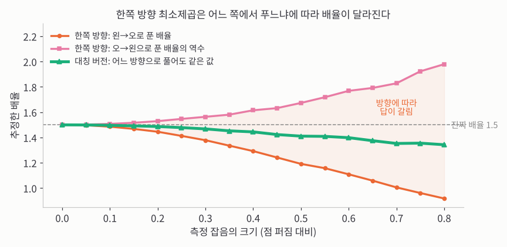
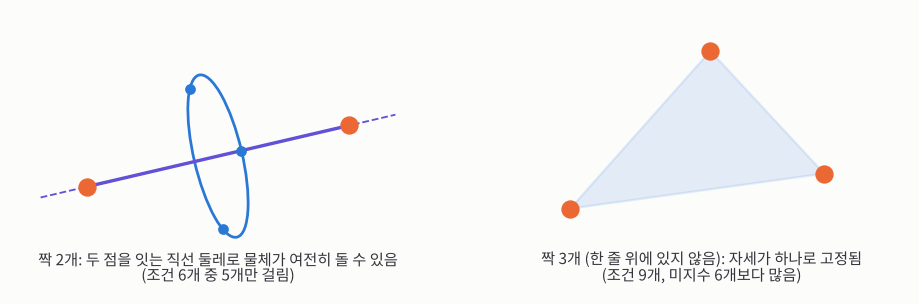
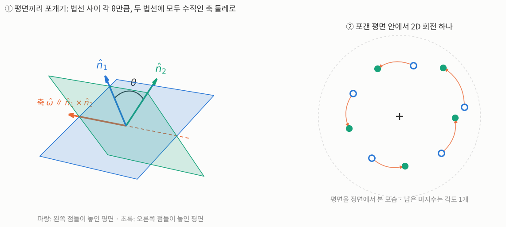
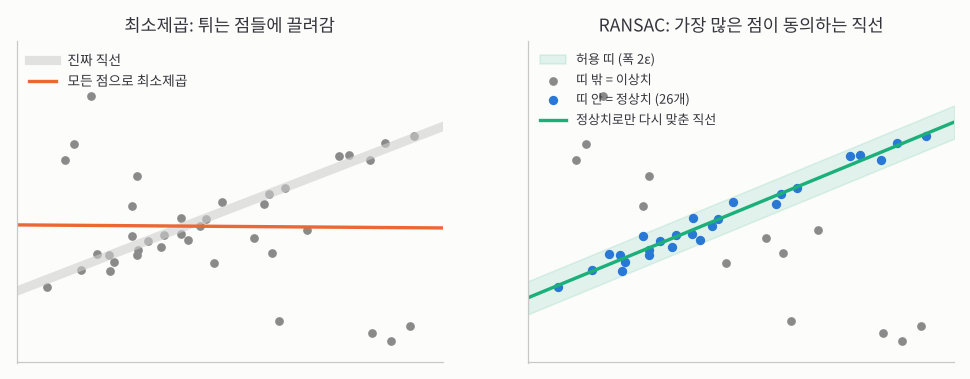
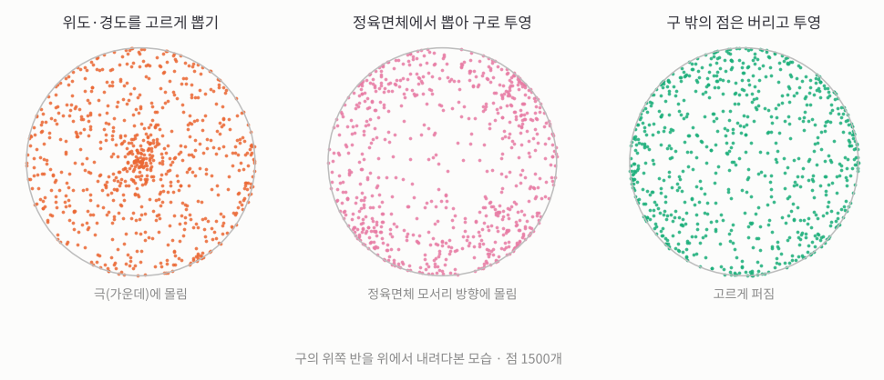
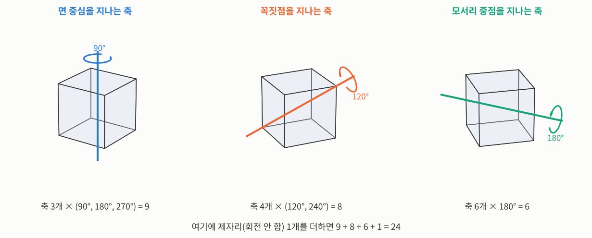


_MIT OpenCourseWare 6.801 19강 원본 영상 (영어)_

> **한 줄 요약:** 두 점 구름 사이의 **이동**은 무게중심 차이, **배율**은 두 구름 크기의 비, **회전**은 4×4 행렬의 가장 큰 고유값에 딸린 고유벡터로, 모두 닫힌 해가 나옵니다. 다만 최소제곱은 튀는 점 몇 개에 크게 휘둘리므로, 실전에서는 **RANSAC**으로 믿을 만한 점만 골라 낸 뒤 풉니다.
{: .prompt-info }

## 지난 시간 복습: 회전으로 하는 두 가지 일

교수님은 절대 방향을 사진 측량의 다른 문제들보다 자세히 다룬다고 말하며 시작합니다. 뒤에 나올 내용이 대부분 이 위에 쌓이기 때문입니다. 그중 까다로운 부분은 늘 회전이었고, [18강](/posts/mit-mv-18-quaternions/)에서 여러 표현 가운데 **단위 사원수**를 고른 가장 큰 이유는, 최소제곱의 "가장 잘 맞는 답"을 **닫힌 해**(반복 없이 식으로 한 번에 나오는 답)로 구할 수 있기 때문이었습니다.

글자 위의 동그라미(°)는 사원수라는 표시입니다. 사원수 $$\mathring{q}$$는 실수 하나와 3D 벡터 하나의 묶음 $$\mathring{q} = (q_0, \mathbf{q})$$이고, 벡터 부분의 성분을 $$\mathbf{q} = (q_x, q_y, q_z)$$로 씁니다. 회전으로 하는 일은 두 가지입니다.

- **회전 이어 붙이기:** 회전 두 개를 연달아 하는 것은 사원수 곱셈 하나입니다. 곱셈 횟수로 세면 3×3 행렬끼리의 곱은 27번, 사원수끼리의 곱은 16번이라 사원수 쪽이 가볍습니다.
- **벡터 돌리기:** 벡터 $$r$$을 실수 부분이 0인 사원수 $$\mathring{r} = (0, r)$$로 보고, 앞뒤로 $$\mathring{q}$$와 그 켤레 $$\mathring{q}^*$$를 곱합니다. 결과도 실수 부분이 0이라 다시 보통 3D 벡터로 돌아옵니다.

$$
\mathring{r}' = \mathring{q}\,\mathring{r}\,\mathring{q}^*
$$

이쪽은 3×3 행렬과 벡터의 곱(곱셈 9번)보다 계산이 많지만, 중간에 나오는 외적 $$\mathbf{q} \times r$$를 다시 쓰면 조금 줄일 수 있습니다.

회전축 $$\hat{\omega}$$(길이 1인 방향, 모자 ^는 단위 벡터 표시)와 각도 $$\theta$$로 나타낸 회전과는 이렇게 이어집니다. 로드리게스 공식과 사원수 회전을 맞춰 보면 나오는 관계입니다.

$$
q_0 = \cos\frac{\theta}{2}, \qquad \mathbf{q} = \hat{\omega}\,\sin\frac{\theta}{2}
$$

거꾸로 사원수에서 축과 각도를 꺼낼 때는, 축은 벡터 부분 $$\mathbf{q}$$의 방향이고, 각도는 $$\theta/2 = \text{atan2}(\|\mathbf{q}\|, q_0)$$입니다. 예를 들어 $$\mathring{q} = (0.707, 0, 0, 0.707)$$이면 축은 $$z$$축이고 $$\theta/2 = \text{atan2}(0.707, 0.707) = 45^\circ$$, 즉 $$z$$축 둘레 90° 회전입니다.

## 사원수와 회전 행렬 사이를 오가기

회전을 나타내는 방법은 여덟 가지쯤 되고, 둘씩 짝지어 바꾸는 방법은 $$8 \times 7 = 56$$가지나 됩니다. 다 볼 수는 없으니 가장 중요한 두 가지, **사원수 ↔ 회전 행렬**만 봅니다. 회전 행렬이 우리에게 가장 익숙한 세계라서, 결국 그쪽으로 오가야 하기 때문입니다.

### 사원수 → 회전 행렬

$$\mathring{q}\,\mathring{r}\,\mathring{q}^*$$를 행렬 곱으로 풀어 쓰면 4×4 행렬이 나오는데, 첫 행과 첫 열은 실수 부분을 다루는 자리라 떼어 내면 3×3 회전 행렬이 남습니다.

$$
R = \begin{pmatrix}
q_0^2 + q_x^2 - q_y^2 - q_z^2 & 2(q_xq_y - q_0q_z) & 2(q_xq_z + q_0q_y) \\
2(q_yq_x + q_0q_z) & q_0^2 - q_x^2 + q_y^2 - q_z^2 & 2(q_yq_z - q_0q_x) \\
2(q_zq_x - q_0q_y) & 2(q_zq_y + q_0q_x) & q_0^2 - q_x^2 - q_y^2 + q_z^2
\end{pmatrix}
$$

### 회전 행렬 → 각도: trace는 0° 근처에서 둔하다

반대 방향이 더 어렵습니다. 3×3 행렬은 숫자가 9개인데 자유도는 3개뿐이라, 9개 중 무엇을 어떻게 쓸지 골라야 합니다.

먼저 대각선 성분의 합(trace, $$\text{tr}$$)을 봅니다. 위 행렬의 대각선을 더하면 $$\text{tr}(R) = 3q_0^2 - (q_x^2 + q_y^2 + q_z^2)$$이고, $$q_0 = \cos(\theta/2)$$와 배각 공식을 쓰면

$$
\cos\theta = \tfrac{1}{2}\big(\text{tr}(R) - 1\big)
$$

$$z$$축 둘레 90° 회전 $$R = \begin{pmatrix} 0 & -1 & 0 \\ 1 & 0 & 0 \\ 0 & 0 & 1 \end{pmatrix}$$이면 $$\text{tr}(R) = 0 + 0 + 1 = 1$$이라 $$\cos\theta = 0$$, $$\theta = 90^\circ$$입니다. 이 값이 $$-1$$과 $$1$$ 사이를 벗어나면 그 행렬은 회전일 수 없으니, 간단한 검사로도 쓸 수 있습니다.

하지만 **각도가 0° 근처일 때는 이 식이 둔합니다.** 코사인 그래프가 0° 근처에서 평평해서, 값이 조금만 흔들려도 각도가 크게 바뀝니다. 숫자로 보면 이렇습니다.

| 실제 각도 | trace에 잡음 0.001이 끼면 |
|---|---|
| 2° | 2.70°로 계산됨 (0.7° 오차) |
| 90° | 90.03°로 계산됨 (0.03° 오차) |

같은 잡음인데 0° 근처에서 오차가 20배 넘게 큽니다. 이럴 때는 대각선이 아닌 성분을 씁니다. 대각선 건너편끼리 빼면 $$q_0 q_x$$처럼 $$\sin\theta$$에 비례하는 값이 나오는데, 사인은 0° 근처에서 가장 예민합니다. 코사인과 사인을 함께 atan2에 넣으면 어느 각도에서나 안정적입니다. 교수님은 수학적으로는 맞지만 숫자로는 엉망인 변환 공식이 책에 많이 실려 있다며, 그런 공식에 대한 "예방 주사"로 이 이야기를 한다고 말합니다.

### 회전 행렬 → 사원수: 가장 큰 것부터

대각선 성분을 더하고 빼면 네 성분의 제곱이 하나씩 나옵니다($$r_{jk}$$는 $$R$$의 $$j$$행 $$k$$열 성분입니다).

$$
\begin{aligned}
1 + r_{11} + r_{22} + r_{33} &= 4q_0^2 \\
1 + r_{11} - r_{22} - r_{33} &= 4q_x^2 \\
1 - r_{11} + r_{22} - r_{33} &= 4q_y^2 \\
1 - r_{11} - r_{22} + r_{33} &= 4q_z^2
\end{aligned}
$$

제곱근을 넷 다 취하면 부호를 모릅니다. 부호 조합은 $$2^4 = 16$$가지이고, $$\mathring{q}$$와 $$-\mathring{q}$$는 같은 회전이니 반으로 줄어도 8가지나 남습니다. 그래서 이렇게 합니다.

1. 넷 중 **가장 큰 값 하나**를 고릅니다. 큰 수의 제곱근이 숫자로 가장 정확합니다.
2. 그 성분은 양수 제곱근으로 정합니다($$\pm\mathring{q}$$가 같은 회전이라 마음대로 골라도 됩니다).
3. 나머지 세 성분은 대각선 건너편 성분의 합·차로 구합니다.

$$
r_{32} - r_{23} = 4q_0q_x,\quad r_{13} - r_{31} = 4q_0q_y,\quad r_{21} - r_{12} = 4q_0q_z
$$

$$
r_{21} + r_{12} = 4q_xq_y,\quad r_{32} + r_{23} = 4q_yq_z,\quad r_{13} + r_{31} = 4q_zq_x
$$

**손으로 계산해 보면:** 앞의 $$z$$축 둘레 90° 회전 행렬로 해 봅시다.

1. 대각 조합: $$4q_0^2 = 1 + 0 + 0 + 1 = 2$$, $$4q_x^2 = 1 + 0 - 0 - 1 = 0$$, $$4q_y^2 = 1 - 0 + 0 - 1 = 0$$, $$4q_z^2 = 1 - 0 - 0 + 1 = 2$$
2. 가장 큰 쪽($$q_0$$와 $$q_z$$가 공동 1등)에서 $$q_0$$를 골라 양수로: $$q_0 = \sqrt{2/4} \approx 0.707$$
3. $$r_{21} - r_{12} = 1 - (-1) = 2 = 4q_0q_z$$이므로 $$q_z = 2 / (4 \times 0.707) \approx 0.707$$, 나머지는 0

결과 $$\mathring{q} = (0.707, 0, 0, 0.707)$$은 앞에서 본 "$$z$$축 둘레 90°" 사원수와 같습니다. 축과 각도를 거쳐 돌아가는 방법도 있지만, 잡음 섞인 행렬 성분 9개를 골고루 잘 쓰기가 오히려 더 복잡합니다.

## 배율까지 넣기

지금까지는 회전과 이동만 생각했고, 대부분은 그거면 충분합니다. 그런데 두 좌표계의 **단위(배율)**가 조금 다를 수도 있습니다.

- 라이다처럼 빛이 다녀온 시간으로 거리를 재는 센서는, 빛의 속도를 아주 정확히 알아서 배율 오차는 거의 없습니다(시작점이 어긋나는 오차는 있을 수 있습니다).
- 카메라 두 위치로 재는 경우는 다릅니다. 두 위치 사이의 거리(기준선)를 "속도 × 시간"으로 어림하는데, 이 값이 정확하지 않으면 복원한 장면 전체의 크기가 달라집니다.
- 비행하며 찍은 사진들로 지형을 이어 붙일 때는 정확도가 아주 중요해서, 조각마다 배율이 조금 다를 수 있다고 열어 두는 게 맞습니다.

배율을 넣어도 **이동은 그대로** 풀립니다. 이동으로 미분해서 0으로 놓으면 [17강](/posts/mit-mv-17-photogrammetry/)처럼 "무게중심이 무게중심으로 간다"가 나옵니다. 그래서 두 점 구름에서 각자 무게중심을 뺀 좌표(프라임 ′를 붙인 $$r'$$)로 쓰면, 남는 것은 회전 $$R$$과 배율 $$s$$(scale)입니다.

$$
r'_{r,i} = s\,R(r'_{l,i})
$$

계산에 쓸 값 세 개를 정의해 둡니다. 두 $$S$$는 각 점 구름이 얼마나 퍼져 있는지(크기의 제곱합, Sum)이고, $$D$$는 돌린 왼쪽 점과 오른쪽 점의 내적(Dot product)을 더한 값으로, 둘이 얼마나 같은 방향을 가리키는지를 뜻합니다. 배율 $$s$$와 헷갈리지 않게 크기의 합은 대문자 $$S$$로 씁니다.

$$
S_r = \sum_i \|r'_{r,i}\|^2, \qquad S_l = \sum_i \|r'_{l,i}\|^2, \qquad D = \sum_i r'_{r,i} \cdot R(r'_{l,i})
$$

### 한쪽 방향으로 풀면 생기는 문제

17강과 같은 식으로 오차를 세우면, 회전은 길이를 바꾸지 않으므로

$$
\sum_i \|r'_{r,i} - s\,R(r'_{l,i})\|^2 = S_r - 2sD + s^2 S_l
$$

$$s$$로 미분해서 0으로 놓으면 $$s = D / S_l$$입니다. 이 식에는 $$D$$, 즉 아직 모르는 $$R$$이 들어 있어서 회전을 먼저 구해야 배율이 나옵니다.

더 큰 문제가 있습니다. 17강에서 짚었듯이, 같은 문제를 **오른쪽에서 왼쪽으로** 풀면 그 배율은 처음 배율의 정확한 역수가 나와야 합니다. 그런데 이 방법은 그렇지 않습니다.

**손으로 계산해 보면:** 무게중심을 뺀 왼쪽 점이 $$(1, 0)$$, $$(-1, 0)$$이고, 오른쪽 점이 잡음이 조금 섞여 $$(0.3, 3)$$, $$(-0.3, -3)$$으로 재졌다고 합시다. 회전은 반시계 90°라 $$R(1, 0) = (0, 1)$$, $$R(-1, 0) = (0, -1)$$입니다.

- $$S_l = 1 + 1 = 2$$, $$S_r = (0.09 + 9) + (0.09 + 9) = 18.18$$
- $$D = (0, 1)\cdot(0.3, 3) + (0, -1)\cdot(-0.3, -3) = 3 + 3 = 6$$
- 왼쪽 → 오른쪽: $$s = D / S_l = 6 / 2 = 3$$
- 오른쪽 → 왼쪽: 같은 식으로 $$\bar{s} = D / S_r = 6 / 18.18 \approx 0.330$$, 역수로 바꾸면 약 $$3.03$$

방향에 따라 3과 3.03으로 답이 갈립니다. 원인은 최소제곱이 **꼼수를 쓴다**는 데 있습니다. 옮기는 쪽 점 구름을 조금 줄이면 점들이 서로 가까워져 오차가 작아 보입니다. 그래서 어느 쪽을 옮기느냐에 따라 그쪽이 작아지는 방향으로 치우칩니다.

_가로축은 측정 잡음의 크기, 세로축은 추정한 배율이고, 점선이 진짜 배율 1.5입니다. 잡음이 없으면 세 방법 모두 1.5를 맞히지만, 잡음이 커질수록 한쪽 방향으로 푼 두 값(주황, 분홍)이 서로 반대쪽으로 벌어집니다. 대칭 버전(초록)은 어느 방향으로 풀어도 같은 값 하나입니다._

### 대칭으로 풀기: 배율은 크기의 비

해결책은 오차를 양쪽에 공평하게 나눠 주는 것입니다(2D 숙제에서 본 것과 같은 꼴입니다). 오른쪽은 $$\sqrt{s}$$로 나누고 왼쪽은 $$\sqrt{s}$$를 곱해서 비교합니다.

$$
e_i = \frac{1}{\sqrt{s}}\,r'_{r,i} - \sqrt{s}\,R(r'_{l,i}), \qquad \sum_i\|e_i\|^2 = \frac{1}{s}S_r - 2D + s\,S_l
$$

이제 $$D$$ 앞에 $$s$$가 없습니다. $$s$$로 미분해서 0으로 놓으면

$$
-\frac{S_r}{s^2} + S_l = 0 \quad\Longrightarrow\quad s = \sqrt{\frac{S_r}{S_l}}
$$

방향을 바꾸면 $$S_r$$과 $$S_l$$이 자리만 바꾸니 정확히 역수가 됩니다. 앞의 예에서는 $$s = \sqrt{18.18 / 2} \approx 3.015$$로, 한쪽 방향 두 답 3과 3.03의 딱 중간쯤(기하평균)입니다.

게다가 이 식에는 $$D$$도 $$R$$도 없습니다. **배율은 그냥 두 점 구름의 크기 비율**이라, 회전을 몰라도, 심지어 어느 점이 어느 점과 짝인지(대응)를 몰라도 구할 수 있습니다. 이렇게 이동, 배율, 회전이 서로 떨어져 나가고, 남는 것은 회전뿐입니다.

## 회전: 레일리 몫으로 보기

18강에서 회전 문제는 "4×4 대칭 행렬 $$N$$에 대해 $$\mathring{q}^T N \mathring{q}$$를 가장 크게 하는 $$\mathring{q}$$를 찾기"로 바뀌었습니다. $$N$$은 짝지은 점들로 만드는 행렬입니다(교수님 수업에서도 "그럼 그 행렬이 뭐냐"는 질문이 나왔는데, 사원수 곱을 행렬로 나타낸 것들을 모든 점 쌍에 대해 더한 것이라 답합니다).

그냥 미분해서 0으로 놓으면 $$N\mathring{q} = 0$$이 되어 $$\mathring{q} = 0$$이라는 쓸모없는 답만 나옵니다. 거꾸로 "가장 크게"만 생각하면 $$\mathring{q}$$를 한없이 키우면 값도 한없이 커집니다. 그래서 **길이가 1**이라는 조건이 꼭 필요합니다. 라그랑주 승수로 풀어도 되지만, 더 간단한 방법이 있습니다. 길이의 제곱으로 **나누는** 것입니다.

$$
J(\mathring{q}) = \frac{\mathring{q}^T N \mathring{q}}{\mathring{q}^T \mathring{q}}
$$

$$J$$는 목적 함수(값을 크게 하려는 함수)라는 뜻으로 흔히 쓰는 글자입니다. 이 꼴을 **레일리 몫**(Rayleigh quotient)이라 합니다. 광학 등에서 많은 업적을 남긴 레일리의 이름입니다. 분자와 분모가 둘 다 $$\mathring{q}$$의 길이 제곱에 비례하니, $$\mathring{q}$$를 몇 배로 늘려도 값이 그대로입니다. 원점에서 뻗은 반직선 위에서는 값이 일정하고, **방향만** 중요해집니다. 그러니 길이 조건 없이 마음대로 미분할 수 있습니다.

**작은 예로 보면:** 2×2로 줄여 $$N = \begin{pmatrix} 3 & 0 \\ 0 & 1 \end{pmatrix}$$이라 합시다.

- $$\mathring{q} = (1, 0)$$: $$J = 3/1 = 3$$
- $$\mathring{q} = (2, 0)$$: $$J = 12/4 = 3$$ (길이를 2배로 해도 같음)
- $$\mathring{q} = (1, 1)$$: $$J = (3 + 1)/2 = 2$$
- $$\mathring{q} = (0, 1)$$: $$J = 1/1 = 1$$

가장 큰 값 3은 $$N$$의 가장 큰 고유값이고, 그때의 $$\mathring{q} = (1, 0)$$이 그 고유벡터입니다. 일반적으로도 그렇다는 것을 미분으로 확인하면, 몫의 미분 공식으로 미분해서 0으로 놓으면

$$
N\mathring{q} = \underbrace{\frac{\mathring{q}^T N \mathring{q}}{\mathring{q}^T \mathring{q}}}_{\lambda}\,\mathring{q}
$$

$$N$$을 곱해도 방향이 그대로인 벡터, 즉 **고유벡터**이고, 이때 $$J$$의 값이 곧 고유값 $$\lambda$$입니다. 가장 크게 하려는 것이니 **가장 큰 고유값의 고유벡터**를 고르면 되고, 작은 고유값을 고를 이유는 없습니다. 라그랑주 승수로 푼 18강과 같은 답입니다. 사원수는 길이 1 조건 하나만 지키면 되니, 회전 행렬의 직교 조건 6개를 지키는 것보다 훨씬 다루기 쉽습니다.

## 짝은 몇 개나 필요할까

그러면 언제 이 방법이 실패할까요? 고유값을 직접 따지면 지저분하니, 교수님은 먼저 직관으로 셉니다. 미지수는 이동 3 + 회전 3 = 6개, 배율까지 넣으면 7개입니다. 짝 하나는 "옮긴 위치가 같아야 한다"는 3D 벡터 식이라 조건 3개를 줍니다.

- **짝 1개:** 그 점을 붙잡아도 물체는 그 점을 중심으로 마음대로 돌 수 있습니다. 조건 3개로는 모자랍니다.
- **짝 2개:** 조건이 6개일 것 같지만, 두 점 사이의 거리는 원래 정해져 있으니 하나는 겹칩니다. 독립인 조건은 5개뿐이라, 두 점을 잇는 직선 둘레로 여전히 돌 수 있습니다. 두 물체를 두 군데만 끈으로 묶어 놓은 것과 같습니다.
- **짝 3개:** 한 줄에 놓이지만 않으면 자세가 하나로 정해집니다. 17강의 "세 점 방법"과 같은 개수라, 이 점에서는 사원수 방법이 더 나을 게 없습니다.

_왼쪽: 주황 점 두 개를 맞춰도, 두 점을 잇는 보라 직선 둘레로 물체(파란 고리 위의 점들)를 여전히 돌릴 수 있습니다. 오른쪽: 한 줄에 있지 않은 세 점을 맞추면 더 이상 움직일 수 없습니다._

회전 대신 아무 3×3 행렬을 허용하는 **일반 선형 변환**이면 어떨까요? 3D에서는 행렬 9개 + 이동 3개 = 미지수 12개라 **짝 4개**가 필요하고, 2D에서는 6개라 짝 3개가 필요합니다. 직교 조건이 없으니 최소제곱도 깔끔하게 풀립니다. 하지만 이 변환은 물체를 비스듬히 찌그러뜨리거나 방향마다 다르게 늘이는 것까지 허용하는데, 실제 센서 둘 사이에서는 그런 일이 일어나지 않습니다. 그래서 우리에게 필요한 건 회전입니다.

## 언제 실패할까: 점들이 한 평면에 있을 때

짝이 2개뿐이면 $$N$$이 특이 행렬(역행렬이 없는 행렬)이 되어 고유값 0이 여러 개 생깁니다. 앞의 직관을 식으로 확인한 셈입니다.

더 흥미로운 경우를 보려면 고유값을 구하는 식을 들여다봅니다. 4×4 행렬의 고유값은 $$\det(N - \lambda I) = 0$$을 풀어 얻는 4차 방정식의 근입니다.

$$
\lambda^4 + c_3\lambda^3 + c_2\lambda^2 + c_1\lambda + c_0 = 0
$$

$$c_3, c_2, c_1, c_0$$은 계수(coefficient)라서 $$c$$로 쓰고, 아래첨자는 붙어 있는 $$\lambda$$의 차수입니다. 이 문제에서는 특별한 일이 두 가지 일어납니다.

- $$c_3$$은 $$N$$의 대각선 합이고, $$N$$을 만드는 방식 때문에 이 값이 언제나 **0**입니다. 말하기는 쉬워도 보이기는 쉽지 않은 사실이라고 교수님은 말합니다.
- $$c_1$$은 3×3 행렬 $$M$$의 행렬식 $$\det M$$에 비례합니다. $$M$$은 짝지은 점들의 바깥곱(열벡터 × 행벡터)을 더한 행렬이고, 데이터를 한 번 훑으며 만든 뒤 그 성분으로 $$N$$을 만드는 것이 가장 효율적입니다.

$$
M = \sum_i r'_{l,i}\, r'^T_{r,i}
$$

그래서 $$\det M = 0$$이면 $$c_1 = 0$$이 되고, 방정식은 $$\lambda^4 + c_2\lambda^2 + c_0 = 0$$, 즉 $$\lambda^2$$에 대한 **2차 방정식**이 됩니다. 4차 방정식의 복잡한 공식 대신 근의 공식으로 바로 풀립니다.

$$\det M = 0$$은 기하학적으로 뜻이 있습니다. 대표적인 경우가 **점들이 한 평면 위에 있을 때**입니다. 오른쪽 점들이 무게중심을 지나고 법선(평면에 수직인 단위 벡터)이 $$\hat{n}$$인 평면 위에 있으면, 모든 점에서 $$r'_{r,i} \cdot \hat{n} = 0$$이라

$$
M\hat{n} = \sum_i r'_{l,i}\,(r'_{r,i}\cdot\hat{n}) = \mathbf{0}
$$

0이 아닌 $$\hat{n}$$을 곱했는데 0이 나왔으니 $$M$$은 특이 행렬이고 $$\det M = 0$$입니다(왼쪽 점들이 평면 위에 있어도 같은 식으로 $$\det M = 0$$입니다).

### 양쪽 다 평면이면 더 쉽다

왼쪽과 오른쪽 점 구름이 **둘 다** 평면 위에 있으면, 회전을 간단한 두 단계로 나눌 수 있습니다.

_① 파란 평면(왼쪽 점들)과 초록 평면(오른쪽 점들)의 법선 $$\hat{n}_1$$, $$\hat{n}_2$$ 사이 각이 $$\theta$$입니다. 두 법선에 모두 수직인 주황 축, 즉 두 평면이 만나는 직선 둘레로 $$\theta$$만큼 돌리면 두 평면이 포개집니다. ② 포갠 평면을 정면에서 본 모습입니다. 이제 파란 고리를 초록 점으로 옮기는 평면 안의 회전 하나, 각도 1개만 남습니다._

1. **평면끼리 포개기:** 회전축은 두 법선에 모두 수직이어야 하니 외적 방향이고, 각도는 내적(코사인)과 외적의 길이(사인)를 atan2에 넣어 구합니다. 축과 각도를 알면 앞에서 본 식으로 사원수도 바로 만듭니다.

   $$
   \hat{\omega} = \frac{\hat{n}_1 \times \hat{n}_2}{\|\hat{n}_1 \times \hat{n}_2\|}, \qquad \theta = \text{atan2}\big(\|\hat{n}_1 \times \hat{n}_2\|,\; \hat{n}_1\cdot\hat{n}_2\big)
   $$

2. **평면 안에서 돌리기:** 포갠 뒤에는 3D 공간 어딘가에 놓인 평면 안의 2D 회전 하나만 남으니, 숙제에서 푼 2D 최소제곱으로 풉니다.

교수님은 문제를 쉽게 만드는 이런 특수한 경우가 실제로도 의미 있는 상황(예: 평평한 땅이나 벽을 잰 경우)에 해당한다는 점을 짚습니다.

## 튀는 점 하나가 다 망친다: RANSAC

교수님은 절대 방향의 닫힌 해를 **"승리"**라고 부릅니다. 다음에 볼 상대 방향에는 아직 닫힌 해가 없기 때문입니다. 그 전에 짚을 문제가 하나 있습니다. 지금까지는 모두 최소제곱이었는데, 최소제곱은 잡음이 종 모양(가우스 분포)일 때는 아주 좋습니다. 이때는 최소제곱이 확률적으로 가장 그럴듯한 답(최대 우도)이기도 해서, 그냥 편해서 쓰는 방법이 아닙니다.

문제는 **잘못 짝지어진 점**(이상치)이 섞일 때입니다. 오차를 **제곱**하니까, 멀리 튄 점 하나의 오차가 엄청나게 커져서 답을 그쪽으로 끌고 갑니다. 제곱 대신 절댓값을 쓰면 덜 끌려가지만 닫힌 해가 없어서 분석하기 어렵습니다. 가장 좋은 건 튄 점을 **아예 무시하는** 것입니다.

_왼쪽: 점들은 회색 띠(진짜 직선)를 따라 놓여 있지만, 위아래로 튄 점들 때문에 모든 점으로 맞춘 최소제곱 직선(주황)이 거의 수평으로 끌려갑니다. 오른쪽: RANSAC은 폭 $$2\epsilon$$인 띠 안에 가장 많은 점(파랑, 26개)이 들어오는 직선을 찾고, 그 점들로만 다시 맞춥니다(초록)._

이 생각을 정리한 것이 **RANSAC**(RANdom SAmple Consensus, 무작위 표본 합의)입니다. SRI(Stanford Research Institute)의 Fischler와 Bolles가 만들었는데, 위성 항법, 별 위치 측정, 자이로스코프처럼 오차가 대부분 얌전하다가 가끔 엄청나게 튀는 문제를 다루던 사람들이었습니다. 방법은 이렇습니다.

1. **무작위로 최소 개수만 뽑습니다.** 직선이면 2개, 절대 방향이면 짝 3개입니다. 점이 많을수록 답이 정확해지니(오차가 대략 $$1/\sqrt{\text{점 수}}$$로 줄어듦) 조금 더 뽑는 사람도 있습니다.
2. **그 점들로 답을 만듭니다.** 보통 최소제곱으로 맞춥니다.
3. **나머지 점으로 검사합니다.** 답에서 거리 $$\epsilon$$ 이내, 즉 폭 $$2\epsilon$$인 띠 안에 드는 점을 정상치(inlier)로 셉니다. $$\epsilon$$(엡실론)은 작은 양에 흔히 쓰는 글자이고, 보통 측정 잡음의 크기를 알고 정합니다.
4. 정상치가 충분히 많으면 멈추고, 그 정상치들로만 최소제곱을 다시 합니다. 아니면 1로 돌아가 다시 뽑습니다.

여기에는 기준이 두 개 들어갑니다. 정상치를 가르는 **띠의 폭**, 그리고 답을 받아들일 **정상치 개수**입니다. 둘 다 잡음의 크기와 정상치 비율을 대략 알아야 정할 수 있습니다. 또 **최대 시도 횟수**(예: 100번)를 정해 둬야 합니다. 그만큼 해도 안 되면, 모형이나 기준이 잘못됐다는 뜻이니 포기하는 게 맞습니다. RANSAC은 절대 방향뿐 아니라, 이상치가 의심되는 최소제곱 문제라면 어디에나 쓸 수 있습니다.

교수님은 "합의"라는 이름을 처음 듣고 [14강의 허프 변환](/posts/mit-mv-14-hough-transform/) 같은 방법을 떠올렸다고 합니다. 무작위로 뽑을 때마다 나온 답(매개변수)을 매개변수 공간의 칸에 한 표씩 던지고, **표가 가장 많이 쌓인 칸**을 고르는 방식입니다. 둘 다 다소 즉석에서 만든 방법이지만 실전에서는 아주 쓸모 있습니다.

## 회전을 고르게 뽑기

뒤에서 복잡한 물체를 알아보고 방향을 맞추는 문제를 다루는데, 그때는 닫힌 해가 없는 경우가 많습니다. 그러면 회전을 이것저것 **시험해 봐야** 합니다. 감지한 물체를 라이브러리의 모형과 맞추려면 여러 회전으로 돌려 보며 비교해야 하고, 그 회전들은 **회전 공간을 고르게** 덮어야 합니다. 단위 사원수는 4D 단위구 위의 점이니, 결국 4D 구에서 점을 고르게 뽑는 문제입니다. 먼저 3D 구로 연습합니다.

_구의 위쪽 반을 위에서 내려다본 모습이고, 점은 각각 1500개입니다. 왼쪽: 위도·경도를 고르게 뽑으면 극(가운데)에 몰립니다. 가운데: 정육면체에서 뽑아 구로 투영하면 모서리 방향(대각선 쪽)에 몰립니다. 오른쪽: 구 밖의 점을 버리고 투영하면 고르게 퍼집니다._

- **위도·경도로 격자 만들기:** 쉽지만 경선이 극에서 모이니 극 근처가 촘촘해집니다. 교수님은 어떤 좌표를 잡아도 구 위에 완벽히 고른 격자는 만들 수 없다고 말합니다. 위도·경도를 **무작위로** 고르게 뽑아도 마찬가지로 극에 몰립니다.
- **정육면체 안에서 고르게 뽑아 구로 투영하기:** 직교 좌표에서 고르게 뽑기는 쉽습니다. 하지만 정육면체는 꼭짓점 쪽이 원점에서 더 멀어서(면 중심까지 1이면 꼭짓점까지 $$\sqrt{3}$$), 그 방향으로 놓인 점이 더 많습니다. 어떤 방향에 놓인 점의 수는 그 방향의 거리의 세제곱에 비례하니, 꼭짓점 방향은 면 중심 방향보다 $$(\sqrt{3})^3 \approx 5.2$$배 촘촘합니다.
- **구 밖의 점은 버리고 투영하기:** 정육면체에서 뽑되 반지름 1인 공 밖에 떨어진 점은 버리면, 남은 점은 공 안에 고르게 있으니 구로 투영해도 고릅니다. 원점에 너무 가까운 점도 나눗셈이 불안정해지니 버립니다.

4D도 똑같습니다. 무작위 숫자 4개를 뽑아 제곱합이 1보다 크면 버리고, 나머지를 길이 1로 맞추면 단위 사원수가 고르게 뽑힙니다. 4D는 그릴 수 없지만 원리는 같습니다.

### 정다면체와 축구공

버리는 점이 아깝다면 구에 더 잘 맞는 도형을 씁니다. **정다면체**(정사면체, 정육면체, 정팔면체, 정십이면체, 정이십면체)의 모서리를 구에 투영하면 구가 똑같은 칸으로 나뉩니다. 문제는 면이 4, 6, 8, 12, 20개밖에 없다는 것이고, 플라톤이 보였듯 정다면체는 이 다섯 개뿐이라 더 잘게 나누려면 칸을 쪼개야 합니다.

교수님은 축구공을 예로 듭니다. 축구공은 오각형 12개와 육각형 20개, 모두 32면입니다. 이런 도형을 **준정다면체**(아르키메데스 다면체)라 하는데, 면이 두 종류 이상의 정다각형이고 모서리 길이는 모두 같습니다. 모두 13개이고, 거울상이 원래 모양과 겹치지 않는 것을 따로 세면 15개가 됩니다. 면이 더 많지만, 면 종류마다 넓이가 달라 칸이 고르지는 않습니다.

### 정육면체를 제자리로 돌리는 회전 24개

4D에는 플라톤도 아르키메데스도 없으니, 회전 공간에서는 직접 규칙적인 무늬를 찾아야 합니다. 교수님은 **정육면체를 제자리로 돌리는 회전들**로 시작합니다. 여기서 $$x, y, z$$축은 정육면체 중심을 원점으로, 세 면에 수직으로 잡은 축입니다.

- 제자리(회전 안 함): $$(1, \mathbf{0})$$
- $$x, y, z$$축 둘레 180°: $$(0, \hat{x}), (0, \hat{y}), (0, \hat{z})$$ ($$\cos 90^\circ = 0$$, $$\sin 90^\circ = 1$$)
- $$x, y, z$$축 둘레 ±90°: $$\tfrac{1}{\sqrt{2}}(1, \pm\hat{x}), \tfrac{1}{\sqrt{2}}(1, \pm\hat{y}), \tfrac{1}{\sqrt{2}}(1, \pm\hat{z})$$ ($$\cos 45^\circ = \sin 45^\circ = 1/\sqrt{2}$$)

여기까지 10개입니다($$\pm\mathring{q}$$는 같은 회전이라 한 번만 셉니다). 이게 전부일까요? 이것들을 서로 곱하면 새 회전이 나오는지 봅니다. $$x$$축 둘레 90°와 $$y$$축 둘레 90°를 곱하면, 18강의 곱셈 규칙 $$(p, \mathbf{p})(q, \mathbf{q}) = (pq - \mathbf{p}\cdot\mathbf{q},\; p\mathbf{q} + q\mathbf{p} + \mathbf{p}\times\mathbf{q})$$에 따라

$$
\tfrac{1}{\sqrt{2}}(1, \hat{x}) \cdot \tfrac{1}{\sqrt{2}}(1, \hat{y}) = \tfrac{1}{2}\big(1 - \hat{x}\cdot\hat{y},\; \hat{y} + \hat{x} + \hat{x}\times\hat{y}\big) = \tfrac{1}{2}(1,\; \hat{x} + \hat{y} + \hat{z})
$$

실수 부분 $$\cos(\theta/2) = 1/2$$이니 $$\theta/2 = 60^\circ$$, $$\theta = 120^\circ$$이고, 축은 $$(1, 1, 1)/\sqrt{3}$$입니다. 정육면체의 **꼭짓점을 관통하는 축** 둘레 120° 회전으로, 처음 10개에 없던 회전입니다. 이렇게 새 회전이 더 나오지 않을 때까지 곱해 나가는 작은 프로그램을 짜면(또는 정육면체를 직접 들고 돌려 보면) 모두 **24개**가 나옵니다.

_24개를 축의 종류로 나눈 그림입니다. 파랑: 마주 보는 면의 중심을 지나는 축 3개, 각각 90°·180°·270°로 9개. 주황: 마주 보는 꼭짓점을 지나는 축 4개, 각각 120°·240°로 8개. 초록: 마주 보는 모서리의 중점을 지나는 축 6개, 각각 180°로 6개. 제자리 1개를 더해 24개입니다._

## 직접 해 보기

**① 절대 방향 닫힌 해.** 파란 점 구름(왼쪽 좌표계)과 주황 점 구름(오른쪽 좌표계)이 있고, 초록 고리는 4×4 행렬 $$N$$의 가장 큰 고유값의 고유벡터로 구한 회전과 이동으로 파란 점을 옮긴 위치입니다. 이상치 개수를 늘려 보세요.

이상치가 없을 때 회전 오차는 0.16°입니다. 이상치를 5개(16개 중) 넣으면 25.82°로 망가지고, 초록 고리가 주황 점에서 멀리 벗어납니다. "RANSAC 쓰기"를 켜면 정상치 11개를 골라 오차가 0.42°로 돌아옵니다. 절반인 8개가 이상치여도 RANSAC은 버팁니다.

**② 직선 RANSAC.** "한 번 뽑기"를 몇 번 눌러 보라색 두 점이 세운 직선과 그 직선의 정상치 수를 보세요. "50번 뽑기"를 누르면 가장 많은 표를 받은 직선이 남습니다.

처음 데이터에서 50번 뽑으면 최소제곱의 기울기 오차가 8.3°인 반면, RANSAC은 0.1°입니다. 이상치 비율을 0.7까지 올려도 대개 버티지만, 뽑아야 하는 횟수가 늘어납니다. 두 점이 모두 정상치일 확률이 $$0.3^2 = 0.09$$로 떨어지기 때문입니다.

## 정리

- 사원수 → 회전 행렬은 공식 하나, 회전 행렬 → 사원수는 **가장 큰 대각 조합**을 골라 숫자 정확도를 지킵니다. 각도를 trace로만 구하면 0° 근처에서 둔하니, 사인에 비례하는 비대각 성분과 atan2를 함께 씁니다.
- 배율은 대칭 버전 $$s = \sqrt{S_r/S_l}$$, 즉 **두 점 구름 크기의 비**입니다. 방향을 바꿔도 정확히 역수가 되고, 회전도 대응도 필요 없습니다.
- 회전은 레일리 몫 $$\mathring{q}^TN\mathring{q}/\mathring{q}^T\mathring{q}$$의 최대화, 즉 $$N$$의 **가장 큰 고유값의 고유벡터**입니다.
- 짝은 **3개** 이상 필요하고, 점들이 한 평면에 있으면 $$\det M = 0$$이 되어 오히려 더 쉽게(평면 포개기 + 2D 회전) 풀 수 있습니다.
- 이상치에는 **RANSAC**: 최소 개수를 뽑아 답을 세우고, 가장 많은 점이 동의하는 답을 고른 뒤 그 점들로만 다시 맞춥니다.
- 회전을 시험 삼아 뽑을 때는 4D 구 위에서 고르게 뽑아야 하고, 정육면체의 회전 24개 같은 규칙적인 집합도 쓸 수 있습니다.

> 다음 글: [[MIT 머신비전 20강] 사진 두 장으로 카메라 자세 찾기: 상대 방향과 위험한 곡면](/posts/mit-mv-20-critical-surfaces-stereo/)

_참고: MIT 6.801/6.866 Machine Vision (Fall 2020), Berthold Horn 강의 녹취록 · Ryan Sander · Tadayuki Yoshitake 강의 노트 (MIT OpenCourseWare, CC BY-NC-SA 4.0)_
