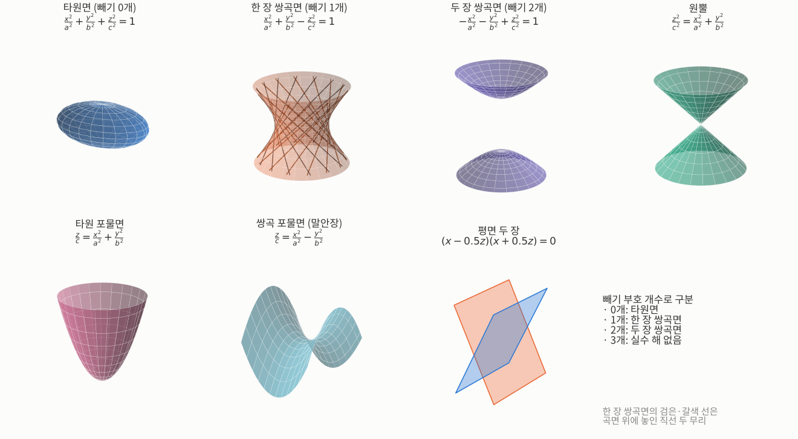
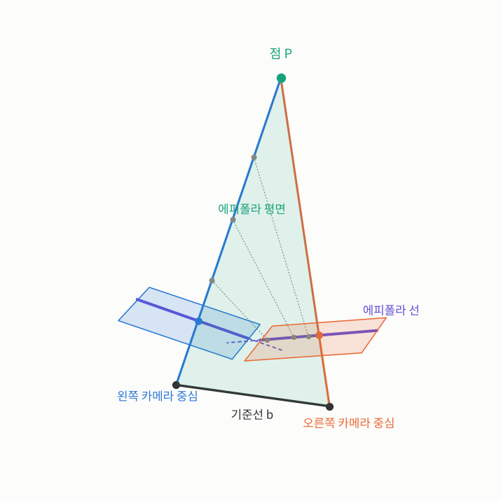
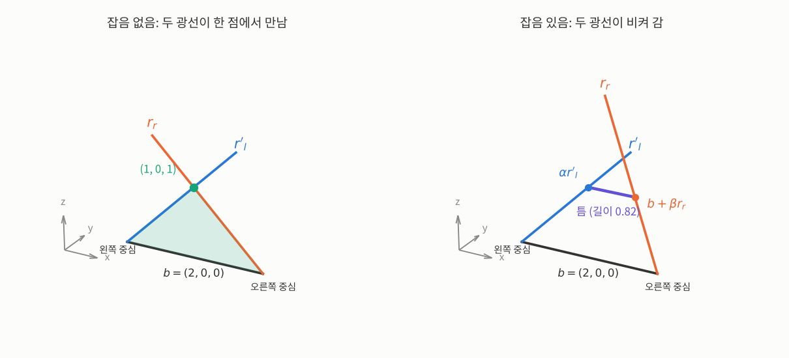
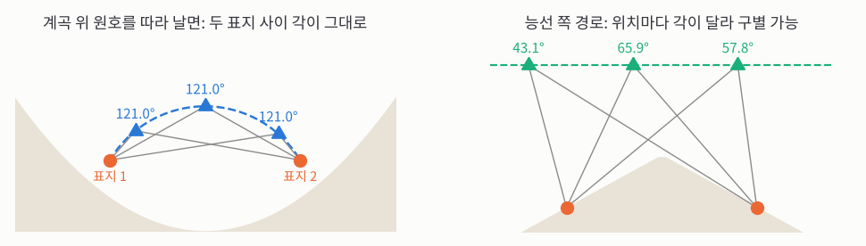


_MIT OpenCourseWare 6.801 20강 원본 영상 (영어)_

> **한 줄 요약:** 3D 좌표 없이 **사진 두 장만으로** 두 카메라가 서로 어떻게 놓여 있는지 찾는 것이 상대 방향 문제입니다. 사진만으로는 크기를 알 수 없어서 찾을 숫자는 5개이고, 짝지은 점도 **5쌍**이 필요합니다. 핵심 조건은 "두 광선과 기준선이 **한 평면 위**에 있어야 한다"입니다. 그런데 장면이 **한 장 쌍곡면**이나 **평면 두 장**처럼 생기면 답이 여러 개가 되거나 크게 흔들립니다.
{: .prompt-info }

## 구를 고르게 나누기 (지난 강의 이어서)

[지난 글](/posts/mit-mv-19-absolute-orientation-ransac/)에서 단위 사원수를 쓰면 모든 회전이 **4D 구 위의 점**이 된다고 했습니다. 회전을 고르게 훑어보거나 히스토그램을 만들려면 이 구를 넓이가 같은 칸으로 나눠야 합니다. 구를 칸으로 나누는 것을 **쪽매 맞춤**(tessellation)이라고 합니다. 4D는 어려우니, 먼저 우리가 사는 3D 공간의 구(2차원 표면)부터 봅니다.

출발점은 **정다면체** 다섯 개입니다. 정다면체의 면을 바깥 구에 비추면 모든 칸의 넓이가 똑같습니다. 정다면체를 제자리에 겹치게 돌리는 방법의 개수(회전군의 크기)도 정해져 있습니다.

| 정다면체 | 면 수 | 회전군 크기 |
|---|---|---|
| 정사면체 | 4 | 12 |
| 정육면체 / 정팔면체 | 6 / 8 | 24 |
| 정십이면체 / 정이십면체 | 12 / 20 | 60 |

정육면체와 정팔면체가 같은 회전군을 갖는 것은 둘이 서로 **쌍대**이기 때문입니다. 쌍대란 면은 꼭짓점으로, 꼭짓점은 면으로 바꾸고, 모서리는 그것을 직각으로 가로지르는 모서리로 바꾼 짝입니다. 정육면체의 면 6개 중심을 이으면 정팔면체가 됩니다. 정십이면체와 정이십면체도 그렇습니다.

문제는 칸이 너무 큼직하다는 것입니다. 가장 많아도 칸이 20개, 회전군은 60개라 구를 촘촘히 나누기엔 턱없이 모자랍니다. 더 촘촘히 나누는 방법은 두 가지입니다.

- **아르키메데스 다면체:** 정다각형이지만 종류를 섞어 쓴 다면체입니다. 모두 13개이고, 그중 두 개(깎은 정육면체, 깎은 십이면체)는 거울에 비친 모양과 겹치지 않아서 거울상까지 세면 15개입니다. 다만 면의 종류가 섞이니 칸 넓이가 같지 않습니다. 정삼각형과 정십이각형을 섞은 것처럼 극단적인 경우에는 삼각형 칸이 훨씬 작습니다.
- **면을 다시 쪼개기:** 정이십면체의 각 면을 작은 삼각형들로 나누는 방법이 인기입니다. 이것이 **지오데식 돔**입니다. 꼭짓점 대부분에는 모서리 6개가 모이지만, 딱 12개에서만 5개가 모입니다. 아주 규칙적으로 보이지만 칸 크기가 조금씩 다릅니다.

교수님 이야기로는, 몬트리올 만국박람회의 지오데식 돔은 막대 길이가 조금씩 달라서 건축가가 막대마다 번호를 붙여 두었습니다. 그런데 작업자들이 그 작은 차이는 상관없다고 보고 번호를 무시했고, 돔이 구가 되지 않아 결국 뜯어서 다시 지었다고 합니다. 이 돔은 Buckminster Fuller의 작품입니다.

히스토그램 칸으로 쓰기엔 삼각형 칸이 좋지 않습니다. 칸의 중심에서 가장자리까지 거리가 들쭉날쭉하기 때문입니다. 그래서 교수님은 삼각형 쪽매의 **쌍대**를 권합니다. 삼각형마다 중심을 꼭짓점으로 바꾸면, 대부분 육각형이고 딱 12개만 오각형인 칸이 생깁니다. 축구공 무늬처럼 어느 칸도 중심에서 너무 멀리 떨어진 곳이 없습니다.

## 2차 곡면 가족

이번 강의 끝에 나올 **위험한 곡면**은 머신비전의 몇몇 문제를 어렵게 만드는 곡면입니다. 그 정체가 **2차 곡면**이라서, 먼저 2차 곡면 가족을 훑어봅니다. 2차 곡면은 좌표 $$x, y, z$$의 2차식 하나로 쓰이는 곡면입니다. 아래 식에서 $$a, b, c$$는 각 방향으로 얼마나 늘어났는지를 정하는 양수입니다.

_윗줄은 빼기 부호의 개수가 0, 1, 2개인 기본형과 원뿔, 아랫줄은 특수한 경우들입니다. 한 장 쌍곡면 위의 검은 선과 갈색 선은 곡면에 그대로 놓인 직선들로, 서로 비스듬히 엇갈리는 두 무리를 이룹니다._

기본형은 식의 **빼기 부호 개수**로 나뉩니다.

- **타원면**(빼기 0개) $$\frac{x^2}{a^2}+\frac{y^2}{b^2}+\frac{z^2}{c^2}=1$$: 미식축구공 모양입니다. $$a = b = c$$이면 구가 됩니다.
- **한 장 쌍곡면**(빼기 1개) $$\frac{x^2}{a^2}+\frac{y^2}{b^2}-\frac{z^2}{c^2}=1$$: 허리가 잘록한 통 모양입니다. 굽은 곡면인데도 **곧은 직선을 품고 있습니다**(ruled surface). 그래서 곧은 막대를 비스듬히 엮어서 이 매끈한 곡면을 만들 수 있고, 실제로 이런 의자나 탁자가 있습니다.
- **두 장 쌍곡면**(빼기 2개) $$-\frac{x^2}{a^2}-\frac{y^2}{b^2}+\frac{z^2}{c^2}=1$$: 곡면이 위아래 두 장으로 갈라져 있고, 한 장에서 다른 장으로 건너갈 수 없습니다.
- **빼기 3개:** 왼쪽이 항상 0 이하라 1이 될 수 없으니 실수 해가 없습니다. 복소수에서만 성립해서 "허수 타원면"이라고 부릅니다.

이 밖에 특수한 경우가 많습니다. 구는 타원면의 특수한 경우이고, 한 장 쌍곡면의 허리를 0까지 졸이면 **원뿔**이 됩니다. **타원 포물면**과 **쌍곡 포물면**(말안장)은 $$z$$가 제곱 없이 1차로만 들어간 경우입니다.

가장 의외인 특수한 경우는 **평면**입니다. 평면은 1차식인데 어떻게 2차 곡면일까요? 만나는 **평면 두 장**을 생각하면 됩니다. 두 평면의 1차식을 곱하면 2차식이 되고, 그 식이 0이 되는 곳은 두 평면 중 어느 하나 위의 점입니다.

$$
(ax + by + c)(dx + ey + f) = 0
$$

여기서 $$a, \dots, f$$는 두 평면을 정하는 계수입니다.

## 상대 방향: 사진 두 장으로 자세 찾기

[17강](/posts/mit-mv-17-photogrammetry/)에서 미뤄 둔 상대 방향으로 갑니다. 카메라 두 대의 2D 사진으로 3D 위치를 계산하는 문제입니다.

두 카메라가 어떻게 놓여 있는지 **알면** 쉽습니다. 왼쪽 사진에서 점 하나를 찾으면, 그 점과 렌즈 중심을 잇는 **광선** 위 어딘가에 실제 물체가 있습니다. 오른쪽 사진에서도 광선을 하나 그리면, 두 광선이 만나는 곳이 물체의 3D 위치입니다.

어려운 것은 두 카메라의 배치를 아는 것, 바로 **상대 방향**입니다. 자율주행차에 스테레오 카메라를 달 때 처음에 한 번 재지만, 두 카메라를 잇는 부분이 완전히 단단하지 않으니 달리는 도중에도 다시 맞춰야 할 수 있습니다. 카메라 한 대가 움직이며 앞뒤로 두 번 찍는 경우(움직임으로부터 구조, structure from motion)도 수학은 똑같습니다. "왼쪽·오른쪽" 대신 "움직이기 전·후"일 뿐이고, 카메라가 움직였든 세상이 움직였든 상관없습니다.

### 설정과 기호

기호를 정하겠습니다.

- 두 카메라의 **렌즈 중심**(투영 중심)이 하나씩 있습니다.
- $$b$$: 왼쪽 렌즈 중심에서 오른쪽 렌즈 중심으로 가는 화살표(벡터)입니다. 17강의 기준선 $$b$$를 방향까지 담아 쓴 것입니다.
- $$r_l, r_r$$: 왼쪽·오른쪽 렌즈 중심에서 물체 쪽으로 뻗은 **광선의 방향**입니다. 각 카메라 자기 좌표계에서 잽니다. 17강에서 $$r_{l,i}$$는 점의 3D 좌표 전체였지만, 사진에서 아는 것은 방향뿐이라 여기서는 **길이를 모르는** 방향 벡터입니다. 이것이 절대 방향과 상대 방향의 차이입니다.
- $$r'_l = R(r_l)$$: 왼쪽 광선을 회전 $$R$$로 돌려 **오른쪽 카메라의 축 방향**으로 나타낸 것입니다. 프라임(′)은 "좌표계를 바꿨다"는 표시입니다.

계산은 원점을 왼쪽 렌즈 중심에 두고, $$x, y, z$$축 방향은 오른쪽 카메라의 축에 맞춘 오른손 좌표계에서 합니다. 교수님은 왼쪽 카메라, 오른쪽 카메라, 가운데 어느 것을 기준으로 잡든 결과가 같아야 한다고 강조합니다.

### 에피폴라 선: 짝은 선 위에서만 찾는다

_두 렌즈 중심을 잇는 기준선 $$b$$와 점 P가 한 평면(에피폴라 평면, 초록)을 이룹니다. 이 평면이 두 영상면(파랑·주황 사각형)을 자른 선이 에피폴라 선(보라)입니다. 왼쪽 광선 위의 회색 점들은 거리가 달라도 모두 오른쪽 영상면의 같은 보라 선 위에 찍힙니다. 보라 점선은 기준선이 영상면과 만나는 점, 에피폴 쪽을 가리킵니다._

물체 점과 기준선을 이으면 평면이 하나 생기고, 각 카메라는 이 평면을 **선 하나**로 봅니다. 그래서 왼쪽 사진에서 SIFT나 SURF 같은 방법으로 점을 찾았다면, 오른쪽 사진에서 짝을 찾을 때 사진 전체가 아니라 **그 선 위만** 뒤지면 됩니다. 선을 따라 얼마나 떨어졌는지가 시차이고, 시차는 17강처럼 거리로 바뀝니다.

이 선을 **에피폴라 선**, 그 선을 만드는 평면을 **에피폴라 평면**이라고 합니다. 에피폴라 평면은 모두 기준선을 지나니, 한 사진 안의 에피폴라 선들은 나란하지 않고 **한 점에서 만납니다.** 그 점은 기준선이 영상면을 뚫는 곳, 즉 **상대편 카메라의 렌즈 중심이 비친 점**이고, **에피폴**이라 부릅니다.

두 카메라가 비슷한 방향을 보면 에피폴은 보통 사진 밖에 있습니다. 사람 눈처럼 두 카메라를 안쪽으로 살짝 모으면 겹쳐 보이는 영역이 가장 넓어지지만 꼭 그럴 필요는 없고, 바깥으로 벌리면 겹치는 영역이 줄어 쓸모가 없습니다.

### 찾을 숫자는 6개가 아니라 5개

상대 방향은 기준선(이동)과 회전입니다. 회전이 3개, 이동이 3개라 절대 방향처럼 6개일 것 같지만 아닙니다. 사진만으로는 **크기를 알 수 없기** 때문입니다.

**숫자로 보면:** 1강의 원근 투영 $$x/f = X/Z$$에서 점 $$(X, Z) = (1, 2)$$는 $$x/f = 1/2$$에 찍힙니다. 세상 전체를 두 배로 키운 $$(2, 4)$$도 $$2/4 = 1/2$$로 똑같이 찍힙니다. 장면과 기준선을 함께 몇 배로 키워도 사진은 그대로입니다.

그래서 바깥 정보가 없으면 기준선의 실제 길이는 알 수 없습니다. 사진 속에서 마트 건물을 알아보고 "저 정도 크기겠구나" 하고 짐작하는 식의 정보가 있어야 합니다. 그래서 기준선은 **길이 1인 방향 벡터**($$\|b\| = 1$$)로 두고, 방향만 찾습니다. 3D 방향은 숫자 2개(경도·위도처럼)로 정해지니, 전체는 **회전 3 + 기준선 방향 2 = 5개**입니다.

### 짝지은 점은 몇 쌍 필요할까

교수님은 철사 비유를 씁니다. 사진 속 점마다 렌즈 중심에서 물체 쪽으로 철사를 하나씩 뻗는다고 해 봅시다. 짝지은 두 철사는 공간에서 만나야 하지만, 각 철사의 어디쯤에서 만나는지는 모릅니다. 그래서 두 철사를 **고리 하나**에 같이 꿰어, 고리가 철사를 따라 미끄러질 수 있게 해 둔다고 생각합니다.

- **1쌍:** 고리가 하나뿐이면 기준선을 바꾸고 돌려도 두 철사가 여전히 고리를 지납니다. 턱없이 부족합니다.
- **2쌍:** 고리가 둘이어도, 두 고리를 잇는 직선을 축으로 오른쪽 카메라를 돌리면 철사들이 여전히 고리를 지납니다. 아직 부족합니다.
- **5쌍:** 대략 말하면, 짝 한 쌍이 조건을 **1개씩** 주므로 5개를 정하려면 5쌍이 필요합니다.

왜 한 쌍당 1개일까요? 두 사진을 겹쳐 보면 짝지은 점의 위치 차이(시차)에는 가로와 세로 두 성분이 있습니다. 두 카메라의 광축이 거의 나란하고 기준선에 수직이라고 하면,

- **가로 시차**는 물체까지의 거리에 따라 달라집니다. 가까울수록 커집니다. 그러니 이건 자세가 아니라 **깊이**에 대한 정보입니다.
- **세로 시차**는 카메라가 제대로 맞춰져 있으면 **0**이어야 합니다. 세로 시차가 있다는 건 두 카메라가 다르게 돌아가 있다는 뜻입니다. 자세에 대한 정보는 이 세로 시차에서 나옵니다.

**숫자로 보면:** 17강처럼 나란한 두 카메라($$b = 1$$ m, $$f = 100$$픽셀)가 점 $$(X, Y, Z) = (0.5, 0.3, 3)$$을 봅니다. 세로 위치는 두 사진 모두 $$100 \times 0.3/3 = 10$$픽셀로 같아서 세로 시차는 0입니다. 가로 위치는 $$x_l = 100 \times (0.5 + 0.5)/3 \approx 33.3$$, $$x_r = 100 \times (0.5 - 0.5)/3 = 0$$이라 가로 시차가 33.3픽셀이고, 이 값은 $$Z$$에 따라 바뀝니다. 오른쪽 카메라가 살짝 아래로 숙여져 있으면 그때 비로소 세로 위치가 달라집니다.

회전과 기준선을 제대로 찾으면 모든 곳의 세로 시차를 0으로 만들 수 있고, 남은 가로 시차로 깊이를 잽니다. 옛날 장비가 실제로 이렇게 맞췄습니다. 유리 사진판 두 장을 쌍안경 같은 기구에 넣고 보다가, 교회 탑이 한쪽 사진에서 살짝 높아 보이면 정해진 손잡이 다섯 개를 차례로, 여러 번 돌려 맞췄습니다. 잘 안 맞으면 그동안의 조정을 기록한 표를 보고 고쳤습니다. 교수님 표현으로 손잡이 잔뜩 달린 우스꽝스러운 기계였고, 지금은 아무도 그렇게 하지 않습니다.

### 5쌍보다 많이, 그리고 사진 위 오차로

5쌍은 최소일 뿐입니다. 정확도를 위해서는 점을 더 많이 쓰고, 그러면 모든 짝을 동시에 딱 맞추는 배치가 없으니 **최소제곱**을 씁니다. 이때 줄이는 것은 3D 공간에서의 오차가 아니라 **사진 위 위치의 오차**입니다. 실제로 재는 것이 사진 위 위치이니, 그 오차가 중요합니다.

문제는 식이 **비선형**이라는 점입니다. 미지수 5개에 기준선 길이 조건을 더해 2차 방정식 7개가 되고, 베주 정리(2차식 $$n$$개의 해는 최대 $$2^n$$개)에 따르면 해가 최대 $$2^7 = 128$$개까지 나올 수 있습니다. 실제 해의 개수는 오랫동안 몰랐고, 한 세기 전 Kupka가 상한을 11개(세는 방식에 따라 22개)로 보였으며, 거의 백 년이 걸려 **20개**로 줄었습니다. 그래서 정확히 5쌍만 쓰는 것을 꺼리는 사람이 많습니다. 다만 교수님 말로는 이건 이론가들의 재밋거리에 가깝고, 실제로는 점이 필요보다 많고 대략적인 배치도 알고 있어서 큰 문제가 아닙니다. 해를 확인하는 단계만 거치면 됩니다.

## 공면 조건: 세 벡터가 한 평면에

이제 짝지은 점들로 기준선과 회전을 계산합니다. 에피폴라 평면을 다시 보면, 잡음이 없을 때 **왼쪽 광선 $$r'_l$$, 오른쪽 광선 $$r_r$$, 기준선 $$b$$가 모두 한 평면 위**에 있습니다.

17강에서 본 **삼중곱** $$[u\,v\,w] = u \cdot (v \times w)$$은 세 벡터가 만드는 평행육면체의 부피였습니다. 세 벡터가 한 평면에 있으면 부피가 0이니, 이 조건을 **공면 조건**이라 하고 이렇게 씁니다.

$$
[\,b\;\; r'_l\;\; r_r\,] = b \cdot (r'_l \times r_r) = 0
$$

짝마다 이 삼중곱을 계산할 수 있습니다. 부호는 세 벡터가 오른손 순서인지에 따라 달라지므로 그냥 더하면 안 되고, 제곱해서 더해야 합니다. 그러면 "삼중곱 제곱합을 가장 작게 하는 기준선과 회전"을 찾는 최소제곱이 바로 떠오릅니다. 완벽한 데이터에서는 잘 되지만, 교수님은 이게 **나쁜 방법**이라고 말합니다. 잡음 이득이 커서, 측정이 조금만 틀려도 답이 크게 틀어지기 때문입니다. 이런 방법이 머신비전에 꽤 퍼져 있다고 합니다.

### 광선 사이의 틈

더 좋은 방법은 실제로 재는 곳, 즉 **사진**에서 출발하는 것입니다. 경계 위치는 공들이면 1/40픽셀까지 잴 수 있습니다. 삼중곱은 오차에 **비례**하지만 오차 자체는 아닙니다. 비례 상수를 알면 쓸 수 있습니다.

기준선과 회전이 정확하지 않으면 두 광선은 만나지 않고 **비켜 갑니다.** 이때 두 광선 사이의 **가장 짧은 틈**이 자연스러운 오차입니다. 가장 짧은 틈은 두 광선 모두에 수직이라, 방향이 외적 $$r'_l \times r_r$$입니다(수직이 아닌 방향으로 건너면 더 줄일 수 있으니까요).

왼쪽 렌즈 중심에서 출발해 한 바퀴 도는 "고리" 식을 세웁니다. 모르는 양 세 개는 앞의 세 그리스 글자 $$\alpha, \beta, \gamma$$로 씁니다. 왼쪽 광선을 따라 $$\alpha$$배 가서, 틈 방향으로 $$\gamma$$만큼 건너면, 오른쪽 렌즈 중심($$b$$)에서 오른쪽 광선을 따라 $$\beta$$배 간 곳에 도착합니다.

$$
\alpha\, r'_l + \gamma\,(r'_l \times r_r) = b + \beta\, r_r
$$

벡터 식 하나는 숫자 식 세 개입니다. 양변에 적당한 벡터를 내적하면 항이 대부분 0이 되어 하나씩 풀립니다. 예를 들어 $$r'_l \times r_r$$을 내적하면, 이 벡터는 $$r'_l$$과 $$r_r$$ 둘 다에 수직이라 $$\alpha$$ 항과 $$\beta$$ 항이 사라지고 $$\gamma$$만 남습니다.

$$
\gamma\,\|r'_l \times r_r\|^2 = [\,b\;\; r'_l\;\; r_r\,], \quad
\beta\,\|r'_l \times r_r\|^2 = (b\times r'_l)\cdot(r'_l\times r_r), \quad
\alpha\,\|r'_l \times r_r\|^2 = (b\times r_r)\cdot(r'_l\times r_r)
$$

- $$\gamma$$는 틈의 크기입니다. 틈의 실제 길이를 $$\delta$$(델타, 거리)라 하면 $$\delta = \|\gamma\,(r'_l \times r_r)\| = |[\,b\; r'_l\; r_r\,]| / \|r'_l \times r_r\|$$로, 결국 **삼중곱이 핵심**입니다.
- $$\alpha$$와 $$\beta$$는 각 광선을 따라 얼마나 갔는지, 즉 3D 위치를 줍니다. 광선은 양쪽으로 무한한 직선이라, 만나는 곳이 카메라 **뒤**면 $$\alpha$$나 $$\beta$$가 음수가 됩니다. 카메라 뒤를 찍을 수는 없으니 그런 해는 버립니다. 최대 20개 해 중 상당수가 이렇게 걸러집니다.

**손으로 계산해 보면:** 보기 쉽게 정수로 해 봅시다. 좌표는 $$x$$축이 기준선 방향(왼쪽 → 오른쪽 렌즈 중심), $$z$$축이 카메라 앞쪽, $$y$$축이 위쪽입니다. 기준선 $$b = (2, 0, 0)$$, 왼쪽 광선 $$r'_l = (1, 0, 1)$$입니다.

먼저 잡음이 없어 오른쪽 광선이 $$r_r = (-1, 0, 1)$$이면, $$r'_l \times r_r = (0, -2, 0)$$이고 삼중곱은 $$b \cdot (0, -2, 0) = 0$$입니다. 두 광선은 왼쪽에서 $$\alpha = 1$$, 오른쪽에서 $$\beta = 1$$ 간 점 $$(1, 0, 1)$$에서 정확히 만납니다.

이번에는 잡음 때문에 오른쪽 광선이 위로 크게 틀어진 $$r_r = (-1, 1, 1)$$이라 합시다.

1. 외적: $$r'_l \times r_r = (0 \cdot 1 - 1 \cdot 1,\; 1 \cdot (-1) - 1 \cdot 1,\; 1 \cdot 1 - 0 \cdot (-1)) = (-1, -2, 1)$$, 길이의 제곱은 $$1 + 4 + 1 = 6$$
2. 삼중곱: $$b \cdot (-1, -2, 1) = -2$$이니 $$\gamma = -2/6 = -1/3$$
3. $$b \times r'_l = (0, -2, 0)$$이고 $$(0, -2, 0) \cdot (-1, -2, 1) = 4$$이니 $$\beta = 4/6 = 2/3$$
4. $$b \times r_r = (0, -2, 2)$$이고 $$(0, -2, 2) \cdot (-1, -2, 1) = 6$$이니 $$\alpha = 6/6 = 1$$
5. 틈의 길이: $$\delta = |\gamma| \sqrt{6} = \sqrt{6}/3 \approx 0.82$$, 그리고 $$\alpha, \beta$$ 모두 양수라 카메라 앞입니다.

검산: 왼쪽에서 $$\alpha r'_l + \gamma (r'_l \times r_r) = (1, 0, 1) - \tfrac{1}{3}(-1, -2, 1) = (\tfrac{4}{3}, \tfrac{2}{3}, \tfrac{2}{3})$$, 오른쪽에서 $$b + \beta r_r = (2, 0, 0) + \tfrac{2}{3}(-1, 1, 1) = (\tfrac{4}{3}, \tfrac{2}{3}, \tfrac{2}{3})$$로 같습니다.

_위 손계산의 숫자 그대로입니다. 왼쪽: 잡음이 없으면 기준선 $$b$$(검정), 왼쪽 광선 $$r'_l$$(파랑), 오른쪽 광선 $$r_r$$(주황)이 한 평면(초록) 위에 있고 두 광선이 $$(1, 0, 1)$$에서 만납니다. 오른쪽: 오른쪽 광선이 $$y$$ 방향으로 틀어지면 두 광선이 비켜 가고, 가장 짧은 틈(보라)이 생깁니다. 틈의 양 끝이 $$\alpha r'_l$$과 $$b + \beta r_r$$입니다._

짝이 정확히 5쌍이면 "$$\gamma = 0$$" 식 5개를 풀면 됩니다. 하지만 식이 2차라 정리하면 5차 방정식 하나가 되고, 5차 방정식은 일반적으로 근의 공식이 없습니다. 그래도 수치로 근을 찾는 건 쉽습니다.

### 가중 최소제곱

틈의 길이 $$\delta$$는 3D에서 잰 오차라서, **먼 물체일수록** 사진 위 오차가 작아도 크게 나옵니다. 우리가 줄이고 싶은 건 사진 위 오차이니, 3D 오차를 사진 위 오차로 바꾸는 **가중치**를 곱합니다. $$i$$번째 짝의 가중치를 $$w_i$$(weight)라 하면, 광선이 거의 나란한 경우 $$w_i \approx f/Z_i$$입니다(초점거리 ÷ 그 점까지의 깊이).

**숫자로 보면:** $$f = 800$$픽셀인 카메라에서 3D 틈이 똑같이 1 cm라도, 10 m 떨어진 점이면 사진 위 오차가 $$800 \times 0.01/10 = 0.8$$픽셀이고, 1000 m 떨어진 점이면 $$0.008$$픽셀뿐입니다. 가중치 없이 더하면 먼 점의 "커 보이는" 3D 틈이 답을 좌우해 버립니다. 교수님의 극단적인 예로, 두 광선이 거의 나란하고 물체가 1광년 떨어져 있으면 사진 위 1초각 오차가 3D에서는 수십만 km가 됩니다.

그래서 풀 문제는 이렇습니다.

$$
\min_{b,\,R} \sum_{i=1}^{n} w_i\,[\,b\;\; r'_{l,i}\;\; r_{r,i}\,]^2, \qquad \|b\| = 1
$$

$$n$$은 짝의 개수입니다. 조건($$\|b\| = 1$$)이 붙어 있고, 가중치 자체가 답에 따라 바뀝니다. 그래서 **반복**합니다. 대략적인 답에서 출발해 가중치를 계산하고, 문제를 풀고, 가중치를 다시 계산하고, 또 풉니다. 대부분 금방 수렴해서 실제로 쓸 만합니다. 가중치의 정확한 식은 복잡해서 교수님은 논문을 참고하라고 합니다.

## 사원수로 쓰면

삼중곱을 [18강](/posts/mit-mv-18-quaternions/)의 사원수로 펼치면 더 쓸모 있는 꼴이 됩니다. 회전을 단위 사원수 $$\mathring{q}$$로 쓰면 왼쪽 광선은 $$\mathring{r}'_l = \mathring{q}\,\mathring{r}_l\,\mathring{q}^*$$로 돌아갑니다($$\mathring{q}^*$$는 켤레). 벡터는 스칼라 부분이 0인 사원수로 씁니다. 삼중곱 값을 $$\tau$$(타우, 17강의 이동 $$t$$와 겹치지 않게 그리스 글자를 씀)라 하고, 기준선 사원수와 회전 사원수를 곱한 새 사원수를

$$
\mathring{d} = \mathring{b}\,\mathring{q}
$$

로 두면 삼중곱이 대칭적인 꼴로 정리됩니다.

$$
\tau = (r_r \times b)\cdot r'_l = (\mathring{r}_r\,\mathring{d})\cdot(\mathring{q}\,\mathring{r}_l)
$$

그러면 $$b$$와 $$R$$ 대신 $$\mathring{d}$$와 $$\mathring{q}$$를 찾으면 됩니다. 둘을 알면 기준선은 $$\mathring{b} = \mathring{d}\,\mathring{q}^*$$로 되찾습니다.

개수를 세어 봅시다. 사원수 두 개라 숫자가 8개인데 찾을 것은 5개입니다. 조건 3개가 그 차이를 메웁니다. 회전이 단위 사원수($$\|\mathring{q}\| = 1$$), 기준선이 길이 1($$\|\mathring{b}\| = 1$$), 그리고 두 사원수가 서로 수직($$\mathring{q} \cdot \mathring{d} = 0$$)입니다. $$8 - 3 = 5$$로 맞습니다. 절대 방향에서는 조건이 단위 사원수 하나뿐이었으니, 이쪽이 더 어렵지만 다룰 만합니다.

이 식에는 **대칭**이 있습니다. 왼쪽과 오른쪽 데이터를 맞바꿔도, $$\mathring{d}$$와 $$\mathring{q}$$를 맞바꿔도 같은 값이 나옵니다. 부호까지 따지면 해가 최대 8벌 나올 수 있습니다($$-\mathring{q}$$는 같은 회전이라 사소한 중복이지만, 나머지는 공식상 "그럴듯한" 해입니다). 광선이 무한한 직선이라 생기는 일이니, 앞에서처럼 $$\alpha, \beta$$ 부호로 카메라 뒤의 해를 걸러야 합니다. 대신 이 대칭은 수치 탐색에 도움이 됩니다. 근사해 하나를 찾으면 나머지가 저절로 나오니까요.

## 실제로 푸는 법

교수님은 닫힌 해가 있었으면 좋겠지만 아마 없을 것이라고 봅니다. 그래서 수치적으로 풉니다.

- **번갈아 풀기:** $$\mathring{d}$$를 고정하면 식이 $$\mathring{q}$$에 대해 **선형**이 되어 최소제곱으로 한 번에 풀립니다. 그다음 $$\mathring{q}$$를 고정하고 $$\mathring{d}$$를 풉니다. 이를 반복합니다. 수렴한다는 증명은 없지만 실제로는 잘 됩니다.
- **비선형 최적화 도구:** 더 강력한 방법은 범용 비선형 최적화 프로그램입니다. 교수님은 무료 구현이 많은 **레벤버그-마쿼트**(Levenberg-Marquardt)를 권합니다. "0이 되어야 하는 식들"과 조정할 매개변수를 넣으면, 식들이 최대한 0에 가까워지도록 매개변수를 맞춰 주는 블랙박스입니다. (교수님은 젊을 때 Marquardt라는 사람과 잠깐 룸메이트였고, 한밤중에 그를 차에 태워 보츠와나 국경을 넘은 적이 있다고 합니다. 그 사람이 이 방법의 Marquardt인지는 모른다고 합니다.)

레벤버그-마쿼트는 매개변수를 이렇게 고쳐 나갑니다. 매개변수 묶음을 $$\theta$$, 오차들을 $$e(\theta)$$, 오차를 매개변수로 미분한 표(야코비안)를 $$J$$라 하면,

$$
\theta \leftarrow \theta - \alpha\,(J^TJ + \lambda I)^{-1} J^T e(\theta)
$$

$$\alpha$$는 한 걸음의 크기, $$\lambda$$는 행렬이 항상 거꾸로 풀리도록 대각선에 더하는 작은 수, $$I$$는 단위행렬입니다. 위의 고리 식의 $$\alpha$$와는 다른 뜻입니다.

### 회전을 매개변수로 나타내기

이런 도구에는 조건이 하나 있습니다. 매개변수가 **군더더기 없이** 자유도와 같은 개수여야 잘 돌아갑니다. 앞의 닫힌 해 방법들은 이게 필요 없었는데, 여기서는 필요합니다. 회전 행렬은 숫자 9개에 자유도 3이라 군더더기가 많습니다.

- **오일러 각:** 흔히 떠올리지만, 교수님은 자기 생각을 다들 알 거라며 넘어갑니다(18강에서 본 짐벌 락 등의 문제).
- **깁스 벡터** $$\hat{\omega}\tan(\theta/2)$$: 회전축 $$\hat{\omega}$$ 방향으로, 회전각 $$\theta$$의 절반의 탄젠트만큼 늘인 벡터입니다. 숫자 3개에 자유도 3이라 딱 맞습니다. 다만 $$\theta = 180^\circ$$에서 무한대가 되는데, 180° 회전도 엄연한 회전입니다. 그래도 스테레오에서 오른쪽 카메라가 왼쪽에서 180° 돌아가 있을 일은 없으니 실제로는 괜찮습니다.
- **단위 사원수(교수님 추천):** 숫자 4개에 자유도 3이라 하나가 남지만, "길이가 1이어야 한다"는 식을 0이 되어야 할 식 목록에 하나 더 넣으면 됩니다. 이렇게 하면 빨리 수렴합니다.

회전을 찾고 나면 기준선은 앞에서처럼 간단한 최소제곱으로 구합니다.

수업 중 질문에 답하며 교수님은 사원수를 직관적으로 정리했습니다. 벡터 부분은 **회전축 방향**을 가리키고 회전량에 따라 길이가 정해지며, 두 회전을 이어 하는 것은 사원수의 곱입니다. 해밀턴의 사원수 책은 800쪽쯤 되지만, 공학자로서 "무엇을 하는 데 필요한가"만 따지면 4쪽 요약으로 충분하다고 합니다.

## 위험한 곡면

이제 이 방법이 **실패하는** 경우입니다. 짝이 5쌍보다 적으면 당연히 안 됩니다. 그런데 짝이 충분해도, 장면이 특정한 모양이면 답이 여러 개가 되거나 오차에 아주 민감해집니다. 한 세기도 더 전에 독일 측량학자들이 이를 발견해 "위험한 곡면"(Gefährliche Flächen)이라 불렀고, 영어로는 **critical surfaces**라고 합니다.

### 계곡 위를 나는 비행기

U자 모양 계곡 위를 비행기가 날며, 땅 위의 표지들을 찍어 자기 자세를 찾는다고 해 봅시다. 카메라가 재는 것은 거리가 아니라 **방향(각도)**뿐입니다.

_계곡을 자른 2D 단면입니다. 왼쪽: 두 표지(주황)와 비행기(파랑)가 한 원 위에 있으면, 원 위 어디에서 봐도 두 표지 사이 각이 121.0°로 같습니다. 원 위의 한 현을 보는 각(원주각)은 어디서나 같기 때문입니다. 오른쪽: 능선 위로 곧게 날면 위치마다 각이 43.1°, 65.9°, 57.8°로 달라서 위치를 구별할 수 있습니다._

비행기가 계곡 축 위로 원을 그리며 날면 표지들 사이의 각이 변하지 않습니다. 각만 보는 카메라는 원 위 어디에 있는지 알 수 없습니다. 그래서 지도 제작용 비행 경로는 계곡 위를 피하고 **능선 위**로 잡습니다. 그러면 움직일 때마다 각이 크게 바뀝니다.

이건 2D 단면이라 전부는 아니지만, 왜 문제가 생기는지 보여 줍니다. 3D로 넓히면 이 원은 **한 장 쌍곡면**이 됩니다. 앞의 2차 곡면 그림을 먼저 보여 준 이유가 이것입니다.

### 그런 곡면을 볼 일이 있나?

한 장 쌍곡면을 실제로 마주칠 일이 얼마나 될까요? 교수님 답은 두 가지입니다.

- 우리는 곡면의 **작은 조각**만 봅니다. 그러니 한 장 쌍곡면을 **조금이라도 닮은** 곡면이면 거의 같은 문제가 생깁니다.
- 한 장 쌍곡면의 특수한 경우, 특히 **평면 두 장**은 훨씬 흔합니다. 앞에서 본 $$(ax + by + c)(dx + ey + f) = 0$$입니다.

평면은 스위스 지형에서는 드물겠지만(교수님 농담), 건물이나 방처럼 사람이 만든 구조물에는 아주 흔합니다. 그러니 무시할 수 없는 문제이고, 다음 강의에서 이어서 다룹니다.

## 직접 해 보기

**① 에피폴라 선.** 왼쪽 사진에서 아무 점이나 눌러 보세요. 오른쪽 사진에 보라색 에피폴라 선이 나타나고, "점까지 거리"를 바꾸면 초록 점(진짜 짝)이 그 선을 따라 미끄러집니다.

거리를 1.2 m에서 12 m까지 바꿔도 초록 점은 보라 선을 절대 벗어나지 않습니다. 거리가 바뀌면 가로 시차만 바뀌기 때문입니다. "카메라 모으기 각도"를 0°로 놓으면 두 카메라가 나란해져 에피폴이 무한히 멀어지고, 에피폴라 선이 가로줄이 됩니다. 17강의 나란한 스테레오가 바로 이 경우입니다.

**② 위험한 원.** 보라 삼각형(비행기)을 끌어 보세요. 파란 점선은 지금과 **같은 각**으로 두 표지가 보이는 위치들입니다. "원 따라 날기"와 "직선으로 날기"를 비교해 보세요.

원을 따라 날면 각의 변화 폭이 0.00°로, 어디를 날고 있는지 각만으로는 전혀 알 수 없습니다. 직선으로 날면 각이 계속 바뀌어 위치를 구별할 수 있습니다.

## 정리

- 정다면체로 구를 나누면 칸 넓이가 같지만 너무 큼직합니다(회전군 크기 12, 24, 60). 더 촘촘히 나눌 땐 지오데식 돔의 쌍대처럼 육각형 위주의 칸이 히스토그램에 좋습니다.
- 2차 곡면은 빼기 부호 개수로 나뉘고, **한 장 쌍곡면**은 굽었는데도 직선을 품습니다. **평면 두 장**도 2차 곡면입니다.
- 상대 방향은 크기를 모르므로 **5자유도**이고, 짝 한 쌍은 **세로 시차** 하나만큼의 조건을 주어 **5쌍**이 필요합니다. 짝은 **에피폴라 선** 위에서만 찾으면 됩니다.
- 핵심 조건은 **공면 조건** $$[\,b\; r'_l\; r_r\,] = 0$$입니다. 잡음이 있으면 두 광선 사이의 틈(삼중곱에 비례)을 사진 위 오차로 바꾸는 가중치 $$w_i \approx f/Z_i$$를 곱해 반복적으로 줄입니다. $$\alpha, \beta$$가 음수인 해는 카메라 뒤라 버립니다.
- 장면이 **한 장 쌍곡면**이나 **평면 두 장**을 닮으면 답이 여러 개가 되거나 불안정해집니다(위험한 곡면).

> 다음 글: [[MIT 머신비전 21강] 카메라의 속사정 알아내기: 방사 왜곡과 Tsai 보정법](/posts/mit-mv-21-camera-calibration/)

_참고: MIT 6.801/6.866 Machine Vision (Fall 2020), Berthold Horn 강의 녹취록 · Ryan Sander · Tadayuki Yoshitake 강의 노트 (MIT OpenCourseWare, CC BY-NC-SA 4.0)_
