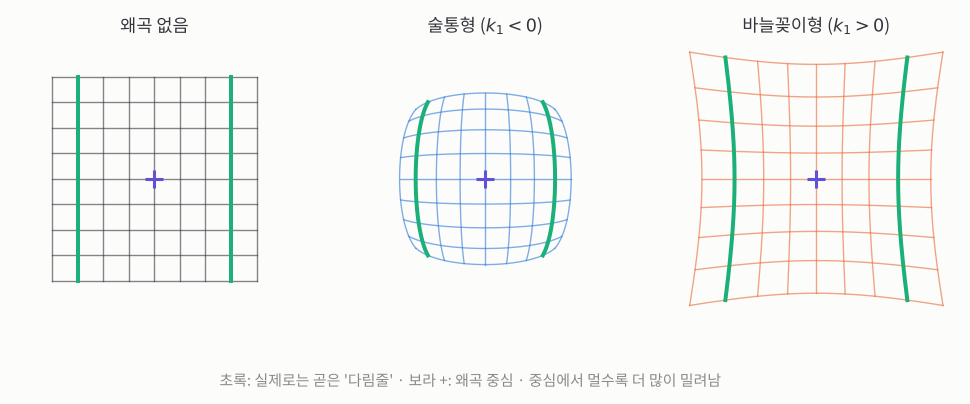
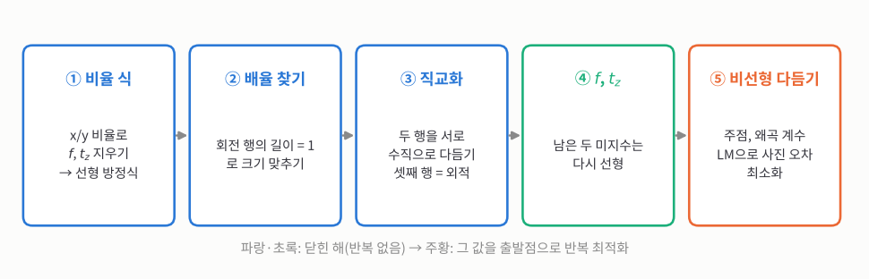
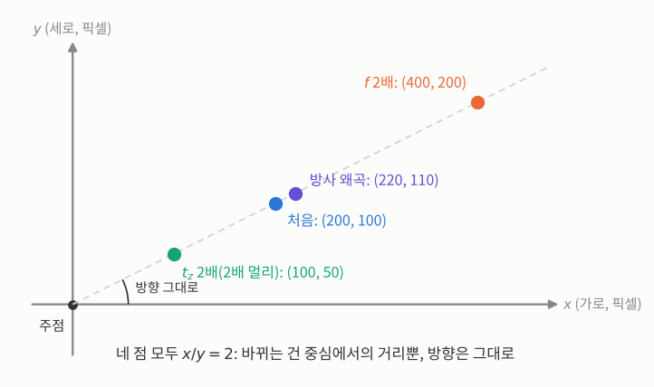
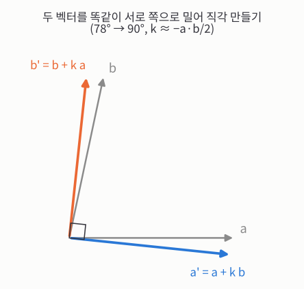
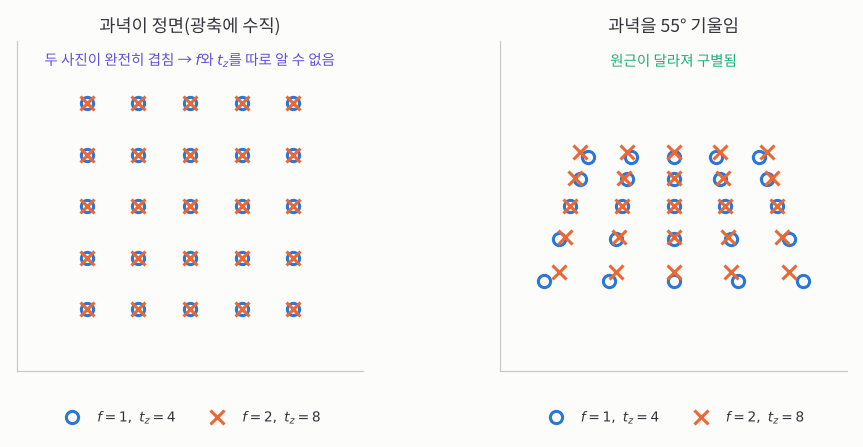


_MIT OpenCourseWare 6.801 21강 원본 영상 (영어)_

> **한 줄 요약:** 카메라 보정은 "위치를 아는 점들이 사진 어디에 찍혔나"로 카메라의 초점거리, 주점, 렌즈 왜곡을 알아내는 일입니다. Tsai의 방법은 **점의 방향(가로세로 비율)만 보면 어려운 미지수들이 한꺼번에 사라지니까** 대부분을 곱하고 더하는 식으로 풀고, 남은 것만 반복 계산으로 다듬습니다. 단, 과녁을 **정면으로만** 찍으면 초점거리와 거리를 구별할 수 없습니다.
{: .prompt-info }

## 1. 상대 방향

_▶ [0:00부터 보기](https://www.youtube.com/watch?v=-n0cXgPSwOw&t=0s) · Relative orientation_

**지난 시간에 찾은 "상대 방향이 안 풀리는 곡면"을 마저 보면, 어떤 장면을 피해야 하는지 알 수 있습니다.**

[20강](/posts/mit-mv-20-critical-surfaces-stereo/)에서 사진 두 장으로 두 카메라의 자세를 찾는 **상대 방향**을 풀었습니다. 사진 측량의 네 문제 중 두 번째이고, 양안 스테레오와 "움직이는 카메라로 3D 되살리기"(structure from motion)가 모두 이 문제입니다. 그리고 "이 방법이 안 통하는 곡면이 있을까?"를 물었고, 그 답이 **2차 곡면** 무리에 있다는 데까지 왔습니다.

## 2. 이차곡면

_▶ [1:11부터 보기](https://www.youtube.com/watch?v=-n0cXgPSwOw&t=71s) · Quadric surfaces_

**좌표계를 곡면에 맞춰 잡으면 2차 곡면의 식이 단순해지니까, 부호만 보고 모양을 가를 수 있습니다.**

여기서는 곡면에 맞춰 특별히 잡은 좌표계를 씁니다. 곡면의 중심이 원점이고, 곡면의 대칭축이 $$X, Y, Z$$축과 나란합니다. 일반적인 위치라면 1차 항과 상수항까지 붙어 식이 복잡해지지만, 모양을 분류할 때는 이 꼴이 편합니다. $$X, Y, Z$$축 방향으로 곡면이 뻗은 크기를 $$a_x, a_y, a_z$$라 하면

$$
\pm\frac{X^2}{a_x^2} \pm \frac{Y^2}{a_y^2} \pm \frac{Z^2}{a_z^2} = 1
$$

- **음수 부호 0개:** 타원면입니다. 세 크기가 같으면 구입니다.
- **음수 부호 1개:** 한 장 쌍곡면입니다. 허리가 잘록한 원통 모양입니다.
- **음수 부호 2개:** 두 장 쌍곡면입니다. 그릇 두 개가 등을 맞댄 모양입니다.
- **음수 부호 3개:** 실제 점이 하나도 없습니다. 복소수까지 넓히면 "허수 타원면"이라고 부릅니다.

상대 방향에서 나온 곡면도 이 무리에 들어갑니다.

## 3. 곡면의 대칭

_▶ [3:02부터 보기](https://www.youtube.com/watch?v=-n0cXgPSwOw&t=182s) · Surface symmetry_

**위험한 곡면의 식에는 상수항이 없으니까, 두 카메라의 중심이 반드시 그 곡면 위에 놓입니다.**

20강처럼 오른쪽 카메라 중심을 원점으로 놓고, 곡면 위 점의 위치 벡터를 $$r$$, 왼쪽 카메라에서 오른쪽 카메라로 가는 기준선 벡터를 $$b$$라 하겠습니다(20강과 같은 기호). 위험한 곡면의 식은 2차 항과 1차 항만 있고 **상수항이 없습니다.**

- **$$r = 0$$을 넣어도 식이 성립합니다.** 상수항이 없으니 남는 게 없습니다. 즉 **오른쪽 카메라 중심이 곡면 위에** 있습니다. 움직이는 카메라로 보면 "두 번째 순간의 카메라 위치"가 곡면 위에 있다는 뜻입니다. 오른쪽 눈이 그 이상한 곡면 위에 있어야 한다는 말입니다.
- **$$r = -b$$를 넣어도 성립합니다.** 기준선을 따라 $$b$$만큼 왼쪽으로 가면 왼쪽 카메라 중심이니, **왼쪽 카메라 중심도 곡면 위에** 있습니다. 움직이는 카메라라면 곡면 위에서 출발해 곡면 위에서 끝나야 합니다.

교수님은 이게 놀랍지 않다고 합니다. 왼쪽과 오른쪽은 대칭이어야 하고, 오른쪽을 기준으로 잡은 건 우연일 뿐이니까요.

## 4. 직선으로 엮인 곡면

_▶ [5:14부터 보기](https://www.youtube.com/watch?v=-n0cXgPSwOw&t=314s) · Ruled surfaces_

**식에 상수항이 없으면 크기가 정해지지 않으니까 기준선 전체가 곡면에 들어가고, 직선을 품는 2차 곡면은 한 장 쌍곡면뿐입니다.**

식의 모든 항이 $$r$$에 대해 1차나 2차라서, $$r$$의 크기를 알 수 없습니다. 그래서 $$r = b$$나 $$r = -b$$가 답이면 임의의 배수 $$k$$에 대해 $$r = kb$$도 답입니다. 즉 **두 카메라를 잇는 기준선 전체가 곡면 위에** 놓입니다.

여기서 두 가지를 알 수 있습니다.

- **드문 경우입니다.** 두 카메라 위치와 그 사이 기준선 전체가 장면의 곡면 위에 놓일 확률은 낮아 보입니다.
- **직선을 품는 곡면입니다.** 타원면에 직선을 대면 한 점에서 닿고 곧 허공으로 나가 버립니다. 두 장 쌍곡면도 직선을 품지 못합니다. 그러니 복잡한 계산 없이도 이 곡면은 **한 장 쌍곡면**이어야 합니다.

한 장 쌍곡면은 사실 모든 점에 직선이 **두 개씩** 지나갑니다. 곧은 막대 두 개를 엇갈려 엮어 의자나 탁자를 만드는 방식이 바로 이 모양입니다.

그렇다면 이렇게 특별한 경우를 왜 걱정할까요?

## 5. 평면에서 생기는 모호함

_▶ [7:41부터 보기](https://www.youtube.com/watch?v=-n0cXgPSwOw&t=461s) · Planar surface ambiguity_

**평면 두 장을 합친 것도 2차 곡면이니까, 흔한 평평한 장면이 위험한 곡면에 들어갑니다.**

2차 곡면의 일반식은 특수한 경우를 많이 품고 있습니다(목록은 인터넷에 있습니다). 교수님은 그중 **평면**만 봅니다.

평면 하나는 $$X, Y, Z$$에 대한 1차식입니다. 평면에 수직인 방향(법선)을 $$n$$, 원점과의 떨어짐을 나타내는 상수를 $$d$$라 하면 $$n \cdot r + d = 0$$입니다. 다른 평면도 하나 더 잡아 두 식을 **곱하면**

$$
(n_1 \cdot r + d_1)(n_2 \cdot r + d_2) = 0
$$

이 식은 "둘 중 한 평면 위에 있다"는 뜻이니 평면 두 장을 나타내고, 곱하면 2차 항까지 나오니 2차 곡면입니다.

상수항은 $$d_1 d_2$$인데, 이게 0이어야 합니다. 그래서 한 평면이 오른쪽 카메라 중심을 지나야 하고, 앞의 대칭 때문에 왼쪽 카메라 중심도 지나야 합니다. 즉 한 평면은 **기준선을 품는 평면(에피폴라 평면)**입니다. 이 평면은 눈을 관통하니 사진에서는 옆에서 본 종이처럼 **선 하나**로만 보여 신경 쓸 게 없습니다.

무서운 건 **다른 한 평면은 아무 평면이나 된다**는 점입니다. 벽, 바닥, 도로처럼 평평한 장면은 아주 흔하니, 평면을 볼 때마다 이 모호함에 빠질 수 있습니다. 양안 스테레오와 지형도 만들기뿐 아니라 움직이는 카메라로 3D를 되살리는 문제도 수학적으로 똑같아서 같은 약점이 있습니다.

## 6. 시야의 영향

_▶ [10:28부터 보기](https://www.youtube.com/watch?v=-n0cXgPSwOw&t=628s) · Field of view impact_

**좁게 보면 그 작은 조각이 우연히 위험한 곡면을 닮기 쉬우니까, 시야를 넓힐수록 답이 안정됩니다.**

정확히 위험한 곡면일 일은 드물어도, 실제 장면이 그 **근처**만 가도 잡음이 크게 커집니다(잡음 이득이 큽니다). 교수님은 증명하지 않지만, **시야가 넓을수록** 문제가 훨씬 안정된다고 합니다.

항공 사진가들은 이걸 100년쯤 전에 이미 알았습니다. 그런데 세밀하고, 방사 왜곡이 적고, 시야까지 넓은 렌즈를 만들 기술이 없었습니다. 그래서 카메라 여러 대를 강철 들보로 만든 단단한 틀에 묶어 한꺼번에 찍었습니다. 눈이 여덟 개인 거미를 닮았다고 **"거미 머리"**(spider head)라고 불렀습니다. 대신 카메라끼리의 관계를 보정해야, 여러 사진을 시야 넓은 카메라 한 대로 찍은 것처럼 이어 붙일 수 있었습니다. 실용적으로는 100년 전부터 알려진 문제이고, 수학은 그보다 늦게 따라왔습니다.

## 7. 내부 방향

_▶ [13:15부터 보기](https://www.youtube.com/watch?v=-n0cXgPSwOw&t=795s) · Interior orientation_

**소실점 방법은 정확도가 낮고 렌즈 왜곡을 못 다루니까, 더 일반적인 보정 방법이 필요합니다.**

상대 방향(2번 문제)을 마치고 3번, **내부 방향**으로 넘어갑니다. 교수님은 기본 생각이 겹치니 갈수록 자세한 설명은 줄어든다고 합니다. 내부 방향은 곧 **카메라 보정**이고, 찾는 것은 셋입니다.

- **주점** $$(x_0, y_0)$$: 광축(렌즈 중심에서 카메라 정면으로 뻗은 선)이 영상면과 만나는 점입니다. 아래첨자 0은 "기준점"이라는 뜻입니다.
- **주거리** $$f$$: 렌즈 중심에서 영상면까지의 거리(초점거리)입니다.

"그건 이미 했잖아요?" 맞습니다. [5강](/posts/mit-mv-05-vanishing-point/)에서 직육면체(벽돌)의 소실점으로 구했습니다. 정밀하게 깎은 벽돌을 보정 물체로 쓰면 되긴 하지만, 아주 정확하게 만들기 어렵습니다. 그리고 그 방법으로는 **방사 왜곡**을 다루기 어렵습니다.

## 8. 방사 왜곡

_▶ [14:58부터 보기](https://www.youtube.com/watch?v=-n0cXgPSwOw&t=898s) · Radial distortion_

**방사 왜곡을 허용하면 렌즈의 다른 결점을 줄이기 쉬우니까, 렌즈 설계자들은 대개 이 왜곡을 남겨 둡니다.**

렌즈는 빛줄기를 정확한 방향으로 꺾어 주는 "유리로 된 아날로그 계산기"입니다. 하지만 완벽한 렌즈는 만들 수 없어서, 무엇을 참을지 골라야 합니다. **방사 왜곡**은 곧은 선이 많은 건물을 찍지 않는 한 거의 티가 안 납니다. 사람, 숲, 유튜브에 올릴 고양이 사진에서는 아무도 모릅니다. 그래서 설계자들은 이 왜곡을 허용하는 대신 다른 문제들을 쉽게 풉니다.

방사 왜곡은 사진 속 점을 **왜곡 중심에서 뻗은 직선을 따라** 안이나 밖으로 조금 밉니다. 사진 속 점의 위치를 왜곡 중심 기준 $$(x, y)$$, 중심에서의 거리를 $$r = \sqrt{x^2 + y^2}$$라 하겠습니다. 밀리는 양 $$(\delta x, \delta y)$$는 보통 $$r$$의 다항식으로 쓰고($$\delta$$는 "조금 바뀐 양"에 흔히 쓰는 글자), 계수 $$k_1, k_2$$가 왜곡 계수입니다.

$$
\delta x = x\,(k_1 r^2 + k_2 r^4 + \cdots), \qquad \delta y = y\,(k_1 r^2 + k_2 r^4 + \cdots)
$$

$$x$$와 $$y$$에 같은 배수를 곱하니, 밀리는 방향은 중심에서 뻗은 직선과 나란합니다. 가장 낮은 항이 $$r^2$$인 이유(왜 $$k_0$$나 $$r$$ 항이 없는지)는 교수님이 숙제로 남겼습니다. 다음 항은 $$r^4$$이고, 대개 첫 항만으로도 충분합니다.

**숫자로 보면:** $$k_1 = -0.08$$, $$k_2 = 0$$일 때 중심에서 $$r = 1$$인 점 $$(1, 0)$$은 $$\delta x = 1 \times (-0.08 \times 1^2) = -0.08$$만큼 안쪽으로, $$r = 2$$인 점 $$(2, 0)$$은 $$\delta x = 2 \times (-0.08 \times 4) = -0.64$$만큼 밀립니다. 거리가 2배가 되자 밀림은 8배가 됐습니다. **모서리로 갈수록 왜곡이 훨씬 커지고, 가운데는 거의 그대로**입니다.

비싼 Zeiss 망원 렌즈를 사면 손으로 잰 왜곡 그래프가 딸려 옵니다. 그래서 비쌉니다. 그래프는 2차로 올라가다가 고차 항 때문에 다시 꺾이는데, 이 꺾임은 보통 둘째 항 $$k_2$$가 맡습니다. 머신비전에서는 흔히 첫 항 $$k_1$$만 씁니다.

## 9. 다림줄로 보정하기

_▶ [19:01부터 보기](https://www.youtube.com/watch?v=-n0cXgPSwOw&t=1141s) · Plumb line calibration_

**추를 단 줄은 반드시 곧고 서로 나란하니까, 사진에서 휘어 보이는 만큼이 곧 렌즈 왜곡입니다.**

옛날에 유명했던 방법은 **다림줄**입니다. 주차장처럼 넓은 곳에 줄을 여러 개 늘어뜨리고 끝에 추를 답니다. 추가 당기니 줄은 곧고, 중력은 어디서나 같은 방향이니 줄끼리 나란합니다. 이걸 찍으면 곧아야 할 줄이 휘어 보입니다.

_사진의 가로·세로 축을 그대로 그린 그림입니다. 가운데 보라 +가 왜곡 중심, 초록 선이 실제로는 곧은 다림줄입니다. 왼쪽: 왜곡이 없으면 다림줄이 곧게 찍힙니다. 가운데: $$k_1 < 0$$이면 바깥쪽이 오므라들어 줄이 바깥으로 불룩해집니다(술통형). 오른쪽: $$k_1 > 0$$이면 바깥쪽이 늘어나 줄이 안쪽으로 오목해집니다(바늘꽂이형). 중심에서 멀수록 더 크게 휩니다._

- **술통형:** 휜 모양이 나무통의 널빤지를 닮아 붙은 이름입니다.
- **바늘꽂이형:** 바늘을 꽂아 두던 작은 쿠션을 닮아 붙은 이름입니다. 교수님은 요즘엔 손바느질을 잘 안 해서 이름이 낯설 거라고 농담합니다.

둘 중 어느 쪽인지는 $$k_1$$의 부호로 정해지고, 휜 줄의 굽은 정도로 $$k_1$$을 어림할 수도 있습니다. 다만 강의에서는 실제 사진 측정으로 구합니다.

**어느 방향으로 식을 쓸까?** 미묘한 선택이 하나 있습니다.

- **왜곡 없는 위치 → 왜곡된 위치:** 원근 투영으로 "있어야 할 곳"을 계산하고, 사진에서 "실제로 찍힌 곳"과 비교해 다항식을 맞춥니다.
- **왜곡된 위치 → 왜곡 없는 위치:** 실제로 잴 수 있는 건 왜곡된 위치뿐이니, 그쪽에서 출발하는 것도 자연스럽습니다.

두 방향은 "급수 뒤집기"라는 방법으로 오갈 수 있습니다. 잘 가르치지 않고 쉽지도 않지만, 자동으로 계산할 수 있습니다. 이 선택은 마지막 최적화를 어느 좌표에서 할지를 정합니다. 교수님은 오차를 **사진 위에서** 줄이려 하니 **왜곡 없는 → 왜곡된** 쪽이 나을 수도 있다고 하고, 일단 열어 둡니다.

아래 데모에서 $$k_1$$, $$k_2$$를 직접 바꿔 볼 수 있습니다.

$$k_1 = -0.08$$이면 반지름 1(150px) 근처의 다림줄이 약 16px 휘고, 화면 모서리 점은 61px나 안쪽으로 밀립니다. $$k_1$$을 0으로 놓고 $$k_2$$만 바꾸면 중심 부근은 거의 그대로이고 바깥쪽만 휩니다. $$r^4$$ 항이라 먼 곳에서만 힘을 쓰기 때문입니다.

## 10. 그 밖의 왜곡 요인

_▶ [23:10부터 보기](https://www.youtube.com/watch?v=-n0cXgPSwOw&t=1390s) · Distortion factors_

**요즘 센서는 기하가 정확하고 렌즈는 회전 대칭이니까, 방사 왜곡 말고 다른 왜곡은 대개 무시해도 됩니다.**

- **접선 왜곡:** 점이 중심에서 뻗은 방향이 아니라 **그에 수직인 방향**(중심 둘레를 도는 방향)으로 밀립니다. 방사 왜곡처럼 중심에서는 없고 모서리로 갈수록 커집니다. 옛날 카메라는 전자석으로 전자빔을 휘는 진공관 장치라, 전자석을 어떻게 달았느냐에 따라 이런 왜곡이 생겼습니다. 지금 반도체 센서는 기하가 완벽하고 회전 대칭 렌즈는 방사 왜곡만 만드니 걱정할 필요가 없습니다. 교수님은 "방사" 왜곡이라는 이름이 붙은 건 다른 종류(접선)가 있기 때문이라고 짚습니다.
- **중심 어긋남:** 왜곡 중심이 주점과 다르면, 원근 투영의 중심이 아닌 점을 기준으로 휘니 위치에 따라 어긋남이 생깁니다. 보통은 조립이 정확해서 아주 작고, 항공 사진처럼 정밀한 일에서만 챙깁니다.

## 11. 기울어진 영상면

_▶ [25:52부터 보기](https://www.youtube.com/watch?v=-n0cXgPSwOw&t=1552s) · Tilted image planes_

**왜곡 모델은 마지막 반복 계산에 얼마든지 넣을 수 있으니까 복잡하게 만들어도 되지만, 너무 많이 넣으면 가짜 정확도가 생깁니다.**

센서(영상면)는 누군가 기계로 끼운 것이라 렌즈에 대해 살짝 **기울어져** 있을 수 있습니다. 그러면 배율이 사진 전체에서 고르지 않고 초점도 조금 어긋나는데, 효과가 작으면 초점보다는 **왜곡**으로 나타납니다. 이 효과는 중심 어긋남과도 엮여 있습니다.

원하면 왜곡 모델을 더 복잡하게 만들 수 있습니다. 강의 계획은 앞부분을 공식으로 풀고, 마지막에 "어려운 비선형 문제네" 하며 계산 꾸러미에 넘기는 것입니다. 그 단계에서는 왜곡 모델에 항을 더해도 큰 부담이 없습니다. 다만 항을 너무 많이 넣으면 실험 측정값에 딱 맞게 조율되어(**과적합**), 정확해 보이는 게 가짜가 됩니다.

**학생 질문:** 기울어짐을 제조할 때 기계로 바로잡으면 안 되나요?
**교수님 답:** 기계 조정과 미세 조율은 비싸고 소프트웨어는 쌉니다. 그래서 요즘은 왜곡 모델에 숫자 몇 개를 더하는 쪽을 택합니다. 예전에는 제조할 때 바로잡았는데, 형태가 완벽히 반듯해야 하는 항공 사진용 카메라에서만 그랬습니다. 미세 조정 나사가 달려 있었고, 사용자가 건드리면 보증이 끝났습니다. 어떤 경우에는 영상면을 직접 돌리는 대신, 아주 작은 각의 **쐐기 프리즘**을 끼워 기울기를 상쇄했습니다. 기울기를 잰 뒤 창고에서 그만큼 상쇄하는 부품을 골라 끼우는 식이었습니다.

## 12. Tsai 보정법

_▶ [29:07부터 보기](https://www.youtube.com/watch?v=-n0cXgPSwOw&t=1747s) · Tsai calibration method_

**과녁이 카메라에 대해 어디 놓였는지는 줄자로 잴 수 없으니까, 카메라 성질과 과녁의 자세를 함께 풀어야 합니다.**

교수님은 **Tsai**의 카메라 보정법을 조금 고쳐서 따라갑니다. 먼저 점들의 좌표를 아주 정확히 아는 **보정 물체(과녁)**가 필요합니다.

- **평면 과녁:** 만들기 쉽고 창고에 두기 쉬우며, 리소그래피(반도체 찍어 내는 공정)로 아주 정확하게 만들 수 있습니다.
- **입체 과녁:** 앞서 본 벽돌 같은 것은 만들기도, 정확하게 유지하기도 어렵습니다. 대신 보정에 유리한 점이 있습니다(27장에서 봅니다).

이번에는 **사진 속 점**과 **과녁 위의 아는 점** 사이의 짝(대응)을 씁니다. 소실점 방법보다 어려운 점은, 과녁과 카메라의 관계를 **줄자로 잴 수 없다**는 것입니다. 바닥에 과녁을 두고 삼각대에 카메라를 올린 뒤, 과녁의 첫 점까지 거리는 잴 수 있어도 과녁이 공간에서 어떻게 돌아가 있는지는 못 잽니다. 게다가 투영의 중심인 **앞쪽 마디점**(front nodal point)이 렌즈 속에 있어서 어디인지 모릅니다. 렌즈 옆면에 표시를 해 둘 수도 없습니다. 바로 렌즈 안쪽에 있으니까요.

그래서 **외부 방향**(과녁이 공간에서 어디 있고 어떻게 돌아가 있는지)을 함께 풉니다. 문제는 커지지만, 바깥에서 재는 오차가 끼어들지 않으니 결과가 훨씬 정확합니다.

## 13. 외부 방향

_▶ [32:16부터 보기](https://www.youtube.com/watch?v=-n0cXgPSwOw&t=1936s) · Exterior orientation_

**외부 방향 6개를 더하면 미지수가 3개에서 9개로 늘지만, 바깥 측정 오차가 사라지니까 오히려 더 정확해집니다.**

- **내부 방향:** 왜곡을 잠시 빼면 $$x_0, y_0, f$$ 3개입니다.
- **외부 방향:** 과녁의 위치(이동 3)와 자세(회전 3), 6개입니다.

합해서 **9개**입니다. 내부 방향은 1강의 원근 투영 식 그대로입니다. 카메라 좌표계(렌즈 중심이 원점, $$Z_c$$축이 카메라 앞쪽)에서 점의 좌표 $$(X_c, Y_c, Z_c)$$를 알면, 사진 위 위치 $$(x_I, y_I)$$를 계산할 수 있습니다(아래첨자 c는 camera, I는 image).

$$
\frac{x_I - x_0}{f} = \frac{X_c}{Z_c}, \qquad \frac{y_I - y_0}{f} = \frac{Y_c}{Z_c}
$$

## 14. 투영 식

_▶ [34:14부터 보기](https://www.youtube.com/watch?v=-n0cXgPSwOw&t=2054s) · Projection equations_

**반복 계산은 엉뚱한 골짜기에 빠질 수 있으니까, 먼저 공식으로 좋은 출발점을 만들고 마지막에만 반복 계산을 씁니다.**

전략은 세 단계입니다.

1. 방사 왜곡처럼 다루기 어려운 미지수가 **결과에 끼어들지 않게** 측정값을 다룹니다.
2. 남은 미지수 중 공식으로 풀 수 있는 것은 공식으로 풉니다.
3. 더 이상 공식이 안 나오면 숫자 계산(반복 최적화)에 맡깁니다.

왜 굳이 이렇게 할까요? 반복 최적화가 줄이는 오차에는 골짜기(최솟값)가 여러 개라, 진짜 골짜기를 찾으려면 **좋은 출발점**이 필요하기 때문입니다. 출발점을 구하는 단계라서, 앞에서 세운 원칙을 조금 어겨도 됩니다. 예를 들어 오차는 사진 위 위치에서 줄여야 한다고 했지만, 그건 직접 하기 어려우니 그와 관련된 다른 양을 줄입니다. 어차피 거기서 멈추지 않으니 괜찮습니다.

_파랑·초록인 앞의 네 단계는 반복 없이 풀리고, 그 결과가 주황인 마지막 반복 최적화의 좋은 출발점이 됩니다._

**단위.** 사진 좌표 $$(x_I, y_I)$$는 센서의 행·열 번호를 그대로 써도 되고, 어떤 기준점에서 잰 밀리미터여도 됩니다. 행·열 번호를 쓰면 편합니다. 픽셀이 정사각형이면 $$f$$도 **픽셀 단위**로 쓰면 됩니다. 예를 들어 $$f = 1000$$픽셀처럼요. 원근 투영 식에서 위아래 단위가 맞기만 하면 되니까요.

**좌표계 둘.** 내부 방향 3개에 외부 방향을 더합니다. 이번에는 좌표계가 둘입니다.

- **과녁 좌표계** $$(X_s, Y_s, Z_s)$$: 과녁에 박힌 좌표계입니다(아래첨자 s는 scene). 예를 들어 정육면체나 벽돌의 한 모서리를 원점으로 잡습니다. 교수님은 "세계 좌표계"라고 불러도 되지만 엄밀히는 과녁에 붙은 좌표계라고 짚습니다. 과녁의 점들은 이 좌표를 정확히 압니다.
- **카메라 좌표계** $$(X_c, Y_c, Z_c)$$: 앞에서 본 것입니다.

카메라 좌표는 과녁 좌표를 돌리고 옮긴 것입니다(17강의 $$R$$과 $$t$$).

## 15. 회전 행렬 추정

_▶ [37:46부터 보기](https://www.youtube.com/watch?v=-n0cXgPSwOw&t=2266s) · Rotation matrix estimation_

**출발점만 구하면 되니까 처음에는 회전 행렬의 9개 숫자를 그냥 미지수로 놓고 시작합니다.**

교수님은 "더 나은 본능을 무시하고" 회전 행렬을 그대로 씁니다. $$R$$의 $$i$$행 $$j$$열 성분을 $$r_{ij}$$, 이동을 $$t = (t_x, t_y, t_z)$$로 쓰면

$$
\begin{pmatrix} X_c \\ Y_c \\ Z_c \end{pmatrix} = R \begin{pmatrix} X_s \\ Y_s \\ Z_s \end{pmatrix} + t
$$

과녁의 점을 과녁 좌표계에서 돌린 다음, $$t$$만큼 옮겨 카메라 앞에 놓는 셈입니다. 원래 이 식은 과녁 좌표를 카메라 좌표로 **바꾸는 데** 쓰지만, 여기서는 거꾸로 씁니다. 과녁 좌표와 사진 좌표를 알고, $$R$$과 $$t$$를 **찾습니다.**

내부 방향과 외부 방향을 합치면

$$
\frac{x_I - x_0}{f} = \frac{r_{11}X_s + r_{12}Y_s + r_{13}Z_s + t_x}{r_{31}X_s + r_{32}Y_s + r_{33}Z_s + t_z}, \qquad
\frac{y_I - y_0}{f} = \frac{r_{21}X_s + r_{22}Y_s + r_{23}Z_s + t_y}{r_{31}X_s + r_{32}Y_s + r_{33}Z_s + t_z}
$$

두 식의 분모는 똑같습니다(카메라에서 본 깊이 $$Z_c$$).

## 16. 미지수 지우기

_▶ [40:22부터 보기](https://www.youtube.com/watch?v=-n0cXgPSwOw&t=2422s) · Eliminating parameters_

**$$f$$, $$t_z$$, 방사 왜곡은 점의 거리만 바꾸고 방향은 그대로 두니까, 두 식을 나눠 방향만 보면 셋이 한꺼번에 사라집니다.**

처음부터 다루기 어려운 것은 방사 왜곡, $$f$$, $$t_z$$입니다. 사진 위의 점을 주점에서 본 극좌표(거리와 방향)로 보면 셋에 공통점이 있습니다.

- **방사 왜곡**은 점을 중심에서 뻗은 직선 위에서만 밉니다. 길이만 바뀌고 각도는 그대로입니다.
- **$$f$$를 바꾸면** 사진이 통째로 확대되어 점이 중심에서 뻗은 방향으로 움직입니다.
- **과녁까지 거리 $$t_z$$를 바꾸면** 배율만 바뀌니 역시 그 방향으로 움직입니다.

**숫자로 확인해 보면:** 카메라 좌표 $$(X_c, Y_c, Z_c) = (2, 1, 10)$$인 점을 $$f = 1000$$픽셀 카메라로 찍으면, 주점 기준으로 $$x = 1000 \times 2/10 = 200$$, $$y = 1000 \times 1/10 = 100$$에 찍힙니다.

_가로가 사진의 $$x$$, 세로가 $$y$$(주점 기준 픽셀)입니다. 파랑이 처음 위치입니다. $$f$$를 2배로 하면 주황 $$(400, 200)$$, 깊이 $$Z_c$$가 2배가 되면 초록 $$(100, 50)$$, 방사 왜곡으로 10% 밀리면 보라 $$(220, 110)$$으로 갑니다. 네 점 모두 주점에서 뻗은 같은 점선 위에 있어서 $$x/y = 2$$가 그대로입니다._

그러니 두 식을 **서로 나누면** $$f$$가 사라지고, 같은 분모에 든 $$t_z$$도 사라집니다. 주점을 원점으로 잡은 사진 좌표를 그냥 $$x_I, y_I$$로 쓰면

$$
\frac{x_I}{y_I} = \frac{r_{11}X_s + r_{12}Y_s + r_{13}Z_s + t_x}{r_{21}X_s + r_{22}Y_s + r_{23}Z_s + t_y}
$$

식 두 개를 합쳐 미지수가 적은 식 하나를 만든 것입니다. 양변에 분모를 곱해 한쪽으로 모으면

$$
(X_s y_I)\,r_{11} + (Y_s y_I)\,r_{12} + (Z_s y_I)\,r_{13} + y_I\,t_x - (X_s x_I)\,r_{21} - (Y_s x_I)\,r_{22} - (Z_s x_I)\,r_{23} - x_I\,t_y = 0
$$

괄호 안은 과녁 좌표(알고 있음)와 사진 좌표(잰 값)로 계산되는 **아는 숫자**입니다. 모르는 것은 $$r_{11}, r_{12}, \dots$$와 $$t_x, t_y$$뿐이고, 각각에 아는 숫자를 곱해 더한 꼴이라 쉽게 풀립니다(미지수에 대해 선형).

## 17. 주점 어림하기

_▶ [44:29부터 보기](https://www.youtube.com/watch?v=-n0cXgPSwOw&t=2669s) · Principal point estimation_

**주점을 모르니 센서 한가운데로 어림하되, 주점 근처 점은 작은 어림 오차에도 방향이 크게 흔들리니까 빼고 씁니다.**

학생이 짚은 대로, 위 식을 쓰려면 사진 좌표에서 주점을 빼야 합니다. 그런데 주점은 우리가 찾으려는 값입니다. 출발점용이니 어림이면 됩니다. 더 나은 정보가 없으면 **센서의 가운데**(행 수의 절반, 열 수의 절반)를 주점으로 놓습니다.

문제는 그 근처의 점입니다. 멀리 있는 점이면 중심이 조금 어긋나도 방향이 거의 안 바뀌지만, 중심 가까이 있는 점은 같은 어긋남에도 방향이 크게 바뀝니다. 그래서 **어림한 중심 근처의 대응은 버립니다.** 교수님은 Tsai 논문에는 이 이야기가 없다고 덧붙입니다. 찾으려는 주점을 미리 안다고 치는 건 **반칙**이지만, 어림일 뿐이고 영향이 큰 데이터는 쓰지 않으니 괜찮다는 겁니다.

**숫자로 보면:** 주점을 가로로 2픽셀 틀리게 잡았다고 합시다. 중심에서 오른쪽 위로 $$(400, 400)$$ 떨어진 점의 방향은 45°에서 $$\arctan(400/398) \approx 45.1^\circ$$로 0.1°쯤 바뀝니다. 그런데 $$(4, 4)$$ 떨어진 점은 $$\arctan(4/2) \approx 63.4^\circ$$로 18°나 바뀝니다.

대응 하나(사진의 이 점이 과녁의 저 점)마다 이런 식이 하나씩 생깁니다.

## 18. 우변이 0인 식 풀기

_▶ [47:11부터 보기](https://www.youtube.com/watch?v=-n0cXgPSwOw&t=2831s) · Solving homogeneous equations_

**우변이 0인 식은 미지수를 모두 2배 해도 그대로 성립하니까, 하나를 1로 정해 놓고 나머지를 풉니다.**

식에 남은 미지수를 세어 봅시다. 회전 행렬의 첫 두 행 6개($$r_{11}, r_{12}, r_{13}, r_{21}, r_{22}, r_{23}$$)와 $$t_x, t_y$$, 모두 **8개**입니다. 여기서 두 가지를 기억해야 합니다.

- **직교 조건은 아직 안 씁니다.** 회전 자유도는 3인데, 지금은 6개를 서로 상관없는 숫자처럼 다룹니다. 각 행이 길이 1이고 두 행이 서로 수직이어야 한다는 것도 아직 신경 쓰지 않습니다.
- **셋째 행은 나중에 얻습니다.** 회전 행렬의 행끼리는 서로 수직이니, 첫째·둘째 행 둘 다에 수직인 벡터(외적)가 셋째 행과 나란합니다.

미지수가 8개면 대응도 8개 필요할 것 같지만 그렇지 않습니다. 이 식은 **우변이 0**입니다(동차 방정식). 교수님은 보통 이런 식을 학교에서 잘 안 가르치지만 머신비전에는 자주 나오니 다루는 법을 알아야 한다고 강조합니다.

우변이 0이면 미지수를 모두 2배 해도 여전히 0입니다. 그래서 이 식만으로는 **전체 크기**를 알 수 없습니다. 푸는 방법은 미지수 하나를 아무 값으로나 정하는 것입니다. 예를 들어 $$t_y = 1$$로 둡니다. 진짜 답이 무엇이든 크기를 조절하면 $$t_y = 1$$로 만들 수 있고, 거꾸로 $$t_y = 1$$로 구한 답은 진짜 답의 어떤 배수입니다. 몇 배인지는 이 식으로는 모릅니다.

## 19. 필요한 대응 점 개수

_▶ [51:02부터 보기](https://www.youtube.com/watch?v=-n0cXgPSwOw&t=3062s) · Correspondences required_

**미지수 하나를 고정하면 7개가 남으니까 대응 점은 최소 7개, 실제로는 더 많이 써서 오차도 함께 잽니다.**

미지수가 7개니 대응 점이 **7개** 필요합니다. 그러니 과녁에는 어느 방향에서 봐도 찾기 쉬운 점이 7개 있어야 하고, 일부는 가려질 테니 실제로는 더 필요합니다. 정육면체를 아무 방향에서 보면 꼭짓점 8개 중 하나가 가려 7개가 보입니다. 교수님은 "딱 맞네요, 정육면체는 나쁘지 않은 과녁"이라고 합니다.

- **정확히 7개:** 7개 식에 미지수 7개라 가우스 소거법이든 MATLAB이든 써서 풉니다. 늘 딱 맞는 답이 나오지만, 오차가 없다는 뜻은 아닙니다.
- **7개보다 많이:** 바람직합니다. 많을수록 답이 단단해지고, **오차가 얼마인지도 알 수 있습니다.** 식이 미지수보다 많으니 최소제곱(유사역행렬)으로 가장 잘 맞는 답을 고릅니다.

어느 쪽이든 결과는 진짜 답의 배수입니다. 이 배수를 되돌리는 방법이 다음 장입니다.

## 20. 회전 추정 다듬기

_▶ [53:48부터 보기](https://www.youtube.com/watch?v=-n0cXgPSwOw&t=3228s) · Refining rotation estimates_

**회전 행렬의 각 행은 길이가 1이어야 하니까, 구한 행의 길이로 나눠 진짜 크기를 되찾고, 두 행에서 나온 값이 맞는지로 검산합니다.**

$$t_y = 1$$로 고정했으니 답은 진짜 값의 어떤 배수입니다. 되돌릴 배수를 $$s$$(scale)라 하면, 첫째 행의 길이가 1이 되도록

$$
s = \frac{1}{\sqrt{r_{11}^2 + r_{12}^2 + r_{13}^2}}
$$

로 구해 모든 미지수에 곱합니다. 둘째 행으로도 $$s$$를 구할 수 있으니, **둘이 거의 같은지가 좋은 검산**입니다. 크게 다르면 뭔가 단단히 틀린 것입니다. 예를 들어 정육면체 왼쪽 모서리 점이라고 생각한 게 사실은 다른 점이었던 경우(대응을 잘못 짝지은 경우)입니다. 실제로는 정확히 같지는 않으니 평균을 써도 됩니다.

**손으로 계산해 보면:** 첫째 행이 $$(1.2, 0, 1.6)$$, 둘째 행이 $$(0.02, 2.0, 0)$$으로 나왔다고 합시다. 길이는 $$\sqrt{1.44 + 0 + 2.56} = 2.000$$과 $$\sqrt{0.0004 + 4.0 + 0} \approx 2.0001$$로 거의 같으니 $$s = 0.5$$로 잘 맞습니다.

이제 $$f$$, $$t_z$$, 방사 왜곡을 뺀 나머지의 **첫 추정**이 나왔습니다. 유사역행렬까지 포함해 모두 공식으로 풀렸습니다.

하나 더 확인할 것이 있습니다. 행 길이는 1로 맞췄지만, 두 행이 **서로 수직**인지는 아직 맞추지 않았습니다. 두 행의 내적 $$r_{11}r_{21} + r_{12}r_{22} + r_{13}r_{23}$$이 0에 가까운지 봅니다. 정확히 0일 리는 없지만 크게 벗어나면 계산이 어딘가 틀린 것입니다. 곧 셋째 행을 외적으로 만들 텐데, 두 행이 수직이 아니면 회전이 아닌 지저분한 행렬이 나옵니다.

## 21. 행렬을 직교로 만들기

_▶ [56:16부터 보기](https://www.youtube.com/watch?v=-n0cXgPSwOw&t=3376s) · Orthogonalizing matrices_

**한쪽만 돌리면 그쪽을 편애하는 셈이니까, 두 행을 서로 쪽으로 똑같이 조금씩 밀어 직각으로 만듭니다.**

거의 수직인 두 벡터가 있을 때, 그와 **가장 가까운** 수직인 두 벡터는 무엇일까요? 첫째 행을 $$u$$, 둘째 행을 $$v$$라 하겠습니다(강의에서는 $$a, b$$로 쓰지만 기준선 $$b$$, 아래 2차 방정식의 계수와 겹치지 않게 바꿨습니다). 교수님은 "지루한 최소제곱"으로 답이 나온다며 결과를 줍니다. **$$u$$는 $$v$$ 방향으로, $$v$$는 $$u$$ 방향으로** 같은 양 $$k$$만큼 밉니다.

$$
u' = u + k\,v, \qquad v' = v + k\,u
$$

남은 질문은 $$k$$가 얼마냐입니다. 새 두 행이 수직이려면 내적이 0이어야 하니

$$
u' \cdot v' = u \cdot v + k\,(u \cdot u + v \cdot v) + k^2\,(u \cdot v) = 0
$$

_회색 두 행 벡터(그림에서는 $$\mathbf{a}, \mathbf{b}$$, 본문의 $$u, v$$)는 78°로 벌어져 있습니다. 둘을 같은 양 $$k$$만큼 서로 쪽으로 밀면 파랑·주황이 되어 90°가 됩니다._

$$k$$에 대한 2차 방정식이니 풀면 될 것 같지만, 여기에 함정이 있습니다. 답 근처에서는 두 행이 거의 수직이라 $$u \cdot v$$가 거의 0이고, 그래서 **첫 항과 마지막 항이 둘 다 아주 작습니다.** 이러면 근의 공식이 숫자적으로 불안정해집니다. 보통은 복잡한 식이 말썽인데, 이번에는 2차 방정식이 말썽입니다.

교수님이 덧붙이는 주의가 하나 더 있습니다. 결과가 **반사 행렬**이 되면 안 됩니다. 셋째 행을 우리가 직접 외적으로 만들면, 반사가 아닌 회전이 되도록 보장할 수 있습니다.

## 22. 2차 방정식의 정밀도

_▶ [59:30부터 보기](https://www.youtube.com/watch?v=-n0cXgPSwOw&t=3570s) · Quadratic equation precision_

**$$k$$가 작으면 $$k^2$$ 항은 더 작으니까 버리고 간단한 식을 몇 번 되풀이하는 게, 근의 공식보다 정확하고 쉽습니다.**

$$k$$가 이미 작다면 $$k^2(u \cdot v)$$는 훨씬 더 작으니 버립니다. 두 행은 길이가 1이라 $$u \cdot u + v \cdot v = 2$$이므로

$$
k \approx -\frac{u \cdot v}{2}
$$

이걸로 밀고, 다시 계산하고, 몇 번 되풀이하면 $$k$$가 0으로 줄어듭니다. 컴퓨터 정밀도에 충분히 가까워지면 멈춥니다.

**손으로 계산해 보면:** $$u = (1, 0.06, 0)$$, $$v = (0.02, 1, 0)$$이면 $$u \cdot v = 0.02 + 0.06 = 0.08$$이니 $$k = -0.04$$입니다.

$$
u' = (1 - 0.0008,\; 0.06 - 0.04,\; 0) = (0.9992,\; 0.02,\; 0), \qquad v' = (0.02 - 0.04,\; 1 - 0.0024,\; 0) = (-0.02,\; 0.9976,\; 0)
$$

$$u' \cdot v' = -0.019984 + 0.019952 \approx -0.00003$$으로, 한 번 만에 거의 0이 됐습니다.

**근의 공식이 둘?** 여기서 교수님이 "다들 깨어 있나요?" 하며 웃습니다. 2차 방정식 $$ax^2 + bx + c = 0$$(여기의 $$a, b, c$$는 계수입니다)의 근은 우리가 배운

$$
x = \frac{-b \pm \sqrt{b^2 - 4ac}}{2a}
$$

말고도

$$
x = \frac{2c}{-b \mp \sqrt{b^2 - 4ac}}
$$

로도 쓸 수 있습니다. 둘 다 맞는지는 두 근의 곱이 $$c/a$$, 합이 $$-b/a$$인지로 쉽게 확인됩니다. 교수님은 이 공식을 다들 모른다는 게 안타깝다고 합니다.

왜 중요할까요? 컴퓨터는 실수를 정확히 저장하지 못해서, **거의 같은 두 수를 빼면** 정밀도를 잃습니다. 예를 들어 $$2.111111 - 2.111 = 0.000111$$은 유효숫자 7자리로 시작했는데 3자리만 남습니다. 근이 실수인 2차 방정식에서는 $$\pm$$ 중 한쪽이 늘 $$-b$$와 $$\sqrt{\ }$$의 부호가 반대라 이런 뺄셈이 됩니다. 요령은 두 공식의 부호가 서로 반대라는 점입니다. 부호가 같아 **더하기**가 되는 쪽을 골라, 한 근은 첫 공식에서, 다른 근은 둘째 공식에서 구합니다.

이 공식으로 $$k$$를 정확히 구할 수도 있지만, 위의 되풀이가 훨씬 간단합니다. 이렇게 직각으로 다듬은 두 행의 외적으로 셋째 행을 얻으면 회전 행렬이 완성됩니다. 다만 아직 최종 답은 아닙니다. 정확한 결과를 얻는 원칙을 다 지키지 않았으니까요.

## 23. 평면 과녁 보정

_▶ [1:03:53부터 보기](https://www.youtube.com/watch?v=-n0cXgPSwOw&t=3833s) · Planar target calibration_

**평면 과녁은 싸고 정확하게 만들 수 있으니까 널리 쓰이고, 과녁 면 위에서 $$Z_s = 0$$이라 식이 더 간단해집니다.**

평면 과녁은 만들기 쉽고, 보관하기 쉽고, 정확합니다. 교수님 예로, 최근에 바퀴 정렬을 받았다면 머신비전 장비였을 수 있습니다. 바퀴에 보정 과녁을 달고 바퀴나 핸들을 돌려 두 회전축을 잽니다. 과녁의 무늬는 모서리 위치를 **픽셀의 1/100**까지, 앞에서 배운 경계 찾기보다도 정밀하게 찾을 수 있게 만들어져 있습니다. 그리고 바퀴 옆면에 **비스듬히** 달려 있습니다. 평면 무늬는 싸면서도 아주 정확하게 찍어 낼 수 있기 때문입니다. 다만 단점이 있습니다.

과녁 좌표계를 이렇게 잡는 게 자연스럽습니다. $$X_s, Y_s$$축은 과녁 면 위에, $$Z_s$$축은 과녁 면에 수직으로 둡니다. 그러면 과녁의 모든 점은 $$Z_s = 0$$입니다. 앞과 같은 방법을 따르되, $$Z_s$$에 곱해지던 $$r_{13}, r_{23}, r_{33}$$이 식에서 빠집니다. 양변을 곱해 정리하면 더 간단한 식이 됩니다.

$$
(X_s y_I)\,r_{11} + (Y_s y_I)\,r_{12} + y_I\,t_x - (X_s x_I)\,r_{21} - (Y_s x_I)\,r_{22} - x_I\,t_y = 0
$$

괄호 안은 여전히 아는 숫자, $$r_{11}, r_{12}, \dots$$가 모르는 것입니다.

## 24. 우변이 0인 식의 제약

_▶ [1:07:16부터 보기](https://www.youtube.com/watch?v=-n0cXgPSwOw&t=4036s) · Homogeneous equation constraints_

**미지수가 6개로 줄고 하나를 고정하면 5개니까 대응 점 5개면 되지만, 고정한 값이 실제로 0에 가까우면 답이 터집니다.**

미지수는 8개가 아니라 **6개**입니다. 우변이 0이니 하나를 1로 고정하면 5개, 그래서 대응 점 **5개**면 됩니다. 7개보다 적으니 큰 장점입니다. 물론 실제로는 더 많이 써서 최소제곱으로 풉니다.

주의할 점이 있습니다. 만약 실제 $$t_y$$가 우연히 0이면(과녁이 $$Y_c$$축 방향으로 전혀 안 옮겨져 있으면), $$t_y = 1$$로 고정하는 순간 다른 값들이 **엄청나게 커져서** 부정확해집니다. 0인 것을 1로 만들려면 무한대 배를 해야 하니까요. 그럴 때는 $$t_x = 1$$로 고정합니다. 수치적으로 좋은 답을 얻으려면 결과를 보고 $$t_y$$가 0에 가까우면 다른 쪽으로 바꿔야 합니다. 교수님은 앞에서는 이 점을 따로 강조하지 않았다고 덧붙입니다.

## 25. 화소 가로세로 비율 문제

_▶ [1:09:08부터 보기](https://www.youtube.com/watch?v=-n0cXgPSwOw&t=4148s) · Camera aspect ratio issues_

**옛날에는 가로와 세로 화소 간격을 서로 다른 시계가 정해서 비율을 따로 구해야 했는데, 평면 과녁으로는 이 비율을 구할 수 없습니다.**

입체 과녁에서는 두 행을 다듬고 외적해 회전 행렬 전체를 얻었습니다. 평면 과녁에서는 회전 행렬의 **왼쪽 위 2×2 부분**만 나옵니다. 나머지를 채우는 방법은 숙제라 강의에서 쓰지 않습니다.

교수님이 지금은 상관없다며 넘어갔던 미묘한 점이 하나 있습니다. 옛날에는 사진의 가로 방향 화소 간격과 세로 방향 화소 간격의 비율을 확신할 수 없었습니다. CCD나 CMOS 센서도 화소가 따로따로인 건 같지만, 읽어 낼 때 한 줄의 신호를 아날로그로 바꿔 내보냈고, 컴퓨터의 영상 캡처 장비가 그걸 **자기 시계로** 잘라 숫자로 만들었습니다. 그래서

- **세로 간격**은 센서의 줄 간격이라 정확히 압니다.
- **가로 간격**은 캡처 장비의 시계와 카메라 시계의 관계에 달려 있었습니다.

그래서 가로를 세로에 대해 늘리는 숫자 하나를 미지수로 더해야 했고, **평면 과녁으로는 이 숫자를 구할 수 없었습니다.** 대수도 지저분해집니다. 요즘은 제품 사양서에 가로세로 간격이 정확히 나와 있으니 걱정할 필요가 없지만, 평면 과녁이 다르다는 점을 다시 보여 줍니다.

이제 남은 것 중 $$f$$와 $$t_z$$를 봅니다. 같은 식, 즉 내부 방향과 외부 방향을 합친 원근 투영 식을 다시 씁니다.

## 26. 깊이 모호함

_▶ [1:12:13부터 보기](https://www.youtube.com/watch?v=-n0cXgPSwOw&t=4333s) · Depth ambiguity_

**회전과 $$t_x, t_y$$를 이미 아니까, 남은 $$f$$와 $$t_z$$는 아는 숫자를 곱해 더한 꼴이 되어 대응 점 하나로도 풀립니다.**

이 단계에는 회전 행렬 **전체**가 필요하고, 정말로 직교인 게 좋습니다. 원래 식에서 분모를 넘겨 정리하면

$$
f\,(r_{11}X_s + r_{12}Y_s + r_{13}Z_s + t_x) - x_I\,t_z = (r_{31}X_s + r_{32}Y_s + r_{33}Z_s)\,x_I
$$

$$
f\,(r_{21}X_s + r_{22}Y_s + r_{23}Z_s + t_y) - y_I\,t_z = (r_{31}X_s + r_{32}Y_s + r_{33}Z_s)\,y_I
$$

괄호 안은 사진 측정과 지금까지 구한 $$t_x, t_y$$, 회전 행렬로 모두 계산됩니다. 모르는 것은 $$f$$와 $$t_z$$ 둘뿐이라, 앞보다 쉬운 문제입니다. 대응 점 하나가 식 두 개를 주니 원리적으로는 **한 점**이면 됩니다. 물론 실제로는 손에 넣을 수 있는 모든 대응으로 최소제곱을 씁니다.

## 27. 깊이 차이가 중요한 이유

_▶ [1:13:56부터 보기](https://www.youtube.com/watch?v=-n0cXgPSwOw&t=4436s) · Depth variation importance_

**원근 투영은 $$f$$를 곱하고 깊이로 나누니까, 과녁을 정면으로 두면 $$f$$와 $$t_z$$를 같이 2배 해도 사진이 똑같아 둘을 가를 수 없습니다.**

평면 과녁을 영상면과 나란하게, 광축에 수직으로 두고 찍고 싶어집니다. 보기 좋은 배치니까요. 무엇이 문제일까요? 원근 투영에는 $$f$$ 곱하기와 깊이 나누기가 들어 있어서, **$$f$$와 깊이를 둘 다 2배 하면 아무것도 안 바뀝니다.** 정면 과녁에서는 모든 점의 깊이가 $$t_z$$로 같으니, 비율 $$f/t_z$$만 알 수 있고 둘을 따로는 못 구합니다.

**숫자로 확인해 보면:** 과녁 위 가로 위치 $$X_c = 1$$인 점을 생각합시다.

| | 정면 과녁(깊이 차이 0) | 기울인 과녁(이 점이 1만큼 더 멂) |
|---|---|---|
| $$f = 1$$, $$t_z = 4$$ | $$1 \times 1/4 = 0.250$$ | $$1 \times 1/(4+1) = 0.200$$ |
| $$f = 2$$, $$t_z = 8$$ | $$2 \times 1/8 = 0.250$$ | $$2 \times 1/(8+1) \approx 0.222$$ |

정면에서는 둘이 똑같이 0.250이지만, 깊이 차이가 있으면 0.200과 0.222로 갈라집니다.

_사진의 가로·세로 축에 과녁 점이 찍힌 위치입니다. 파란 ○는 $$f = 1$$, $$t_z = 4$$, 주황 ×는 $$f = 2$$, $$t_z = 8$$로 찍은 것입니다. 왼쪽: 과녁이 정면이면 두 사진이 완전히 겹칩니다. 오른쪽: 과녁을 55° 기울이면 가까운 쪽과 먼 쪽의 크기 차이(원근)가 달라져 둘이 갈라집니다._

그래서 과녁에 **깊이 차이**가 있어야 합니다. 얼마나가 최선인지는 따로 따질 문제지만, 광축에 수직이면 안 되고 45°나 60°쯤 기울입니다. 입체 과녁이 유리한 이유가 이것입니다. 바퀴 정렬 장비를 보면, 카메라는 차체와 나란히 내려다보고 과녁은 바퀴 옆에 튀어나와 달려 있는데, 카메라에서 가장 잘 보이게 수직으로 달지 않고 **45°로** 기울여 답니다. 그러지 않으면 $$f/t_z$$만 알고 $$f$$와 $$t_z$$를 따로 구하지 못하니까요.

줌 배율을 바꾸면 $$f$$와 $$t_z$$가 같은 비율로 커집니다. 기울기 0°에서는 줌을 아무리 바꿔도 두 사진의 차이가 0.00px입니다. 20°만 기울여도 줌 배율 1.8에서 차이가 약 1.9px, 45°면 3.7px로 벌어져 $$f$$와 $$t_z$$를 따로 구할 수 있게 됩니다.

거의 다 왔습니다. 남은 것은 **주점**과 **방사 왜곡**입니다. 주점은 아무도 공식으로 푸는 방법을 찾지 못했고, 그래서 여기서 반복 최적화로 넘어갑니다.

## 28. 비선형 최적화

_▶ [1:17:03부터 보기](https://www.youtube.com/watch?v=-n0cXgPSwOw&t=4623s) · Non-linear optimization_

**지금까지 구한 값으로 과녁 점이 사진 어디에 찍혀야 하는지 예측할 수 있으니까, 예측과 실제의 차이를 모든 미지수에 대해 한꺼번에 줄입니다.**

미지수를 모두 알면 과녁 위의 점을 사진 위 위치로 **앞으로 계산**할 수 있습니다. 과녁의 3번 점을 회전, 이동, 원근 투영, 방사 왜곡에 차례로 통과시키면 예측 위치가 나옵니다. 이 예측 위치를 $$(x_P, y_P)$$(아래첨자 P는 predicted)라 하면, 실제로 찍힌 위치 $$(x_I, y_I)$$와 딱 겹치기를 바랍니다. 어긋난 만큼이 오차이고, 모든 점의 오차 제곱을 더해 줄입니다.

$$
\min \sum_i \Big[(x_{I,i} - x_{P,i})^2 + (y_{I,i} - y_{P,i})^2\Big]
$$

예측 위치는 $$R, t, x_0, y_0, f, k_1$$, 어쩌면 $$k_2$$와 그 이상에 달려 있으니, 미지수가 아주 많은 최소화 문제입니다. 지난 시간에 말한 대로 아주 오래전에 만든 좋은 꾸러미가 있습니다. **LMdif**이고, 원래 포트란으로 쓰인 MINPACK에 들어 있으며 지금은 MATLAB을 비롯한 여러 언어에 옮겨져 있습니다. 대응마다 식 두 개를 최대한 맞추도록 미지수를 조금씩 조절합니다.

그런데 작은 문제가 있습니다. $$R$$은 숫자가 9개인데 자유도는 3뿐이라 군더더기가 많습니다.

## 29. 회전 나타내기

_▶ [1:20:31부터 보기](https://www.youtube.com/watch?v=-n0cXgPSwOw&t=4831s) · Representing rotation_

**이 꾸러미는 조건 없는 최소화만 하니까, 조건이 필요 없는 회전 표현을 쓰거나 조건을 벌점으로 넣어야 합니다.**

17강의 $$R^T R = I_3$$, $$\det R = +1$$ 조건을 이 꾸러미에 억지로 지우기는 어렵습니다. 대신 다른 표현을 씁니다.

- **오일러 각:** Tsai가 쓴 방법입니다. 숫자 3개라 군더더기가 없지만, 특정 자세에서 특이점이 있습니다.
- **깁스 벡터:** 회전축 방향 $$\hat{\omega}$$에 반각의 탄젠트를 곱한 숫자 3개라 역시 군더더기가 없지만, 180° 회전에서 무한대로 터집니다(교수님은 "380°"라고 말했지만 말실수입니다). 과녁 배치상 그런 큰 회전이 나올 일이 없다면 잘 통합니다.
- **단위 사원수:** 특이점이 없습니다. 대신 숫자가 4개라 군더더기가 하나 있습니다. 해결은 간단합니다. 사원수의 길이와 1의 차이에 비례하는 오차 항을 **식 하나로 더 넣습니다.** 이 항을 얼마나 세게 매길지 정할 수 있고, 세게 할수록 길이 1인 답에 가까워집니다.

사원수 방법은 180° 근처를 피해야 한다는 조건 없이 잘 통합니다.

## 30. 잡음 민감도 분석

_▶ [1:22:53부터 보기](https://www.youtube.com/watch?v=-n0cXgPSwOw&t=4973s) · Noise sensitivity analysis_

**반복 계산은 식으로 민감도를 따지기 어려우니까, 입력에 일부러 잡음을 넣어 여러 번 돌려 보고 답이 얼마나 퍼지는지 봅니다.**

레벤버그-마쿼트 방법은 **가까운 골짜기**만 찾습니다. 엉뚱한 곳에서 출발하면 엉뚱한 골짜기로 기꺼이 걸어 들어갑니다. 앞에서 그 많은 공식 단계를 거친 이유가 이것입니다. 그렇지 않았다면 처음부터 여기서 시작했을 겁니다.

아주 중요한 질문은 **잡음 민감도**, 즉 잡음 이득(입력의 잡음이 답에서 몇 배로 커지나)입니다. 정면 과녁의 경우 $$f$$와 $$t_z$$의 잡음 이득은 엄청나게, 사실상 무한대로 큽니다. 비율 $$f/t_z$$는 잘 정해지는데도요. 하지만 반복 계산이고 앞 단계는 어림이라 일반적인 말을 하기 어렵습니다.

식으로 풀리는 방법이었다면 민감도를 바로 따질 수 있었을 겁니다. 숫자 계산만 있을 때는 **몬테카를로 방법**을 씁니다.

1. 잰 사진 위치에 성질을 아는 잡음(정해진 표준편차의 가우스 잡음)을 더합니다.
2. 보정을 다시 돌려 답을 얻습니다. 매번 조금씩 다른 답이 나옵니다.
3. 이걸 여러 번 해서 답의 표준편차를 봅니다.
4. 답의 퍼짐을 입력 잡음의 퍼짐으로 나눈 것이 잡음 이득입니다.

코드만 있으면 입력을 이리저리 흔들어 여러 번 돌리기만 하면 되는 간단한 방법입니다. 이렇게 해서 알게 된 것들이 있습니다.

- **정면 과녁은 절대 안 됩니다.** 매개변수 공간의 특정 방향($$f$$와 $$t_z$$를 같이 키우는 방향)으로 잡음 이득이 엄청납니다.
- **$$k_2$$ 너머의 왜곡 계수는 잘 정해지지 않습니다.** 측정 잡음에 아주 민감하니, 구할 가치가 별로 없습니다.

## 31. 다음: 모양 분석

_▶ [1:26:18부터 보기](https://www.youtube.com/watch?v=-n0cXgPSwOw&t=5178s) · Future shape analysis_

**3D 회전을 다룰 도구를 다 갖췄으니까, 이제 2D에서 했던 알아보기와 자세 찾기를 3D에서 합니다.**

연휴가 끝나면 한 단계 더 올라갑니다. 아주 낮은 수준의 처리에서 시작해 중간 수준을 거쳤고, 다음은 **모양을 나타내고, 알아보고, 공간에서의 자세를 정하는** 문제입니다. 2D 패턴을 다룰 때 알아보기와 자세 찾기를 했던 것과 나란한 이야기를, 이제 3D에서 합니다. 교수님은 "즐거운 연휴 보내세요"로 강의를 마칩니다.

## 정리

- 위험한 곡면은 식에 상수항이 없어 **두 카메라 중심과 기준선 전체를 품는** 한 장 쌍곡면이고, 현실에서는 **평평한 장면**(평면 두 장의 경우)이 흔한 위험입니다. **넓은 시야**가 답을 안정시킵니다.
- 내부 방향은 주점, 초점거리, **방사 왜곡** 계수를 찾는 카메라 보정입니다. 방사 왜곡은 모서리로 갈수록 커지고, 다림줄로 볼 수 있으며, 보통 $$k_1$$ 하나면 충분합니다.
- Tsai 보정법: 과녁 자세를 줄자로 잴 수 없으니 외부 방향까지 함께 풉니다. $$f$$, $$t_z$$, 방사 왜곡은 점의 **방향을 바꾸지 않으니** 두 식을 나눠 지우고, 우변이 0인 식은 하나를 1로 정해 풉니다. 행 길이로 크기를 맞추고, 두 행을 서로 쪽으로 밀어 직각으로 다듬고, $$f$$와 $$t_z$$를 구하고, 주점과 왜곡은 반복 최적화로 다듬습니다.
- 과녁을 **정면으로만** 찍으면 $$f$$와 $$t_z$$를 구별할 수 없으니 45°쯤 기울여 찍습니다. 평면 과녁으로는 화소 가로세로 비율도 정할 수 없습니다.
- 반복 최적화는 가까운 골짜기만 찾으니 좋은 출발점이 필요하고, 민감도는 몬테카를로로 확인합니다.

> 다음 글: [[MIT 머신비전 22강] 지도와 사진으로 내 위치 찾기, 그리고 모양을 구 위에 펼치기](/posts/mit-mv-22-exterior-orientation-egi/)

_참고: MIT 6.801/6.866 Machine Vision (Fall 2020), Berthold Horn 강의 영상·녹취록 · Ryan Sander · Tadayuki Yoshitake 강의 노트 (MIT OpenCourseWare, CC BY-NC-SA 4.0)_
