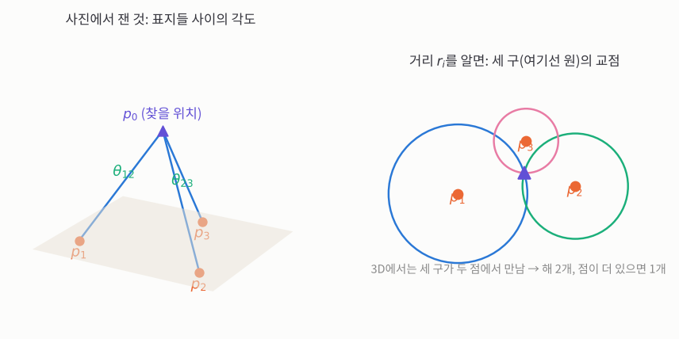
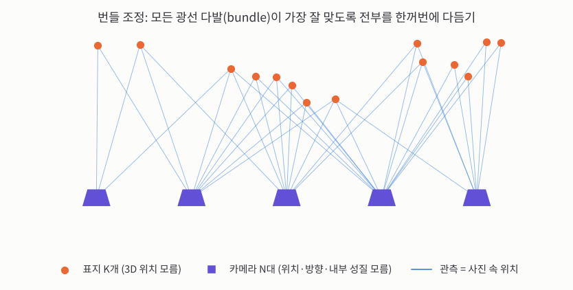
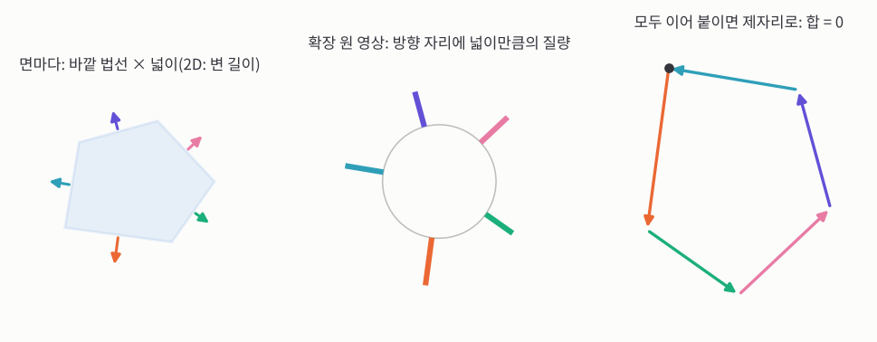
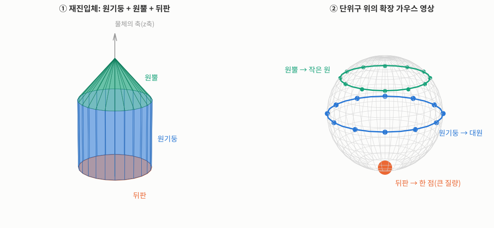
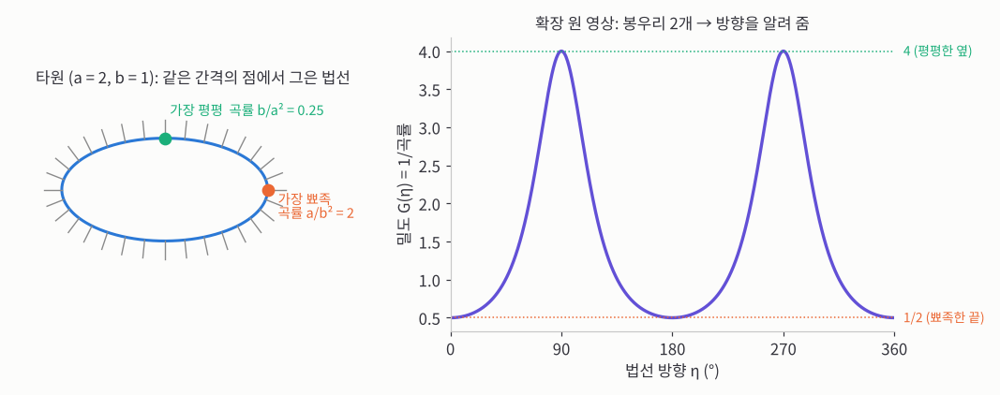


_MIT OpenCourseWare 6.801 22강 원본 영상 (영어)_

> **한 줄 요약:** 위치를 아는 표지 세 개가 사진에 보이면, 표지들 사이의 **각도**만으로 내 위치(후보 2개)와 자세를 구할 수 있습니다. 카메라와 표지가 여럿이면 모두를 한꺼번에 다듬는 **번들 조정**을 씁니다. 강의 후반은 3D 인식으로 넘어가, 물체의 겉면을 **법선 방향별 넓이**로 구 위에 펼친 **확장 가우스 영상**을 소개합니다.
{: .prompt-info }

## 외부 방향: 사진 한 장 + 지도 = 내 위치

이번 강의로 사진 측량 부분이 끝납니다. [17강](/posts/mit-mv-17-photogrammetry/)의 네 문제 중 마지막 하나, **외부 방향**(2D↔3D)입니다.

드론이 땅 위를 날고 있고, 그 땅은 자세한 3D 지도가 있다고 해 봅시다. 그러면 땅 위의 눈에 띄는 표지들의 3D 위치는 압니다. 드론의 카메라가 그 표지들을 찍었을 때, **드론은 어디에 있고 어느 쪽을 보고 있을까요?** 17강의 절대 방향처럼 회전과 이동을 찾는 문제지만, 한쪽은 3D(지도), 다른 쪽은 2D(사진)라는 점이 다릅니다.

기호를 정하겠습니다.

- $$p_1, p_2, p_3$$: 지도에서 위치를 아는 표지(point) 세 개입니다.
- $$p_0$$: 찾을 위치, 즉 카메라의 투영 중심(렌즈 중심)입니다. 번호 0은 "기준이 되는 점"이라는 뜻으로 붙였습니다.

모르는 것은 위치 3개와 자세(회전) 3개, 모두 **6자유도**입니다. 표지 하나가 사진에서 가로·세로 위치 두 개를 주니, 표지 **세 개**면 식이 6개라 딱 맞습니다. 교수님은 이렇게 단순하게 센 개수가 여기서는 맞는다고 말합니다.

이 문제는 1950년대에 Church라는 사진 측량학자가 이미 교과서에서 풀어 둔 것입니다. 교수님은 머신비전 연구자들이 사진 측량을 다시 발명하면서 오히려 더 못하게 한 경우가 많다고 농담하며, 이 수업은 사진 측량의 뿌리로 돌아간다고 말합니다.

**위치만 알면 되는데, 자세는 빼고 위치 3개만 풀 수는 없을까요?** 안 됩니다. 위치와 자세가 서로 얽혀 있어서, 원하는 변수만 따로 풀 수 없습니다.

### 삼각대 세우기

카메라 내부 성질(주점 $$x_0, y_0$$와 초점거리 $$f$$)은 이미 보정되어 있다고 가정합니다. 그러면 사진 속 점 하나마다, 렌즈 중심에서 장면으로 뻗는 **광선** 하나가 정해집니다. 표지는 그 광선 위 어딘가에 있습니다.

교수님의 비유는 **삼각대**입니다. 렌즈 중심에서 나간 광선 세 개를 막대 세 개라고 생각하고, 세 막대 끝이 땅 위 세 표지에 정확히 닿도록 삼각대를 놓는 것입니다.

_왼쪽: 사진에서 바로 재는 것은 광선 사이의 각도 $$\theta_{12}, \theta_{23}$$입니다. 오른쪽: 거리 $$r_i$$를 알면 위치는 각 표지를 중심으로 하는 구들의 교점입니다(보기 쉽게 원으로 그렸습니다)._

삼각대의 **다리 사이 각도**는 사진에서 바로 잽니다. 두 광선의 방향 벡터로 내적을 하면 각의 코사인이, 외적의 크기를 구하면 사인이 나옵니다. 광선 $$i$$와 $$j$$ 사이의 각을 $$\theta_{ij}$$(각도에 흔히 쓰는 글자)라 하겠습니다.

모르는 것은 **다리 길이**입니다. $$p_0$$에서 표지 $$p_i$$까지의 거리를 $$r_i$$라 합시다. 이 길이는 곧 "$$p_i$$를 중심으로 하는 구의 반지름(radius)"이 되므로 $$r$$로 씁니다.

### 다리 길이 구하기: 삼각형 풀기

$$p_0$$와 두 표지가 이루는 삼각형을 보면, 두 변이 $$r_i, r_j$$이고 그 사이 각이 $$\theta_{ij}$$, 마주 보는 변은 두 표지 사이의 거리 $$\|p_i - p_j\|$$(지도로 앎)입니다. 옛 항해·측량 책에는 이런 삼각형 공식이 가득했는데, 사실 **사인 법칙**과 **코사인 법칙** 둘이면 충분합니다. 여기서는 코사인 법칙을 씁니다.

$$
\|p_i - p_j\|^2 = r_i^2 + r_j^2 - 2\, r_i r_j \cos\theta_{ij}
$$

**손으로 확인해 보면:** 드론이 $$p_0 = (0, 0, 4)$$에 있고, 땅 위 표지가 $$p_1 = (3, 0, 0)$$, $$p_2 = (-3, 0, 0)$$이라 합시다.

1. 다리 길이: $$r_1 = \sqrt{3^2 + 0^2 + 4^2} = 5$$, $$r_2 = 5$$
2. 사진에서 재는 각: 두 광선 방향은 $$(3, 0, -4)/5$$와 $$(-3, 0, -4)/5$$, 내적은 $$(-9 + 0 + 16)/25 = 0.28$$이니 $$\cos\theta_{12} = 0.28$$
3. 코사인 법칙: $$r_1^2 + r_2^2 - 2 r_1 r_2 \cos\theta_{12} = 25 + 25 - 2 \cdot 25 \cdot 0.28 = 36$$, 지도에서 잰 $$\|p_1 - p_2\|^2 = 6^2 = 36$$과 같습니다.

실제 문제에서는 거꾸로 $$\theta_{ij}$$와 $$\|p_i - p_j\|$$를 알고 $$r_i$$를 찾습니다. 삼각형이 세 개(12, 13, 23)라 식 세 개, 미지수 $$r_1, r_2, r_3$$ 세 개입니다. 다만 식이 비선형이라 깔끔한 닫힌 해가 없을 수도 있습니다. 그래도 해가 몇 개인지는 따질 수 있고, 수치적으로는 언제나 풀 수 있습니다.

### 구의 교점과 거울상 해

다리 길이를 알면 위치는 쉽습니다. $$p_0$$는 $$p_1$$에서 거리 $$r_1$$인 구 위에 있고, 나머지 두 구 위에도 있습니다. 구 두 개는 원에서 만나고, 그 원과 세 번째 구는 보통 **두 점**에서 만납니다. 그래서 위치 후보가 2개입니다.

두 번째 해는 세 표지가 놓인 평면에 대한 **거울상**입니다. 위 손계산에서 $$p_0 = (0, 0, -4)$$도 두 표지까지 거리가 똑같이 5입니다. 걸러 내는 방법은 두 가지입니다.

- 드론은 땅 **위**를 나니, 땅 아래 해는 버립니다.
- 거울상 자리에서 보면 사진 속 표지들의 **도는 순서**(시계 방향인지 반대인지)가 뒤집힙니다. 종이 뒷면에서 글씨를 비춰 보면 거꾸로 보이는 것과 같습니다.

표지가 세 개보다 많으면 위치를 더 정확히 구할 수 있고, 최소제곱으로 푸는 것이 좋습니다. 짝을 잘못 지은 표지(이상값)가 섞여 있다면 19강의 **RANSAC**처럼 세 쌍씩 무작위로 골라 풀어 보기를 반복합니다.

### 자세 구하기

**자세**(attitude)는 땅의 좌표계에 대해 카메라가 얼마나 돌아가 있는지, 즉 회전입니다. 위치 $$p_0$$를 알면, 각 표지 위치에서 $$p_0$$를 빼서 이동을 없앨 수 있습니다. 땅 좌표계에서 본 표지 방향을 $$b$$로 씁니다.

$$
b_i = p_i - p_0, \qquad i = 1, 2, 3
$$

같은 세 광선을 카메라 좌표계에서도 압니다. 카메라 좌표계의 원점이 렌즈 중심이니, 사진 속 점에서 바로 광선 방향이 나오기 때문입니다. 이 방향을 $$a_i$$로 씁니다($$a, b$$는 두 묶음을 구분하려고 붙인 순서 글자입니다). 길이는 서로 다를 수 있으니 방향만 쓰도록 길이 1로 줄여 $$\hat{a}_i, \hat{b}_i$$로 씁니다(모자는 단위 벡터 표시).

이제 "카메라 좌표계 방향 $$\hat{a}_i$$를 돌리면 땅 좌표계 방향 $$\hat{b}_i$$가 된다"는 벡터 쌍이 세 개 있습니다. 17강 방법 1처럼 세 벡터를 열로 나란히 세우면

$$
R\,(\hat{a}_1\;\hat{a}_2\;\hat{a}_3) = (\hat{b}_1\;\hat{b}_2\;\hat{b}_3) \quad\Longrightarrow\quad R = B A^{-1}
$$

여기서 $$A = (\hat{a}_1\;\hat{a}_2\;\hat{a}_3)$$, $$B = (\hat{b}_1\;\hat{b}_2\;\hat{b}_3)$$입니다. 회전 방향은 카메라→땅으로 잡든 땅→카메라로 잡든 상관없습니다. 3×3 행렬 하나만 뒤집으면 되니 간단합니다.

교수님은 여기서 질문 하나를 남겨 둡니다. **이렇게 구한 $$R$$은 저절로 직교 행렬일까요?** 잡음이 없다면 그렇지만, 잡음이 있으면 정확히 직교가 아닐 수 있습니다.

### 실제로는: 3점 해로 출발, 최소제곱으로 다듬기

세 점은 **최소한**의 경우일 뿐입니다. 실제로는 점을 더 많이 쓰고 최소제곱으로 풀어 정확도를 높이는데, 그러면 닫힌 해는 사라집니다. 그래서 권하는 방법은 이렇습니다.

1. 세 점으로 닫힌 해를 구해 **첫 추측**으로 씁니다.
2. 그 추측에서 출발해 반복 계산으로 최소제곱 오차를 줄입니다.
3. 오차는 3D 공간이 아니라 **사진 위**에서 잽니다. 측정 잡음이 생기는 곳이 사진이기 때문입니다.

## 번들 조정: 전부 한꺼번에

이 문제는 비행기에만 해당하지 않습니다. 관광객 여러 명이 유명한 광장이나 조각상을 각자 다른 자리에서 찍었다고 해 봅시다. 카메라가 여러 대, 같은 장면을 본 사진이 여러 장입니다. 이때 쓰는 방법이 **번들 조정**(bundle adjustment)이고, 이것도 머신비전이 다시 발견한 오래된 사진 측량 기법입니다. 각 카메라에서 나가는 광선 다발(bundle)들이 서로 잘 맞도록 조정한다는 뜻입니다.

이번에는 모르는 것이 훨씬 많습니다.

- 장면 속 점들의 3D 위치(처음에는 모름)
- 모든 카메라의 위치와 회전
- 흔히 각 카메라의 내부 성질(주점, 초점거리), 정밀하게 하려면 렌즈의 방사 왜곡까지

_주황 점이 장면 속 점, 보라 사다리꼴이 카메라, 파란 선이 각 카메라가 그 점을 본 광선입니다. 광선 다발들이 점에서 가장 잘 만나도록 모든 미지수를 함께 조정합니다._

줄일 오차는 이번에도 3D가 아니라 **사진 위**의 오차(재투영 오차)입니다. 이 거대한 비선형 최적화는 앞에서 배운 **레벤버그-마쿼트** 방법으로 잘 풀립니다. 합리적인 첫 추측만 주면, 수많은 매개변수를 조금씩 고쳐 가며 오차를 줄이는 "블랙박스"에 넣으면 됩니다. 사진이 많으면 조건도 많아서 이렇게 많은 미지수도 풀립니다.

예로, 아프리카 리프트 밸리의 사람이 거의 가지 않는 화산을 드론 한 대로 날며 찍어서, 칼데라의 현재 모양을 자세한 3D로 되살린 일이 있습니다. 드론의 정확한 위치는 몰라도 **대략적인 위치는 알고 있어서** 첫 추측으로 쓸 수 있었습니다. 비선형 최적화는 엉뚱한 국소 최솟값에 빠질 수 있으니, 답 가까이에서 출발하는 것이 중요합니다.

남은 문제는 여러 사진에서 같은 점을 찾는 일입니다. 경계 찾기는 배웠지만 **눈에 띄는 점** 찾기는 아직 안 배웠습니다. 대표적인 방법이 Lowe의 SIFT이고(처음에는 특허가 있었습니다), 지금은 특허를 피하면서 더 빠른 방법이 많이 나와 있습니다. 다른 사진에서 다시 찾기 쉬운 점을 고르고 묘사하는 일은 그 자체로 큰 산업입니다. 이것만 빼면, 번들 조정을 구현하는 데 필요한 도구는 지금까지 사진 측량 문제들을 풀며 모두 배웠습니다.

## 3D 물체는 어떻게 나타낼까

지금까지 수업은 저수준 처리(필터링, 에일리어싱, 경계 찾기)에서 시작해 사진 측량, 2D에서의 인식과 자세 찾기까지 왔습니다. 이제는 **3D에서** 물체를 알아보고 자세를 찾으려 합니다. 2D보다는 덜 정확합니다. 그러려면 먼저 3D 물체를 **어떤 형태로 저장할지** 정해야 합니다.

- **다면체:** 꼭짓점, 모서리, 면을 서로 연결한 그래프로 저장하면 됩니다. 이런 문제를 "블록 세상"이라고 부르는데, 1960년대 초창기에 아이들 장난감 블록 같은 물체만 다뤘던 데서 나온, 약간 비꼬는 이름입니다.
- **메시**(작은 다각형 조각의 모음): 곡면을 잘게 쪼갠 조각으로 근사합니다. 조각마다 두 모서리의 외적으로 법선을 구하고 반사 지도로 명암을 넣으면 그림을 그리기에 좋습니다. 하지만 **자세 찾기와 인식에는 나쁩니다.**

메시가 왜 나쁜지 보겠습니다. 두 메시를 맞추려면 꼭짓점끼리 짝지어 거리 제곱을 줄여야 하는데, 꼭짓점에는 특별한 이름이 없습니다. 같은 물체를 다시 스캔해도 똑같은 메시가 나오는 일은 거의 없습니다. 가장 가까운 꼭짓점끼리 반복해서 맞추는 방법도 있지만 믿을 만하지 않습니다. 인식도 마찬가지입니다. 조각이 320개인 메시와 360개인 메시가 같은 물체일 수도 있으니, 조각 수를 비교하는 건 의미가 없습니다.

### 바라는 성질: 이동과 회전에 대해

물리에서 불변성과 대칭을 따지듯, 표현이 가져야 할 성질을 정해 봅니다.

1. **이동:** 물체를 옮기면 표현은 간단하게, 이해하기 쉽게 바뀌어야 합니다. 모든 것을 물체의 무게중심 기준으로 적으면 이동과 무관해집니다.
2. **회전:** 물체를 돌리면 표현도 **예측 가능하게** 바뀌어야 합니다. 원근 투영으로 찍은 사진은 돌릴 때 아주 복잡하게 바뀌니 적합하지 않습니다.

회전에 대해서는 "전혀 안 바뀜"(불변)을 원하는 게 아닙니다. 우리는 회전을 **알아내고** 싶으니, 회전하면 표현도 단순하고 규칙적으로 바뀌어야 합니다.

### 첫 후보: 일반화 원기둥

보통의 원기둥은 원(생성자)을 그 원에 수직인 직선(축)을 따라 밀어서 만듭니다. 이걸 조금씩 일반화해 봅니다.

1. 생성자 모양을 원 말고 다른 모양으로 바꿉니다. 단면은 길이 방향으로 일정합니다.
2. 생성자를 축에 비스듬히 기울입니다. 이건 단순히 짧아 보이게 만드는 변환일 뿐입니다.
3. 생성자 크기를 축을 따라 바꿉니다. 그러면 원뿔이 됩니다.
4. 축 자체를 휘게 합니다.

이걸 다 합치면 훨씬 복잡한 모양도 만들 수 있습니다. 사람 몸을 나타내는 데는 꽤 쓸모가 있어서, 팔다리를 일반화 원기둥으로 만들고 관절로 이으면 화가들이 쓰는 나무 인형이 됩니다.

문제는 **유일성**입니다. 인식하려면 같은 물체는 언제나 같은 표현이어야 하는데, 일반화 원기둥은 한 물체를 무한히 많은 방법으로 나타낼 수 있습니다. 구가 대표적입니다. 어느 축을 잡든 원이 커졌다 작아지게 밀면 구가 되니, 표현이 무한히 많습니다. 잡음이 섞인 데이터에서도 같은 문제가 생깁니다. **유연성과 유일성 사이의 줄다리기**이고, 그래서 크게 성공하지 못했습니다. 교수님은 3D 표현은 2D와 달리 아직 연구가 진행 중이라, 지금 나온 방법들도 저마다 한계가 있다고 말합니다.

## 확장 가우스 영상

다면체로 돌아가 다른 방법을 써 봅니다. 면마다 **바깥 법선(길이 1) × 그 면의 넓이**인 벡터를 하나씩 구하고, 꼭짓점과 그래프 정보는 **전부 버립니다.** 이 벡터들만 남깁니다.

놀랍게도 이렇게 정보를 많이 버려도, **볼록한 다면체**라면 이 벡터 묶음이 같은 다면체는 단 하나뿐입니다. 민코프스키가 오래전에 증명했습니다. 인식에 딱 좋은 성질입니다. 엉뚱한 물체와 헷갈릴 일이 없으니까요.

다만 증명이 **비구성적**이라, 그런 다면체가 하나뿐이라는 것만 알려 주고 실제로 만드는 방법은 알려 주지 않습니다. Katsushi Ikeuchi가 반복으로 다면체를 되살리는 방법을 만들었지만 아주 느렸습니다. 그런데 곧 사람들이 깨달았습니다. 우리가 할 일은 되살리기가 아니라 **인식과 정렬**이라는 것을요. 모델 목록과 비교하고, 관측한 물체를 모델에 맞추는 회전만 찾으면 됩니다.

### 벡터의 합은 0

이 벡터들을 꼬리에 머리를 이어 붙이면 **제자리로 돌아옵니다.** 즉 합이 0입니다. 면 $$i$$의 넓이를 $$A_i$$(Area), 바깥 단위 법선을 $$\hat{n}_i$$(normal)라 하면

$$
\sum_{i=1}^{N} A_i\,\hat{n}_i = 0
$$

합이 0이 아니면 닫힌 볼록 물체가 아닙니다. 예를 들어 면 하나를 빠뜨린 경우입니다. 거꾸로 합이 0인 벡터 묶음이면 어떤 것이든 그에 해당하는 볼록 다면체가 하나 있습니다.

**손으로 확인해 보면:** 2D 직사각형(가로 2, 세로 1)으로 해 봅시다. 2D에서는 넓이 대신 변의 길이를 씁니다.

| 변 | 길이 | 바깥 법선 | 법선 × 길이 |
|---|---|---|---|
| 오른쪽 | 1 | $$(1, 0)$$ | $$(1, 0)$$ |
| 위 | 2 | $$(0, 1)$$ | $$(0, 2)$$ |
| 왼쪽 | 1 | $$(-1, 0)$$ | $$(-1, 0)$$ |
| 아래 | 2 | $$(0, -1)$$ | $$(0, -2)$$ |

합은 $$(1 + 0 - 1 + 0,\; 0 + 2 + 0 - 2) = (0, 0)$$입니다.

_왼쪽: 다각형의 각 변에 바깥 법선을 그렸습니다. 가운데: 법선 방향 자리에 변 길이만큼의 막대를 원 위에 세운 것이 확장 원 영상입니다. 오른쪽: "법선 × 길이" 벡터는 변을 90° 돌린 것이라, 이어 붙이면 원래 다각형을 돌린 모양으로 제자리에 돌아옵니다._

### 곡면에는: 구 위에 질량 올리기

다면체가 아닌 물체는 어떻게 할까요? 교수님의 예는 (단순하게 만든) **대륙간 탄도 미사일의 재진입체**입니다. 원기둥 부분, 원뿔 부분, 그리고 보이지 않는 평평한 뒤판으로 되어 있습니다.

방법은 겉면을 **법선이 거의 같은 조각들**로 자르는 것입니다. 조각마다 넓이와 법선을 구한 다음, **단위구 위에서 그 법선 방향에 해당하는 점에, 넓이만큼의 질량을 올려놓습니다.** 이것이 **확장 가우스 영상**(Extended Gaussian Image, EGI)입니다. 조각을 더 잘게 나눠도 결과는 같습니다. 넓이가 절반인 조각 두 개가 같은 법선을 가지면, 구의 같은 점에 같은 총질량을 올리기 때문입니다.

_① 재진입체입니다. 회색 화살표가 물체의 축이고, 이 축을 $$z$$축으로 잡았습니다. ② 단위구 위의 질량입니다. 원기둥의 법선은 모두 $$z$$축에 수직이라 적도(대원) 위에 같은 질량으로 늘어섭니다(파랑). 원뿔의 법선은 위로 같은 각만큼 기울어 있어 위쪽의 작은 원 위에 모입니다(초록). 평평한 뒤판은 법선이 모두 $$-z$$ 방향이라 남극 한 점에 큰 질량으로 몰립니다(주황)._

- **원기둥:** 법선이 빙 돌지만 언제나 원기둥 축에 수직입니다. 그래서 질량이 구의 **대원**(구 중심을 지나는 원) 위에 놓이고, 조각을 고르게 자르면 질량도 고릅니다.
- **원뿔:** 법선들도 원뿔 모양으로 퍼져 있습니다. 그래서 구 위의 **작은 원**에 모입니다.
- **뒤판:** 모든 점의 법선이 같아서 구의 **한 점**에 큰 질량이 몰립니다. 한 점에 뾰족하게 솟은 값(임펄스) 같은 것입니다.

### 이걸로 인식과 정렬하기

물체 목록마다 확장 가우스 영상을 미리 계산해 둡니다. 비교는 평면이 아니라 **구 위에서** 합니다. 한쪽에 질량이 많은 곳에 다른 쪽도 질량이 많아야 하니, 상관(correlation) 같은 값으로 얼마나 잘 맞는지 잽니다. 이 값으로 두 가지를 합니다.

- **정렬:** 한쪽 구를 돌려 가며 가장 잘 맞는 회전을 찾습니다.
- **인식:** 가장 잘 맞았을 때의 값으로 어느 물체인지 고릅니다.

앞에서 정한 성질도 만족합니다.

- **이동:** 법선과 넓이만 쓰니 물체를 옮겨도 그대로입니다.
- **회전:** 물체를 돌리면 법선이 모두 같이 돌아서, 구 위의 질량 분포도 **똑같이 돕니다.** 단순하고 직관적입니다.

### 밀도와 곡률

매끈한 곡면에서는 조각을 끝없이 잘게 나누면 질량 대신 구 위의 **밀도**가 남습니다. 밀도는 곡률과 반대로 움직입니다. 많이 휜 곳은 법선이 넓게 흩어져 밀도가 **낮고**, 평평한 곳은 법선이 몰려 밀도가 **높습니다.** 재진입체에서 가장 평평한 뒤판이 가장 큰 질량을 남긴 것이 그 예입니다.

물체 위의 점을 "같은 법선을 가진 구 위의 점"으로 보내는 대응을 **가우스 사상**이라고 합니다. 지구의 위도가 바로 이 생각으로 정해집니다. 위도는 지구 중심에서 잰 각이 아니라, 그 자리의 땅에 수직인 방향(중력 방향)이 적도면과 이루는 각입니다. MIT는 북위 약 42°에 있습니다. 실제로는 원심력과 고르지 않은 질량 분포 때문에 조금 더 복잡하지만, 기본은 법선입니다.

**볼록한** 물체라면 이 대응을 거꾸로 할 수 있습니다. 구 위의 점 하나마다 그 법선을 가진 물체 위의 점이 딱 하나 있기 때문입니다. 볼록하지 않으면 여러 점이 같은 법선을 가질 수 있어 일대일이 깨집니다. 그래서 여기서는 볼록한 물체만 다룹니다.

3D 곡률은 정의하기가 까다로우니, 먼저 2D로 연습합니다.

## 2D로 연습: 확장 원 영상

2D에서는 볼록한 닫힌 곡선을 단위**원** 위에 펼칩니다. 곡선의 짧은 조각 하나는, 양 끝 법선 사이의 **원호**로 옮겨집니다. 기호를 정합니다.

- $$\eta$$(에타): 단위원 위의 위치, 즉 법선 방향의 각입니다. 곡선 위의 위치와 구분하려고 다른 그리스 문자를 씁니다.
- $$s$$: 곡선을 따라 잰 길이입니다.
- $$\kappa$$(카파): 곡선을 따라 갈 때 방향이 도는 빠르기, **곡률**(curvature)입니다. 곡률을 뜻하는 영어 머리글자 k에 해당하는 그리스 문자입니다.
- $$G$$: 원 위의 밀도입니다. 가우스(Gauss)의 머리글자입니다.

$$
\kappa = \frac{d\eta}{ds}, \qquad G(\eta) = \frac{ds}{d\eta} = \frac{1}{\kappa}
$$

곡률은 곡선이 그 자리에서 맞닿는 원(곡률 원)의 반지름의 역수이기도 합니다. 많이 휜 곳은 법선이 빨리 돌아 조각의 길이가 넓은 원호에 퍼지니 밀도가 낮고, 평평한 곳은 좁은 원호에 몰리니 밀도가 높습니다. 이것이 2D의 **확장 원 영상**이고, 닫힌 볼록 곡선이라면 이 분포가 같은 곡선은 하나뿐입니다.

### 2D에서는 되살릴 수 있다

3D에서는 민코프스키 정리가 비구성적이었지만, 2D에서는 $$G(\eta)$$로 곡선을 직접 되살릴 수 있습니다. 법선이 $$\eta$$인 곳에서 곡선은 법선에 수직인 방향 $$(-\sin\eta, \cos\eta)$$로 나아가고, 그 방향으로 길이 $$ds = G(\eta)\,d\eta$$만큼 갑니다. 출발점을 $$(x_0, y_0)$$라 하고 더해 가면

$$
x = x_0 + \int -\sin\eta\; G(\eta)\, d\eta, \qquad y = y_0 + \int \cos\eta\; G(\eta)\, d\eta
$$

닫힌 곡선이라면 한 바퀴 돌았을 때 제자리여야 하므로

$$
\int_0^{2\pi} \sin\eta\; G(\eta)\, d\eta = 0, \qquad \int_0^{2\pi} \cos\eta\; G(\eta)\, d\eta = 0
$$

즉 원 위 **밀도의 무게중심이 원의 중심**에 있어야 합니다. 다면체의 "벡터 합 = 0"과 같은 조건입니다. 이 조건만 지키면 밀도는 마음대로 놓을 수 있습니다.

### 예 1: 원

반지름이 $$\rho$$(로)인 원을 봅시다. 반지름은 보통 $$r$$로 쓰지만, 앞에서 $$r_i$$를 다리 길이로 썼으니 겹치지 않게 그에 해당하는 그리스 문자를 씁니다. 원에서는 호의 길이가 $$s = \rho\eta$$라서

$$
\kappa = \frac{1}{\rho}, \qquad G(\eta) = \rho
$$

로 일정합니다. 큰 원일수록 밀도가 큽니다. 더 평평해서 거의 같은 방향을 향하는 부분이 많기 때문입니다.

**손으로 확인해 보면:** $$\rho = 2$$이면 $$G = 2$$이고, 한 바퀴 적분하면 $$\int_0^{2\pi} 2\, d\eta = 4\pi$$로 둘레 $$2\pi \cdot 2$$와 같습니다. $$G\,d\eta = ds$$이니 당연한 결과입니다.

하지만 원은 어느 방향이든 똑같아서, 원을 돌려도 확장 원 영상이 변하지 않습니다. **방향을 알아내는 데는 쓸모가 없습니다.**

### 예 2: 타원

좀 더 복잡한 예로 타원을 봅니다(3D로 하면 계산이 길어서 2D로 합니다). 원점에 중심을 두고, 긴 반지름 $$a$$는 $$x$$축 방향, 짧은 반지름 $$b$$는 $$y$$축 방향으로 놓습니다.

$$
\frac{x^2}{a^2} + \frac{y^2}{b^2} = 1
$$

그리기 쉬운 매개변수 꼴은 원을 세로로 $$b/a$$만큼 찌그러뜨린 것입니다. 찌그러뜨리기 전 원에서의 각을 $$\varphi$$(파이)라 하겠습니다($$\theta$$는 앞에서 광선 사이 각으로 썼으니 겹치지 않게 다른 글자를 씁니다).

$$
x = a\cos\varphi, \qquad y = b\sin\varphi
$$

$$\varphi$$는 그림 속 타원에서 잰 각이 아니라는 점에 주의합니다. 타원의 넓이는 $$\pi a b$$이고, $$a = b$$이면 원의 넓이가 됩니다.

$$\varphi$$로 미분하면 접선이 $$(-a\sin\varphi,\ b\cos\varphi)$$이고, 두 성분을 바꾸고 부호 하나를 바꾸면 법선 $$(b\cos\varphi,\ a\sin\varphi)$$가 나옵니다. 이 법선의 방향이 곧 $$\eta$$이므로 둘의 관계는

$$
a\tan\varphi = b\tan\eta
$$

입니다. 지구도 살짝 찌그러진 구라서, 측지학에서 이 식이 그대로 나옵니다. 지구는 약 1/300만큼만 찌그러져 있어 두 각이 거의 같지만, 엄밀히는 구분해야 합니다.

**손으로 확인해 보면:** $$a = 2$$, $$b = 1$$, $$\varphi = 45^\circ$$인 점에서 법선은 $$(1 \cdot 0.707,\ 2 \cdot 0.707) = (0.707,\ 1.414)$$이니 기울기가 2입니다. 식으로도 $$\tan\eta = (a/b)\tan\varphi = 2 \times 1 = 2$$, 즉 $$\eta \approx 63.4^\circ$$로 같습니다.

계산을 끝까지 하면, 법선 방향 $$\eta$$에서의 곡률은

$$
\kappa(\eta) = \frac{(a^2\cos^2\eta + b^2\sin^2\eta)^{3/2}}{a^2 b^2}, \qquad G(\eta) = \frac{1}{\kappa(\eta)}
$$

입니다. 곡률이 가장 크고 작은 곳은 두 반지름의 끝, 즉 $$\eta = 0, \pi/2, \pi, 3\pi/2$$에서 나옵니다.

_왼쪽: $$a = 2$$, $$b = 1$$인 타원에 같은 간격으로 법선을 그렸습니다. 뾰족한 끝(주황)은 곡률이 크고, 평평한 옆(초록)은 곡률이 작습니다. 오른쪽: 밀도 $$G(\eta)$$에는 봉우리가 두 개 있고, 그 위치가 타원이 어느 쪽으로 누워 있는지 알려 줍니다._

**손으로 계산해 보면:** $$a = 2$$, $$b = 1$$일 때

- 뾰족한 끝($$\eta = 0^\circ$$): $$\kappa = a^3/(a^2 b^2) = a/b^2 = 2$$, 밀도 $$G = 0.5$$
- 평평한 옆($$\eta = 90^\circ$$): $$\kappa = b^3/(a^2 b^2) = b/a^2 = 0.25$$, 밀도 $$G = 4$$

원과 달리 밀도가 방향에 따라 오르내립니다. 그래서 타원을 돌리면 분포도 같이 돌고, 두 분포의 봉우리가 겹치도록 돌리면 회전이 나옵니다. 맞춘 뒤에도 잘 안 겹치면 애초에 타원이 아닌 것입니다. 인식도 같은 방법으로, 목록의 물체마다 분포를 미리 구해 두고 가장 잘 맞는 것을 고릅니다.

## 다시 3D로: 가우스 곡률

3D에서는 점이 아니라 **조각**을 옮깁니다. 물체 위의 작은 조각 넓이를 $$\delta O$$(Object), 그 조각의 법선들이 단위구 위에 차지하는 넓이를 $$\delta S$$(Sphere)라 하면, 둘의 비가 **가우스 곡률**입니다. 밀도 $$G$$는 그 역수입니다.

$$
K = \lim \frac{\delta S}{\delta O}, \qquad G = \frac{1}{K} = \lim \frac{\delta O}{\delta S}
$$

2D의 곡률 $$\kappa$$와 구분하려고 3D 가우스 곡률은 대문자 $$K$$로 씁니다. 평평한 곳은 법선이 거의 같아 구 위의 아주 작은 넓이로 옮겨지니 곡률이 작고, 많이 휜 곳은 법선이 넓게 퍼져 곡률이 큽니다. 3D 곡률은 사실 이보다 복잡하지만, 가우스 곡률은 그중 다루기 좋은 숫자 하나입니다.

볼록한 곳에서는 물체 위 조각의 테두리를 한 방향으로 돌면, 구 위 조각의 테두리도 같은 방향으로 돕니다. 그래서 곡률이 양수입니다. 감자칩(프링글스) 같은 **안장점**에서는 구 위에서 반대 방향으로 돌아 곡률이 음수가 됩니다. 여기서는 볼록한 물체만 다룹니다.

**손으로 확인해 보면:** 반지름 $$\rho$$인 구는 겉넓이가 $$4\pi\rho^2$$이고, 그 법선은 단위구 전체(넓이 $$4\pi$$)를 덮습니다. 그래서

$$
K = \frac{4\pi}{4\pi\rho^2} = \frac{1}{\rho^2}, \qquad G = \rho^2
$$

입니다. $$\rho = 2$$이면 $$K = 1/4$$, $$G = 4$$입니다. 2D의 원($$\kappa = 1/\rho$$, $$G = \rho$$)과 같은 모양이고, 작은 구는 곡률이 크고 큰 구는 곡률이 작습니다.

그런데 벽돌처럼 모서리가 있는 물체는 어떨까요? 면에서는 곡률이 0이고 모서리에서는 무한대라, 점마다 곡률을 정할 수 없습니다. 대신 한 영역에 걸쳐 곡률을 **적분한 값**은 정할 수 있습니다. 이 **적분 곡률**과, 이걸로 인식과 정렬을 하는 방법이 다음 강의의 주제입니다.

## 직접 해 보기

**① 다각형의 확장 원 영상.** 꼭짓점을 끌거나 다각형 전체를 옮기고, 슬라이더로 돌려 보세요.

어떻게 바꿔도 "법선 × 길이의 합"은 (0.00, 0.00)입니다. 다각형을 옮기면 오른쪽 그림은 꿈쩍도 하지 않고, 돌리면 막대들이 같은 각도만큼 함께 돕니다. 꼭짓점 하나를 안쪽으로 밀어 넣어 오목하게 만들면 경고가 뜹니다.

**② 표지 세 개로 내 위치 찾기 (2D).** 표지 사이의 두 각 $$\theta_{12}$$, $$\theta_{23}$$은 각각 원 하나씩을 정하고, 카메라는 두 원의 교점에 있습니다. 카메라를 끌어 보세요.

처음 위치에서 각을 ±0.5° 틀리면 위치 오차가 최대 17.9px입니다. 카메라를 표지 쪽으로 올리면(예: 세로 200px 근처) 2~3px로 줄어듭니다. 반대로 주황 원(세 표지를 모두 지나는 원) 위로 끌고 가면 두 원이 겹쳐 버려 오차가 수백 px로 폭발합니다. 20강의 위험한 곡면과 같은 현상의 2D판입니다.

## 정리

- **외부 방향:** 사진 속 광선 사이 **각도 → 코사인 법칙으로 다리 길이 → 구들의 교점**으로 위치를 구합니다(후보 2개, 거울상은 땅 아래이거나 표지 순서가 뒤집혀서 걸러짐). 그다음 방향 벡터 세 쌍을 맞춰 자세 $$R = BA^{-1}$$를 구합니다. 실제로는 3점 해로 출발해 사진 위 오차로 다듬습니다.
- **번들 조정**은 장면 점과 카메라의 모든 미지수를 재투영 오차 최소화로 한꺼번에 다듬습니다. 좋은 첫 추측이 중요합니다.
- 3D 표현은 이동에는 단순하게, 회전에는 예측 가능하게 바뀌어야 하고, 같은 물체는 하나의 표현을 가져야 합니다. 메시와 일반화 원기둥은 이 조건을 못 지킵니다.
- **확장 가우스 영상**은 겉면을 법선 방향별 넓이로 단위구 위에 펼친 것입니다. 이동에 무관하고, 회전하면 함께 돌며, 볼록한 물체라면 모양을 하나로 정합니다(민코프스키).
- 밀도는 곡률의 역수입니다. 2D에서는 $$G(\eta) = ds/d\eta$$이고 원은 일정, 타원은 봉우리 두 개를 가집니다. 3D에서는 가우스 곡률 $$K = \lim \delta S/\delta O$$이고 반지름 $$\rho$$인 구는 $$G = \rho^2$$입니다.

> 다음 글: [[MIT 머신비전 23강] 모양을 방향의 분포로 기억하기: 확장 가우스 영상](/posts/mit-mv-23-extended-gaussian-image/)

_참고: MIT 6.801/6.866 Machine Vision (Fall 2020), Berthold Horn 강의 녹취록 · Ryan Sander · Tadayuki Yoshitake 강의 노트 (MIT OpenCourseWare, CC BY-NC-SA 4.0)_
