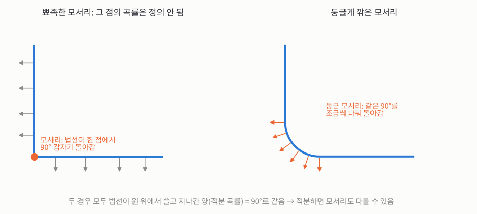
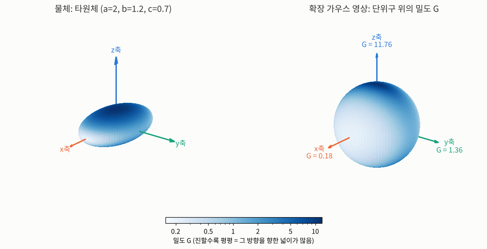
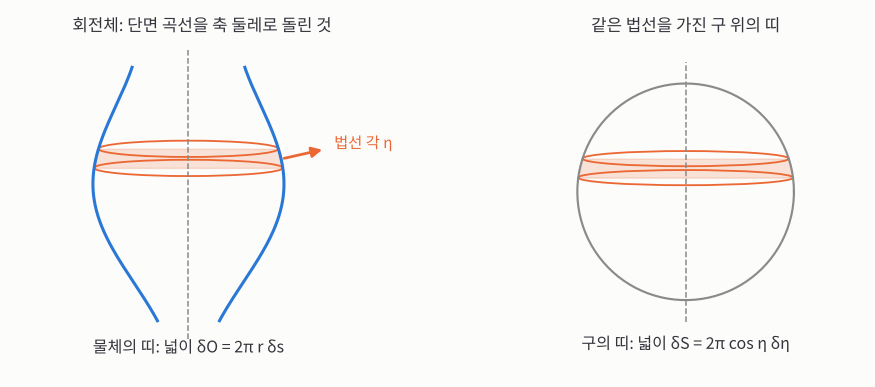
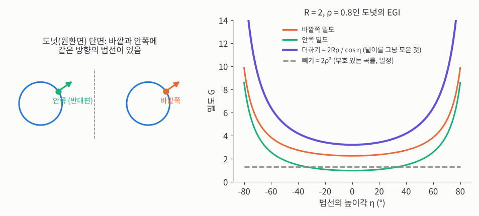
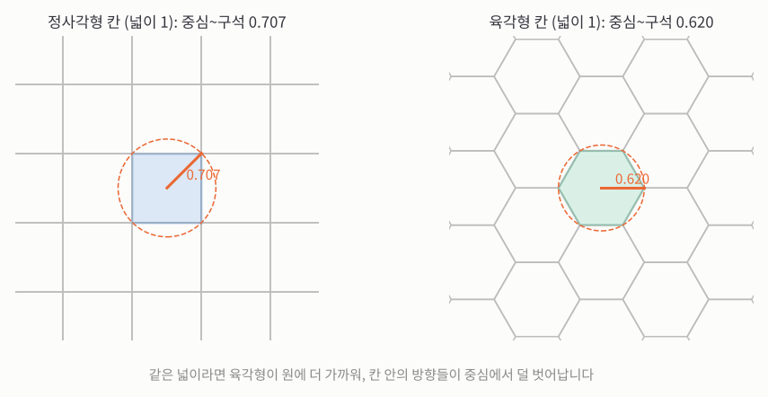


_MIT OpenCourseWare 6.801 23강 원본 영상 (영어)_

> **한 줄 요약:** 물체의 겉면을 "어느 방향을 향한 넓이가 얼마나 되나"로 바꿔 **구 위의 질량 분포**로 적은 것이 확장 가우스 영상(EGI)입니다. 물체를 옮겨도 변하지 않고, 돌리면 똑같이 돌기 때문에 **인식과 자세 맞추기**에 좋습니다. 실제로 쓰려면 구를 칸으로 나눠야 하는데, 칸은 **같은 넓이, 둥근 모양**이고 **돌려도 칸이 칸으로 옮겨 가는** 것이 좋습니다.
{: .prompt-info }

아래 소제목은 강의 영상의 챕터 순서 그대로입니다. 각 소제목 아래 링크를 누르면 영상의 그 부분부터 볼 수 있습니다.

## 1. 확장 가우스 영상

_▶ [0:00부터 보기](https://www.youtube.com/watch?v=s9wu_z8EKAc&t=0s) · Extended Gaussian Images_

**겉면의 방향을 구 위로 옮기면, 많이 휜 곳은 넓게 퍼지고 평평한 곳은 한 점에 모이니까, 그 넓이의 비로 "얼마나 휘었나"를 잴 수 있습니다.**

[지난 글](/posts/mit-mv-22-exterior-orientation-egi/)에서 다면체는 면마다 "방향과 넓이"를 적어 두면 된다는 것을 봤습니다. 그런데 공, 달걀, 도넛처럼 매끈하게 휜 물체는 면이 따로 없습니다. 이번 강의는 이런 물체를 적는 **확장 가우스 영상**(Extended Gaussian Image, EGI)을 다룹니다. 교수님은 먼저 지난 시간 내용을 다시 정리합니다.

1강에서 표면의 방향을 **표면에 수직으로 꽂은 길이 1짜리 이쑤시개**(법선)로 나타냈습니다. 물체 겉면 곳곳의 이쑤시개를 모두 뽑아, 방향은 그대로 둔 채 **반지름 1인 공(단위구)의 중심**에 꽂는다고 생각해 봅시다. 이쑤시개 끝이 닿는 공 표면의 점이 그 겉면이 향한 방향입니다. 이렇게 "법선이 같은 점끼리" 짝지어 겉면을 단위구로 옮기는 것이 **가우스 영상**입니다.

점 대신 겉면의 작은 조각을 옮기면, 그 조각의 이쑤시개들은 구 위에서 작은 영역을 차지합니다.

- **많이 휜 곳**은 이쑤시개 방향이 빠르게 바뀌니 구 위에서 **넓게** 퍼집니다.
- **완만한 곳**은 방향이 거의 같으니 구 위의 **좁은** 영역으로 모입니다.
- **평평한 면**은 모두 같은 방향이라 구 위의 **한 점**에 몰립니다(뾰족한 봉우리, 임펄스).

이 차이를 숫자로 잰 것이 **가우스 곡률**입니다. 기호를 정하겠습니다.

- $$\delta O$$: 물체(Object) 겉면 위 작은 조각의 넓이입니다. $$\delta$$는 "아주 작은 양"이라는 표시입니다.
- $$\delta S$$: 그 조각의 이쑤시개들이 단위구(Sphere) 위에서 차지하는 넓이입니다.
- $$K$$: 가우스 곡률입니다. 교수님처럼 대문자 $$K$$로 씁니다. [22강](/posts/mit-mv-22-exterior-orientation-egi/)에서 2D 곡선의 곡률은 $$\kappa$$, 3D 곡면의 가우스 곡률은 $$K$$로 나눴던 것과 같습니다.

$$
K = \lim_{\delta O \to 0} \frac{\delta S}{\delta O}
$$

**손으로 계산해 보면:** 반지름 2인 공 전체를 옮기면 물체 넓이는 $$4\pi \cdot 2^2 = 16\pi$$, 이쑤시개들이 덮는 넓이는 단위구 전체인 $$4\pi$$입니다. 그래서 $$K = 4\pi / 16\pi = 1/4$$입니다. 반지름 $$R$$인 공이면 $$K = 1/R^2$$로, 큰 공일수록 덜 휘었습니다.

교수님은 이 비를 **뒤집은 값**을 구 위의 위치마다 적어 두겠다고 합니다. 가우스(Gauss)의 이름을 따 $$G$$로 씁니다.

$$
G = \frac{1}{K} = \lim \frac{\delta O}{\delta S}
$$

$$G$$는 대충 말해 "**이 방향을 향한 겉면이 얼마나 많은가**"입니다. 위의 반지름 2인 공이면 $$G = 4$$입니다. 볼록하고 매끈한 물체라면 정확히 그 방향을 향한 점은 보통 하나뿐이지만, 그 주변의 작은 조각을 생각하면 이 생각을 그대로 쓸 수 있습니다.

## 2. 적분 곡률

_▶ [2:30부터 보기](https://www.youtube.com/watch?v=s9wu_z8EKAc&t=150s) · Integral Curvature_

**곡률을 점마다 따지지 않고 조각 전체로 모으면, 모서리처럼 곡률이 무한대인 곳도 "구 위에서 덮은 넓이"라는 유한한 값으로 다룰 수 있습니다.**

곡률을 물체 조각 위에서 모으면(적분하면), 변수를 바꿔 계산했을 때 **구 위에서 대응하는 조각의 넓이**가 나옵니다. 이 값을 **적분 곡률**이라 합니다. 반대로 $$G$$를 구 위의 조각에서 모으면 **물체 위에서 대응하는 조각의 넓이**가 나옵니다.

$$
\iint_O K\, dO = \iint_S dS, \qquad \iint_S G\, dS = \iint_O dO
$$

교수님은 둘째 식이 "더 관심 있는 양"이라고 합니다. 구 위의 어떤 영역을 고르면 "그 방향들을 향한 겉면이 모두 얼마인가"를 바로 알려 주기 때문입니다. 법선이 조금씩 다른 점들을 한데 모아 생각하는, "그 방향을 가진 넓이"라는 생각의 일반화입니다.

**손으로 확인해 보면:** 반지름 2인 공의 위쪽 반구를 봅시다. 물체 위 넓이는 $$2\pi \cdot 2^2 = 8\pi$$이고, 이쑤시개들은 단위구의 위쪽 반구, 넓이 $$2\pi$$를 덮습니다. 첫째 식: $$K = 1/4$$이니 $$\tfrac14 \times 8\pi = 2\pi$$로 구 위 넓이와 같습니다. 둘째 식: $$G = 4$$이니 $$4 \times 2\pi = 8\pi$$로 물체 위 넓이와 같습니다.

적분 곡률의 좋은 점은 **표면 방향이 갑자기 꺾이는 곳**, 즉 모서리와 꼭짓점에서도 쓸 수 있다는 것입니다. 교수님은 정육면체 꼭짓점을 예로 듭니다. 곡률을 점마다 보면 세 면에서는 0, 0, 0이고 모서리와 꼭짓점에서는 무한대입니다. 이걸 곡률이라고 말하기는 곤란합니다. 그런데 꼭짓점을 둘러싼 조각 전체의 곡률을 모으면, 그 조각에서 **방향이 바뀐 총량**이 나옵니다.

## 3. 정육면체 꼭짓점의 적분 곡률

_▶ [5:51부터 보기](https://www.youtube.com/watch?v=s9wu_z8EKAc&t=351s) · Cube Integral Curvature_

**모서리를 둥글게 갈아 생각하면 꼭짓점의 법선들이 구의 1/8을 덮으니까, 꼭짓점의 적분 곡률은 $$4\pi/8 = \pi/2$$입니다.**

정육면체 꼭짓점에 모인 세 면의 법선은 단위구 위의 세 점이고, 서로 위도나 경도로 90°씩 떨어져 있습니다. 그럼 그 사이는 어떻게 될까요? 교수님은 **줄로 모서리를 갈아 둥글게 만든다**고 생각해 보라고 합니다. 단면이 뾰족한 꺾임이 아니라 둥근 곡선이 되고, 그 둥근 부분의 반지름을 점점 줄이면 원래 모서리가 됩니다.

_정육면체 모서리를 옆에서 본 단면입니다. 왼쪽: 뾰족한 모서리에서는 회색 법선이 한 점(주황)에서 갑자기 90° 돌아갑니다. 오른쪽: 모서리를 둥글게 깎으면 같은 90°를 주황 법선들이 조금씩 나눠 돌아갑니다. 어느 쪽이든 법선이 쓸고 지나간 양은 90°로 같습니다._

- **모서리:** 두 면의 방향을 부드럽게 잇는 방향들(두 법선을 양수로 섞은 방향들)이 나옵니다. 구 위에서는 두 점을 잇는 **큰 원의 호**입니다.
- **꼭짓점:** 세 법선을 양수로 섞은 방향들이 나오고, 구 위에서는 세 호로 둘러싸인 **구면 삼각형**이 됩니다.

이 삼각형은 구의 **한 팔분면**(1/8)입니다. 단위구 넓이가 $$4\pi$$이니 꼭짓점의 적분 곡률은 $$4\pi / 8 = \pi/2$$입니다. 얼마나 둥글게 갈았는지와 상관없이 같은 값입니다. 정육면체 대신 비스듬한 평행육면체라면 비슷하지만 다른 값이 나오고, 원기둥이나 원뿔에도 같은 생각을 쓸 수 있습니다. 다만 교수님은 적분 곡률은 이 정도만 보고, 앞으로는 둘째 식($$G$$를 모으면 넓이)을 주로 쓴다고 합니다.

## 4. 닫힌 물체의 조건

_▶ [8:48부터 보기](https://www.youtube.com/watch?v=s9wu_z8EKAc&t=528s) · Closed Object Constraints_

**앞에서 본 실루엣과 뒤에서 본 실루엣의 넓이가 같아야 하니까, 닫힌 물체의 EGI는 "구 위의 질량"으로 봤을 때 무게중심이 반드시 구의 중심에 옵니다.**

구 위에 아무 분포나 그리면 EGI가 될까요? 다면체에서 "넓이만큼 긴 법선 벡터들을 다 더하면 0"이라는 조건을 봤는데, 매끈한 곡면도 비슷합니다.

기호를 정합니다. 다면체의 $$i$$번째 면의 넓이를 $$A_i$$(Area), 그 면의 법선, 즉 단위구 위의 점을 $$\hat{s}_i$$(sphere 위의 점이라 $$s$$)로 씁니다. 멀리서 물체를 바라보는 방향은 $$\hat{v}$$(view)입니다. 모자(^)는 길이가 1인 단위 벡터라는 표시입니다.

교수님의 논증은 이렇습니다.

1. 방향 $$\hat{v}$$에서 보면 면 $$i$$는 기울어진 만큼 줄어 보여서, 겉보기 넓이는 $$A_i(\hat{s}_i \cdot \hat{v})$$입니다(내적은 두 방향 사이 각의 코사인).
2. 볼록한 물체라면 보이는 면은 이 값이 양수인 면들뿐이니, 보이는 넓이는 그 면들의 합입니다.
3. 반대편 $$-\hat{v}$$에서 보면 실루엣은 거울에 비친 모양일 뿐 **넓이는 같습니다.** 이번에 보이는 면은 $$(\hat{s}_i \cdot \hat{v})$$가 음수인 면들입니다.
4. 볼록한 물체의 면은 앞이나 뒤 중 한쪽에서 반드시 보이니, 3의 식을 2로 옮겨 정리하면 모든 면에 대해 $$\sum_i A_i(\hat{s}_i \cdot \hat{v}) = 0$$입니다.
5. 이것이 **모든 방향 $$\hat{v}$$**에서 성립해야 하니, 벡터 합 자체가 0이어야 합니다. 0이 아니라면 그 벡터 방향에서 바라봤을 때 0이 아닌 값이 나오기 때문입니다.

$$
\sum_i A_i\,\hat{s}_i = \mathbf{0} \quad(\text{다면체}), \qquad \iint_S G(\hat{s})\,\hat{s}\, dS = \mathbf{0} \quad(\text{매끈한 곡면})
$$

각 면을 단위구 위의 점 $$\hat{s}_i$$에 넓이 $$A_i$$만큼의 질량으로 올려놓으면, 이 식은 "질량의 무게중심이 구의 중심"이라는 뜻입니다. 교수님은 매끈한 경우도 같은 논증이라 생략합니다.

**손으로 확인해 보면:** 한 변이 1인 정육면체는 넓이 1인 면 6개가 $$\pm x$$, $$\pm y$$, $$\pm z$$축 방향을 향합니다. 합은 $$(1,0,0) + (-1,0,0) + (0,1,0) + (0,-1,0) + (0,0,1) + (0,0,-1) = (0,0,0)$$입니다. **뚜껑을 뗀 상자**라면 옆면 4개는 서로 상쇄되지만 바닥($$-z$$축 방향, 넓이 1)만 남아 합이 $$(0, 0, -1)$$입니다. 무게중심이 구의 중심에서 벗어났으니 닫힌 물체가 아니라는 신호입니다.

교수님의 예도 같습니다. 원뿔과 원기둥을 붙인 물체를 구 위에 그리면 원기둥 옆면은 큰 원, 원뿔 옆면은 작은 원이 됩니다. 큰 원은 무게중심이 구의 중심이지만, 작은 원은 한쪽으로 치우쳐 있어서 둘을 합치면 중심에서 벗어납니다. 무엇을 빠뜨렸을까요? 물체를 막는 **뒤판**입니다. 뒤판은 구의 반대편에 큰 질량 하나를 놓아, 작은 원의 치우침을 정확히 상쇄합니다.

## 5. 타원체 EGI 계산

_▶ [17:00부터 보기](https://www.youtube.com/watch?v=s9wu_z8EKAc&t=1020s) · Ellipsoid EGI Calculation_

**모양을 식으로 아는 물체는 EGI를 근사 없이 정확히 계산할 수 있으니까, 데이터와 비교할 "모범 답안"을 만들 수 있습니다.**

실제로는 측광 스테레오 같은 방법으로 얻은 겉면 데이터를 조각조각 구 위에 올립니다. 그래도 연속적인 경우를 생각해 두면 좋은데, 모양을 식으로 아는 물체(위의 원뿔+원기둥처럼)는 EGI를 **정확히** 계산할 수 있기 때문입니다.

**구**는 이미 압니다. 어디서나 $$G = 1/K = R^2$$으로 한 값뿐입니다. 다른 물체는 구 위의 위치마다 값이 달라서, 구 위의 점을 가리킬 좌표가 필요합니다.

다음으로 복잡한 예로 교수님은 **타원체**를 고릅니다. 위험한 곡면을 다룰 때 만난 모양입니다. 기호를 정합니다.

- $$a, b, c$$: 타원체가 $$x$$축, $$y$$축, $$z$$축 방향으로 뻗은 반지름(반축)입니다. 셋이 같으면 구입니다.

타원체는 보통 $$x^2/a^2 + y^2/b^2 + z^2/c^2 = 1$$로 씁니다. 하지만 이런 식(음함수)은 겉면의 점을 만들어 그림을 그리거나, 겉면 위에서 적분할 때는 쓸모가 별로 없습니다. 그래서 각도 두 개 $$\theta, \phi$$로 점을 바로 만드는 꼴을 씁니다.

$$
\mathbf{r}(\theta, \phi) = (a\cos\theta\cos\phi,\; b\sin\theta\cos\phi,\; c\sin\phi)
$$

구라면 $$\theta, \phi$$가 경도와 위도에 해당합니다. 각도를 차례로 바꾸기만 하면 겉면 위의 점이 나옵니다.

필요한 것은 두 가지, **법선**과 **곡률**입니다.

- **법선:** 법선은 겉면에 닿는 모든 접선에 수직이니, 접선 두 개의 외적이면 됩니다. 접선은 $$\mathbf{r}$$를 $$\theta$$로, $$\phi$$로 각각 미분하면 나옵니다. 외적을 정리하면 길이는 신경 쓰지 않아도 되고(어차피 1로 맞춥니다), 모양이 $$\mathbf{r}$$와 비슷하게 나옵니다. $$a$$ 자리에 $$bc$$, $$b$$ 자리에 $$ac$$, $$c$$ 자리에 $$ab$$가 들어간 꼴입니다.
- **곡률:** 한 번 더 미분해서 "겉면 위를 움직일 때 법선이 구 위에서 얼마나 빨리 움직이나"를 봐야 합니다. 교수님은 논문에 있고 "꽤 고통스럽다"며 결과만 줍니다.

## 6. 타원체 EGI의 특징점

_▶ [23:35부터 보기](https://www.youtube.com/watch?v=s9wu_z8EKAc&t=1415s) · Ellipsoid Feature Points_

**결과를 물체 위 좌표가 아니라 구 위의 방향으로 적어 두니까, 방향만 넣으면 밀도가 바로 나오고, 물체를 돌리면 이 무늬도 그대로 따라 돕니다.**

계산에서 가장 번거로운 부분은, 답을 물체 위의 좌표 $$\theta, \phi$$가 아니라 **단위구 위의 좌표**로 바꾸는 일입니다. 우리가 원하는 것은 "구 위의 이 방향에 밀도가 얼마인가"이기 때문입니다. 단위구 위의 방향을 $$\hat{n} = (n_x, n_y, n_z)$$(normal의 $$n$$)로 쓰면 결과는

$$
G(\hat{n}) = \frac{a^2 b^2 c^2}{\left(a^2 n_x^2 + b^2 n_y^2 + c^2 n_z^2\right)^2}
$$

입니다. 위도와 경도로 방향을 주면 그대로 넣어 $$G$$를 얻습니다.

_왼쪽: 타원체를 칠한 색은 그 점이 향한 방향의 밀도 $$G$$입니다. 주황 $$x$$축 방향으로 가장 길고, 파란 $$z$$축 방향으로 가장 납작합니다. 오른쪽: 단위구의 같은 방향 자리에 같은 밀도를 칠한 EGI입니다. 납작한 윗면(파란 $$z$$축 방향)이 가장 평평해 밀도가 가장 높고, 길쭉한 끝(주황 $$x$$축 방향)이 가장 뾰족해 가장 낮습니다._

교수님 말대로 놀랄 것 없이, 반축이 겉면과 만나는 곳이 특별한 점입니다.

**손으로 계산해 보면:** $$a = 2$$, $$b = 1.2$$, $$c = 0.7$$이면 분자는 $$(2 \times 1.2 \times 0.7)^2 = 1.68^2 = 2.8224$$입니다. 세 축 방향을 넣으면

- $$x$$축 방향 $$\hat{n} = (1, 0, 0)$$: $$G = 2.8224 / (2^2)^2 = 2.8224 / 16 \approx 0.18$$ (가장 뾰족한 끝, **최소**)
- $$y$$축 방향 $$\hat{n} = (0, 1, 0)$$: $$G = 2.8224 / (1.2^2)^2 = 2.8224 / 2.0736 \approx 1.36$$ (**안장점**)
- $$z$$축 방향 $$\hat{n} = (0, 0, 1)$$: $$G = 2.8224 / (0.7^2)^2 = 2.8224 / 0.2401 \approx 11.76$$ (가장 평평한 면, **최대**)

최대와 최소는 서로 90° 떨어져 있고, 셋째 점은 최대도 최소도 아닌 안장점입니다. 구 반대편에는 같은 세 점이 거울상으로 하나씩 더 있습니다. 구 위에 최대와 최소가 있으면 안장점도 반드시 생긴다는 정리가 있으니, 그리 놀랍지 않습니다. 이 밀도를 구 전체에 걸쳐 모으면 약 20.44로, 이 타원체의 겉넓이와 같습니다(수치로 확인).

### 돌리면 같이 돈다

여기서는 타원체의 축을 $$x, y, z$$축에 맞춰 놓았지만, 일반적으로도 EGI의 최대·최소·안장점은 물체의 축과 줄을 맞춥니다. 물체를 공간에서 돌리면 EGI는 **정확히 같은 방식으로** 돕니다.

교수님은 이것이 "회전해도 변하지 않는 것"(불변성)을 찾는 게 아니라는 점을 짚습니다. 돌리면 바뀌어도 되지만, **알아보기 쉬운 방식으로** 바뀌어야 한다는 것입니다. 이를 불변(invariant) 대신 **등변**(equivariant)이라고 부르기도 하는데, 교수님은 정해진 용어는 없다고 덧붙입니다. 원근 투영 사진은 물체를 돌리면 아주 복잡하게 바뀌는 것과 대조적입니다.

이 성질 덕분에 실험 데이터로 두 가지를 할 수 있습니다. 데이터의 EGI가 타원체의 EGI와 맞는지 보고 **타원체인지 알아보기**, 그리고 모델 목록의 EGI를 돌려 가며 데이터의 EGI와 맞춰 **공간에서의 자세 알아내기**입니다.

**직접 해 보기.** $$a$$, $$b$$, $$c$$로 모양을 바꾸고, 아래 두 슬라이더로 돌려 보세요. 왼쪽 물체의 짙은 부분(평평한 곳)과 오른쪽 구의 짙은 부분이 언제나 같은 방향을 가리킵니다. 물체를 돌리면 EGI도 똑같이 돕니다.

처음 모양($$a = 1.6$$, $$b = 1.0$$, $$c = 0.6$$)에서 축 방향 밀도는 0.14, 0.92, 7.11입니다. 세 값을 모두 1.0으로 맞추면 구가 되어 오른쪽 구가 한 가지 색으로 고르게 칠해지고, 어느 쪽으로 돌려도 구별되지 않습니다.

## 7. 회전체

_▶ [30:10부터 보기](https://www.youtube.com/watch?v=s9wu_z8EKAc&t=1810s) · Solids of Revolution_

**회전체는 회전축 둘레로 모든 것이 똑같으니까, 물체의 가로 띠 하나가 구의 가로 띠 하나로 가서, 3D 문제가 단면 곡선 하나의 2D 문제로 줄어듭니다.**

구는 아주 간단하고, 타원체는 온전한 3D 모양이라 복잡했습니다. 그 사이에 다루기 쉬운 물체들이 있는데, 바로 **회전체**입니다. 단면 곡선 하나(생성 곡선)를 축 둘레로 돌려 만든 물체로, 원기둥, 원뿔, 구, 그리고 적당한 매개변수의 한 장·두 장 쌍곡면이 모두 여기 속합니다.

기호를 정합니다. 회전축을 $$z$$축으로 잡습니다.

- $$r$$: 회전축($$z$$축)에서 겉면까지의 거리(반지름, radius)입니다.
- $$z$$: 높이입니다.
- $$s$$: 생성 곡선을 따라 잰 길이입니다.
- $$\eta$$(에타): 법선이 적도면과 이루는 각입니다. 구 위에서는 그 방향의 **위도**가 됩니다.

곡선이 여러 가지 꼴로 주어질 수 있어서, 교수님은 $$r$$, $$z$$, $$s$$ 중 편한 것으로 쓰는 공식을 몇 개 만들겠다고 합니다.

곡률은 정의대로, **대응하는 조각의 넓이 비**로 구합니다. 점 하나 대신 폭이 $$\delta s$$인 가로 띠 하나를 봅니다. 띠의 아래 가장자리와 위 가장자리에서 법선이 조금 다르니, 이 띠는 구 위의 가로 띠 하나로 갑니다. 회전축 둘레의 방향(구의 경도 방향)으로는 모든 것이 똑같으니 신경 쓰지 않아도 됩니다.

_왼쪽: 파란 생성 곡선을 회색 점선(회전축, $$z$$축) 둘레로 돌린 회전체입니다. 폭이 $$\delta s$$인 주황 띠의 법선은 모두 같은 위도 $$\eta$$를 가리킵니다. 오른쪽: 그 띠는 단위구 위에서 위도 $$\eta$$의 가로 띠로 갑니다. 두 띠 넓이의 비가 곧 곡률입니다._

- **물체의 띠:** 잘라서 평평하게 펴면 길이 $$2\pi r$$, 폭 $$\delta s$$인 띠라 넓이는 $$2\pi r\,\delta s$$입니다.
- **구의 띠:** 위도가 높을수록 둘레가 줄어듭니다. 반지름 1인 구를 적도면에 내려 보면 위도 $$\eta$$에서의 반지름이 $$\cos\eta$$이니, 둘레는 $$2\pi\cos\eta$$, 폭은 $$\delta\eta$$입니다.

$$
K = \frac{\delta S}{\delta O} = \frac{2\pi\cos\eta\,\delta\eta}{2\pi r\,\delta s} = \frac{\cos\eta}{r}\,\frac{d\eta}{ds}
$$

$$2\pi$$가 지워졌습니다. 뒤의 $$d\eta/ds$$는 곡선을 따라 갈 때 법선이 도는 빠르기, 즉 **생성 곡선의 2D 곡률** $$\kappa$$입니다. 그래서 $$K = \dfrac{\cos\eta}{r}\,\kappa$$이고, 생성 곡선의 곡률만 알면 끝납니다. 교수님은 여기서도 "가우스 곡률은 두 넓이의 비"라는 같은 생각을 썼을 뿐이라는 점을 강조합니다.

## 8. 곡률 공식

_▶ [37:22부터 보기](https://www.youtube.com/watch?v=s9wu_z8EKAc&t=2242s) · Curvature Formulas_

**띠의 작은 직각삼각형에서 $$\eta$$의 사인·탄젠트를 읽고 한 번 더 미분하면, 단면 곡선이 어떤 꼴로 주어져도 곡률을 바로 쓸 수 있습니다.**

생성 곡선은 $$r$$을 $$s$$의 함수로, 또는 높이 $$z$$의 함수로 줄 수 있습니다. 경우마다 쓰기 편한 공식을 만듭니다. 이제 아래첨자로 미분을 나타내겠습니다($$r_s = dr/ds$$, $$r_{ss} = d^2r/ds^2$$, $$r_z = dr/dz$$).

띠가 회전체와 만나는 곳을 크게 키우면, 곡선 방향으로 $$\delta s$$, 높이로 $$\delta z$$, 반지름으로 $$\delta r$$인 작은 직각삼각형이 보입니다. $$\eta$$가 양수(위쪽을 향한 법선)이면 곡선이 축 쪽으로 들어오니 $$\delta r$$는 음수입니다.

**$$r(s)$$로 주어질 때.** 삼각형에서 $$\sin\eta = -r_s$$입니다. 공식에 필요한 것은 $$\cos\eta$$이니, $$s$$로 한 번 더 미분합니다. 사인이 코사인이 되면서 $$\cos\eta\,\dfrac{d\eta}{ds} = -r_{ss}$$이고, 대입하면

$$
K = -\frac{r_{ss}}{r}
$$

곡률에 **2계 미분**이 들어가는 것은 당연하다고 교수님은 말합니다.

**구로 검산:** 반지름 $$R$$인 구에서 회전축까지의 거리는 $$r = R\cos(s/R)$$입니다(각도는 호의 길이를 반지름으로 나눈 것). 두 번 미분하면 $$r_{ss} = -\frac{1}{R}\cos(s/R)$$이니 $$K = \frac{(1/R)\cos(s/R)}{R\cos(s/R)} = \frac{1}{R^2}$$로 맞습니다.

**$$r(z)$$로 주어질 때.** 교수님은 호의 길이로 곡선을 주는 건 "곡선을 적는 흔한 방법 12가지 중 하나지만 상위 3위 안에는 못 든다"고 농담합니다. 옆으로 눕혀 보면 $$y$$를 $$x$$의 함수로 적는 익숙한 꼴, 즉 $$r$$을 $$z$$의 함수로 주는 게 더 흔합니다. 같은 삼각형에서 $$\tan\eta = -r_z$$, $$\cos\eta = dz/ds$$입니다. 첫 식을 $$s$$로 미분하면 $$\sec^2\eta\,\dfrac{d\eta}{ds} = -r_{zz}\,\dfrac{dz}{ds}$$이고, 정리하면 $$K = -r_{zz}\cos^4\eta / r$$입니다. $$\sec^2\eta = 1 + \tan^2\eta = 1 + r_z^2$$를 쓰면

$$
K = -\frac{r_{zz}}{r\,(1 + r_z^2)^2}
$$

**숫자로 검산:** 반지름 5인 구의 단면은 $$r = \sqrt{25 - z^2}$$입니다. 높이 $$z = 3$$에서 $$r = 4$$, $$r_z = -z/r = -3/4$$, $$r_{zz} = -25/r^3 = -25/64$$입니다. 그러면 $$1 + r_z^2 = 1 + 9/16 = 25/16$$이고

$$
K = \frac{25/64}{4 \times (25/16)^2} = \frac{25/64}{2500/256} = \frac{1}{25}
$$

로 $$1/R^2 = 1/25$$와 같습니다.

교수님이 이 공식들을 만든 이유가 있습니다. 회전체 하나를 골라 그 EGI를 자세히 보고, 정렬과 인식에 어떻게 쓰는지 보려는 것입니다. 바로 **도넛**입니다.

## 9. 볼록하지 않은 물체의 EGI

_▶ [46:45부터 보기](https://www.youtube.com/watch?v=s9wu_z8EKAc&t=2805s) · Non-Convex Object EGI_

**도넛은 볼록하지 않아서 같은 방향을 향한 곳이 두 군데라, 두 곳을 어떻게 합칠지 정해야 하고, 곡률의 부호를 살려 더하면 방향 정보가 사라져 버립니다.**

도넛(원환면)은 원 하나를 축 둘레로 돌려 만든 회전체입니다. 크기를 정하는 값은 둘입니다. 회전축에서 관의 중심까지 거리를 $$R$$, 관의 반지름을 $$\rho$$(로, 반지름 $$r$$과 비슷한 그리스 문자)로 씁니다.

회전체이니 앞의 공식을 그대로 쓰면 될까요? 교수님이 "무엇이 문제일까요?"라고 묻자 한 학생이 "볼록하지 않다"고 답합니다.

지금까지는 볼록한 물체만 봤습니다. 볼록한 물체는 어떤 방향을 향한 점이 하나뿐이라, 구에서 물체로 되돌아갈 곳이 하나로 정해집니다. 게다가 EGI가 같은 볼록한 물체는 하나뿐이라는 것을 Alexandroff가 증명했습니다(다만 어떻게 찾는지는 알려 주지 않는 증명입니다). 도넛에서는 이 좋은 성질 일부를 잃습니다.

도넛에서는 **같은 방향을 향한 곳이 두 군데**입니다.

- **바깥쪽:** 칠판 방향으로도, 칠판에서 나오는 방향으로도 같은 쪽으로 휘어 볼록합니다. 곡률이 양수입니다.
- **안쪽(구멍 쪽):** 칠판 방향으로는 원을 따라 볼록하지만, 칠판에서 나오는 방향으로는 반대로 휘어 **안장 모양**입니다. 곡률이 음수입니다.

_왼쪽: 도넛을 회전축(회색 점선)을 지나는 평면으로 자른 단면입니다. 오른쪽 원의 바깥쪽 점(주황)과 왼쪽 원의 안쪽 점(초록)이 같은 방향의 법선을 가집니다. 오른쪽: $$R = 2$$, $$\rho = 0.8$$일 때 두 곳의 밀도와, 그 합(보라)·부호 있는 차(회색 점선)를 위도 $$\eta$$에 따라 그린 그래프입니다._

그래도 일단 공식을 그대로 써 봅니다. 위도 $$\eta$$인 바깥쪽 점에서 회전축까지는 $$r = R + \rho\cos\eta$$이고, 관을 따라 잰 길이로는 $$\eta = s/\rho$$입니다. 두 번 미분하면 $$R$$은 사라지고 $$r_{ss} = -\frac{1}{\rho}\cos\eta$$이니, $$K = -r_{ss}/r$$에서

$$
K_+ = \frac{\cos\eta}{\rho\,(R + \rho\cos\eta)}, \qquad K_- = -\frac{\cos\eta}{\rho\,(R - \rho\cos\eta)}
$$

입니다. 안쪽($$K_-$$)은 $$r = R - \rho\cos\eta$$로 같은 계산을 한 것이고, 부호도 크기도 다릅니다. 생성 곡선의 곡률은 아래에서 위로 갈수록 줄다가 꼭대기에서 0이 되고, 그 너머에서 음수가 됩니다. 그래서 도넛은 관의 중심을 지나는 원기둥을 경계로, 안쪽(곡률 음수)과 바깥쪽(곡률 양수) 두 부분으로 나뉩니다.

두 곳을 어떻게 합칠까요? 하나는 같은 방향을 가진 모든 점의 곡률을 부호까지 살려 그대로 더하는 것입니다. 관심 있는 건 역수 $$G$$이니 $$1/K_+$$와 $$1/K_-$$를 더하면

$$
\frac{1}{K_+} + \frac{1}{K_-} = \frac{\rho(R + \rho\cos\eta) - \rho(R - \rho\cos\eta)}{\cos\eta} = 2\rho^2
$$

로 많은 것이 지워집니다. **어디서나 같은 값**이라, 반지름 $$\sqrt{2}\,\rho$$인 구의 EGI($$G = R^2 = 2\rho^2$$)와 똑같습니다. 예를 들어 $$\rho = 0.8$$이면 모든 방향에서 1.28입니다. 방향 정보가 전혀 없으니 자세를 맞추는 데 쓸 수 없고, 교수님은 이 길을 버립니다.

## 10. 수치로 EGI 만들기

_▶ [55:33부터 보기](https://www.youtube.com/watch?v=s9wu_z8EKAc&t=3333s) · Numerical EGI Construction_

**실제로는 겉면 조각마다 법선 자리에 넓이를 더해 넣을 뿐 휜 방향은 따지지 않으니까, 안쪽도 양수로 더해지고, 그 결과 극에서 끝없이 커지는 봉우리가 생겨 자세 맞추기의 손잡이가 됩니다.**

실제로 EGI를 만들 때는 법선을 그냥 구 위로 옮깁니다. 물체를 작은 조각으로 잘라, 조각마다 넓이와 법선을 구하고, 구 위의 그 방향 자리에 넓이만큼 질량을 놓습니다. 이때 겉면이 안으로 휘었는지 밖으로 휘었는지는 전혀 따지지 않습니다. 그래서 음수였던 안쪽도 **양수로** 더해야 맞고, 그러면

$$
G = \frac{1}{K_+} + \frac{1}{|K_-|} = \frac{2R\rho}{\cos\eta}
$$

가 됩니다. 이것이 도넛의 EGI입니다.

**손으로 계산해 보면:** $$R = 2$$, $$\rho = 0.8$$이면 적도($$\eta = 0^\circ$$)에서 $$G = 2 \times 2 \times 0.8 / 1 = 3.2$$, 위도 $$60^\circ$$에서 $$G = 3.2 / 0.5 = 6.4$$입니다. 극으로 갈수록 커집니다.

이제 상수가 아니니 좋습니다. 그런데 극($$\eta = 90^\circ$$)에서는 $$\cos\eta = 0$$이라 **무한대**가 됩니다. 원뿔+원기둥 물체의 뒤판처럼 한 점에 몰린 임펄스와는 다른 종류의 특이점으로, 극에 다가갈수록 끝없이 커집니다. 교수님은 이를 그려 보이는 방법을 줍니다. 단위구를 반지름 1인 원기둥 안에 넣고, 구의 중심에서 위도 $$\eta$$ 방향으로 뻗은 선이 원기둥에 닿을 때까지의 길이를 보면 $$1/\cos\eta$$(시컨트)입니다. 적도에서 0이 아닌 값으로 시작해 계속 커지다가, 90°에서 무한대로 갑니다.

이 봉우리는 정렬에 쓸모가 있습니다. 모델의 EGI와 데이터의 EGI는 어디서나 0이 아니고 부드럽게 변하지만 극 근처에서 급하게 커지니, 두 구를 돌려 **극의 봉우리끼리**(실제로는 아주 큰 값끼리) 맞추면 됩니다. 다만 그래도 회전축 둘레로 얼마나 돌았는지는 정해지지 않습니다. 회전체라면 원래 구별할 수 없는 것이니 당연합니다.

### EGI에서 물체를 되살릴 수 있을까

교수님은 지난 시간 이야기에 대해 이메일로 받은 질문을 소개합니다. EGI에서 물체를 되살릴 수 있을까? 먼저, 증명은 둘 다 **비구성적**입니다. 다면체에 대한 Minkowski의 증명과 매끈한 곡면에 대한 Alexandroff의 증명은 "같은 EGI면 같은 물체"를 보일 뿐, 어떻게 만드는지는 알려 주지 않습니다.

다면체라면 아주 느린 방법이 있습니다. 법선을 알면 평면을 세울 수 있고, 그 평면 조각이 물체의 한 면입니다. 평면들을 원점에서 안팎으로 밀며, 면 넓이가 주어진 값과 최대한 맞도록 거리들을 조정하는 큰 최적화 문제를 풉니다. 하지만 어렵습니다.

- 평면끼리의 교차를 계속 계산해야 해서 계산량이 많습니다.
- 너무 밀면 어떤 면은 물체와 만나지 않아 아예 사라집니다.
- 면을 바깥으로 밀면 보통 넓이가 줄 것 같지만, 어떤 물체에서는 반대로 늘어납니다. 그러면 바로잡으려던 되먹임이 거꾸로 작동해 폭주합니다.

이 연구는 Ikeuchi가 시작했고 Jim Little의 연구도 있습니다. 짧은 답은 "안 된다, 계산을 많이 하면 근사는 된다"입니다. 다행히 우리에게는 필요 없습니다. **인식은 구 위의 분포끼리 비교하고, 정렬은 한쪽 구를 돌려 다른 구와 맞추면** 되니, 물체 공간으로 돌아갈 일이 없습니다.

## 11. 방향 히스토그램

_▶ [1:02:25부터 보기](https://www.youtube.com/watch?v=s9wu_z8EKAc&t=3745s) · Direction Histograms_

**EGI를 컴퓨터에 담으려면 구를 칸으로 나눠 방향마다 넓이를 세야 하고, 칸이 같은 넓이·둥근 모양이며 돌려도 칸이 칸으로 옮겨 가야 정보를 잃지 않습니다.**

### 다른 방향의 띠로 다시 보기

교수님은 도넛의 EGI를 다른 방향의 띠로 한 번 더 확인합니다. 이번에는 회전축을 지나는 평면으로 도넛을 자르고, 그 평면을 조금 돌려 얇은 조각을 만듭니다. 이 조각은 관을 한 바퀴 도니, 구 위에서도 극에서 극까지 한 바퀴 도는 **레몬 조각 모양의 초승달 띠**가 됩니다.

- **구 위의 띠:** 폭이 위도에 따라 $$\cos\eta$$에 비례해 줄어듭니다(극 근처에서 눌림).
- **도넛의 조각:** 폭이 거의 고릅니다. 바깥쪽이 안쪽보다 조금 넓지만, 같은 평면이 도넛을 두 군데에서 자르고 두 조각의 치우침이 정확히 반대라, 둘을 더하면 고릅니다.

그래서 넓이 비, 즉 곡률은 $$\cos\eta$$에 비례하고 $$G$$는 $$1/\cos\eta$$에 비례합니다. 앞의 결과와 같습니다.

### 도넛의 넓이와 같은 EGI

교수님이 도넛의 겉넓이를 묻고 직접 답합니다. 둘레 $$2\pi\rho$$인 원이 길이 $$2\pi R$$인 길을 따라 쓸고 지나가니

$$
\text{겉넓이} = 2\pi\rho \times 2\pi R = 4\pi^2 R\rho
$$

입니다(손짓으로 하는 논증이지만 엄밀하게도 됩니다). $$R = 2$$, $$\rho = 0.8$$이면 $$4\pi^2 \times 1.6 \approx 63.2$$로, 위의 $$G$$를 구 전체에 모은 값과 같습니다.

그런데 $$G = 2R\rho/\cos\eta$$에는 $$R$$과 $$\rho$$가 따로가 아니라 **곱 $$R\rho$$로만** 나옵니다. 그래서 모양은 달라도 넓이가 같은 도넛은 EGI가 같습니다. 예를 들어 $$R = 6$$, $$\rho = 0.5$$인 가늘고 큰 자전거 타이어와 $$R = 3$$, $$\rho = 1$$인 굵고 작은 스쿠터 타이어는 곱이 둘 다 3이라, 적도 밀도가 $$2 \times 3 = 6$$으로 같고 EGI 전체가 똑같습니다.

이것이 **볼록하지 않은 물체를 허용한 대가**입니다. 볼록한 물체는 EGI 하나에 물체 하나였는데, 이제 여러 개가 됩니다. 교수님은 트럭과 스쿠터가 드나드는 정비소라면 곤란하겠지만, 공·정육면체·벽돌·탁자 사이에 도넛이 하나뿐인 세상이라면 상관없다고 말합니다.

문제가 하나 더 있습니다. 볼록한 물체는 앞뒤에서 찍으면 겉면 전체가 보입니다. 보는 방향에서 90° 안쪽을 향한 겉면은 보이고, 그 너머는 어차피 뒷면이니까요. 그런데 도넛은 카메라 쪽을 향하는데도 **구멍 안쪽에 가려 안 보이는** 작은 부분이 있습니다. 수학적인 EGI에는 들어가지만, 측광 스테레오 데이터로 만들면 그만큼 빠져 작은 오차가 생깁니다.

### 숫자 데이터로 만들기: 삼각형 조각

이제 식으로 정의된 모양이 아니라 **숫자 데이터**로 넘어갑니다. 교수님은 특허(PatMax 등) 이야기 때와 비슷하다고 합니다. 결국은 실제 영상으로 학습하지만, CAD처럼 완벽한 모양 설명이 있으면 완벽하게 만든 실물 없이도 모델을 만들 수 있었습니다. 여기서도 실제 물체는 완벽하지 않지만, 원래 모양으로 만든 모델을 목록에 넣을 수 있으면 쓸모가 있습니다.

측광 스테레오 데이터라면 겉면 조각이 보통 픽셀 하나에 대응하는 작은 사각형이고, 그래픽스의 메시 모델이라면 삼각형 조각입니다. 어느 쪽이든 할 일은 같습니다. 조각마다 **법선**과 **넓이** 두 가지를 구하는 것입니다.

꼭짓점이 $$\mathbf{a}, \mathbf{b}, \mathbf{c}$$인 삼각형을 봅시다. 법선은 두 변의 외적이면 됩니다. 외적의 크기는 두 변의 길이와 그 사이 각의 사인을 곱한 것, 즉 두 변이 만드는 **평행사변형의 넓이**이고, 삼각형은 그 절반입니다. 법선을 $$\mathbf{n}$$, 넓이를 $$A$$라 하면

$$
\mathbf{n} = (\mathbf{b} - \mathbf{a}) \times (\mathbf{c} - \mathbf{b}) = \mathbf{a}\times\mathbf{b} + \mathbf{b}\times\mathbf{c} + \mathbf{c}\times\mathbf{a}, \qquad A = \tfrac{1}{2}\|\mathbf{n}\|
$$

처음 꼴은 $$\mathbf{b}$$가 두 번 나와 한쪽으로 치우쳐 보이지만, 펼치면 오른쪽처럼 대칭인 꼴이 됩니다.

**손으로 계산해 보면:** $$\mathbf{a} = (0, 0, 0)$$, $$\mathbf{b} = (2, 0, 0)$$, $$\mathbf{c} = (0, 3, 0)$$이면 $$\mathbf{b} - \mathbf{a} = (2, 0, 0)$$, $$\mathbf{c} - \mathbf{b} = (-2, 3, 0)$$이고

$$
(2, 0, 0) \times (-2, 3, 0) = (0 \cdot 0 - 0 \cdot 3,\; 0 \cdot (-2) - 2 \cdot 0,\; 2 \cdot 3 - 0 \cdot (-2)) = (0, 0, 6)
$$

입니다. 법선은 $$+z$$축 방향, 넓이는 $$6/2 = 3$$으로, 밑변 2·높이 3인 직각삼각형의 넓이와 같습니다. 대칭인 꼴로도 $$\mathbf{a} = 0$$이니 $$\mathbf{b}\times\mathbf{c} = (0, 0, 6)$$만 남아 같은 답입니다.

조각마다 법선 방향 자리에 넓이만큼 질량을 올리면, 그 질량의 밀도가 $$G$$입니다. 도넛에서 두 곳을 빼지 않고 **더한** 이유가 바로 이것입니다. 이 방법은 곡률을 직접 따지지 않습니다. 곡률이 크면 조각들이 구 위에 넓게 흩어질 뿐이고, 그 곡률이 양수인지 음수인지는 상관없습니다.

### 방향 히스토그램

이렇게 만드는 것이 **방향 히스토그램**입니다. 보통 히스토그램처럼 구를 칸으로 나누고, 칸마다 들어온 양을 셉니다. 교수님은 이 도구가 다른 분야에서도 쓰인다고 소개합니다.

- **근육 섬유:** 대부분 나란해서, 구 위에서 섬유의 길이 방향에 뚜렷한 봉우리가 생기고 다른 곳에는 조금 있습니다.
- **뇌 MRI:** 뇌 속 물이 흐르는 방향을 재면 신경 섬유(축삭)가 주로 뻗은 방향을 알 수 있어, 뇌의 한 곳과 다른 곳을 잇는 "케이블"을 그리고 연구할 수 있습니다.
- **종양의 혈관:** 종양은 자라려고 혈관을 끌어들이는데, 정상적으로 자라는 조직과 달리 엉망이라 혈관이 사방으로 뻗습니다. 그래서 방향 히스토그램이 구 전체에 고르게 퍼집니다. 정상 조직은 주된 방향이 있어 뚜렷한 덩어리가 보입니다.
- **극저온 전자현미경** 등에서도 씁니다.

### 평면에서 먼저: 어떤 칸이 좋은가

1D 히스토그램은 구간을 나눠 세기만 하면 됩니다. 2D에서는 칸 모양을 골라야 합니다. 칸 안의 값들이 서로 비슷하려면 칸이 **둥글수록** 좋은데, 원으로는 빈틈이나 겹침 없이 평면을 채울 수 없습니다. 극단적인 예로 삼각형 칸은 같은 넓이라도 중심에서 아주 먼 값까지 한 칸에 섞입니다. 중심에서 가장 먼 곳과 가까운 곳의 비가 삼각형은 크고, 정사각형은 중간, **육각형**은 작습니다.

_왼쪽: 넓이 1인 정사각형 칸은 중심에서 구석까지 0.707입니다. 오른쪽: 같은 넓이의 육각형 칸은 0.620으로, 주황 점선 원에 더 가깝습니다._

**손으로 계산해 보면:** 넓이 1인 정사각형은 한 변이 1이라, 중심에서 구석까지는 대각선의 절반 $$\sqrt{2}/2 \approx 0.707$$입니다. 정육각형은 한 변이 $$\ell$$일 때 넓이가 $$\tfrac{3\sqrt{3}}{2}\ell^2$$이므로, 넓이가 1이 되려면 $$\ell = \sqrt{2/(3\sqrt{3})} \approx 0.620$$이고, 정육각형은 중심에서 꼭짓점까지가 한 변과 같으니 0.620입니다.

그래도 사람들은 정사각형을 씁니다. $$x$$와 $$y$$를 따로 다룰 수 있어 아주 쉽기 때문입니다. 육각형이 낫지만 손이 더 가고, 두 배쯤 좋아지는 것도 아니라 잘 쓰지 않습니다.

**직접 해 보기.** 마우스를 올리면 그 점이 들어가는 칸의 중심까지 선을 그립니다. "점 500개 뿌리기"를 몇 번 눌러 보세요.

두 격자는 칸 넓이가 같습니다(한 칸 2400px²). 칸 중심까지의 평균 거리는 18.4px 안팎으로 거의 비슷하지만, **가장 먼 거리**는 정사각형이 약 34px, 육각형이 약 30px로 육각형이 확실히 짧습니다. 정사각형의 손해는 대부분 네 구석에서 생깁니다.

### 칸 경계 문제

1D에서도 생기는 문제가 하나 더 있습니다. 어떤 값이 이 칸에 들어갔는데, 잡음이 조금만 달랐으면 옆 칸에 들어갔을 수 있습니다. 두 히스토그램을 비교할 때 이 우연을 고려해야 합니다. 방법은 두 가지입니다.

- **반 칸 어긋난 히스토그램을 하나 더:** 그러면 경계에 걸친 값들이 그쪽에서는 같은 칸에 들어갑니다. 대신 어긋난 것과 안 어긋난 것을 함께 비교해야 합니다. 2D에서는 원래 격자, $$x$$로 반 칸 민 것, $$y$$로 반 칸 민 것, 둘 다 민 것으로 **4벌**이 필요해서, 차원이 늘수록 비싸집니다.
- **값을 이웃 칸에 나눠 넣기:** 값 하나를 넣을 때 일부를 옆 칸들에 나눠 넣습니다(2D면 네 칸). 분포를 퍼짐 함수로 흐리게 하는 셈이고, 구현에 따라 이쪽이 더 쌀 수 있습니다. 앞의 방법이 읽을 때 일을 하는 것이라면, 이쪽은 넣을 때 일을 하는 것입니다.

### 구는 더 까다롭다

그런데 우리는 평면이 아니라 구를 나눠야 합니다. 경도·위도 격자가 좋지 않다는 것은 이미 봤습니다. 평면에서는 생각할 필요도 없던 것들을 정리하면, 구를 나누는 칸이 갖췄으면 하는 성질은 이렇습니다.

1. **칸 넓이가 같을 것:** 평면에서는 저절로 되지만 구에서는 어렵습니다.
2. **칸 모양이 같을 것**
3. **칸이 둥글 것:** 구 위에 삼각형 격자는 쉽게 만들 수 있지만 좋지 않고, 육각형·오각형처럼 둥근 모양이 낫습니다.
4. **규칙적인 무늬일 것**
5. **어느 칸에 넣을지 빨리 정할 수 있을 것:** 평면에서는 좌표를 칸 크기로 나눠 정수 부분만 쓰면 됩니다. 구에서 단위 법선 벡터가 주어지면, 모든 칸의 중심 벡터와 내적해 가장 큰 칸(각이 가장 작은 칸)을 고를 수는 있습니다. 하지만 값을 하나 넣을 때마다 모든 칸을 훑어야 해서 실용적이지 않습니다.
6. **돌렸을 때 칸이 칸으로 옮겨 갈 것**

마지막 성질이 EGI에 특히 중요합니다. 모델과 데이터를 맞추려면 한쪽을 돌려 봐야 하는데, 평면에서는 그냥 한 칸씩 밀면 됩니다. 칸 크기만큼 밀면 숫자를 그대로 쓰니 손실이 없습니다. 구에서는 회전으로 맞춰야 합니다.

교수님은 예로 **정십이면체**를 구에 중심에서 비춰 오각형 칸 12개로 나눕니다(실제로 쓰기엔 너무 적지만 설명용입니다). 그러면 히스토그램은 숫자 12개입니다. 정십이면체를 제자리로 돌리는 회전 하나를 하면, 칸 하나는 다른 칸으로 갑니다. 1번 칸 값이 저쪽으로, 7번 칸 값이 이쪽으로 오는 식으로 **숫자의 순서만 바뀔 뿐** 손실이 없고 계산도 쉽습니다. 평면에서 배열의 시작점만 옮기는 것과 같습니다.

회전 뒤에 칸들이 딱 맞지 않고 걸쳐 있다면, 각 칸의 값을 겹친 칸들에 나눠 담는 **보간**이 필요합니다. 한 번은 쓸 만하지만, 여러 번 돌리면 매번 조금씩 뭉개져서 **복사본을 또 복사한 것**처럼 결국 쓸모없어집니다. 그래서 이런 규칙적인 무늬를 주는 플라톤 다면체와 아르키메데스 다면체가 방향 히스토그램의 출발점이 됩니다. 강의는 여기서 시간이 다 되어, 이 다면체들은 다음 시간으로 넘어가고, 교수님은 퀴즈에 필요한 내용은 다 다뤘다고 알립니다.

## 정리

- 가우스 곡률 $$K$$는 구 위 넓이와 물체 넓이의 비이고, EGI는 그 역수인 **밀도** $$G$$를 단위구 위에 펼친 것입니다. 적분하면 정육면체의 **꼭짓점**($$\pi/2$$)도 다룰 수 있습니다.
- 닫힌 물체의 EGI는 무게중심이 구의 중심에 있습니다. 앞뒤에서 본 실루엣 넓이가 같기 때문입니다.
- EGI는 물체를 옮겨도 그대로이고, 돌리면 똑같이 돕니다. 타원체는 세 축 방향에 최대·최소·안장 밀도가 있고, 회전체는 띠가 띠로 가서 $$K = -r_{ss}/r$$로 간단히 계산됩니다.
- 도넛처럼 볼록하지 않은 물체는 같은 방향이 두 곳에 있어, 넓이를 더해 모으면 극에서 무한대가 되고, $$R\rho$$가 같은 도넛끼리는 EGI가 같습니다.
- EGI를 담는 칸은 같은 넓이·둥근 모양이 좋고, 정다면체 기준 칸이면 **회전이 칸 번호 바꾸기**가 됩니다.

여기까지가 MIT 6.801 강의 노트의 마지막 강의입니다. 밝기의 변화로 움직임과 모양을 읽는 데서 시작해(1~10강), 경계와 패턴을 찾고(11~16강), 사진으로 위치와 방향을 재고(17~22강), 마지막으로 3D 모양을 방향의 분포로 기억하는 방법(23강)까지 왔습니다.

_참고: MIT 6.801/6.866 Machine Vision (Fall 2020), Berthold Horn 강의 영상·녹취록 · Ryan Sander · Tadayuki Yoshitake 강의 노트 (MIT OpenCourseWare, CC BY-NC-SA 4.0)_
