> **주의사항**: 이 글은 머신비전으로 목표물의 3D 월드 좌표를 이미 알고 있다는 전제에서 출발합니다. 비전 처리 과정은 다루지 않습니다.
{: .prompt-warning }

## 서론

머신비전을 이용한 로봇 제어 방법은 강의 등 자료가 많지만, 직관적으로 이해하기 어렵다는 단점이 있습니다. 가장 근본적인 이유는 친절하지 않다는 것입니다. 대부분은 기술 홍보 목적으로 만든 영상이고, 나머지마저도 이론 중심입니다. 필자는 비전 시스템으로 로봇을 어떻게 제어할 수 있는지 직관적인 접근을 제시하려고 합니다.

## 1. 야코비안

로봇을 제어하기 위해서는 야코비안 개념을 이해해야 합니다. 야코비안은 관절 각도가 조금 변할 때 손끝이 얼마나 움직이는지를 나타내는 비율(행렬)입니다.

**변수 정의**

- $q = (q_1, \dots, q_n)$ = 관절 각도 ($n$ = 관절 수)
- $\dot q$ = 관절 속도. 숫자 $n$개 묶음(벡터)이고, "각 관절이 지금 얼마나 빨리 도는지"입니다.
- $\dot x = (v, \omega)$ = 손끝의 선속도 3개 + 각속도 3개 = **6개**
- $J(q)$ = $6 \times n$ 변환표(행렬, 야코비안). "관절이 이만큼 돌면 손끝이 이만큼 움직인다"는 비율을 담고 있습니다. 6축 로봇이면 $6\times6$, 7축이면 $6\times7$입니다.

행 6개는 손끝의 움직임($x, y, z$ 방향 이동 + $x, y, z$축 둘레 회전), 열 $n$개는 각 관절($q_1, \dots, q_n$)입니다.

$$
\underbrace{\begin{bmatrix} \Delta x\\ \Delta y\\ \Delta z\\ \Delta \theta_x\\ \Delta \theta_y\\ \Delta \theta_z \end{bmatrix}}_{\text{손끝 이동 } (6\times1)}
=
\underbrace{\begin{bmatrix}
\dfrac{\partial x}{\partial q_1} & \dfrac{\partial x}{\partial q_2} & \cdots & \dfrac{\partial x}{\partial q_n}\\
\dfrac{\partial y}{\partial q_1} & \dfrac{\partial y}{\partial q_2} & \cdots & \dfrac{\partial y}{\partial q_n}\\
\dfrac{\partial z}{\partial q_1} & \dfrac{\partial z}{\partial q_2} & \cdots & \dfrac{\partial z}{\partial q_n}\\
\dfrac{\partial \theta_x}{\partial q_1} & \dfrac{\partial \theta_x}{\partial q_2} & \cdots & \dfrac{\partial \theta_x}{\partial q_n}\\
\dfrac{\partial \theta_y}{\partial q_1} & \dfrac{\partial \theta_y}{\partial q_2} & \cdots & \dfrac{\partial \theta_y}{\partial q_n}\\
\dfrac{\partial \theta_z}{\partial q_1} & \dfrac{\partial \theta_z}{\partial q_2} & \cdots & \dfrac{\partial \theta_z}{\partial q_n}
\end{bmatrix}}_{J(q)\ (6\times n)}
\underbrace{\begin{bmatrix} \Delta q_1\\ \Delta q_2\\ \vdots\\ \Delta q_n \end{bmatrix}}_{\text{관절 변화 } (n\times1)}
$$

예를 들어 $\partial y / \partial q_2$ 칸에는 "2번 관절을 조금 돌렸을 때 손끝이 $y$ 방향으로 얼마나 가는지"가 들어 있습니다. 각 칸의 숫자는 현재 관절 각도 $q$를 넣어 계산합니다.

그래서 2번 관절만 $\Delta q_2$만큼 돌리면 손끝의 $y$ 변화량은

$$
\Delta y \approx \frac{\partial y}{\partial q_2}\,\Delta q_2
$$

> 아래 3행의 $\Delta\theta_x, \Delta\theta_y, \Delta\theta_z$는 손끝이 월드 $x, y, z$축 둘레로 돈 작은 각도입니다. 시간으로 나누면 각속도 $\omega_x, \omega_y, \omega_z$가 됩니다.
{: .prompt-tip }

$$
\dot x = J(q)\,\dot q = \dot q_1 \cdot (\text{1열}) + \dot q_2 \cdot (\text{2열}) + \cdots + \dot q_n \cdot (n\text{열})
$$

$J$의 $i$열은 **$i$번 관절만 돌렸을 때 손끝이 움직이는 방향과 크기**입니다. 2관절 팔로 보면 바로 보입니다.

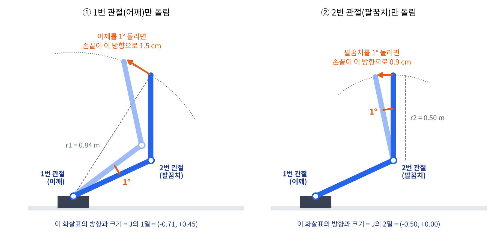
*관절 하나만 돌리면 진한 팔이 연한 팔이 됩니다(잘 보이도록 회전을 과장했습니다). 손끝은 그 관절을 중심으로 한 원의 접선 방향으로, 관절에서 멀수록 많이 움직입니다. 이 화살표가 곧 $J$의 한 열입니다.*

로봇을 움직일 때는 반대 방향, 즉 "손끝을 이렇게 움직이고 싶다 → 관절은 얼마나?"를 풉니다.

$$
\dot q = J(q)^{-1}\,\dot x
$$

이 식은 관절 각도와 손끝 속도를 넣음으로써 관절의 속도를 출력한다고 이해하면 됩니다.

### 한 번 움직일 때의 순서: 포워드 → 야코비안 → 인버스

야코비안은 손끝의 **위치**를 알려 주지 않습니다. "관절을 조금 돌리면 손끝이 어느 방향으로 얼마나 움직이나"라는 **변화량의 비율**만 알려 줍니다. 그래서 실제로 로봇을 움직일 때는 세 가지를 같이 씁니다.

| 단계 | 하는 일 | 입력 → 출력 |
|---|---|---|
| **목표** | 비전이 목표물 위치를 알려 줌 | 카메라 → 목표 손끝 위치 $x_d$ |
| **포워드**(순기구학) | 손끝이 **지금 어디 있는지** 계산 | 현재 관절 각도 $q$ → 현재 손끝 위치 $x = f(q)$ |
| **오차** | 손끝이 가야 할 방향과 양 | $\Delta x = x_d - x$ |
| **야코비안** | 지금 자세에서 "관절 1°당 손끝 몇 cm" 비율표 계산 | $q$ → $J(q)$ |
| **인버스** | 손끝이 갈 양을 관절이 돌 양으로 바꿈 | $\Delta q = J(q)^{-1}\Delta x$ |
| **명령** | 로봇에 보내고 처음으로 | $q \leftarrow q + \Delta q$ |

한 줄로 정리하면 이렇습니다.

> 비전이 **목표**를, 포워드가 **현재 위치**를 주고 → 그 차이가 **손끝이 갈 양 $\Delta x$** → 야코비안 역행렬로 **관절이 돌 양 $\Delta q$**로 바꿉니다.

포워드가 먼저인 이유는 "지금 어디 있는지" 알아야 "얼마나 더 가야 하는지"를 알 수 있기 때문입니다. 여기서 "인버스"는 야코비안의 역행렬이고, 관절 각도를 한 번에 푸는 역기구학(IK)과는 다릅니다. 작은 $\Delta q$를 매 주기 반복해서 목표에 다가가는 방식입니다.

### 실제로 우리가 넣는 건 위치

1. 월드 좌표계에서 목표점(웨이포인트)과 속도를 입력으로 넣습니다.
2. 이동 시간 $T$는 거리와 속도·가속 제한으로 **자동으로** 정해집니다.
3. 그 시간 동안 경로를 보간해서 **매 제어 주기마다 목표 위치 $x_d(t_k)$**를 로봇에 보냅니다.
4. 로봇 내부 제어기가 위치 차이를 관절 각도 변화로 바꿉니다.

$$
\Delta x_k = x_d(t_{k+1}) - x(t_k),
\qquad
\Delta q_k = J(q_k)^{-1}\,\Delta x_k,
\qquad
q_{k+1} = q_k + \Delta q_k
$$

양변을 제어 주기 $\Delta t$로 나누면 위의 $\dot q = J^{-1}\dot x$와 같은 식입니다. 위치를 넣든 속도를 넣든, **안에서 $J^{-1}$을 거친다는 점은 같습니다.**

| | 기호 | 내용 |
|---|---|---|
| **입력** | $x_d(t_k)$ | 매 주기 보내는 목표 손끝 위치 |
| **행렬** | $J(q_k)$ | **현재 관절 각도**로 계산한 야코비안. $q$는 곱하는 값이 아니라 $J$의 숫자를 정하는 값 |
| **출력** | $\Delta q_k$ | 이번 주기 동안의 관절 각도 변화 |

각도를 한 번에 푸는 문제($x = f(q)$를 $q$에 대해 풀기)는 $\sin$, $\cos$가 얽힌 비선형 방정식이지만, 한 주기 동안의 작은 변화는 현재 자세에서 **선형**이라 역행렬 한 번으로 풀립니다.

위치를 넣는 방식의 장점도 있습니다. $\Delta x_k$가 "목표 위치 − **현재** 위치"라서, 이전 주기에 덜 갔으면 다음 주기에 그만큼 더 가라는 명령이 자동으로 들어갑니다. 오차가 적분되며 쌓이지 않습니다.

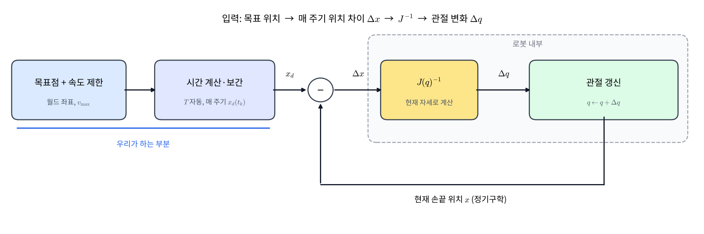
_목표점 + 속도 제한 → 시간 자동 계산·보간 → 매 주기 목표 위치 → 로봇 내부에서 $J(q)^{-1}$로 관절 변화 계산. 자세가 바뀌면 $J$도 바뀌므로 매 주기 다시 계산합니다._

이 식은 **역행렬이 존재해야** 성립합니다. 문제는 여기서 시작합니다.

## 2. 좌표를 넣었는데 특이점이 발생한다

목표 좌표는 정상적인 값이고 구간 속도도 제한해 뒀는데 로봇이 멈칫하거나 에러로 정지하는 경우가 있습니다. 우리는 앞서 위치와 속도, 이동 경로 간 시간을 이미 정해 놓고 로봇에게 움직이라고 명령했기 때문입니다. 이 경우 로봇은 주어진 시간 안에 이동하려다 보니, 경로가 특이점 근처를 지나면 관절이 감당할 수 없을 만큼 빨리 돌아야 하는 상황이 생깁니다.

$\det J(q) = 0$인 자세가 **특이점**입니다. 이때

- 위치를 입력으로 넣었는데 **손끝이 그 방향으로 움직이지 않는** 상황이 생기고 (랭크 결손)
- 그 근처에서는 $J^{-1}$이 폭주해서 **아주 느린 손끝 움직임에도 관절이 엄청 빨리 돌아야** 합니다.

직접 움직여 보면 어떤 자세에서 $\det J = 0$이 되는지 바로 보입니다. 아래는 2관절 팔(링크 0.5 m, 0.35 m)입니다. 분홍 목표를 끌면 손끝이 따라가고, 손끝의 타원과 $\det J$가 실시간으로 바뀝니다.



2관절 팔에서는 $\det J = l_1 l_2 \sin q_2$라서, $q_2 = 0^\circ$(완전히 펴짐)이나 $\pm180^\circ$(완전히 접힘)일 때 0이 됩니다. 손끝으로 보면 **닿을 수 있는 영역의 바깥 경계와 안쪽 경계**가 바로 특이점입니다. 두 경우 모두 팔 방향(노란 선)으로는 손끝이 움직이지 못합니다.

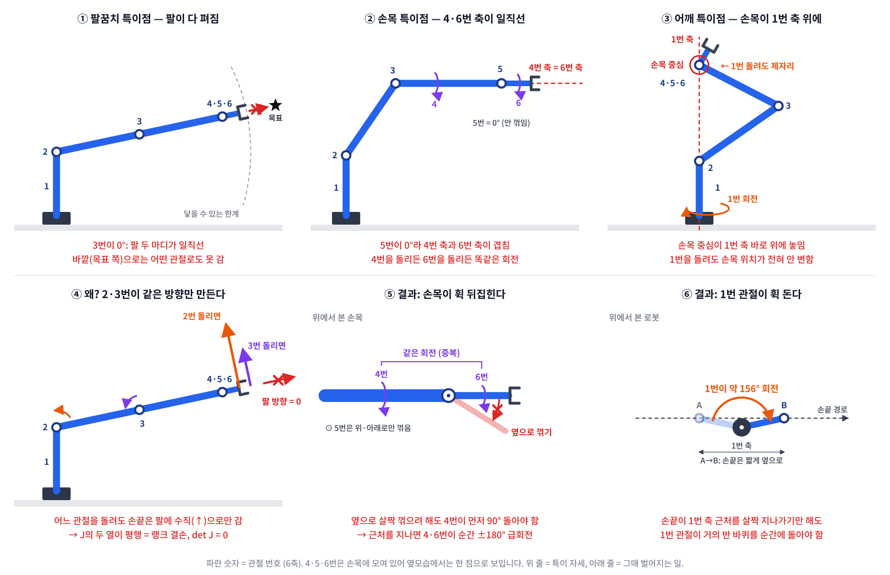
_위 줄은 특이 자세(팔꿈치·손목·어깨), 아래 줄은 그때 벌어지는 일입니다. 팔이 다 펴지면 바깥으로 못 가고, 4·6번 축이 겹치면 손목이 휙 뒤집히고, 손목이 1번 축 위에 오면 1번 관절이 휙 돕니다._

### 손계산: 2관절 평면 팔

6×6 행렬은 손으로 다루기 힘드니, 원리가 같은 가장 작은 예로 봅니다.

- 링크 길이 $l_1 = l_2 = 0.5$ m
- 손끝 위치 $x = l_1 c_1 + l_2 c_{12}$, $y = l_1 s_1 + l_2 s_{12}$ (여기서 $c_{12} = \cos(q_1+q_2)$)

미분하면

$$
J = \begin{bmatrix} -l_1 s_1 - l_2 s_{12} & -l_2 s_{12}\\ l_1 c_1 + l_2 c_{12} & l_2 c_{12}\end{bmatrix},
\qquad
\det J = l_1 l_2 \sin q_2
$$

$q_2 = 0$, 즉 **팔을 일직선으로 쭉 폈을 때** $\det J = 0$입니다. 이때 두 열이 모두 "팔 방향에 수직"이 되어, 팔 방향(베이스 쪽으로 당기기)의 속도를 만들 수 없습니다.

#### 숫자로 확인: 팔을 쭉 편 자세

$q_1 = 30^\circ$, $q_2 = 0^\circ$로 놓고 직접 계산해 봅니다.

**1. 삼각함수 값.** $q_1 + q_2 = 30^\circ$이므로 $s_1 = s_{12} = 0.5$, $c_1 = c_{12} = 0.866$

**2. 야코비안**

$$
J = \begin{bmatrix} -0.25-0.25 & -0.25\\ 0.433+0.433 & 0.433\end{bmatrix}
= \begin{bmatrix} -0.5 & -0.25\\ 0.866 & 0.433\end{bmatrix}
$$

**3. 행렬식**

$$
\det J = (-0.5)(0.433) - (-0.25)(0.866) = -0.2165 + 0.2165 = 0
$$

**4. 왜 0인가.** 1열 $(-0.5,\ 0.866)$이 2열 $(-0.25,\ 0.433)$의 정확히 **2배**입니다. 두 화살표가 같은 방향이라, 어깨와 팔꿈치를 어떻게 섞어 돌려도 손끝은 그 한 선 위로만 움직입니다.

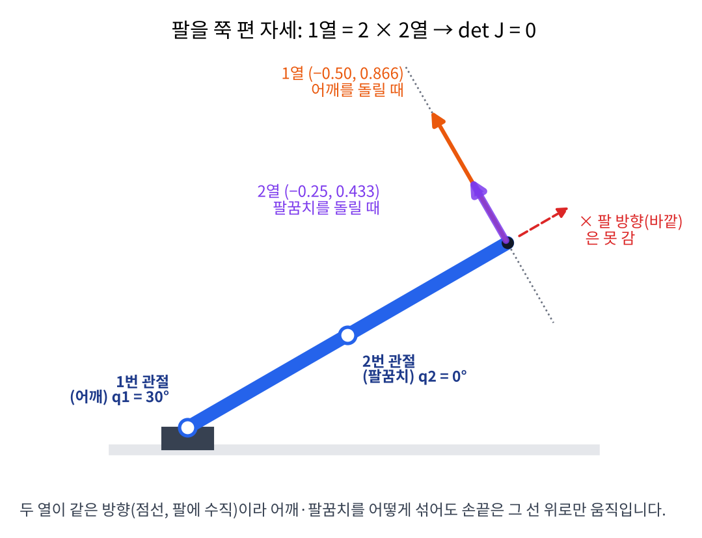
*두 열이 모두 팔에 수직인 같은 방향(점선)이라, 팔 방향(빨간 화살표)으로는 손끝을 보낼 수 없습니다.*

**5. 팔 방향으로 1 cm 밀어 보기.** 팔 방향은 $(0.866,\ 0.5)$이므로 $\Delta x = (0.00866,\ 0.005)$를 풀어 봅니다.

$$
\begin{aligned}
-0.5\,\Delta q_1 - 0.25\,\Delta q_2 &= 0.00866\\
0.866\,\Delta q_1 + 0.433\,\Delta q_2 &= 0.005
\end{aligned}
$$

첫 식에 $-1.732$를 곱하면 $0.866\,\Delta q_1 + 0.433\,\Delta q_2 = -0.015$가 되는데, 둘째 식은 같은 좌변이 $0.005$라고 합니다. **모순**이라 해가 없습니다. 관절을 어떻게 돌려도 그 방향으로는 못 갑니다.

**6. 일반식으로 확인.** 같은 계산을 기호로 하면

$$
\det J = l_1 l_2\,(s_{12}c_1 - s_1 c_{12}) = l_1 l_2 \sin q_2
$$

라서 $q_1$과 상관없이 $q_2 = 0^\circ$(펴짐)이나 $180^\circ$(접힘)이면 항상 0입니다. $q_2 = 10^\circ$만 굽혀도 $0.25 \times \sin 10^\circ = 0.043$으로 0이 아니게 됩니다.

**7. 넓이로 보면 직관적입니다.** $\det J$는 **두 링크로 만든 평행사변형의 넓이**입니다.

- 밑변 = 1번 링크 길이 $l_1$
- 높이 = 2번 링크가 1번 링크 연장선에서 들린 정도 = $l_2 \sin q_2$
- 넓이 = 밑변 × 높이 = $l_1 l_2 \sin q_2$ = $\det J$



| $q_2$ | 높이 $0.5\sin q_2$ | 넓이 = $\det J$ | 모양 |
|---|---|---|---|
| $90^\circ$ | 0.5 | **0.25** (최대) | 직사각형 |
| $30^\circ$ | 0.25 | 0.125 | 기울어진 평행사변형 |
| $10^\circ$ | 0.087 | 0.043 | 거의 납작 |
| $0^\circ$ | 0 | **0** | 선으로 눌림 → 특이점 |

왜 링크 평행사변형이 $\det J$와 같을까요? $J$의 두 열은 "관절 → 손끝" 벡터를 각각 90° 돌린 것입니다. 두 벡터를 똑같이 90° 돌려도 그 둘이 만드는 평행사변형 넓이는 그대로입니다. 그리고 1열은 (링크1 + 링크2), 2열은 링크2에서 나오는데, 한 변에 다른 변을 더해 밀어도(전단) 넓이는 같으므로 결국 링크1과 링크2가 만드는 넓이가 됩니다.

정리하면 **팔이 접혀 평행사변형이 넓을수록 잘 움직이고, 팔을 펴서 납작해지면 $\det J \to 0$, 즉 특이점**입니다. 이 "0은 아니지만 아주 작은" 경우에 무슨 일이 생기는지 이어서 봅니다.

$q_1 = 0$에서 손끝을 $\dot x = (-0.1, 0)$ m/s로 당기는 경우를 계산해 봅니다. $q_2 = 10^\circ$이면

$$
J = \begin{bmatrix} -0.0868 & -0.0868\\ 0.9924 & 0.4924\end{bmatrix}
$$

1행에서 $-0.0868(\dot q_1 + \dot q_2) = -0.1$이므로 $\dot q_1 + \dot q_2 = 1.152$이고, 2행 $0.9924\,\dot q_1 + 0.4924\,\dot q_2 = 0$과 연립하면

$$
\dot q_1 = -1.134\ \text{rad/s},\qquad \dot q_2 = 2.286\ \text{rad/s} \;(\approx 131^\circ/\text{s})
$$

손끝은 겨우 10 cm/s로 움직이는데 팔꿈치는 1초에 131°를 돌아야 합니다.

| $q_2$ | $\det J$ | 필요한 $\dot q_2$ | 최소 특이값 $\sigma_{\min}$ |
|---|---|---|---|
| $90^\circ$ | 0.250 | $11.5^\circ$/s | 0.309 |
| $30^\circ$ | 0.125 | $42.8^\circ$/s | 0.116 |
| $10^\circ$ | 0.043 | $131^\circ$/s | 0.039 |
| $1^\circ$ | 0.004 | $1313^\circ$/s | 0.004 |

표의 $\det J$와 $\sigma_{\min}$은 둘 다 "야코비안이 얼마나 찌그러졌나"를 숫자 하나로 나타낸 값입니다. 관절을 모든 방향으로 같은 양만큼 돌리면(원), 손끝은 **타원** 모양으로 움직입니다.

- $\sigma_{\max}, \sigma_{\min}$ (특이값): 그 타원의 긴 반지름과 짧은 반지름. $\sigma_{\min}$은 **가장 안 움직이는 방향의 비율**입니다.
- $\det J$ (행렬식): 원이 타원으로 바뀔 때 넓이가 몇 배가 되는지. 2관절이면 $\sigma_{\max} \times \sigma_{\min}$입니다.

슬라이더로 팔꿈치를 펴 보면 타원이 납작해지다가 0°에서 선이 됩니다. 그 방향으로 손끝을 움직이려면 관절이 대략 $1/\sigma_{\min}$배 빨리 돌아야 합니다.



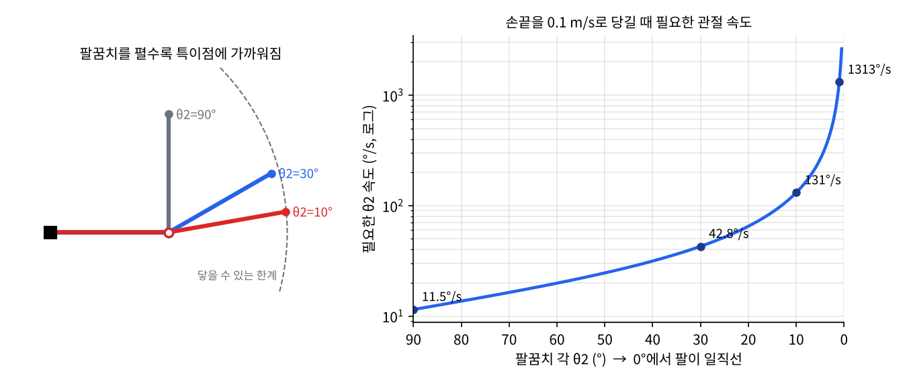
*팔을 펼수록 $\sigma\_{\min}$이 0에 가까워지고, 필요한 관절 속도는 대략 $1/\sigma\_{\min}$배로 커집니다.*

실제 로봇은 관절 속도 한계가 있으니, 이 상황에서 **속도 제한에 걸려 멈추거나, 경로를 벗어나거나, 에러를 내고 정지**합니다. 이게 현장에서 말하는 "특이점에서 로봇이 멈칫한다"의 정체입니다.

## 3. 6축 로봇의 단점

### 대표 특이점 3가지

산업용 6축 로봇(구형 손목: 마지막 세 축이 한 점에서 만남)은 야코비안이 "팔 부분"과 "손목 부분"으로 나뉘어서

$$
\det J = \det J_{\text{팔}} \cdot \det J_{\text{손목}}
$$

둘 중 하나만 0이 돼도 특이점입니다. UR 같은 협동로봇도 같은 세 종류를 안내합니다.

| 특이점 | 언제 | 무엇을 잃나 |
|---|---|---|
| **팔꿈치** | 팔이 일직선으로 펴짐 ($q_3 \approx 0$) | 팔 방향 속도. 2절의 예와 같음 |
| **어깨** | 손목 중심이 1축 연장선 바로 위에 옴 | 1축을 돌려도 손목 중심이 안 움직임 |
| **손목** | 5축이 0°가 되어 4축과 6축이 일직선 | 4축과 6축이 같은 회전을 하게 됨 → 회전 1자유도 상실 |

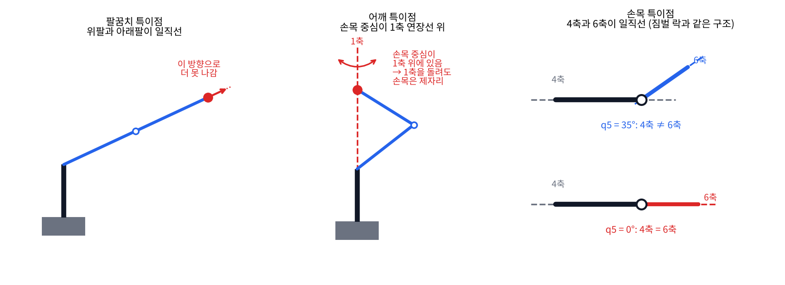
_왼쪽부터 팔꿈치(팔이 일직선), 어깨(손목 중심이 1축 위), 손목(4축과 6축이 일직선)._

손목 특이점에서 $\det J_{\text{손목}} \propto \sin q_5$입니다. 손목 중심 기준으로 4번 열과 6번 열이 같은 벡터가 되어 랭크가 5로 떨어집니다. (오일러각의 짐벌 락과 정확히 같은 구조입니다. 손목 세 축이 곧 ZYZ 오일러각이기 때문입니다.)

### 문제의 본질: 여유가 0

특이점 자체보다 더 근본적인 문제는 **관절 수 = 작업 자유도**라는 점입니다.

- **팔 모양을 고를 수 없음**: 손끝 위치와 방향을 정하면 팔 모양은 **유한 개**(구형 손목 6축은 보통 최대 8개: 어깨 좌/우 × 팔꿈치 위/아래 × 손목 뒤집기)로 정해집니다. 그 사이를 연속으로 오갈 수 없습니다.
- **특이점을 피할 방법이 경로 수정뿐**: 직선 경로가 특이점을 지나가면 손끝 경로 자체를 바꾸거나, 5절의 DLS처럼 정확도를 포기하고 버티는 수밖에 없습니다.
- **관절 한계·장애물 회피 불가**: 팔꿈치가 벽에 닿을 것 같아도, 손끝을 그대로 둔 채 팔꿈치만 비킬 방법이 없습니다.
- **해 사이 전환 비용**: 다른 해로 넘어가려면 손끝이 원래 경로를 벗어나는 큰 재배치 동작이 필요합니다.

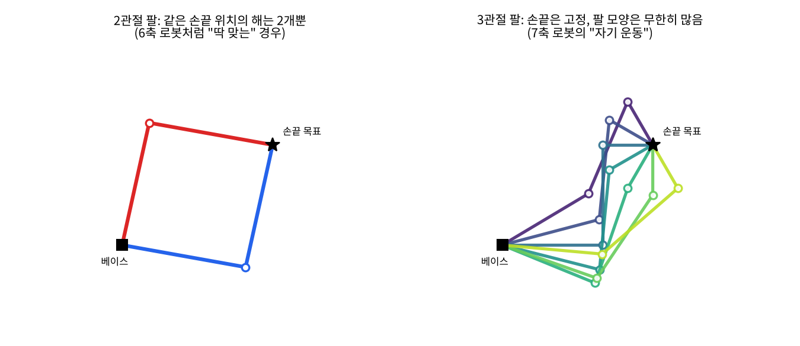
_왼쪽: 관절 수가 딱 맞으면 같은 손끝 위치에 해가 2개뿐. 오른쪽: 관절이 하나 남으면 손끝을 고정한 채 팔 모양이 연속으로 바뀝니다._

## 4. 7축 로봇의 장점

### 영공간: 손끝을 안 움직이는 관절 속도

7축이면 $J$는 $6\times7$입니다. 식은 6개, 미지수는 7개라 $J\dot q = 0$을 만족하면서 **영벡터가 아닌 $\dot q$**가 존재합니다. 이 집합이 영공간(null space)이고, 이 방향으로 관절을 움직이면 **손끝은 그대로, 팔 모양만** 바뀝니다. 이를 자기 운동(self-motion)이라 합니다. 손을 책상에 붙인 채 팔꿈치만 원을 그려 보면 바로 느껴집니다.

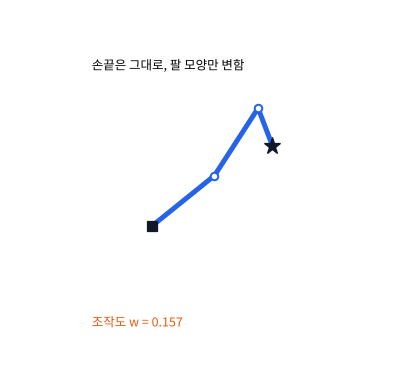{: width="414" }
_손끝(별)은 그대로인데 팔 모양만 계속 바뀝니다. 아래 조작도 $w$ 값도 같이 변합니다._

### 손계산: 3관절 평면 팔

평면에서 손끝 **위치**(2자유도)만 맞추는 3관절 팔은 "작업 2 + 여유 1"이라 7축 로봇의 축소판입니다.

- 링크 길이 $L = (0.4,\ 0.4,\ 0.2)$ m, 자세 $q = (0^\circ,\ 90^\circ,\ -90^\circ)$
- 손끝 = $(0.6,\ 0.4)$

$i$번째 열은 "$i$번 관절 → 손끝" 벡터를 90° 돌린 것입니다.

$$
J = \begin{bmatrix} -0.4 & -0.4 & 0\\ 0.6 & 0.2 & 0.2 \end{bmatrix}
$$

이제 **손끝을 안 움직이는 관절 속도** $n = (n_1, n_2, n_3)$를 찾습니다. 손끝 속도가 0이어야 하므로 $Jn = 0$입니다.

- 1행: $-0.4n_1 - 0.4n_2 = 0 \Rightarrow n_2 = -n_1$
- 2행: $0.6n_1 + 0.2n_2 + 0.2n_3 = 0$에 $n_2 = -n_1$을 넣으면 $0.4n_1 + 0.2n_3 = 0 \Rightarrow n_3 = -2n_1$

$n_1 = 1$로 놓으면

$$
n = (1,\ -1,\ -2)
$$

**검산:** $-0.4(1) - 0.4(-1) + 0 = 0$, $0.6(1) + 0.2(-1) + 0.2(-2) = 0$. 관절을 $(1, -1, -2)$ 비율로 돌리면 손끝 속도는 정확히 0입니다.

### 여분의 자유도를 어디에 쓰나

일반적인 해는 "손끝 작업" + "영공간에서 고른 2차 목표"입니다.

$$
\dot q = J^{+}\dot x + (I - J^{+}J)\,z
$$

**변수 정의**

- $J^{+} = J^\top (JJ^\top)^{-1}$ = 의사역행렬. 손끝 작업 $\dot x$를 만족하는 최소 크기 관절 속도
- $(I - J^{+}J)$ = 아무 벡터나 영공간으로 투영하는 행렬. 손끝에 영향 없음
- $z$ = 2차 목표의 기울기. 예를 들어 아래 지표들의 기울기

여기에 넣는 2차 목표가 곧 7축의 장점입니다.

| 2차 목표 $z$ | 효과 |
|---|---|
| 조작도 $w = \sqrt{\det(JJ^\top)}$ 증가 방향 | **특이점에서 멀어짐**. 2관절 팔이면 $w = l_1 l_2 \lvert\sin q_2\rvert$ |
| 관절 한계 중앙으로 | 관절 한계에 걸리지 않음 |
| 장애물에서 멀어지는 방향 | 손끝을 둔 채 팔꿈치만 비킴 |
| 토크·에너지 최소 | 같은 작업을 더 편한 자세로 |

위의 3관절 팔로 직접 해 보면, 손끝 $(0.6, 0.4)$를 고정한 채 영공간을 따라 팔 모양을 훑었을 때 조작도는 0.16에서 0.26까지 변합니다. 가장 큰 자세를 고르면 같은 작업을 특이점에서 가장 먼 자세로 할 수 있습니다.

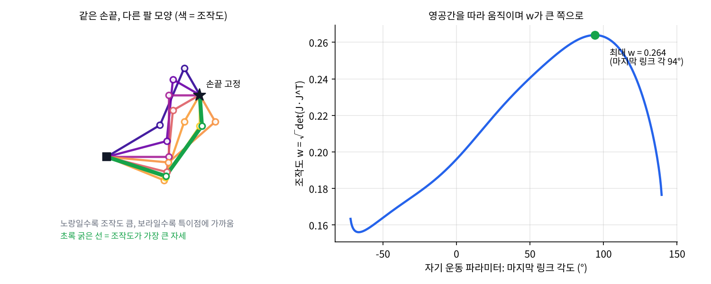
_왼쪽: 같은 손끝을 만드는 여러 팔 모양 (색 = 조작도). 오른쪽: 자기 운동 파라미터에 따른 조작도. 최대 $w = 0.264$._

6축은 특이점을 만나면 **손끝 경로를 바꿔야** 했지만, 7축은 **손끝 경로는 그대로 두고 팔 모양을 바꿔서** 피합니다. 이게 핵심 차이입니다. 사람 팔이 어깨 3 + 팔꿈치 1 + 손목 3 = 7자유도인 것도 같은 이유로 볼 수 있습니다.

### Franka에서는: elbow 파라미터

Franka Research 3 같은 7축 로봇은 카테시안 자세만으로는 팔 모양이 하나로 정해지지 않습니다. 그래서 libfranka는 영공간의 1자유도를 직접 지정하게 해 줍니다.

- `RobotState::elbow[0]` = 3번 관절 각도 (rad)
- `RobotState::elbow[1]` = 4번 관절이 꺾인 방향 ($+1 / 0 / -1$)

`CartesianPose`에 `O_T_EE`와 함께 `elbow`를 넘기면, **손끝 자세는 유지하면서 3번 관절로 팔꿈치 위치를 고르는** 셈입니다. 6축이었다면 이 인자는 존재할 이유가 없습니다.

## 5. 피하지 못하면 버티기: DLS

6축은 특이점을 피할 여유가 없으니, 지나가야 한다면 **폭주만 막는** 방법이 필요합니다. 그게 DLS(Damped Least Squares)이고, 수학적으로는 Tikhonov 정규화(머신러닝의 ridge regression)와 같습니다.

### 식

역행렬은 "손끝 오차만 최소화"합니다. DLS는 여기에 **관절 속도가 커지는 것에 벌점**을 추가합니다.

$$
\min_{\dot q}\ \|J\dot q - \dot x\|^2 + \lambda^2\|\dot q\|^2
\;\;\Rightarrow\;\;
\dot q = J^\top (JJ^\top + \lambda^2 I)^{-1}\dot x
$$

- $\lambda$ = 감쇠 계수(damping factor, Tikhonov factor). $\lambda = 0$이면 역행렬과 같음

### SVD로 보면 한 줄

각 특이값 방향의 이득이 이렇게 바뀝니다.

$$
\frac{1}{\sigma} \;\longrightarrow\; \frac{\sigma}{\sigma^2 + \lambda^2}
$$

- $\sigma \gg \lambda$ (특이점에서 멀 때): 거의 $1/\sigma$, 정확히 따라감
- $\sigma \to 0$ (특이점): 무한대가 아니라 **0으로** 감. 최댓값은 $\sigma = \lambda$에서 $1/(2\lambda)$

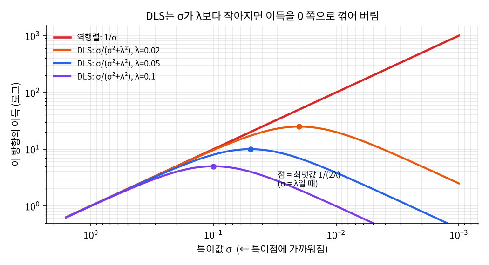
_오른쪽(특이점 쪽)으로 갈수록 역행렬은 끝없이 커지지만, DLS는 $\sigma = \lambda$에서 꺾여 내려옵니다._

### 손계산: 2관절 팔, $q_2 = 1^\circ$

2절의 예에서 $\sigma_{\min} = 0.0039$이고, $\lambda = 0.05$로 놓습니다.

| | $\sigma_{\min}$ 방향 이득 | 필요한 $\dot q_2$ | 실제 손끝 속도 |
|---|---|---|---|
| 역행렬 | $1/0.0039 = 256$ | 1313°/s | $(-0.1,\ 0)$ 정확 |
| DLS $\lambda=0.05$ | $0.0039/(0.0039^2+0.05^2) = 1.55$ | **8°/s** | $(-0.0006,\ 0.001)$ |

관절 속도가 160분의 1로 줄었고, 대가로 팔 방향 손끝 속도를 거의 포기했습니다. 어차피 그 방향은 물리적으로 낼 수 없는 방향이라, **"못 하는 건 포기하고 대신 폭주하지 않는다"**는 거래입니다.

### 시뮬레이션: 특이점 근처를 지나는 직선 경로

2관절 팔의 손끝을 **베이스 1 cm 옆을 지나는 직선**으로 0.1 m/s 움직여 봤습니다. 손끝이 회전축 바로 옆을 지나니 1축이 순간적으로 휙 돌아야 하는, 6축의 어깨 특이점과 같은 상황입니다.

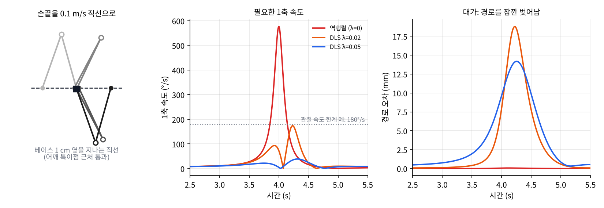
_역행렬은 1축이 577°/s까지 치솟습니다. DLS는 관절 속도를 한계 아래로 누르는 대신 경로를 1~2 cm 잠깐 벗어납니다._

| 방법 | 1축 최대 속도 | 최대 경로 오차 |
|---|---|---|
| 역행렬 | 577°/s | 0.1 mm |
| DLS $\lambda = 0.02$ | 174°/s | 18.8 mm |
| DLS $\lambda = 0.05$ | 39°/s | 14.2 mm |

### 실전 포인트

- $\lambda$가 크면 안전하지만 평소에도 추종 오차가 생깁니다. 그래서 보통 **$\sigma_{\min}$이나 조작도가 임계값 아래로 떨어질 때만 $\lambda$를 키우는 가변 감쇠**를 씁니다.
- 6축이든 7축이든 다 씁니다. 7축은 영공간으로 특이점을 **피하고**, DLS는 피하지 못했을 때 **버티는** 수단이라 둘을 같이 씁니다.

## 6. 7축도 공짜는 아니다

- **특이점이 완전히 사라지진 않음**: 팔을 끝까지 뻗는 작업공간 경계의 특이점은 관절을 몇 개 달아도 피할 수 없습니다. 7축은 "피할 여지"가 생기는 것입니다.
- **역기구학 해가 무한함**: 해를 고르는 기준(2차 목표, elbow 지정)이 반드시 필요하고, 기준 없이 의사역행렬만 쓰면 반복 작업에서 팔 모양이 조금씩 떠내려갈 수 있습니다.
- **제어·계산 복잡도 증가**: 영공간 투영, 우선순위 제어 등 설계할 것이 늘어납니다.
- **하드웨어 비용**: 모터·감속기·센서가 하나 더 들고, 무게와 가격이 올라갑니다.

## 정리

- 손끝 자세는 6자유도라서, 6축 로봇은 관절 수가 딱 맞고 **여유가 0**입니다.
- 야코비안의 $\det J$가 0이 되는 특이점(팔꿈치·어깨·손목)에서는 특정 방향으로 움직일 수 없고, 근처에서는 관절 속도가 $1/\sigma_{\min}$배로 폭주합니다. 2관절 예에서 $q_2 = 1^\circ$이면 10 cm/s에 1313°/s가 필요했습니다.
- 6축은 특이점을 만나면 **손끝 경로를 바꾸는 것** 말고는 피할 방법이 없고, 지나가야 한다면 **DLS**로 정확도를 조금 포기하며 폭주를 막습니다.
- 7축은 $6\times7$ 야코비안의 **영공간**이 생겨, 손끝을 고정한 채 팔 모양을 바꾸는 자기 운동이 가능합니다. 이걸로 특이점·관절 한계·장애물을 피합니다.
- Franka는 이 여분의 1자유도를 `elbow`(3번 관절 각도 + 4번 관절 방향)로 노출합니다.

### 더 읽을거리

- T. Yoshikawa, *Manipulability of Robotic Mechanisms*, IJRR 4(2), 1985: 조작도 $w = \sqrt{\det(JJ^\top)}$를 제안한 논문입니다.
- B. Siciliano 외, *Robotics: Modelling, Planning and Control*, 3장: 야코비안, 특이점, 여유 자유도를 표준적으로 다룹니다.
- [libfranka](https://github.com/frankarobotics/libfranka): `robot_state.h`의 `elbow` 설명
